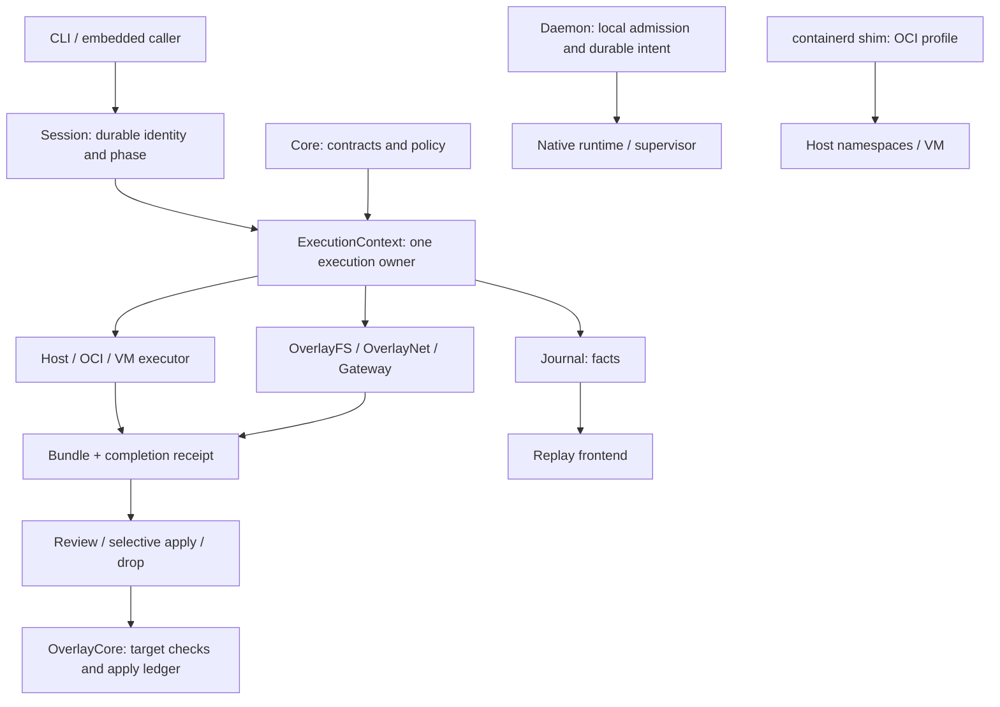

# pVisor 分层架构与实现审查

审查日期：2026-11-16（Asia/Shanghai）。已完成关键路径审查；原审查结论针对固定基线，后续修复进展如下。

提交说明：源码链接使用仓库相对路径；`target/review-2026-11-16` 下的原始日志、探针和RAM诊断只保留于本地，未随PR上传。相关证据链接仅在保留该目录的本地检出中可用；远端复核请使用文中的命令、回归测试与明确的平台范围。

## PR提交前联合验证（2026-11-16）

- `mise run test -- pvisor pvisor-cli pvisor-daemon pvisor-overlay-core pvisor-overlayfs pvisor-overlaynet pvisor-replay pvisor-vm`：**2296 passed（其中1项被nextest标为leaky），65 skipped**；不把此数字与各轮重叠结果累计。[联合日志](target/review-2026-11-16/pr/pvisor-pr-tests.log)。
- leaky项为`pvisor-cli windows_cli_tests::tests::windows_resource_and_exec_options_preserve_literal_values`。源码仅解析参数并做断言；单独复核**1 passed**且未再次标记leaky。[复核日志](target/review-2026-11-16/pr/pvisor-pr-leak-check.log)。一次复核未复现不能解释联合运行时输出句柄未及时关闭的根因，原始标记保留，不报告为零异常。
- `mise run ci -- "fmt-rust --check" "fmt-py --check"`通过；修正了已修改CLI测试的一处断言排版。`mise run lint`全链通过：workspace all-targets Clippy `-D warnings`、迁移API warnings-denied rustdoc、Python Ruff与workflow Actionlint。[格式](target/review-2026-11-16/pr/pvisor-pr-format-final.log)、[lint](target/review-2026-11-16/pr/pvisor-pr-lint.log)。
- 本轮硬件资格沿用前述真实HVF与FSKit记录；联合默认测试中的skip未执行，也不代表Linux/KVM或WHP已完成资格验证。独立的`PVisor-Architecture-Review-workspace-2026-11-16.md`未纳入此PR。

## 第五轮：H03 同 inode rename 已确认用户可达并修复（2026-11-16）

**H03升级为实测确认的P2缺陷，并已修复Host适配器。** Core的no-op判断本身正确，VM已有不移动旧路径时的保护；缺口是Host把每次普通rename成功都当作路径发生移动。当前整体评分维持7.0/10；局部修复不扩展为所有hardlink、恢复及平台组合已经合格。

### 用户可达性与反例

同一regular-file的两个hardlink名字`one`、`two`先被LOOKUP并共享一个协议inode，随后执行普通`rename(one, two)`。Core保留两个名字并返回成功；旧Host却调用`remap_inode_prefix`，从Node.paths/by_path删除`one`。再`unlink(two)`后，幸存文件仍在Core中，但原协议inode已没有路径。

- **真实用户系统调用：已确认可达。** 本机macFUSE **5.4.0 / FSKit**实际转发rename，观测sink记录`rename_from`命中1次。去掉中间source lookup后，`rename one→two; unlink two; read/stat one`暴露幸存文件的inode由4变5。读到的内容仍正确，不写成已确认数据丢失。[修复前真实挂载失败](target/review-2026-11-16/h03/pvisor-h03-mount-before-direct.log)。
- **确定性协议反例：已复现ENOENT。** 使用现有`fuser::Session::from_fd`，经socket送入真实INIT、LOOKUP、RENAME、UNLINK、GETATTR分派，而非手动调用Core后模拟map更新。旧实现对原nodeid的GETATTR返回`-2`，即ENOENT。[修复前协议日志](target/review-2026-11-16/h03/pvisor-h03-protocol-before.log)。协议层ENOENT与真实挂载下的inode变化分别报告，不混作同一个用户观察。
- **中间LOOKUP会掩盖问题。** 在rename后先stat/lookup源路径，再unlink目标，会把丢失的alias重新加入映射；该早期轨迹旧实现也通过。[有修补性lookup的对照](target/review-2026-11-16/h03/pvisor-h03-mount-before-named.log)。最终回归显式禁止这个中间步骤。
- Linux VFS在已认定source/target为同一inode时会直接返回成功，因此普通Linux挂载操作未必进入此回调；不能据此判定adapter的no-op处理正确。[Linux源码](https://code.googlesource.com/linux/torvalds/linux/+/977991fdc43dbe2f3f473699bbe45207969f020f/fs/namei.c)。XNU对大小写不敏感/保留大小写的文件系统存在交由filesystem处理的分支；项目的macFUSE协商包含CASE_INSENSITIVE，本机FSKit回调命中提供直接证据。[XNU rename路径](https://github.com/apple-oss-distributions/xnu/blob/main/bsd/vfs/vfs_syscalls.c)。这不声称所有macOS后端、版本和挂载选项都相同。

早期使用临时隐藏卷名的挂载尝试返回mount(8) 69，没有到达rename，不作为缺陷证据。最终使用可见唯一卷名，先确认mount-table entry，再执行轨迹，并在断言失败时也显式卸载；[早期环境失败日志](target/review-2026-11-16/h03/pvisor-h03-mount-before.log)保留。

### 最小修复与分层回写

[Host rename](crates/pvisor-overlayfs/src/fs.rs#L1714)在Core成功后使用`resolve_checked(old)`判断源名字是否仍存在：仍存在则返回成功的no-op结果，不进入inode prefix remap；实际移动继续原有更新，exchange继续原有交换逻辑。查询错误原样返回，NOREPLACE及非法flags的验证保留。该读回在既有namespace mutation串行化和upper独占所有权内进行；不是对外部并发backing writer的同步机制。

本轮仅更改Host这处生产逻辑，没有增加跨crate DTO、公共方法或修改Core的rename返回类型。Core继续拥有overlay身份/rename语义；adapter必须把成功但未移动的结果映射为“协议namespace不变”。Host与VM的结构无须强行统一，需用相同轨迹与独立效果断言约束各自inode/handle状态。Host/VM README同步补写此契约和验证范围。

### 回归与验证

- [Host默认协议回归](crates/pvisor-overlayfs/src/dispatch.rs#L1338)：lower、已复制一个alias的Core fixture、upper三种状态，经真实请求分派执行rename→unlink→原inode GETATTR/OPEN/READ/RELEASE；要求成功、原内容和lower不变。无需host FUSE挂载，也没有为测试暴露私有状态。
- [VM对照回归](crates/pvisor-vm/src/devices/virtio/fs/overlay_correctness_tests.rs#L128)：lower、经协议OPEN完成copy-up、upper三种状态，检查NOREPLACE仍为Linux EEXIST、no-op不留下detached replacement、unlink后缓存nodeid仍可GETATTR/OPEN/READ且后续LOOKUP身份不变。生产VM rename逻辑无需修改；这是内存中协议adapter回归，不冒充真实guest/kernel资格验证。
- [真实挂载回归](crates/pvisor-overlayfs/tests/same_inode_rename_mount.rs)：以独立native文件系统执行同一rename/unlink作为oracle，对比幸存内容及inode身份不变；覆盖未copy-up和已写入copy-up，macOS额外断言rename回调命中1次。最终**1/1通过，内部两个场景均通过**。[日志](target/review-2026-11-16/h03/pvisor-h03-mount-final.log)。
- `mise run test -- pvisor-overlay-core pvisor-overlayfs pvisor-vm`：**740 passed，12 skipped**，包含既有replacement/exchange、hardlink、namespace recovery和API边界测试。[完整日志](target/review-2026-11-16/h03/pvisor-h03-tests.log)。skip原样保留，真实mount测试另行显式执行。
- Core、OverlayFS、VM及消费者pvisor/CLI以`mise run lint-rust`执行all-targets、`-D warnings`通过；Host/VM warnings-denied rustdoc通过。[lint](target/review-2026-11-16/h03/pvisor-h03-lint.log)、[rustdoc](target/review-2026-11-16/h03/pvisor-h03-rustdoc.log)。

**关闭范围：**已确认并关闭Host成功no-op后错误remap及其用户可达后果。Linux host FUSE、Linux/KVM和WHP原生运行本轮未执行，VM所有半物化/恢复历史也未穷举。原生挂载资格限定上述本机FSKit配置；没有更改批准台账、快照、xfail、依赖或Cargo.lock。

扩展观察保留为后续候选：若在VM adapter构造后直接调用私有Core.copy_up一个alias、再首次LOOKUP两名，草稿fixture得到不同初始nodeid（4与2）。最终VM回归改用真实协议OPEN建立copy-up历史，并仍严格要求共享nodeid；这不是证明所有半物化状态都正确。需另行验证directory materialization或恢复是否能用户可达地建立该状态，再决定是否修复首次alias发现/身份绑定。它不属于本次Host错误remap的关闭结论，也没有被计入通过数量。

## 第四轮：H01 / H02 生命周期修复（2026-11-16）

**H01 的危险生命周期已确认并修复；H02 的同进程重试故障已在真实 HVF 上复现并修复。** 两项按各自反例关闭，不以其他用例的通过数量抵销。整体评分仍保留7.0/10，不把局部修复转换为未测平台或所有失败路径的保证。

### H01：保留 leader 身份，最后发信号，再 reap

根因有两处：[ProcessExecutor](crates/pvisor/src/executor/process.rs#L1733)原来先调用消费状态的`Child::wait`，随后用缓存PGID清理；共享清理函数的grace loop又调用`try_wait`。leader及进程组消失后，旧数字有机会被无关同UID进程组复用，后续TERM/KILL无法区分新旧所有者。旧实现的受控fence回归确定失败，显示清理提前释放leader身份：[修复前日志](target/review-2026-11-16/h01-h02/pvisor-h01-before.log)。这证明生命周期缺口，**没有在宿主上强制PID churn，也没有宣称已经观测到随机误杀**。

新增[非消费式退出观察](crates/pvisor/src/execution_context/lifecycle.rs#L718)：先注册SIGCHLD通知，再用`waitid(WEXITED|WNOWAIT|WNOHANG)`检查指定子进程；保留stdin EOF和原始退出/信号状态，继续复用ExecutionContext的exit/cancel/deadline优先级。Host executor改用该观察；容器正常等待与VM最终CPU采样契约不变。所有共享清理调用点已核对。

[共享清理](crates/pvisor/src/execution_context/lifecycle.rs#L770)拒绝已回收或与child不符的PGID，TERM→grace→KILL期间不再消费leader；最后一次组信号之后才`Child::wait`。未回收PID保留数字身份，关闭本项目单一child owner/reaper路径中的复用窗口。不会用pidfd替代整个组的身份论证。

[三个回归](crates/pvisor/src/execution_context/lifecycle.rs#L819)分别验证：(1) leader以7退出、TERM-resistant后台子进程继续持有管道，grace中仍可WNOWAIT取得leader，KILL后后台管道EOF，最终reap仍为7；(2) stdin关闭、重复非消费观察、退出码与信号状态保持；(3) 将受控无关子进程的PGID作为陈旧/错配输入时不能杀掉它。原有退出码、取消、PTY和后台管道测试保持断言，定向**19/19通过**。[日志](target/review-2026-11-16/h01-h02/pvisor-h01-after-native.log)。

代价：zombie leader可能使组在grace期间一直可见，因此结束延迟可能达到已配置的termination grace（默认2秒）；不以提前reap换取低延迟。它仍不是追踪脱离进程组后代的机制，也不承诺抵抗嵌入调用方额外安装的外部reaper；namespace/cgroup与单一child所有权边界继续成立。

### H02：启动失败必须同步收束原生资源

修复前通过公开production API拒绝首次ready，然后在**同一个进程**再次构建VM，第二次确定失败于`Internal(Vm(VmSetup(VmCreate)))`：[真实HVF反例](target/review-2026-11-16/h01-h02/pvisor-h02-before.log)。这将原“待验证”升级为实测故障：`HvfVm`缺少`hv_vm_destroy`，仍占用进程的VM instance；vCPU handle丢弃JoinHandle，返回错误没有同步释放屏障。原CPU cleanup guard能最终销毁CPU，不足以释放VM instance或保证返回边界。

修复覆盖启动资源链：

- [HVF vCPU owner](crates/pvisor-vm/src/vmm/macos/vstate.rs#L789)保留线程句柄；Drop先断开双向通道，kick正在执行的CPU，然后join，确保CPU在线程内完成销毁。初始化通道返回错误也join；pause/resume回执接收端关闭时正常停止。
- [Vmm字段顺序](crates/pvisor-vm/src/vmm/mod.rs#L209)先释放CPU handles，再释放原生VM，之后释放自身RAM owner；[HvfVm](crates/pvisor-vm/src/hvf/mod.rs#L337)仅在成功创建后拥有destroy责任，构造的配置对象在成功/失败结果上均释放。初始寄存器配置失败也销毁已创建CPU，未成功创建的owner不会销毁别人的VM。
- 进一步census暴露了独立的kqueue泄漏：Darwin`Epoll`克隆裸FD且没有释放owner，每轮留下两个描述符。[轮询器](crates/pvisor-vm/src/utils/macos/epoll.rs#L146)改为`Arc<OwnedFd>`，保留共享注册语义，最后一个clone释放FD；新增clone跨原owner释放后仍能收到事件的回归。公开API补写拒绝后的资源与重试契约，README同步更新。

新增[真实HVF回归](crates/pvisor-vm/tests/ready_abort_hvf.rs)，分别在1/2 vCPU子进程内依次执行：VM创建后用非法设备profile拒绝setup、ready保持暂停后拒绝、显式resume后拒绝、再次启动后拒绝。每轮立即比较**启动前**的完整open-FD集合和thread-ID集合，要求完全相等；并检查网络peer EOF、调用方backing仍可写、旧control handle失效，以及ready原始错误类型/消息不变。每个子进程有30秒外部watchdog，不以延后census或重试隐藏泄漏。两种CPU拓扑均完成全部四轮。

### 验证与边界

| 检查 | 结果与证据 |
| --- | --- |
| pVisor + VM完整默认测试 | **1264 passed，16 skipped**；[日志](target/review-2026-11-16/h01-h02/pvisor-h01-h02-tests.log) |
| 显式真实HVF：ready前RAM不变 + abort/retry资源census | **2/2 passed**，两项各含1/2 vCPU；[日志](target/review-2026-11-16/h01-h02/pvisor-h01-h02-hardware.log) |
| 原完整环境快照 + stdio启动回归 | **2/2 passed**；[日志](target/review-2026-11-16/h01-h02/pvisor-h01-h02-snapshot.log)、[结构化结果](target/review-2026-11-16/h01-h02/environment-snapshot.json) |
| 受影响的pvisor、VM、CLI、daemon | `mise run lint-rust`以all-targets、`-D warnings`通过，同时编译消费者；[日志](target/review-2026-11-16/h01-h02/pvisor-h01-h02-lint.log) |
| VM公开文档与边界 | warnings-denied rustdoc通过；API/repository边界guard包含在默认测试；[文档日志](target/review-2026-11-16/h01-h02/pvisor-h01-h02-rustdoc.log) |

H01/H02在当前修复范围内关闭；H03在本轮时仍待验证，后续第五轮已确认并修复。硬件证据只覆盖本机macOS/Apple Silicon/HVF与既有固定固件；Linux/KVM、WHP原生运行未执行。尚未穷举每个HVF系统调用失败点，也不将callback/setup清理扩展成任意运行期失败可恢复。join无法给卡住的宿主内核、page fault或设备I/O提供时限，runner仍需外部监管。所有skip保留，批准台账、快照、xfail及Cargo.lock未修改。

## 第三轮：H04（首次快照125）已定位并修复，严格lint恢复（2026-11-16）

**结论：故障在独立快照探针的PID 1引导，发生于Rust main之前。** 不把它归因于F04的vCPU放行顺序，也没有改变VMM的125失败判定。正式`pvisor-guest`已经有libc constructor修复stdio；原始`guest_linux`独立探针没有同样的前置引导。

### 根因证据链

1. 当前实现串行save第5次自然复现125，保留的rootfs仅有init文件，没有`/proc`或`starts`。使用PTY时第5次仍复现，排除了仅仅是输出捕获方式导致失败。
2. 临时文件映射RAM诊断保留了失败机器的内核日志。日志先显示`Run /init.krun as init process`，再记录PID 1收到致命信号11；PC为`0x268798`，它是musl `abort`里的空地址写入fallback，而非探针main。[内核与寄存器证据](target/review-2026-11-16/snapshot-bootstrap/kernel-fatal-signal.txt)。
3. 根据保存的用户栈，调用者返回地址为`0x24a364`；前一条指令`0x24a360`调用abort。原始ELF的DWARF与反汇编把它定位到Rust `sanitize_standard_fds`：发现POLLNVAL后open(`/dev/null`, O_RDWR)失败便abort。[调用位置](target/review-2026-11-16/snapshot-bootstrap/abort-callsite.txt)。原始探针root没有`/dev`，内核也记录`devtmpfs: error mounting -2`。内核初始console是否及时提供stdio使原始触发具有时序性。
4. 固件的`0001-krunfw-Don't-panic-when-init-dies.patch`把PID 1退出转为orderly reboot。独立探针没有提交完成回执，所以VMM仍正确地把该重启归为“缺少workload status”，返回125。退出码是后果，丢失stdio与`/dev/null`才是需要修复的引导前提。

### 修复与稳定回归

[guest_linux](crates/pvisor-vm/src/probes/guest_linux.rs)增加仅PID 1执行的libc constructor：在Rust运行时检查标准流之前检查fd 0..2，缺失时创建`/dev`并挂载devtmpfs；Rust随后完成自己的标准描述符修复。constructor只使用固定C路径和原始系统调用，不做Rust I/O、分配或线程操作。原有有效console描述符不被主动替换。main记录初始缺失位图供独立oracle检查。

新增[无std的PID 1 trampoline](crates/pvisor-vm/src/probes/guest_closed_stdio.rs)主动关闭0/1/2，再exec Rust探针；root开始时明确没有`/dev`。新增[真实HVF回归](tests/hardware/environment_snapshot.py#L21)要求完成引导、初始缺失位图等于7且只启动一次。内部driver的boot模式在ready后结束，专门检查startup；原有完整save/restore用例的内容、摘要损坏、租约、原root删除和backing删除断言均保留。

同一新回归在旧guest上**3/3次确定失败并返回125**；修复后**10/10次通过**，没有自动重试或放宽断言。[修复前](target/review-2026-11-16/snapshot-bootstrap/pvisor-snapshot-bootstrap-before.log)、[修复后连续验证](target/review-2026-11-16/snapshot-bootstrap/pvisor-snapshot-bootstrap-stable.log)。`mise run test-environment-snapshot`运行新回归及原完整环境快照用例，**2项全部通过**。[完整结果](target/review-2026-11-16/snapshot-bootstrap/pvisor-snapshot-bootstrap-after.log)。H04关闭；旧的单次通过/失败不再承担根因判断。

### 严格检查与其他验证

- 清理from/to的Linux专用声明、tree_observation和staged_fixture的Linux专用helper，以及CLI stage/export测试的平台专用导入。保留原有Linux用例与所有断言，没有添加allow、移除测试或降低告警等级。
- 全部14个产品crate以`cargo clippy --all-targets --locked ... -- -D warnings`通过，使用项目`mise run lint-rust`入口和离线基线依赖。[严格lint日志](target/review-2026-11-16/snapshot-bootstrap/pvisor-snapshot-all-lint-final.log)。这取代第二轮“lint被既有警告阻断”的当前状态，历史失败日志仍保留。
- VM与OverlayCore完整默认测试**665 passed，10 skipped**；CLI stage契约**2 passed**。[Rust测试](target/review-2026-11-16/snapshot-bootstrap/pvisor-snapshot-rust-tests.log)、[CLI测试](target/review-2026-11-16/snapshot-bootstrap/pvisor-snapshot-stage-cli.log)。两个独立guest fixture均以rustc `-D warnings`编译，Python回归通过Ruff检查。
- 硬件资格限定本机macOS/HVF与所记录固件；不替代Linux/KVM、WHP、断电或同进程HVF abort/retry验证。诊断循环另遇到明确的`detached filesystem inode`快照资格拒绝，与125引导失败不同；未放松既有“不支持unlinked-open文件”的边界，新startup回归不混入该资格条件。

所有诊断源修改在临时构建后恢复；没有把print-fatal-signals、串口或原始RAM追踪开关加入产品公开接口。保留了[失败RAM压缩证据](target/review-2026-11-16/snapshot-bootstrap/failed-ram.bin.gz)、原guest源码、二进制摘要和原始日志。批准台账、快照、xfail和Cargo.lock未改变。

## 第二轮修复：F07 / F05 / F06（2026-11-16）

三项实现已完成。F07 将 writer 与 reader 统一为64 MiB上限；新增任务准入预留生命周期与每个未完成capture回执空间，超预算在操作分派前拒绝，旧authority与请求ID保留。失败回执上限4096个Unicode字符；resume/fork容量检查移到restore准备与子记录发布之前。F05采用私有临时socket→0600→原子rename，既有不安全端点仍拒绝。F06读端增加O_NONBLOCK并保留fd类型检查。

已通过：OverlayCore完整216项（6项跳过），含公开sealed gate的无writer FIFO独立子进程、目录、symlink、坏文件与恢复有效日志；daemon bin/user-service 28项全通过，含发布前暂停、失败清理、并发启动与原偶发失败用例；第一批Session 9项通过，包含真实64 MiB边界附近的拒写保旧、回执预留和拒绝新capture/resume/fork后仍可终止。扩展Session生命周期28项通过，公开executor/completion/session集成9项通过；结论不包含断电或Linux实机资格。F04后续结果见下节。

## F04 修复与第二轮最终验证（2026-11-16）

新建VM的全部vCPU在build后保持parked；HVF的fresh和restore都先发出Paused确认。Builder先调用on_ready、完成后端worker安装，再通过既有有确认与失败闩锁的resume路径放行fresh VM。restore继续要求调用者显式resume，不在回调后自动放行。删除了不再使用的旧resume_vcpus旁路；WHP已有的paused-ready顺序保持不变。API签名未变，契约文档明确初始暂停和显式恢复语义。

新增 [真实硬件ready回归](crates/pvisor-vm/tests/ready_before_execution.rs)，在独立子进程中分别构造1/2-vCPU、256 MiB VM，检查初始paused、回调等待期间RAM摘要不变和原始拒绝错误；父进程有30秒期限。加强既有KVM abort测试为明确assert paused==true，不能只验证查询成功。

| 验证 | 当前结果 | 本地证据 |
| --- | --- | --- |
| OverlayCore完整默认测试 | 216 passed，6 skipped；公开FIFO/目录/symlink/损坏/有效日志回归通过 | [overlay.log](target/review-2026-11-16/followup-fixes/pvisor-followup-overlay.log) |
| VM + daemon完整默认测试 | 619 passed，9 skipped；包含API boundary与原user-service失败用例 | [vm-daemon.log](target/review-2026-11-16/followup-fixes/pvisor-followup-final-vm-daemon.log) |
| Session及SessionService定向测试 | 28 passed；未选中707项不计为运行；后续单项加强验证Running capture容量拒绝 | [session.log](target/review-2026-11-16/followup-fixes/pvisor-followup-final-session.log) |
| 公开executor/completion/session集成 | 9 passed，无跳过 | [contracts.log](target/review-2026-11-16/followup-fixes/pvisor-followup-contracts.log) |
| 真实HVF ready拒绝 | 1项通过，内部串行覆盖1和2 vCPU；RAM在回调期间稳定 | [ready-hvf.log](target/review-2026-11-16/followup-fixes/pvisor-followup-ready-hvf.log) |
| 真实guest成功放行与退出 | 0、7、255三个退出状态全部通过，guest-root不能伪造退出authority | [guest-exit.log](target/review-2026-11-16/followup-fixes/pvisor-followup-guest-exit.log) |
| 真实双CPU环境保存/退出/独立恢复 | 当前实现一次复跑及额外三次串行运行连续通过；显式restore resume、内容校验、后台删除与恢复独立性均保留 | [rerun.log](target/review-2026-11-16/followup-fixes/pvisor-followup-environment-rerun.log)、[repeat.log](target/review-2026-11-16/followup-fixes/pvisor-followup-environment-repeat.log) |
| 已迁移API严格rustdoc | 通过 | [api-docs.log](target/review-2026-11-16/followup-fixes/pvisor-followup-api-docs.log) |
| 严格Clippy | 未通过：依赖OverlayCore既有apply.rs:1726/1727未使用from/to，未改告警或降低检查 | [lint.log](target/review-2026-11-16/followup-fixes/pvisor-followup-lint.log) |

**历史记录（已在第三轮定位并修复H04）。** 完整环境快照首次运行在save阶段以125退出，日志为VM shutdown without workload status，尚未进入restore。为反证本轮回归，单独构建原始四个VM实现文件的版本并在同样固件/探针下运行，对照通过；当前实现随后连续四次通过。对照构建后所有待提交VM改动逐字节恢复，未留下baseline产品实现。首次失败原因没有定位，不能由重跑通过宣称已消失，也不能据单次失败认定为本轮修复引入。后续应在负载/启动故障实验中追踪，记录为H04；保留 [首次失败](target/review-2026-11-16/followup-fixes/pvisor-followup-environment.log) 与 [基线对照](target/review-2026-11-16/followup-fixes/pvisor-followup-baseline-environment.log)。

真实硬件结果限定当前macOS/HVF与本地固件；Linux/KVM、WHP、断电恢复及HVF同进程abort→retry仍未验证。F07保护新准入与后续写入，不会自动修复升级前已经超过64 MiB的不可读记录，也不删除旧幂等身份。以上历史审查章节和原始评分保留固定基线事实，不能把其中的“未修复”描述当作当前工作树状态。

## 核心正确性修复跟进（2026-11-16）

F08、F02、F03、F01 已实现修复并新增回归；原审查各章节保留基线事实与证据，不将历史复现改写成修复后的行为。F04/F05/F06/F07 已在第二轮实现修复；待验证风险仍保留，本轮未重新评分。

| 问题 | 实现变化 | 验证与剩余限制 |
| --- | --- | --- |
| F08 | 具体 RunExecutor 声明请求相关能力；runtime 不从 isolation 标签推导 Seatbelt/netns。Landlock-only 对需要网络隔离的计划拒绝启动；attestation 不再给该分支虚报 Network | macOS 能力准入正反例与真实 Seatbelt 启动通过；Linux 增加后端/拒绝/证据测试，本机未执行 Linux 分支或真实直连负例 |
| F02 | 每次 flow 分配不可复用的 generation，所有异步事件应用前匹配 key+generation | 六类排队旧事件不影响新 flow，新代 data 仍能交付；完整 guest Ethernet 复现仍待 Linux/VM 验证 |
| F03 | try_join! 在任一方向 I/O Err 时取消另一方向并发出失败 | 本机 RST 及时结束 idle upload；正常远端 EOF 后仍可上传数据；既有大下载背压测试通过 |
| F01 | 未闭合 continuation start 跨 run_failed 保留歧义；SDK/agent 执行未知时拒绝同状态重试。Generic continuation 成功验证并保存轨迹后追加 finish | 公共 API + fake Pi SDK：副作用一次后中断，fresh output 重试返回 AmbiguousExecution，副作用仍一次；PrepareOnly 无副作用；完整成功回执仍允许重开 |

本轮验证：OverlayNet+Replay 275 项通过、2 项跳过；随后新增/加强的 flow 3 项、SDK/continuation 2 项分别通过。Runtime lib 720 项通过、1 项因尚未构建 CLI 失败、11 项跳过；构建 CLI 后该 Seatbelt 用例与2项新增能力测试均通过。公开 executor/completion/session 集成9项、CLI配置13项通过。OverlayNet/Replay 全目标严格 Clippy 通过；daemon/shim/CLI 的 cargo check 通过。以上计数有重叠，不合并成覆盖率。

行为变更需要调用者注意：Landlock-only 不再接受 deny-all 网络组合；失败的原生 continuation 可能由 continuation_error 改为 ambiguous_execution，且禁止在原状态重试；外部包装 executor 需要委托新增 capability_plan 才能保留后端的动态能力。旧 journal 的未闭合 continuation 也会被拒绝，不应手动清除来重复未知效果。

修复日志存于 [correctness-fixes](target/review-2026-11-16/correctness-fixes)。Linux/KVM/HVF/WHP 的运行资格未因本次 macOS 验证而获得证明。

## 审查结论

**总体 7.0/10：产品抽象有特色，核心持久化与生命周期设计扎实；实现一致性和平台资格仍处于开发者预览阶段。** 最值得保留的是 Session/Execution 身份分离、完成回执、Journal 的未知结果处理、Overlay 的分阶段发布，以及 VM CPU/设备/RAM 联合冻结。主要弱点出现在跨后端、异步任务和 SDK 适配器之间：一层的正确保证没有完整传递到下一层。

确认 **1 项 P1、7 项 P2**。其中 F01/F02/F03/F06 有隔离探针复现，F05 有现有测试实际失败和源码支持，F04/F07/F08 为源码调用链确认。P1 是修复优先级，不能替代触发范围和证据等级。另有 3 项待验证风险、若干架构改进候选及一个 macOS 严格 lint 失败，均分开列出。

| 编号 | 优先级 | 核心问题 | 证据与限制 |
| --- | --- | --- | --- |
| F08 | P1 | Landlock-only 没有安装网络隔离，却记录 Network Enforced | Linux 源码全链确认；不是 safe 默认逃逸，未运行 Linux 实机 |
| F02 | P2 | VM TCP 旧事件可落到复用相同元组的新连接 | 局部状态机复现；未做完整 guest Ethernet 复现 |
| F03 | P2 | VM 双向 TCP 桥等待闲置方向，并吞掉单侧 I/O 错误 | 本机真实 RST 探针复现 |
| F01 | P2 | SDK 工具结果不确定后，同状态显式重试仍会重复副作用 | 未改公共 API + fake Pi SDK 复现；不是后台自动重试 |
| F04 | P2 | fresh VM 在 on_ready 前启动 CPU，违反 API 时序契约 | Unix 调用链确认；未证实隔离逃逸 |
| F05 | P2 | manager 的 bind→chmod 窗口使当前启动者误判 socket 不安全 | 现有测试失败一次、复跑通过；尚无受控屏障复现 |
| F06 | P2 | preimage FIFO 在类型校验前阻塞 sealed gate | 公开 API 复现；未证明 guest 可修改该元数据 |
| F07 | P2 | Session 能写出超过自身读取上限的权威记录 | 源码确认；长期大量请求触发，未运行大容量探针 |

与 Firecracker、gVisor、Kata Containers、Bubblewrap 相比，pVisor 的差异化在于 Agent 执行、事实采集与文件结果接受的闭环。它们的隔离机制与产品目标并不相同。本报告依据官方设计资料做定性比较，不编造竞品精确分数或未测性能排行；分项评分和比较依据见后文。

阅读建议：先读整体设计与问题总表，再按 Core/文件系统、Runtime/VM、网络/Gateway/Replay、外围入口下钻。模型修订表保留了每次下钻如何改变顶层判断。报告覆盖全部 14 个 crate 的角色，深审关键路径；**不声称逐行审完约 40.6 万行 Rust 或穷尽全部平台与特性组合**。

## 基线与方法

- Git 基线：`d9b977647a547b43527a129cdb9038e6b54790a9`，开始时工作树干净；版本 0.3.2。
- 环境：macOS arm64，Darwin 27.0.0；Rust/Cargo 1.98.0；nextest 0.9.137。
- 14 个工作区 crate，约 40.6 万行 `src/**/*.rs`（包含内嵌测试和生成代码；不是有效产品代码规模或质量指标）。vendor、固件及 Python/前端不计入此数。
- 从产品承诺、资源所有者、持久化事实、信任边界向下追踪；源码确认与动态复现分别标注。报告是当前基线的工程判断，不等于安全认证。
- 本轮只新增报告和隔离验证材料，不修改产品实现、审批台账或批准快照。

## 顶层模型

pVisor 是 Agent 原生沙箱框架，包含 Docker style sandbox 与 Agent style stagebox 两条路径。前者主要是每个容器一个 VM；后者是 Session 管理的执行、文件暂存、审阅与选择性应用，可使用 Host、OCI、VM。stagebox 是工作流，不自动赋予更强隔离。公开威胁模型不承诺恶意多租户隔离。

责任链：CLI/SDK → Session/ExecutionContext → admission → Executor 与驱动 → result/Bundle/completion receipt → review/apply/drop。Core 承载跨组件契约；Journal 记录事实；OverlayCore 承载文件语义；OverlayFS 和 VM virtio-fs 是不同适配器；OverlayNet 承载网络策略；Gateway 处理模型协议和采集；Replay 是重建 agent 历史、重新执行工具并续跑的前端，不是 VM 指令级重放。

需要验证的关键不变量：

1. 请求能力、有效策略、实际安装控制和观察结果不混淆。
2. Session 稳定身份与每次 Execution/owner epoch 分离，旧控制不能影响新执行。
3. durable completion 只有一个提交事实，日志交付失败不改变已提交结果。
4. apply 不越界、不覆盖已经变化的宿主内容，部分成功和失败可识别。
5. DNS 授权与实际连接使用同一地址；流和后台任务有界。
6. VM 暂停、设备、RAM 所有权和恢复顺序形成完整屏障。
7. API边界只按各 crate 当前迁移阶段评价，不把全仓统一重写当作前提。

## 模型修订记录

| 轮次 | 原判断 | 新证据 | 当前判断与影响 | 后续复核 |
| --- | --- | --- | --- | --- |
| 0：产品与依赖盘点 | “一个沙箱运行器”不足以描述项目 | 根 README、Cargo 依赖、runtime README、架构与安全文档 | 两条工作流，多种执行机制；Session 是持久生命周期聚合，daemon/shim 各有入口契约；不预设分布式调度 | 深读完成提交、apply、VM、网络及适配器 |
| 1：Core / Journal | Core 只是 DTO，Journal 只是日志 | Core 的 network preflight 与 file policy preparing/armed；Journal 的 append rejected/unknown、文件锁、fsync、poison 恢复、取消后提交 | Core 也拥有纯规则和状态约束；Journal 是有失败分类的本地幂等事实存储。顶层保留“提交不等于通知，不等于分布式 exactly-once” | scoped policy 与 Overlay/completion 的调用者 |
| 2：Session / completion | 多份 session/run/bundle/journal 可能造成多头状态 | Session 私有字段和 typed transitions；ExecutionContext 的 teardown→Bundle→receipt→terminal；receipt v2 绑定身份与摘要；无 receipt 则 Unknown | 当前是单一权威与多个投影，本地崩溃一致性比粗看目录时更成熟；前端取消不等于放弃已接受的完成提交 | 进程收尾、VM barrier、掉电验证 |
| 3：OverlayNet | DNS 策略与连接可能脱节 | resolve_and_authorize 逐地址授权，HTTP no_proxy、固定解析、禁重定向 | 已读显式代理路径未发现二次解析绕行；VM flow 的 tuple 重用及双向桥接失败仍需单独核实 | 候选状态代际与 join! 退出问题，尚不计确定缺陷 |
| 4：Daemon / 镜像 / 容器入口 | 可能是运行库的简单包装 | daemon 先写意图再调 runtime，uncertain storage fail-stop，delete 确认 Missing 才释放容量；镜像 ref CAS、固定 publication 后镜像切换校验；Docker Instance 从 Session 派生 | daemon 是独立单节点控制聚合，不能套用 native Session 的 stage/apply；镜像内容寻址与可变 ref 分开，内容哈希不等于发布者签名；多入口仍有独立能力矩阵 | Linux daemon 实机、远端S3、容器运行代际 |
| 5：shim / Windows / CLI | 同名 container 或 VM 可能意味着一致能力 | shim VM 明确忽略一批 OCI host 约束；Windows Store 独立 api 和 WHP owner；CLI 显式工作负载分派、可信安装目录 companion | 兼容入口是不同产品配置，统一 Session 不能消除平台差异；需要能力矩阵与真实边界测试，而不是继续靠名称归纳保证 | shim Linux、Windows WHP 尚未执行 |
| 6：VM / RAM | 普通 pause 可能被当作快照屏障 | freeze 包含 vCPU pause、设备 worker freeze 与 MemoryGate access lease drain；映射前校验 RAM geometry，失败留 parked/control_failed | 已读路径严格区分 pause 与 freeze；没有证据支持“快照时设备还任意写内存”的泛化指控。风险重心转为跨平台及多种 RAM 策略的组合验证与维护 | KVM/HVF/WHP、pager压力及故障注入未运行 |
| 7：Overlay apply / 恢复 | apply 返回错误可能意味着目标未变化 | Prepared→TargetApplied→Committed 分阶段 ledger；备份清理在提交后，清理失败仍返回 Err；文档说明非跨文件事务 | apply 有可恢复发布协议，但调用方不能从普通 Err 推断“未执行”。类型化阶段结果有实际价值；也不能把未承诺的全 read-set 串行化作为既定缺陷 | FUSE adapter 与 Core rename 语义一致性 |
| 8：VM ready 契约 | API 声明 on_ready 先于 CPU 执行 | fresh build 内 start_vcpus/resume 在回调之前；restore 则有 parked 特殊路径 | readiness 回调的公共文字承诺与 fresh Unix 实现有偏差；应独立于快照屏障评价，不能把配置能力/回调等同于 guest 尚未运行 | 真实 KVM/HVF callback-before-guest 探针，生产调用者影响 |
| 9：guest / Host authority | guest 输出可能被误作可信控制证据 | OCI transcript 不决定 host 终态；VM guest exit 校验 PID1/UID0/token；Host socket 绑定 inode/UID/Session/Execution | 合作、权威与强制边界在已读链上分开。same-UID host、guest kernel/PID1 仍是明确可信主体 | macOS逃逸后代与guest内核不在本轮动态保证内 |
| 10：daemon 实测 | startup.lock 应已消除启动窗口 | 265 项适配器测试中 user_service 1 项报 unsafe daemon socket；当前启动者自己在 child bind→chmod 时也调用 query，而锁只挡其他 starter | 出现实际启动失败，需区分既有端点不安全与自己尚未发布的端点；不能以放松0600验证修复 | 单项复跑、定位call栈和最小修复方案 |
| 11：OverlayFS dispatch / apply路径 | 全局 Mutex 可能把所有内容 I/O 串行化；apply 可能都靠路径检查 | FileIoLease 在锁外做普通 READ/WRITE/FSYNC；namespace 发布用 IoActivity fence；Linux ProjectTarget 逐段无symlink目录fd并绑定dev/ino | 撤回粗略的“大锁包全部I/O”与“apply全靠pathname”推断；保留元数据串行热点的测量需求 | Linux mount与压力未执行，无吞吐结论 |
| 12：网络隔离探针 | VM flow代际与join错误只是候选 | 原始实现临时副本：旧事件被新同tuple flow接收；loopback RST后单向错误等待，另一向成功又被Result::or吞掉 | 两个独立根因成立，分别是连接身份不足与错误组合不正确；不泛化为DNS绕过或跨VM泄漏 | F02/F03，生产端到端guest重连回归仍需添加 |
| 13：SDK Replay探针 | Journal应对所有工具执行保留未知效果闩锁 | 未改公共execute + fake Pi SDK，首次工具append后exit23，same state/run-id仅换output又append；都返回continuation_error | SDK adapter未闭合工具歧义防线，不能把直接执行adapter的恢复保证外推到SDK runner | F01，真实SDK各版本资格验证 |
| 14：preimage读取探针 | 类型校验应及时拒绝坏文件 | 原始preimage reader遇普通坏文件立刻报错，遇无peer FIFO阻塞至watchdog | open发生在fstat前；本地坏stage可用性缺陷已复现，不能称guest越权 | F06，stage权限边界不变 |
| 15：长期Session台账 | 有reader大小上限即可保证有界可恢复 | writer无相同上限；CaptureReused可持续增加request台账，reader拒绝64MiB以上 | 需在提交前落实增长预算，不能先写出下一次拒读的authority；触发为长期大量合法请求 | F07，边界探针尚未执行 |
| 16：Linux Landlock fallback | 计划/事实类型分离意味着各backend的证据可信 | SandboxedProcess推断Seatbelt网络计划；Landlock-only分支跳过netns，仅安装filesystem rules，却按network请求写入linux-network-namespace Enforced | 发现P1能力证据缺陷：受限Linux Host fallback可保留宿主网络却宣称Deny已落实。推翻“分层正确即可相信所有组合”的泛化；修复优先于API美化 | F08，源码全链确认，Linux实机未运行；safe默认拒绝fallback |

## 整体设计判断

### 产品边界是成立的，保证不能只看产品名称

这个项目真正有价值的设计，是把“允许做什么”“由什么机制执行”“发生了什么”“哪些文件效果被人接受”拆成四个问题。它不只启动一个进程再收集 stdout。Session、能力证据、stage、completion receipt、apply ledger 为这四件事提供了不同的所有者。

对开发者最重要的三个约束是：普通 Host Session 默认写穿；stagebox 不代表必然 VM 隔离；文件 apply/drop 不撤回网络调用、数据库写入与已付费模型请求。根 README 和安全文档对这些约束基本诚实。不能用“有 VM”推导所有入口都有同一网络/资源/文件策略，也不能用“有 Journal”推导确定性重放或分布式事务。



图中是主要所有权关系，非完整调用图。Daemon 与 shim 共享底层机制，但不因此继承 native Session 的全部文件接受协议。

### 四条端到端路径

| 场景 | 输入与决策 | 实际效果 owner | 持久化/对外事实 | 失败后的正确解释 |
| --- | --- | --- | --- | --- |
| Native Session | RunSpec、分层 policy、executor admission | ExecutionContext + 选中的 executor + drivers | Bundle 摘要绑定的 completion receipt；run/session 为投影 | receipt 缺失为 Unknown；取消请求不是已停止 |
| 选择性 apply | 已完成且可审阅的 stage、用户选择、目标原像 | OverlayCore；SessionService 取得业务锁与权限 | Prepared / TargetApplied / Committed ledger | 多文件发布可部分推进；Err 可能发生在目标已提交后的清理 |
| VM 容器 | 镜像固定版本、Create、mount、guest identity | 容器 owner generation + VM runner | Session<ContainerProfile>、generation completion | restart 保持容器身份，替换 Execution；旧 generation 不应重新取得权限 |
| Daemon SDK | 经过验证的 CreateRequest、节点资源预算 | 单节点 Daemon + 独立 native supervisor | durable intention、owner/generation/cgroup identity、tombstone | timeout/断连是未知；只有确认清理后才释放容量 |

这四条路径足以说明为什么不应把项目改写成一个统一的 `Sandbox` 大接口：它们的提交点、保留资源和调用者权限并不相同。应该复用身份、存储与边界检查，不应统一掉真实语义差异。

### 模块拆分与变化成本

核心依赖方向总体合理：Core 不依赖运行库；Journal 依赖 Core；OverlayCore 依赖 Core/Journal；OverlayFS 是适配器；Gateway 依赖网络与记录组件；Replay 不反向成为运行库依赖。VM 依赖 OverlayCore 处理 virtio-fs，是复用相同文件语义的合理关系。测试依赖形成的反向引用不等于生产依赖环。

需要收敛的是 `pvisor` 的公开和维护范围。它有 104,766 行 `src` Rust，承载 Session、executor、Docker/Compose/build、image cache、环境快照、RAM pool client 与多种平台策略；`lib.rs` 还公开 `RunLease`、`SessionDirectoryLock`、`host_transport`、`write_private_json` 等机制。[公开面](crates/pvisor/src/lib.rs#L106)。这不是按当前 AGENTS 规则违规：该 crate 尚未迁移。问题是修改一个生命周期机制时，调用者仍可能直接依赖文件布局和锁，而不能只依赖一次领域操作。

最小演进是先把一个真实变化轴的操作收回 owner，例如让 CLI 对 stage mutation 只调用 SessionService，再迁移该 crate 的 api；不要一次创建通用存储框架、通用执行框架和全仓 DTO 层。`pvisor-vm`、`pvisor-overlayfs`、`pvisor-journal`，以及当前已采用同样形式的 `pvisor-containers`，证明“小步缩窄公开面”在此仓库可行。

`pvisor-vm` 的 155,878 行含 libkrun 导入、平台后端和生成代码，不能归因于本项目全部手写复杂度。它与 `pvisor` 合计占 src 行数约 64.2%，说明维护注意力集中，但行数本身不证明边界错误。[导入与回补来源](crates/pvisor-vm/provenance/README.md#L1)。内嵌 VMM 的收益是能精确控制 freeze、内存和文件适配器；代价是项目必须持续承担设备实现、平台 ABI、上游修复同步与回归资格验证。

## 核心契约与文件系统：从规则到持久效果

### pvisor-core

#### 职责、依赖与核心模型

Core 拥有 Operation/Event/Outcome、执行身份与能力记录、Host/Guest wire schema、共享 overlay records 及纯策略判断。它不拥有进程、socket、mount、durability writer，边界总体合理。Core 仍未进行 `api` 边界迁移，因此根模块导出与 public inherent 方法不构成当前项目约定的违规。

`Operation` 的身份、`Placement`、`Outcome` 与 `OperationObservation` 表达实际执行及观察；`RunState`、计划证据与安装证据分开，避免在选定 executor 时提前宣布 enforcement。`Event` 对 ID、因果引用数量、scope 和序列化体积设上限；journal 再维护跨事件因果图，职责没有重复到每个 producer。

`ControlMachine` 保存当前状态与有限的转移历史，拒绝重复授权与非法 controller 转移；Allow/Deny 后的 Applied/Failed 保留 effect，避免将“拒绝动作成功应用”误解为“允许”。参见 [policy.rs:40](crates/pvisor-core/src/policy.rs#L40)。策略状态机本身可序列化，不应把反序列化对象当作已认证权威；当前 enforcement owner 在 runtime/driver，未找到反序列化绕过的产品调用链。

#### 策略与协议检查

`NetworkPolicy::authorize` 在自定义 controller 之前检查 canonical capability，controller 不能简单返回 Allowed 以扩大 canonical 权限。resolved-address 检查还保持地址、端口、transport 和私网限制；one-time grant 收窄每层及 fallback，保留 explicit deny 与带宽限制。这是正确的“扩展决策器不扩展权威”设计，参见 [network.rs:175](crates/pvisor-core/src/network.rs#L175)。地址规范化与 IPv4-mapped IPv6 的处理有实际实现与合同测试，不能凭字符串比较臆测绕过。

`FileAccessPolicy` 把规则编译与 execution/session binding 分开。preparing 仅存在运行时共享状态，deserialize 默认为未准备；arm 结束临时准备态。多层采用 Deny/Ask/Warn/Allow 的保守组合。CLI/runtime 未安装 approval channel，CLI 拒绝 Ask，不能把 embedding 扩展描述成已交付交互审批。

Host envelopes 用版本、request ID 关联、Session/Execution/generation target 和 1 MiB frame contract 分隔 host 权威与 cooperative guest schema。无参 command 用空结构 wire variant 拒绝额外字段，避免 Serde tagged unit variant 的宽松解析。纯 `.validate()` 不承担认证和 target 解析，endpoint 仍需绑定。

CPU 观测用 pid+start_time_ticks 防 PID 复用，用单调采样时间计算区间，计数回退与加法溢出报错，guest ticks 不重复计入。Memory 将 unavailable 与 measured 显式区分；cgroup validation 没有错误地要求互相重叠的 kernel counter 求和，或要求瞬时 current≤max。资源观测与 admission reservation 的分离是优点。

#### 架构改进机会

`audit::CHANNEL` 是 process-global `OnceLock<Arc<dyn AuditChannel>>`，`install` 静默忽略第二次安装：[audit.rs:51](crates/pvisor-core/src/audit.rs#L51)。当前 shipped path 没有安装者，不定性产品漏洞；对多租户 embedding、同进程测试隔离和动态 runtime 生命周期不友好。最小演进先让安装返回 AlreadyInstalled；只有出现多个 runtime 独立审批域时，再把 channel 放到 session/runtime 显式 owner，不需要预先引入通用依赖容器。

不少 public 数据仍允许构造无效组合，依赖边界调用 validate。当前源码证明的是若干明确入口有校验，而不是所有 DTO 都已类型化不可错。下一步边界迁移可先选高价值的经过验证身份/路径/状态，以减少反复验证，不宜为每个字符串添加空包装。

### pvisor-journal

#### 核心数据与所有权

`Journal` 只有共享 state Mutex 与 broadcast sender，State 持有 ID、持久文件或 memory records、Event ID→offset+digest、因果图、未解析引用及 poisoned 标记。`Trace` 保存不可变 producer/trace 身份，producer 构造不抢做 append 的验证。最后一个 clone、Trace 或已接受 blocking task 离开才释放 writer file/lock，资源所有权明确。

`lib.rs` 只有 `pub mod api`，实现模块私有。API 声明 owns 方法合同，具体 owner 从私有实现 re-export；没有根兼容导出。这个迁移状态与项目约定一致。

#### 正常路径、失败与恢复

append 先验证 Event 与 record roundtrip，再在锁下检查 poison、同 ID digest 和环。相同 ID/内容的重试返回原 receipt，不重复广播；不同内容拒绝。落盘 seek EOF→write_all→sync_all 成功后才更新索引和发 notification。任一步持久写错误使所有 clone 进入 Unknown/poison，直到 close/reopen 读回完整前缀；不允许先前已成功 ID 的重试掩盖当前 poison。参见 [journal.rs:143](crates/pvisor-journal/src/journal.rs#L143)。

open 以 nonblocking/nofollow 打开并检查 descriptor 是 regular file，再 chmod/lock。只修复末尾未完成 frame，不修复已完整但坏的记录或截断 header；恢复的完整记录再 sync 后才允许 LocalSync receipt。read/validate 用 shared lock，明确不能在 writer 开着时假装一致读取。snapshot 持 writer mutex，按源大小上限复制，输出失败可留下部分目的内容但不 poison journal；目的文件发布归调用者。

异步 append 的 `spawn_blocking` clone 是独立 owner；一旦接受，取消 awaiter 不取消写。这比“取消即回滚”诚实，必须由上层保留 event identity 进行重试。广播容量 256，可 lag；records 才是恢复源。[journal.rs:238](crates/pvisor-journal/src/journal.rs#L238)

DurableFiles 的 atomic write 是临时文件写+mode→file sync→rename→parent sync，并非 rollback transaction；rename 后 dir sync 失败可留下新可见数据。新建路径逐层持久化；临时 basename 固定长度。无需把它包装成通用存储框架。

#### 判断与边界

本轮没有确认 journal 实现缺陷。其错误、取消与本地 durability 合同在四个模块中最完整。内存保留每个 Event 的去重与因果信息，records 读取也随历史增长；没有总日志大小/事件数量预算。对单 execution 本地记录可接受，对长期 daemon 常驻 journal 必须先测量并定义 rotation/retention；不要未测量就断言内存泄漏或写吞吐差。没有网络复制、共识、跨节点 exactly-once 保证，也不应拿这些不存在的需求扣分。

### pvisor-overlay-core

#### 不变量与真实拆分

`OverlayLayout` 明确 lower 顺序、target、baseline、frozen 与逐层 mutability。`OverlayCore` 拥有解析、whiteout/opaque、hardlink group、copy-up receipt、访问控制、first observations 和缓存；mount/transport adapter 保持 inode/handle、请求生命周期与 namespace 串行化。核心允许内部 observation/copy preparation 并发，但并不承诺任意外部调用者并行调用所有 mutation 都安全，适配器负责遵守时序合同。

`OverlayCore` 的私有字段见 [core.rs:297](crates/pvisor-overlay-core/src/core.rs#L297)：hardlink group 是 Core lifetime owner，不依赖 adapter inode map，因此 FUSE FORGET 后重新遇到 alias 仍可定位已 copy-up 对象；first-fingerprint flight 只保存进行中捕获，完成/错误均释放，不作为永久数据缓存。

`PreparedCopyUp` 是真实 capability：owner Arc token、相对路径、来源 metadata/逻辑属性、stability promise、临时目录与文件；不能把另一个 core 的 receipt 发布到本 core。Drop 清理未发布文件，目录清理前核对 dev/inode。Mutable source 在复制/发布路径 revalidate，变化返回 EAGAIN；Immutable 跳过的检查来自 lifetime promise，不来自“文件以只读方式打开”。参见 [core.rs:378](crates/pvisor-overlay-core/src/core.rs#L378)。

Backend registry 保存 Weak backend，lookup 升级 owner 后释放全局 registry lock 再 I/O；namespace lease 可延长 backend 注册寿命，实际 backing storage 仍由 caller 持有。ContentIndex 对数据大小（64 MiB）、排序记录、SHA256 与查找边界做校验，missing-path alias fallback 校验 inode identity；regular-file open 包含 NONBLOCK，不能用 FIFO 挂住索引验证。这些防护也构成 F06 的局部对照。

#### 观察与 stage 生命周期

first observation 可来自 frozen baseline、内容读取或首次 mutation，不是把运行期间所有系统调用排列成可重放 filesystem transaction。Strict 在 first mutation 前完成 observation 持久化；Checkpoint 在 completion/checkpoint 统一 drain；Ephemeral 保留 isolation 和显式 fsync，但不承诺 apply、checkpoint、crash recovery 或 execution reuse。

begin 会在 writer 暴露前持久移除旧 seal；已有 managed stage 必须已封存才可复用。seal 要求所有 writer 停止，先 sync journal，再 upper files 和 bottom-up directories，最后 durable seal。可选并行 drain 的 worker 数有界，按 dev/inode 只同步一次 hardlinked regular file，打开时再检查身份，不跟随 symlink。这个顺序正确体现 durable acknowledgment；仍需 crash/power-loss 和真实 filesystem 的验证来证明部署行为。

#### apply 计划、发布和恢复

selection 会闭包祖先/完整目录替换所需依赖，并在真正发布前检查 preimages。冲突集合包括 selected paths、记录过的既有祖先、整体替换的 descendants；**未把所有未写入的读取都当事务读集**。例如读取 A 再仅修改 B，A 的并发更改未必阻止 apply B；这是 scope 语义，不能称 Serializable。Mutable lower 也不是执行快照。

`Prepared` ledger 先于 target mutation，`TargetApplied` 先于 upper prune，`Committed` 先于可重试备份清理。Prepared 重试承认原 preimage 或已知 desired 状态，TargetApplied 恢复只消费/prune，不把已 prune 的 opaque upper 重新当新操作。ledger 同时绑定 overlay ID、generation、target，抑制旧记录复活。核心发布路径见 [apply.rs:939](crates/pvisor-overlay-core/src/apply.rs#L939)。

锁目录/文件校验 owner/mode/link 与 symlink，按 canonical target 串行化 cooperating applies。完整目录 replacement 使用 receipt-owned 备份；protected subtree 检查涵盖隐藏/排除 descendants，防止通过删除父目录影响受保护内容。root-target 对高风险目录/opaque/type transition 先拒绝，不承诺 rootfs 全操作。

Linux scoped project apply 的 `ProjectTarget` 从 `/` 按 O_DIRECTORY|O_NOFOLLOW 打开路径，验证记录的 dev/inode，以 `/proc/self/fd/<n>/.` 锚定 parent；只接受 regular files 与 new directories，不允许跨 project boundary 恢复：[apply.rs:1094](crates/pvisor-overlay-core/src/apply.rs#L1094)。不能将该路径概括成纯 pathname TOCTOU。通用 cleanup 仍有同 UID 可信/路径稳定约定，不能据此声称对同 UID 恶意改 stage 完整防御。

#### 架构债：多阶段结果应进入错误合同

`OverlayError` 主要是 Io 与多个 String variant：[apply.rs:33](crates/pvisor-overlay-core/src/apply.rs#L33)。当 target publication 完成后，prune、metadata persist 或 backup cleanup 失败，调用者只收到普通 Err；理解已产生的效果需要重读 ledger。源码明确最后 cleanup 失败也会使整次调用 Err：[apply.rs:970](crates/pvisor-overlay-core/src/apply.rs#L970)。

建议增量增加 apply-specific failure receipt：`apply_id`、最后确认持久阶段、可能已有 target effect、允许的恢复动作，并保留 source error；用 ledger 的既有三个阶段，不再引入第二套事务框架。最小方案只是更明确文档和 CLI 指引；typed receipt 对 embedding 最有价值。验收应分别注入 publication、TargetApplied、prune、Committed 后 cleanup 失败，验证调用者能区分重试恢复与纯验证失败，且恢复不会重新发布已完成路径。这是可维护性/集成合同缺口，不是当前数据丢失复现。

### pvisor-overlayfs

#### API、inode 与 held descriptors

已迁移的 `api` 独占 public boundary，配置 DTO 与 opaque `OverlaySession`/`FsMetrics` 分离。session owner 同时持 background FUSE、dispatch、cache workers；显式 consuming unmount 报告错误，Drop best effort。mount 之前校验 kernel-cache 合同，错误允许留下已准备目录，契约有说明。

inode identity 不等于 pathname：host adapter 维护 by_path、by_object、Node paths、lookup refs 与 open file/dir handles。copy-up 后为既有 open descriptors 重新绑定 upper object，namespace rename/removal 与 detached handle 生命周期分别处理。这个状态必须留在 adapter，因为 FUSE reference/forget/cookie 是协议语义；Core 则拥有跨 adapter 的 hardlink 与 overlay 语义。需要共同 trace oracle 而非强迫两个 adapter 共享所有结构。第五轮H03已用真实FSKit及请求分派确认no-op后Host错误remap，并补齐与VM对照的rename/unlink轨迹；修复不改变Core与adapter的所有权划分。

API `OverlayMountConfig` 的 lower 默认全部 Immutable，Core 本身默认 Mutable。它是明确 caller promise，但对 embedding 调用者仍有误用成本；runtime 对 live lower 正确覆盖为 Mutable（runtime/overlay.rs385–388），因此未认定产品默认缓存错误。后续可通过明确 immutable constructor 或 required declaration 改善易用性，单纯新增另一个 bool 会增加混淆。

#### 调度、同步与错误

两个有界 lane 分别服务读与 mutation（每 lane 128 requests，mutation payload 16 MiB），队列饱和不会无界积压。copy preparation 在全局状态锁外，执行前后保留 referenced inode pins，最终 namespace publication 持锁。普通 read/write/sync 也先取 `FileIoLease`，释放 state mutex 做 backing I/O，再回锁完成观察/效果。`IoActivity` 是在途计数和 namespace fence，不是跨 I/O 的互斥锁。[dispatch.rs:150](crates/pvisor-overlayfs/src/dispatch.rs#L150)

shutdown 停止 admission，drain 已接受工作，才停通知与 background。drain 不取消底层 I/O，无 copy deadline，README 已披露。15s LifecycleDeadline 从 dispatch.shutdown 返回后才创建：[mount.rs:160](crates/pvisor-overlayfs/src/mount.rs#L160)，因此不可宣称整个 unmount 有界。更严的 supervisor SLA 需要外层进程隔离/终止策略，并解释 partial effects；不宜在库里随意丢 worker 或假报 unmount 成功。

#### kernel cache 与观测

cache 默认禁用，启用 Metadata 需要显式 owned-view/stable-view 契约；custom policies、exclusions、journal/metrics 与缓存不兼容时直接拒绝。macOS 和 writable MetadataAndData 不支持而明确报错，未悄悄退化。[mount.rs:110](crates/pvisor-overlayfs/src/mount.rs#L110)

通知 worker 分为 reply/entry/stop，避免 entry invalidation 等 kernel namespace 锁时反向阻塞释放它的 syscall reply。全局 reservation≤512，reply/entry 队列各256，effects≤4096。pending 时 TTL 为0；先 attributes invalidation→reply→异步 entry invalidation→最终 attributes pass，再解除 pending。失败不静默降级缓存，而 detach 后 abort，且 abort endpoint 不在 detach 失败后写入。每个失败等待有期限，终止失败会 abort 本进程。这个复杂度有明确死锁与缓存一致性理由，不应以“线程太多”要求合并。[cache.rs:240](crates/pvisor-overlayfs/src/cache.rs#L240)

FsMetrics 是每 session 可 clone sink，path 最多8192、溢出另计、计数饱和；失败 mutation 记 uncertain_effects，避免把 errno 等价为无效果。它使用 lossy string 展示 path，与 apply 的 lossless path_bytes 合同不同，不能拿指标作路径身份或授权依据。[observation.rs:26](crates/pvisor-overlayfs/src/observation.rs#L26)

## 执行、隔离与虚拟机：资源所有权和失败边界

### 核心类型与所有权关系

| 类型 | 核心字段/语义 | 责任与边界 |
|---|---|---|
| `Session<Profile>` | `run_id` 是跨执行稳定身份；`active_execution` 是确认启动的执行身份；`owner_epoch` 对持续 supervisor admission fencing；`root` 是 canonical authority 根；`state` 是持久续接阶段；`kind` 区分 Task/Container | 字段私有，clone 只是独立快照；读对象不隐式刷新，操作必须取得租约、重新读取和校验，再 apply+write。`SessionState::Suspended` 表示有 completion receipt 授予续接权，不能由 live pause 推导 |
| `TaskProfile` | `active_stage`/`previous_stage`、原 `RunConfig`/`RunSpec`、suspended `head`、checkpoints、capture/resume/fork 请求台账和 store pins | 保存环境与续接权，不另造生命周期 owner。BTreeMap 选择提供稳定序列化/查找，但台账缺少与持久记录上限一致的容量策略（F07） |
| `Execution` | 克隆控制入口；内部 owner 包含 `RunStatus`、pending operation、已应用 journal `Position`、`history_gap`、`outcome_unknown`；watch 一次发布 coherent snapshot，另持取消 token/native control | 同一锁采样状态与进度；纯 Input transition 可回放；pending 上限 32；不确定历史或已派发效果未知时拒绝新 VM 控制，避免把超时变成自动重试 |
| `RunSpec` | schema、RunId、AgentRef、invocation、input、RuntimeConfig、CapabilitySet、SessionPolicies、metadata | 表达调用输入和请求策略，不能自身证明安装。`metadata` 仍是动态扩展通道，validation 和消费逻辑分散，是维护成本来源 |
| `ExecutorPlan` | name/kind/isolation、逐维 `CapabilityEnforcementPlan`、checkpoint/migration 支持 | admission 的预期能力。F08 表明根据 `IsolationKind::SandboxedProcess` 额外推导特定 OS 机制会破坏此边界，应由具体后端提供机制能力 |
| `ExecutorObservations` | 实际 CPU/QoS、原始 Unix termination signal、origin、逐维 enforcement evidence | 信号不由 exit code 猜测；证据需要实际安装动作返回。当前结构明确，Landlock fallback 的 producer 违反了结构意图 |
| `RunResult` | RunId+ExecutionId、terminal state、时间、exit/failure、bounded process output、结构 value/artifacts、metrics、warnings、observations | executor 只交 `ExecutorOutput`；runtime normalize terminal invariants，加入 teardown/commit 结果，统一形成最终权威记录。大 payload 应走 artifact；本类型本身不保证所有字段大小 |
| `ExecutionContext` | 单次 spec、Execution、events、AgentCtl、typed attachments、drivers 等 | 统一执行→停止/收尾→seal/bundle→completion receipt→terminal notification。VM network attachment 通过单次 take 转移 owner；避免随意共享可写实现状态 |
| `VmBuilder` | private `Builder` 持 owned configuration；`run(self, ...)` 消费 | 以独立 runner 为使用单位，宿主 sandbox/FD 校验在调用者。配置方法尽量先验证再更新；平台统一签名，unsupported 显式失败 |
| `VmmHandle` | `Weak<Mutex<Vmm>>`、共享 transition mutex、IdleGate、`cold_pager_started` atomic | clone 不延长 VM owner 生命周期；操作升级 weak 后临时持 owner。复杂转换串行化；弱引用解决失效控制柄，但不自动证明各 backend teardown 对称 |
| `FrozenMachine<'a>`/`RamBlock` | 前者是冻结作用域内的 VMM 借用；后者是 VM-owned RAM 范围描述及 backing owner | 借用限制 guard 逃逸；裸 RAM 操作仍依赖暂停、设备排空、驻留/映射状态不变量；Rust 类型只承担其中一层证明 |
| `MemoryGate`/`Access` | closed、active leases、prepare callback、dedup/balloon/cold-fault策略；Condvar；Access 持 gate Arc 并在 Drop 归还 | 含 retained descriptor slice 的设备访问必须持 lease；remap 前 drain。prepare 不在 gate mutex 内调用，减少锁反转；活动访问 drain 时允许嵌套访问，超时后不能继续 remap |
| `GuestConfig` | Linux argv/env/cwd/limits、network、sidecars/bridges、shares/mounts、stdio、ProcessConfig、root disk、control/serial_control | host 定义 launch policy，guest PID1 落地；GuestConfig 携带的是 guest 路径和 guest 权限，不等于宿主访问授权 |
| guest control protocol | 1 MiB frame 上限；serial 每 port 32 个 admitted 请求；request ID 与 pid 分开；Started 返回 PID+generation；stdin 16 KiB credit/ack；单独 signal port | frame 长度先验证再分配；同一进程注册表处理 launch/reap/signal；超时或部分写无法保证无效果，协议明确不得盲目重试 |

关键来源：

- [Session 聚合](crates/pvisor/src/runtime/execution/session.rs#L94)、[TaskProfile](crates/pvisor/src/runtime/execution/session.rs#L149)、[Execution 状态机](crates/pvisor/src/runtime/execution/mod.rs#L102)。
- [RunSpec](crates/pvisor-core/src/execution.rs#L77)、[计划等级](crates/pvisor-core/src/execution.rs#L665)、[Observations](crates/pvisor-core/src/execution.rs#L746)、[ExecutorPlan](crates/pvisor-core/src/execution.rs#L850)、[RunResult](crates/pvisor-core/src/execution.rs#L925)。
- [VmBuilder/VmmHandle](crates/pvisor-vm/src/api.rs#L770)、[MemoryGate](crates/pvisor-vm/src/devices/virtio/memory_gate.rs#L130)、[GuestConfig](crates/pvisor-guest/src/lib.rs#L81)、[guest framing](crates/pvisor-guest/src/control.rs#L356)。

### Runtime、Session、completion 与控制

`ExecutionContext::complete` 是合适的生命周期聚合点。executor 返回后先 normalize，随后 driver teardown，再写结果/Bundle，之后才提交 completion receipt 和发布终态事件。teardown 失败会把结果归为 infrastructure failure。completion commit 遇到 fsync 不确定，代码明确不覆盖可能已提交的 Bundle，也不发布一个假确定的成功终态。这比“进程退出码为 0 即任务成功”的设计严谨。

completion v2 绑定 RunId/ExecutionId、类型化结果及 Bundle 内容摘要。离线查询需要这份 durable 证据；owner 消失但没有 receipt 时得到 Unknown，避免把进程死亡解释成成功。事件是观察和审计通路，receipt 成功后末端事件写失败只增加 audit-gap 警告，不重写已经提交的事实。这里的权威关系值得保留，并在调用方文档里明确：in-memory 返回值可能包含提交后的告警，持久 Bundle 字节保持原样。

`Session` 把长期 logical identity 与 execution incarnation 分开。请求处理在租约下重读 selected stage/active execution，防止旧模板或旧端点在 resume/fork 后误操作新执行。capture 先提交 request ID 再分派，返回不确定时保留 admission receipt。删除 checkpoint 保留请求 tombstone，保持重试语义。其代价是必须有长寿命容量设计；当前 F07 恰好说明 durable correctness 不仅是 fsync/rename，还包含“writer 输出必须能由 reader 接受”。

managed `SessionRun` 把前端 wait 和完成发布任务分开。Drop 请求取消，拥有结果/收尾责任的任务继续；保证成立需要 Tokio runtime 仍活着，不能描述成进程被杀后仍保证完成。bare `RunHandle` 与 managed handle 的行为不同，使用者需要知道持有哪种 owner。

host control 将同用户、私有 endpoint、inode/metadata、Run/Execution identity 作为 admission 边界。客户端超时只能说明没有拿到答复，服务端可能已经接受；不应该自动发新请求把“效果未知”当无效果。当前代码沿此方向处理，且将 history_gap/outcome_unknown 上升为控制状态，而不是把日志错误静默吞掉。

来源：[生命周期](crates/pvisor/src/execution_context/lifecycle.rs#L341)、[commit 不确定处理](crates/pvisor/src/execution_context/lifecycle.rs#L498)、[completion receipt](crates/pvisor/src/runtime/completion.rs#L65)、[离线记录](crates/pvisor/src/runtime/execution/record.rs#L73)、[managed owner](crates/pvisor/src/runtime/session_service/managed.rs#L191)、[host transport](crates/pvisor/src/runtime/host_transport.rs#L316)。

### Executor 与宿主隔离

`RunExecutor` 为选择和执行提供共同边界，核心生命周期由 runtime 持有。VM 网络/原生 workspace 的 opt-in 能力没有由后端名字自动推出，这一做法值得扩展到 Host filesystem/network 安装。OCI delegated result 被当作 transcript，终态仍取自宿主观察的 runtime status，且不会因为容器写了一份 JSON 就取得宿主 enforcement authority。

Host process 使用明确 process group、取消/超时选路、输出 drain task 和收尾。即使 leader 已退出，也尝试清理同组后代；输出仍被后代持有时有 grace timeout 和 stop token，避免无限等待 pipe EOF。Linux 全 namespace 路径还包含 user/mount/PID namespace、PID1 reaper、mount private propagation、Landlock/no_new_privs、继承 FD 清理，以及 setup attestation 与 child release 的握手。网络-only 与 Landlock-only 使用较弱的进程树模型，这些差异须作为实际能力报告。

macOS Seatbelt 的普通兼容模式与 restrictive read 模式不同。代码对文件写、文件读、network 的证据分维处理；macOS 不将无法强制的 memory limit 汇总成已 enforced Resources。VM 的 macOS runner 仍持有用户宿主权限，guest kernel 隔离不应在报告里升级为对敌对多租户的完整边界。

F08 是本轮最高优先级问题：Linux namespace 建不起来时，Landlock fallback 只实现文件系统规则，但 plan、安装 receipt 和 CLI banner 仍可声称 deny-all network 已安装。问题揭示的是模块间能力组合验证失效，不能通过增加日志或改一个名称修复。

来源：[executor 启动与所有权](crates/pvisor/src/executor/process.rs#L608)、[进程执行/输出收束](crates/pvisor/src/executor/process.rs#L1639)、[Linux setup](crates/pvisor/src/executor/sandbox.rs#L185)、[namespace supervisor](crates/pvisor/src/executor/sandbox.rs#L1904)、[macOS setup](crates/pvisor/src/executor/sandbox.rs#L417)、[实际资源证据](crates/pvisor/src/executor/process.rs#L1729)、[delegated result](crates/pvisor/src/executor/container.rs#L492)。

### VM、snapshot、RAM 与 unsafe

`pvisor-vm` 采取统一公开 API、私有平台实现，supported capabilities 表示编译实现的能力，不表示 host 已授权虚拟化或已安装 sandbox。`VmBuilder` 持有输入资源，`VmmHandle` 弱引用 owner，`FrozenMachine` 限定 snapshot borrow。这是清晰而有用的抽象边界。外部 caller 继续负责 runner supervision、rootfs 独立副本、host/boot/build compatibility、snapshot 事务发布和单执行 ownership；没有把分布式存储事务塞进 VMM。

snapshot 并非普通 CPU pause 的别名。`snapshot_transaction` 先串行化 transition，验证 current mode，驱动 CPU pause 与 device freeze，释放 VMM lock 允许 worker drain，再关闭 MemoryGate，最后将 guard 交给 capture action。resumable 与 save-and-stop 分开；后者在 action 拒绝时也保持 parked。冻结或恢复屏障失败意味着必须终止 runner，不能继续运行部分转换的 RAM。

MemoryGate 对设备 retained buffers 建立运行时 lease。descriptor reader/writer 等持有 access 时，RAM replacement 必须等待；callback 在 gate lock 外执行；dedup advice 与 prepare/cold pager 的互斥约束进入 state。cold-fault generation/pending 计数用于证明观测期间无新活动。RAM restore 验证 exact topology、alignment、区间、文件 backing，compact extent 的 MAP_FIXED 限制在已经保留的 owner 地址范围；这比依赖调用者“传个地址”强得多。

unsafe 的主要证明义务不是单条指针语句，而是 RAM 地址的生命周期、VM/backend 仍引用该地址时能否 unmap、设备 slice lease 是否保留、pager/dedup/balloon 能否同时改变映射、失败时是否停止 guest。当前审过的路径能看到这些义务被显式建模，未据此确认内存不安全。但整个组合空间没有穷举：KVM/HVF、fresh/restore、paused/running/offloaded、eager/lazy pager、dedup/physical sharing、dirty/free page、SMP/guest-idle 的组合应有单独支持矩阵与平台验收。

HVF 与 KVM 的 callback-abort teardown 不对称，详见 H02。公开 API 的 fresh boot ready 顺序与实现不符，详见 F04。两者应区别：F04 有完整源码调用链证明；H02 的同进程 retry/资源实际残留在原审查时尚待HVF回归；第四轮已复现VmCreate失败，补齐同步清理和硬件验证。

来源：[API 所有权](crates/pvisor-vm/src/api.rs#L1)、[snapshot transaction](crates/pvisor-vm/src/handle.rs#L41)、[联合冻结](crates/pvisor-vm/src/vmm/mod.rs#L264)、[gate drain](crates/pvisor-vm/src/devices/virtio/memory_gate.rs#L197)、[RAM restore 映射](crates/pvisor-vm/src/memory.rs#L95)、[RAM owner](crates/pvisor-vm/src/vmm/ram.rs#L360)。

### Guest 与退出/控制协议

guest 是可信 Linux PID1 bootstrap，承担 mount/network/process setup、sidecars、进程注册/信号/回收、最后 writeback 和 exit report。它属于 guest 内 TCB，不能把“guest root workload 无法调用退出接口”推导为“被攻陷 guest kernel 仍可信”。

guest exit 通道要求 root-device 请求、kernel-supplied PID1/UID0 身份、一次 claim 的随机 token、固定帧与 0..255 code。token 不出现在 Debug；报告一次后进入 Submitted。guest 在 claim 前设置不可 dump，进程结束后 syncfs 失败会将 code 改为 125，再尝试报告与 reboot。比传统 guest 向 stdout 写“done”更接近可验证 provenance。

进程 registry 用 PID+generation，reaper 先 `waitid(... WNOWAIT)` 观察、在锁下确认并先 kill group，再消费 wait status，防止注册/信号与 PID 复用交错。主 workload 结束后 PID1 清理 VM 内全部后代。控制 framing 有分配上限；serial request identity、输入 credit、取消 attachment 与独立 signal port 划分了 backpressure/停止路径。这里的复杂度有对应的生命周期问题支撑，不属于抽象堆叠。

未全面审查 guest 所有 file-control primitive、PTY/serial relay、allocator-reclaim SO、guest Linux syscall/credential 降权分支；这些需要单独安全与互操作测试。控制协议 schema 自身可读，不能据此宣称每个 handler 已被验证。

来源：[exit authority](crates/pvisor-vm/src/devices/virtio/fs/guest_exit.rs#L27)、[PID1 收尾](crates/pvisor-guest/src/linux.rs#L891)、[reap 前 fencing](crates/pvisor-guest/src/linux/process.rs#L205)、[serial 身份与credit](crates/pvisor-guest/src/control.rs#L245)。

## 网络、模型采集与 Replay：异步边界的语义

### pvisor-overlaynet

#### 初始假设 → 核心证据 → 上层修订

初始假设：这是供 Gateway 使用的网络代理，网络安全主要取决于 HTTP 路由策略。

下钻后：它实际上有显式 HTTP/CONNECT 和 VM Ethernet/smoltcp 两条数据面；peer 是同一宿主机上的本地成员传输。`OverlaySink` 的关联 RequestContext 把网络接入与业务语义分开，`EgressRuntime` 复用策略和 bandwidth registry；但两条 TCP 转发路径独立实现并已经出现错误传播差异。peer 成员反而已经使用 generation，VM flow 没有。

回写顶层：正确的抽象边界是“策略化的宿主机网络执行层”，不是普通 HTTP proxy，也不是跨主机分布式 overlay。策略/DNS链条总体严谨，当前突出风险在 VM flow 生命周期。增加一个大而全的 networking framework 不会比补齐 flow generation 和双向错误契约更有效。

#### 职责与数据结构

- `server.rs:27,63` 的 `OverlayRequestContext<T>` / `OverlaySink` 传递策略、run/execution/session 上下文；Gateway 通过 hook 提供识别与业务处理，网络层不依赖 Gateway 的 LLM 模型。
- `egress.rs:52` 的 `EgressRuntime` 持有共享 `Arc<RwLock<NetworkPolicy>>`、控制器和带宽状态。动态替换让 clone 看见新策略；已授权的 in-flight 操作仍按原快照进行，是应明确保留的撤销边界，不能说它实现了强制切断所有既有连接。
- `resolver.rs:44–190` 先校验逻辑 host，再进行一次有超时的解析，再逐个授权 IP，形成 `AuthorizedTarget`。`forward.rs:151–160` 禁用环境代理/自动重定向，并把授权结果通过 `resolve_to_addrs` 交给实际 HTTP 连接；CONNECT 也使用授权地址。没有发现仅凭“检查过域名却又重新任意解析”形成的普遍 DNS rebinding 缺口。
- `server.rs:176–224` 的请求 permit 跟随 response，CONNECT 转移到 tunnel task，避免函数返回就提前放开容量。VM flow 数、握手期限、TCP 缓冲、每流数据 credit、共享事件队列均有具体界限。
- `vm.rs:251–312` 的 `FlowKey`、`Flow`、`FlowEvent` 是最重要的状态组合：key 是三元组，guest IP 由每 VM 固定；Flow 拥有 smoltcp handle、upstream sender/task、inbound 队列与 EOF 状态。这个模型缺少“一次连接实例”的标识，不能通过 Rust 所有权自动补足。
- `peer.rs:39–78,247–301,532–563` 对成员文件/锁/inode/随机 generation 做校验。generation 同时进入 source/destination packet header；成员目录与文件权限、单链接约束和全生命周期 flock 避免大量简单 stale membership 错误。信任边界是同一 UID 的宿主机环境；不应把它评价成抗恶意同 UID 的网络安全协议。peer 包转发是 best effort，不承担应用重试或分布式共识。

F02/F03 的完整复现和修复验收集中列在“已确认问题”；这里的正向评价不能抵销这些连接生命周期缺陷。

#### 非缺陷的架构取舍

README 用 `1024 × 2 × 64 KiB ≈ 128 MiB` 描述 socket buffer 容量，不能据此当作全部 RSS 上界：还有 outbound/inbound 数据 credit、每流读 buffer、shared events、socket 和任务元数据。代码已有数量/字节约束，不应把这点编成新的“无界内存漏洞”。建议把文案标为 socket buffer 子预算，另列总容量估算和流数关系。真正的容量是否够用，需要受控负载测量，本次没有做吞吐/峰值 RSS 基准。

### pvisor-gateway

#### 初始假设 → 核心证据 → 上层修订

初始假设：Gateway 是 HTTP adapter 加 logging，Story/Turn 可能只是展示层组织。

下钻后：request authorization、local token、provider credentials、协议 IR、流生命周期、模型等待、事实提交、Story 投影都有独立状态。`PendingCall` 与模型等待 guard 承担了 handler cancellation 的终结义务；per-story FIFO actor 保证投影顺序；独立 internal backfill budget 避免 child→parent 操作被同一个外部预算堵死。

回写顶层：Gateway 是连接 runtime 调度和语义事实的边界组件，不只是代理。其复杂度大多有问题域来源；按文件大小机械拆分反而可能打散终结/提交的一致性。优先需要明确“网络交付、capture 接收、journal 持久化、投影刷新”的不同 ack，维持现有代码已经开始建立的边界。此审查没有确认新的 Gateway P1/P2 缺陷，不能为模块均匀分配问题而凑数。

#### 请求与协议

`gateway/llm_capture.rs` 主路径先做 action authorization，再读取有界 body、识别模型/请求，应用 client token 与模型许可，然后注入服务端凭据。单次 execution 的 local token 被消费并移除，不应把它带给供应商。捕获请求可以发生在模型请求被拒绝之前，这是审计失败请求的合理安排，不代表已经执行外部请求。`GatewayState` 是持有 Arc 的运行时配置，proxy.toml 是诊断视图，host 绑定 root session 才是权威输入。

`llm.rs:194,259,292,306` 的 `LlmRequest`/`LlmResponse` 和 event payload 由 Gateway 自己定义，承载 `llm/v1` 语义；Core 承载通用 Observation。不要误称 IR 已经属于 Core。`understanding.rs` 统一解析 provider 输入，`conversion/typed_stream.rs:1–35` 将 provider SSE 解码成 typed event 再渲染目标协议，而不是先转 Chat 再层层转换。`Unknown` 和 extensions 保留无规范映射的输入，是比丢字段更诚实的边界；完整 provider schema 等价性仍需供应商 fixtures/真实版本验收。

流式转发具有有界 channel、capture body 上限和 SSE frame 上限，发送与 shutdown 使用可取消 select。passthrough 在 push_chunk 时保留原始 wire bytes，语义解析错误只记录；最终 finish 仍校验 decoder 未失败、无不完整 SSE frame、各 candidate 有 terminal。这里“transparency”和“capture 成功”不是一个结果，报告应区分 wire bytes 已交给客户端和最终语义 call 成功。

`gateway/llm_capture.rs:69` 的 PendingCall Drop 能在非流式 handler 被丢弃时提交 Cancelled；流式路径转移这一终结责任。模型等待 guard 在授权/发送阶段进入，失败和 Drop 会释放，成功在交付边界 disarm。队列 drain marker 表示应用 response stream 已被消费，不能把它当作远端 agent 已读到、TCP 对端已确认或已执行下一步的证明。宿主机是否可以恢复执行还由 runtime/controller 决定。

#### Capture 的所有权和失败模型

- [coordinator.rs:33](crates/pvisor-gateway/src/engine/coordinator.rs#L33) 的 CaptureRuntime 拥有整体队列与生命周期，per-story worker 串行应用 command。`apply_queue.rs:20–24` 规定外部 1024 tasks/64 MiB，内部 256 tasks/32 MiB，诊断另有预算；有界 admission 是显式可失败操作。
- [actors/story.rs:145](crates/pvisor-gateway/src/engine/actors/story.rs#L145) 先 `journal.append_async` 得 durable receipt，再更新 seen、request 因果索引、TurnMachine 和 index；observer 在 commit 后 `spawn_blocking`，观察器失败进入告警/死信，不撤销已提交事实、不重试模型 HTTP。这是正确的单一事实来源与投影关系。
- [story/context.rs:15](crates/pvisor-gateway/src/engine/story/context.rs#L15) 的 StoryContext 和 CallContext 分开故事身份、路由身份与请求身份；Call 的阶段和 Turn 的模型轮/工具轮不等价。`TurnMachine` 单写者地维护 active_turn 和 call→turn 映射，避免所有观察者自己猜关联。
- [coordinator.rs:125](crates/pvisor-gateway/src/engine/coordinator.rs#L125) 的 shutdown 将清理交给独立 owned task，取消等待者不应取消实际 drain；停止新外部接收、完成已接收任务及内部 backfill，再终止 workers。没有把 Drop 当作可以同步 flush 所有异步事实的魔法。
- 数据级别有 Summary/Dialogue/Full 的区别，最终 record、诊断/死信还有敏感字段处理。它不是任意 secret 的通用发现器；本次确认的是实现的字段/内容层次，不声称所有未知 provider 扩展绝不会携密。

#### 值得持续观察的取舍

`TurnMachine` 的 `turns: Vec<Turn>`、`call_turns: HashMap`（`story/turn_machine.rs:20–27`），Story actor 的 seen 和共享 request 索引，会随保留历史增长。代码/README 已明确 admission budget 不等于总 RSS；在 execution 有限生命周期中保留它们能简化完整快照和投影重建，并非必然泄漏。如果 Gateway 要长期跨执行复用，必须先定义保留/归档语义，再考虑 checkpoint 和有界索引；现在就引入分页存储框架没有依据。建议用“保留多少个 story、每个 story 多久、单 story 事件量”作为容量承诺，而不只给队列长度。

边界迁移方面，这个 crate 的公共领域模块较多，后续可沿用户已经指定的逐 crate API 迁移规则收敛。它目前属于尚未迁移的 crate，不能仅因未采用 `pub mod api` 就宣判违反本轮要求。也不应为了统一表面把 Gateway 自有 LLM DTO 塞入 Core，除非出现真正共享契约的消费者和版本治理需求。

### pvisor-replay

#### 初始假设 → 核心证据 → 上层修订

初始假设：持有 run lock 并使用 durable tool receipts 后，同一 run 的不确定工具副作用会 fail closed。

下钻后：这对 Rust 直接 execute_call 路径成立；Mini-SWE/Pi/SWE SDK bridge 的子进程能执行工具，但只在整个进程前后写 continuation 标记，journal admission 不认识未完成的 continuation。正确防线在 adapter 边界未闭合。

回写顶层：应把 Replay 的保证写成“具体执行路径、持久化单位和故障边界”的矩阵。当前不是缺一套分布式事务，而是 SDK 执行拥有副作用、Rust admission 却没有对应的 durable intent/receipt。最小修复是补齐这个跨边界协议。正常 explicit replay 本来就会重复已完成工具，不能将这一设计与不确定执行后的错误放行混为一谈。

#### 领域模型与执行边界

ReplayPlan 把原始记录的工具边界表示为 ToolBatch/ToolCall，同时保存 adapter 所需 native Value。通用流程负责 workspace/trajectory 校验、run lock、输出目录、journal、process supervision；adapter 负责固定 agent 版本、原生历史重建、观察结果替换、resume semantics。原始 observation 对各 agent 保持 opaque 合理，不应为了整齐抽象抹平其恢复差异。

`engine.rs:33–68` 先 validate/canonicalize/build plan/验证 runtime version，再锁 state 并创建唯一 output directory。PrepareOnly 不运行工具也不启动 SDK bridge；ReplayOnly 执行边界前工具但不请求下一轮模型；continuation 才进入继续运行。Replay quality、执行 status、agent 最终状态并非同一个维度，不能用 Verified 推导工具返回和原记录完全相同或外部环境确定。

`process` 代码为子进程提供 process group、stdin backpressure deadline、stdout/stderr reader、bounded retained tails、超时后 grace/kill/drain 等所有权；这比只套 `Command::output` 成熟。它依赖外层 sandbox，process group 本身不能承诺阻止 setsid 逃出进程组的任意程序。本次不以此提出新漏洞，也不把 Replay 当作独立安全隔离容器。输入文件和 Read 的路径处理已使用有界读取/受控 directory FD/no-follow 等机制，但本次未穷尽所有 Write/Edit 的并发路径替换情况。

本地 continuation bridge 把监听器启动、取消、线程/runtime teardown 和 no-proxy 统一进 private host；各 agent 保留 nonce/manifest/sequence 和 final check，是适度复用。远端已经收到模型请求后取消本地等待，不能撤销供应商副作用，README 已承认这一边界。

F01 说明 SDK bridge 没有完整继承直接工具路径的 uncertainty admission，详见问题章节。

## 运行库外围模块：具体设计与实现

### Daemon：一个相对完整的单节点控制面

**职责与数据。** `Daemon` 持有 `registry: Mutex<Registry>`、独立 `commits` 锁、每 sandbox 的 `Weak<RwLock<()>>`、`Runtime` 和全节点 `proxy_slots`；`storage_failed` 是明确的失败闩锁。[数据与构造](crates/pvisor-daemon/src/daemon/mod.rs#L40)。`Record` 存 sandbox 外部投影、资源计费与端点凭据；native `Identity` 绑定 owner、generation、Execution、boot/cgroup 身份；tombstone 保存已清理事实。身份不能由一个持久 PID 代替。

**调用链。** Create 先验证协议与资源、取得对象独占 gate、在 commit lock 下核算全节点容量并保存 Pending，再调用 native create。HTTP future 被丢弃后，已接受的工作在独立任务继续。Delete 先保存 Stopping，native cleanup 以绑定的 cgroup 和 owner lease 确认空闲，之后才能删记录/释放容量。[准入与提交](crates/pvisor-daemon/src/daemon/mod.rs#L190)、[native cleanup](crates/pvisor-daemon/src/runtime.rs#L568)。这是真正处理了部分失败的控制面，而非把 CRUD 映射到 shell 命令。

**存储。** Registry v2 把每个 sandbox 分别写入；`commit_record` 先校验与计费，再 tempfile→file sync→rename/unlink→directory sync。内存状态只在确认提交后更新；不确定错误使后续操作 fail-stop，避免拿旧内存覆盖磁盘赢家。[提交](crates/pvisor-daemon/src/daemon/store.rs#L239)、[原子替换](crates/pvisor-daemon/src/daemon/store.rs#L605)。16 MiB 是逻辑账本预算，不是进程 RSS 上限。

**网络入口。** 节点的 128 个 proxy permit 贯穿 response body；sandbox 的读锁只保留到 upstream headers，避免无穷 SSE 阻止删除。控制采用写优先排队。禁用环境代理、重定向、解压与 idle 连接复用，减少跨 sandbox 的回环端口重用问题。[转发](crates/pvisor-daemon/src/daemon/api.rs#L627)。TTL 是尽力清理，不是硬执行期限；该代价已文档化，不应报成未实现的承诺。

**问题与边界。** 本轮确实遇到了同用户 manager 启动失败，详见 F05。它不推翻 registry 的提交协议：user-service bootstrap 是另一个 owner 边界。OpenSandbox/E2B 是固定版本的部分协议，不是完整兼容实现；没有跨节点调度，不应要求 Raft、分布式 lease 或 HA 才算设计合格。Linux cgroup 与 SDK→真实 guest 数据链路本轮未实机运行。

### Docker / Compose / build：兼容投影与资源所有权

`ContainerProfile` 保存镜像、准入配置、argv/env/cwd、Compose 归属和重启计数，Session 保存身份、Execution 与生命周期。`Instance` 是派生兼容投影，不另存一份独立 instance authority。[Session 投影](crates/pvisor/src/docker/session.rs#L1)。这是有价值的整合，不能因为看到两种 struct 就判为重复持久状态。

`RestartPolicy` 是 enum，自动重启仅由已观察的 workload exit 驱动；admission/transport failure、手动 stop 和 health failure 不隐式重试。owner epoch 在 backoff 与重试期间保留，generation 在新 execution 时变更。[重启](crates/pvisor/src/docker/lifecycle.rs#L133)。剩余摩擦是 `Instance.state: String` 与 SessionState 的双向转换、相邻字段 `exit_code` 的组合合法性靠函数维护。应先在容器实现内部枚举化状态转换，不必改 public JSON 拼写或一次迁移所有 wire DTO。

Staged bind 有独立 `Binding {store, instance_id, generation, mount_index, guest_target, source}`；拒绝 `/`、`--rm`、重叠挂载及与 direct-writable mount 混用，review/apply 前再次核对当前容器代际与 Session lease。[准入与绑定](crates/pvisor/src/docker/staging.rs#L31)。`PathBuf` 并不天然代表已授权目录，但这里没有只凭“两个路径字符串不同”就推断源独立。

Compose reconcile 先核验现有归属、平台、镜像和替换计划，依靠 `replaces` 恢复中断 promotion，而不是按容器名称猜谁属于项目。[替换](crates/pvisor/src/docker/compose/reconcile.rs#L56)。Build RUN cache 的共享 build lease 与 per-key exclusive lock，配合 prune 的 exclusive lease，避免删掉正在使用的缓存锁 inode。[缓存](crates/pvisor/src/docker/build/cache.rs#L16)。本轮抽查这些状态路径，未全量审查 Dockerfile parser、所有 COPY/tar 语义和 Compose 命令，也未运行真实 Docker CLI 资格测试。

### 镜像、缓存与发布：合理的本地/远端边界

关键拆分是可变 `refs/NAME.json` 与不可变 publication 内容。Resolver 选定一个 publication 后不因下载失败再次解析名称；镜像只替换固定 digest 的来源。`publish_reference` 用版本 token 做 CAS，丢失确认后 read-back。[解析与引用发布](crates/pvisor/src/image/cache/repository.rs#L55)。这提供版本一致性，不提供发布者身份认证；选择 resolver 与 TLS 仍是信任决策。

`Mirrors` 惰性建立每个来源，最多 8 个、单源预算 5 秒、总预算 30 秒；读入数据通过校验才被接受。Http 用独立线程拥有 async runtime，以便同步文件服务调用，32 个 active permit 限制任务总量；channel 虽名为 unbounded，不能只凭名称认定无界。[镜像回退](crates/pvisor/src/image/cache/mirrors.rs#L85)、[HTTP 准入](crates/pvisor/src/image/cache/http.rs#L181)。

`RemoteFs` 的 metadata map 与 `ContentReader` 分开，网络内容读取不持整个文件系统大锁；热 block cache 用 64 MiB/4096 项 FIFO，避免每次命中维护 LRU。持久 block lock 不在普通完成时 unlink，避免 flock 锁域分裂。[内容读取](crates/pvisor/src/image/cache/backend.rs#L765)。这种简单的 FIFO 是有成本依据的取舍，并不需要换成“更优雅”的通用缓存框架。

仍需记账：looked-up inode 的 `nodes/paths/objects` 保留到 backend 生命周期结束，因为没有 forget contract。[metadata owner](crates/pvisor/src/image/cache/backend.rs#L81)。有限镜像不意味着统一小内存上界；超大目录树应测峰值而非只引用 64 MiB block-cache 数字。这是容量模型与接口能力问题，本轮没有测到泄漏。S3 实网、远端服务故障、多进程发布掉电未覆盖。

### CLI：应当保持的薄层，与仍存在的机制依赖

命令层属于 `pvisor-cli`，运行生命周期属于 `pvisor`；`pvisor-replay` 是 companion frontend。未知命令不应隐式成为宿主工作负载，显式 `-- COMMAND`/`spawn` 保持意图边界。Companion 只在当前安装目录找固定名字，检查 owner、可执行普通文件与 group/world write，避免从 PATH 捡到同名程序。[companion](crates/pvisor-cli/src/companions.rs#L27)。本轮未发现已读 dispatch 绕过；该检查不是对被信任本地用户的防护，也不是所有祖先路径的远程证明。

CLI README 对 result-file、status Unknown、restored resume 与 live unpause 的差别写得明确。维护负担来自所有操作还需理解不同 storage、lease 与 feature 分支。收敛方向应是让一个完整领域命令拥有前置条件和失败结果，而不是让 CLI 加更多通用 helper。纯参数/输出测试不能证明终端进程组、FUSE mount 或 VM boot。

### containerd shim：真实 OCI 子集，不等于 VM 版 runc

Host path 的 `ContainerPlan` 把 OCI spec 验证与 self-exec 执行分开，Created→Running→Stopped 有明确状态和重复退出抑制；信号依赖拥有的 pidfd，guest exec 与 host PID 分开。这些拆分是合理的。[状态](crates/pvisor-shim/src/state.rs#L9)、[约束入口](crates/pvisor-shim/src/plan.rs#L1262)。

重要取舍在 VM profile：`linux.resources`、seccomp、部分 LSM/mount 字段被接受为 no-op，root.readonly/hostname 则拒绝。[VM 分支](crates/pvisor-shim/src/plan.rs#L1283)。VM 有自己的 kernel，并不能在语义上替代 CPU quota、workload 用户约束或可见文件范围。文档已明确 no-op，因此本报告把它列为兼容性边界与部署风险，而不是新发现的隐蔽实现 bug。尤其 `plan.rs` 中“与 Kata/Firecracker 相同”的概括应缩窄：Kata 官方架构有 guest 内 namespace/cgroup 与 workload 管理，不能据此证明 pVisor 可以忽略同一 OCI 字段。

最小改进是提供字段→落实位置→忽略/拒绝的机器可检查矩阵，对资源类约束增加明确的拒绝或等价映射；不要在未实现这些语义时扩大 Kubernetes 兼容宣称。当前宿主只执行了可移植 plan/state 契约，Linux mount、pidfd group signalling、cgroup 和 containerd 生命周期没有实机验收。

### Windows containers：保持独立有正当理由

`pvisor-containers::api` 明确执行要求 WHP/Windows，其他平台返回 unsupported；公开 `State` 含 Unknown，generation 使 restart 不复用控制身份。[API](crates/pvisor-containers/src/api.rs#L1)。OCI Linux 文件在 guest ext4 上解包，避免用 NTFS 近似 POSIX metadata；`InputSource` 要求取消响应并由 scope join，所有权约定清楚。

这不是应立即合并进 Unix Docker profile 的冗余 crate：存储、console、named pipe、ACL 与 Linux 文件语义的位置不同。可共享的是 guest process contract、信号解析、纯协议及行为测试。当前只审接口和平台分派，未对全部 Win32 unsafe/overlapped I/O 深审，更没有运行 WHP；不得把本机 catalog/API 测试记为 Windows 执行通过。

## 已确认问题：触发、后果、反证与最小修复

优先级依据支持路径与后果，证据充分度另列。编号保持发现过程中的稳定标识；按处理优先级排列。修复建议均未实施，也没有改写现有测试或规格来获得通过。

### F08 · P1 · Linux Landlock-only 可把未实施的网络拒绝报告为 Enforced

**证据：源码完整调用链确认；Linux 实机未复现。** 适用 Linux Host 在 namespace 不可用、Landlock 可用、非 `--safe` 的 filesystem sandbox fallback；库调用者也可显式选该 executor。不是 macOS 问题，也不是 `--safe` 默认回退。普通 Audit CLI 可进入该组合；库调用者在允许 subprocess、没有其他不支持维度时，也可能在 Enforce 下通过错误的 Network plan。默认 CLI `--strict` 还可能被独立 Subprocess 维度阻断，不能笼统写成所有严格模式都放行。

1. [CLI fallback](crates/pvisor-cli/src/cli/run.rs#L1563) 选择 `landlock_only_with_launcher`；[descriptor](crates/pvisor/src/executor/process.rs#L1502) 将它标为 `SandboxedProcess`。
2. [effective_capability_plan](crates/pvisor/src/runtime/run.rs#L823) 根据这个粗粒度 isolation enum 推导 `macos-seatbelt-network-deny`/proxy-only 的 Planned 能力，未区分 Linux Landlock。
3. [launcher](crates/pvisor/src/executor/process.rs#L886) 把 Deny 转为 `LoopbackOnly`，但 [sandbox 分派](crates/pvisor/src/executor/sandbox.rs#L212) 在 `enter_rootless_namespaces` 之前进入 Landlock-only。
4. [run_landlock_only](crates/pvisor/src/executor/sandbox.rs#L336) 只安装 filesystem Landlock；[ruleset](crates/pvisor/src/executor/sandbox.rs#L537) 仅有 `handled_access_fs` 与 PATH_BENEATH，没有网络限制。
5. [write_rootless_attestation](crates/pvisor/src/executor/sandbox.rs#L1277) 却只要 plan 是 loopback-only，就记录 `Network=Enforced, linux-network-namespace`；[结果消费](crates/pvisor/src/executor/process.rs#L1729) 把它当作已安装证据。

**可观察后果。** 该分支仍有宿主 socket 能力，忽略显式代理的 workload 可以直连；结果却宣称网络拒绝已强制实施。即使 CLI 的某些独立 flag 是 best-effort，错误的 Enforced 仍违背证据契约。CLI 的 [网络提示](crates/pvisor-cli/src/cli/run.rs#L1810) 仍宣称 private deny-all network namespace；Landlock 标记之后只改变文件系统提示，没有纠正策略。根因是“用 executor 类别推断能力”与“按请求生成安装证据”连在一起，不能只改显示字符串。

**反证。** `--safe` 在 CLI 拒绝此 fallback；真正 rootless 分支调用 namespace setup；新 Landlock 内核也不会自动补网络规则，官方 API 要求显式 `handled_access_net`，网络规则自 ABI v4 引入。[Linux Landlock 文档](https://www.kernel.org/doc/html/v6.9/userspace-api/landlock.html)。上层 OverlayNet 的代理 Deny 不限制绕过代理的直接 socket。

**最小修复与验收。** 让具体 backend 声明可安装机制，Landlock-only 遇到 mandatory Network Deny/proxy-only 时在执行前拒绝；若允许 audit/cooperative 路径，结果必须保留实际等级。attestation 只能由已成功执行的安装步骤累积。Linux 回归用本机受控监听器同时验证 namespace 正例、Landlock-only 的明确拒绝，以及任何成功执行结果都不虚报 netns；无需建立新的通用 policy 框架。

### F02 · P2 · 旧 flow 事件可污染复用同一元组的新连接

关键位置：[vm.rs:892](crates/pvisor-overlaynet/src/vm.rs#L892)，身份定义 [vm.rs:251](crates/pvisor-overlaynet/src/vm.rs#L251)，回收 [vm.rs:978](crates/pvisor-overlaynet/src/vm.rs#L978)。

触发条件：一个 VM TCP 连接产生的 Data/EOF/失败事件已经进入共享 mpsc；guest 关闭或 RST 旧连接，随后用同一源端口和目的地址/端口建立新连接；旧事件到新连接建立后才被处理。频繁重连、RST 后端口复用或 guest 自行发包可以满足条件。影响只在这个 VM flow table 内，不能由此推导跨 VM 数据泄漏。

完整调用链与时序：

1. `drive_flows` 为旧 Flow 启动 `connect_upstream` / `bridge_upstream`，事件仅携带 FlowKey，进入 `event_tx`。
2. `run_backend` 在 `vm.rs:360–427` 用普通 `tokio::select!` 选择 `event_rx.recv()` 或 guest `frame_reader.read_more()`；没有先 drain 所有事件的规则。
3. 当它先读取旧连接 RST，`interface.poll` 使旧 socket Closed，`reap_closed_flows` 在 `vm.rs:443,996–1001` 移除旧 Flow 并 abort task。abort 不能取回已入队事件。
4. 下一轮仍可选择新的 guest frame。一个后续 read batch 中的同元组 SYN 在 `vm.rs:402–411` 调用 `ensure_listener`；`vm.rs:521` 此时查不到旧 key，于是创建新 Flow。
5. 之后 `apply_flow_event` 只通过 `flows.get_mut(&key)` 找对象。旧 Data 被追加到新 Flow inbound，旧 RemoteEof 设置新 Flow 的 EOF，旧 ConnectFailed/BridgeFailed abort 新 socket；旧 Connected 也能覆盖新 Flow sender/phase。

反证检查：旧 key 在 map 中时 `ensure_listener` 确实不重建；因此不能声称任意重复 SYN 都触发。旧连接必须先回收。RST 与新 SYN 若在同一 frame batch 被处理，也不等于上面两轮交错；这里要求分开的后续读取，正常调度允许。smoltcp 对 TCP sequence 的检查不能过滤直接写入新 Flow inbound 的内部事件，事件并不携带旧 wire TCP sequence。固定 guest IP 不会禁止同一 VM 的端口复用。task abort 只解决未来生产，不解决已经入队数据。

验证：仓库外源码副本中追加确定性状态转换探针，使用原始 `ensure_listener`、`reap_closed_flows`、`apply_flow_event`，把旧 Data/EOF/BridgeFailed 排队后回收并重建同 key，证实新 Flow 受到三种变更。源码未修补。探针是局部状态机复现，加上真实 main select 顺序证明可达；本次没有在真实 VM 中以完整 Ethernet/应用交互端到端复现。不要把局部测试描述成完整 VM 攻击演示。

严重程度：P2。可造成重连串数据、错误 EOF 或连接被误杀，属于执行正确性问题；尚无跨隔离边界证据。修复成本小但不应被普通网络重试掩盖。

最小修复：每次新建 Flow 分配 generation/FlowId，生产任务捕获该 ID，所有事件包含它；应用事件时同时匹配 key 与 ID，否则丢弃并释放 permit。不需要变更网络协议或引入复杂生命周期框架。验收需分别覆盖旧 Connected、Data、RemoteEof、ConnectFailed、BridgeFailed 在 key 复用后的投递，并覆盖“旧事件先处理”的正常顺序；新连接仍能独立成功。

### F03 · P2 · 双向 VM TCP 桥吞掉单侧错误，并等待闲置方向

关键位置：[vm.rs:881](crates/pvisor-overlaynet/src/vm.rs#L881)。

`bridge_upstream` 的 upload 会等待 `outbound.recv`、写 host socket；download 会读 socket、发送 Data/RemoteEof。最后执行 `tokio::join!(upload, download)`，再 `upload_result.or(download_result)`。`Result::or` 只有两个结果均为 Err 时最终才是 Err：`Err.or(Ok)` 和 `Ok.or(Err)` 都是 Ok。因此任何一个方向单独失败，只要另一方向正常结束，就不发 BridgeFailed；而另一个方向尚在等数据时，join 会继续等。

真实链条：guest VM TCP → `drive_flows` → `connect_upstream` → `bridge_upstream` → 远端 RST 导致 download 的 `read.read(...).await?` 提前 Err → upload 仍在 `outbound.recv()` 等 idle guest → backend 收不到 BridgeFailed，不能沿 `apply_flow_event` abort guest socket。之后 upload sender 正常关闭，也会因为 `.or` 丢弃既有 read error。

反证：正常 TCP 半关闭应允许另一方向继续，这是合理需求，不能用“一侧 EOF 就取消一切”的修复破坏它。但 I/O Err 与正常 EOF 不同。显式 CONNECT 路径 [forward.rs:57](crates/pvisor-overlaynet/src/forward.rs#L57) 已经使用 `try_join!`，说明项目中已有相应正确模型。TCP 超时最终可能回收流，但不能恢复丢失错误；不应靠长时间超时充当错误通知。

验证：源码副本中的探针实际建立本机 TCP，再对 peer 设置 SO_LINGER=0 并关闭产生 RST。运行原始 `bridge_upstream`，保持 guest upload 空闲，300 ms 内没有任何 flow failure，task 仍未结束；关闭 outbound sender 后 task 结束但仍无 RemoteEof/BridgeFailed。该探针已通过。第一次探针原本期待 delayed BridgeFailed，实际得到 None，促使进一步定位 `.or`；保留了第一次失败记录，没有改产品来让测试通过。

严重程度：P2，适用于 VM egress/Gateway TCP 桥；单连接挂起和 flow slot 迟迟不能释放，且错误信息被消失。没有证据表明一定造成整个 backend 死锁。

最小修复：以 `try_join!` 组合两个方向，任一 Err 立即取消另一 future 并发 BridgeFailed；正常 Ok 的半关闭仍等待另一方向。验收覆盖 read reset、write broken pipe、另一侧空闲、正常双向 EOF、正常半关闭，以及流表可回收与后续连接正常。

### F01 · P2 · SDK 工具中断后，同状态的不确定重试被放行

关键位置：[adapter/mod.rs:300](crates/pvisor-replay/src/adapter/mod.rs#L300)、[journal.rs:92](crates/pvisor-replay/src/journal.rs#L92)。

README 的具体承诺：[README.md:9](crates/pvisor-replay/README.md#L9) 说未获 finish 的工具 start 在 run failure 后仍 ambiguous，阻止同 state 重试；[README.md:25](crates/pvisor-replay/README.md#L25) 同时明确 fully resolved terminal run 可以 fresh output root 显式重跑，重复工具并不违反 exactly-once，因为它本就不提供该保证。发现针对的是前者没有覆盖 SDK 工具，不是要求删除后者。

调用链与触发条件：

1. `execute(PlaybackRequest)` → `engine::execute_with_run_id`，配置为 Pi/Mini-SWE/SWE、非 PrepareOnly，形成受支持版本的 ReplayPlan。
2. `adapter/pi_agent.rs:36–39`、`mini_swe_agent.rs:315–318`、`swe_agent.rs:206–209` 跳过 PrepareOnly 后统一调用 `run_sdk_bridge`。
3. `adapter/mod.rs:300` 只 append `continuation_started`，然后 `run_process`。实际工具在 SDK runner 中执行，例如 [pi_agent_runner.mjs:200](crates/pvisor-replay/assets/pi_agent_runner.mjs#L200) 对每个 prefix call `await executeCall`；Mini-SWE 对 `environment.execute(action)` 同类。工具可能先完成一个外部修改，再崩溃、被杀或没有产出 runner result。
4. `run_process` 非零退出/结果读取验证失败直接返回 continuation error；只有所有结果验证/产物写入成功后，`adapter/mod.rs:552` 才 append `continuation_finished`。这条路径没有工具 `tool_started`/`tool_finished`。
5. `engine::finalize_failure` 写 run_failed。下一次 `Journal::open` 虽然拿锁并恢复 journal tail，但 `journal.rs:95–116` 的 ambiguous 只处理 tool_started/tool_finished/terminal，忽略 pending continuation_started。因此它认为可再次执行。
6. 第一个调用已经结束，run.lock 正常释放；保持同 `state_dir` 和 `run_id`，只改成新的 `output_dir` root，`engine.rs:65` 的唯一目录约束也通过。没有 manifest 把这次 SDK uncertain state 永久绑定为不能重用。工具于是再次执行。

反证检查：不是后台自动重试，必须有第二次显式 execute/CLI 调用。复用同一个 output root 会被现有目录约束拒绝。PrepareOnly 在调用 bridge 以前返回，故没有这个副作用问题。完全成功、完成回执已闭合的显式重放被文档允许，不应该修成永久禁止。Rust generic 直接工具路径 [generic.rs:178–196](crates/pvisor-replay/src/adapter/generic.rs#L178) 确实先写 start、执行、再写 finish，能拦住上述 uncertainty；所以这是跨 adapter 契约缺口，而非整个 replay 没有防线。Replay 自身建议 fresh sandbox 也降低本地文件副作用，但不会替 host admission 证明所有工具（包括网络外部副作用）已经完成。

可执行证据：通过未修改的原始 `pvisor-replay` 公共 `execute` API 构造 Pi fixture，固定版本、ReplayOnly、max_steps=1、无需模型；fake SDK 的 bash 工具先向 marker append 一行，再 `process.exit(23)`，尚未返回观察结果。第一次得到 continuation_error，journal 有 continuation_started，无 continuation_finished 和 tool_started。仅更换 output root，再调用同 state/run-id，第二次仍 continuation_error，但 marker 已有两行。测试通过，证明 run lock/output guard/版本校验没有阻断这个序列。fixture 替换的是外部 SDK，Rust adapter、journal、engine、runner asset 均为原实现。

严重程度为 P2：需要显式重用 state/run-id 和新的 output root；文档本就警告 replay 会重复工具并建议新 sandbox。问题集中在“同状态下已有未知副作用”的防护承诺，仍应优先于样式清理。

最小修复：为 SDK 整体有副作用的 replay attempt 写 durable intent，并在明确得到有效完成回执后关闭；未闭合 attempt 在同 state admission 时 fail closed。进一步要求逐工具可诊断性时，再建立 host-owned 逐工具 receipt channel，不必先引入事务协调框架。intent ID 要区分重用 native call ID 和多次 attempt，不能让旧成功记录解决新 start。验收：第 N 个 prefix tool 完成副作用、尚未产出 receipt 时退出；同 state/run-id + fresh output root 返回 AmbiguousExecution 且 marker 不变；已完整成功的显式重放仍可允许；PrepareOnly 不产生工具副作用；三个 SDK adapters 均覆盖。

### F04 · P2 · Fresh VM 的 on_ready 在 CPU 已运行后才调用

**状态：完整源码链确认；KVM/HVF 硬件启动未执行。**

[公开契约](crates/pvisor-vm/src/api.rs#L377) 声明 callback 在 CPU execution 前调用，错误会 abort startup。实际 [Builder::run](crates/pvisor-vm/src/builder.rs#L412) 先 `B::build`，之后才 [on_ready](crates/pvisor-vm/src/builder.rs#L432)。[VMM build](crates/pvisor-vm/src/vmm/builder.rs#L1254) 已 `start_vcpus`；[Linux fresh path](crates/pvisor-vm/src/vmm/mod.rs#L596) 在 restore 特例外执行 `resume_vcpus`。HVF [start_threaded](crates/pvisor-vm/src/vmm/macos/vstate.rs#L370) 的 init ack 也不代表 fresh CPU parked：[run](crates/pvisor-vm/src/vmm/macos/vstate.rs#L523) 仅 restore 调 pause_and_park，fresh 随后进入 emulation。

触发：公开 API caller 将初始化准备或拒绝决策放在 callback，期望此前 guest 无执行。guest 可以先运行，callback Err 也不能撤回已经发生的 guest 行为。

反证：生产 [runner](crates/pvisor/src/executor/vm/supported.rs#L2780) 在 `vm.run` 前已安装宿主 sandbox、校验 inherited FD、写 attestation；当前 callback 主要安装观测/pager/control，并负责 restore resume。因此本项没有证明 pVisor sandbox escape。Restore 分支也确实先 parked。

最小修复：fresh CPU 同样保持初始 parked，callback 成功后再统一放行，确保 KVM/HVF 都满足统一契约；若产品决定放宽该 API，必须明确 callback 时 guest 可能已运行，且审查所有调用者依赖，不能只改一句文档掩盖安全排序假设。

验收：真实 KVM/HVF 上使用 guest marker 或 CPU counter，callback 持续期间 marker 不得推进；callback 返回错误后无 callback 前 guest 副作用且 owner 资源收束；单独测试 restore callback 显式 resume。当前 Linux abort test 的双次启动/FD/thread 集合检查是有用起点，但并未测试“callback 前无执行”。

### F05 · P2 · 当前 starter 仍会看到自己子进程的 bind→chmod 窗口

**证据：本轮现有测试实际失败一次；单项复跑通过；根因由源码支持。** `implicit_start_and_manager_restart_preserve_pool_identity_and_fixed_mode` 在 `decode` 收到 `unsafe daemon socket`。本轮 265 项适配器测试不能记作全通过。

[start](crates/pvisor-daemon/src/user_service.rs#L242) 取得 startup.lock，可以挡住其他 starter；但 spawn 自己的 manager 后，[轮询](crates/pvisor-daemon/src/user_service.rs#L309) 仍立即 query。子进程 [bind 后才 chmod 0600](crates/pvisor-daemon/src/user_service.rs#L436)，父进程若落在窗口，[socket_metadata](crates/pvisor-daemon/src/user_service.rs#L156) 拒绝，错误不属于 absent，于是启动命令失败，manager 可能仍继续启动。

已存在的 `start_waits_for_bootstrap_before_inspecting_the_new_socket` 测试验证的是另一个 starter 等锁的场景，不能覆盖持锁启动者与其子进程之间的发布。单项重跑成功符合竞态特征，不是根因已排除。

**最小修复与验收。** 自己新建的 child 使用私有 readiness 通道，完成 chmod、listener 与身份安装后发送确认，再 query；或采用具有相同安全前提的原子 endpoint 发布。既有端点仍严格拒绝不安全权限、外来 peer 和协议不匹配，不能用全局重试/忽略权限检查掩盖问题。回归在 child bind 与 chmod 之间插入受控屏障，验证当前 starter 等待而非失败，并保留恶意既有端点的负例。

### F06 · P2 · compact preimage 验证可被 FIFO 挂起

- **类别/优先级**：实现缺陷，P2，本地 malformed stage 可用性。不是已证明的 sandbox escape。
- **根因位置**：[preimage_log.rs:462](crates/pvisor-overlay-core/src/preimage_log.rs#L462)。`OpenOptions.read(true).custom_flags(O_NOFOLLOW).open(path)` 没有 O_NONBLOCK；`.metadata().is_file()` 在 open 后执行。FIFO 无 writer 时 open 等待，永远到不了 type check。
- **触发与完整路径**：一个 managed stage 的 durability-v1/sealed-v1/complete-v1/entries/format-v2.json 均合法，但 log-v2 是没有 peer 的 FIFO。`stage::require_sealed` → `compact_preimages` 仅 stat log → `PreimageLog::read_complete` → `read_prefix` 阻塞。上层 review/inventory/apply/recovery 均存在 require_sealed gate：[stage.rs:184](crates/pvisor-overlay-core/src/stage.rs#L184)、[apply.rs:901](crates/pvisor-overlay-core/src/apply.rs#L901)。
- **反证与影响边界**：O_NOFOLLOW 已防末端 symlink；read_prefix 确实检查 regular file，但顺序无法防 open 等待；stage policy/seal helper、Journal 与 ContentIndex 使用 NONBLOCK，不能覆盖本独立读端。未证明 guest 能写 host-owned metadata；输入可来自调用者、人工修改或非预期恢复状态，不能提升到远程/低信任利用。
- **运行证据**：当前 macOS 基线，编译现有 `preimage_log.rs` 的 path include 并直接依赖当前 overlay-core；另调用实际公开 `pvisor_overlay_core::stage::require_sealed`。普通坏 regular log 立即返回 UnexpectedEof；FIFO 在2秒子进程 deadline 到期仍未返回，被探针父进程杀停。两份结果分别在 [result.json](target/review-2026-11-16/preimage-probe/result.json)、[stage-result.json](target/review-2026-11-16/preimage-probe/stage-result.json)。公开 API 复现没有使用挂载或改产品源码。
- **最小修复**：读端 flags 加 O_NONBLOCK，保留对已打开 descriptor 的 regular type 检查；顺手审查同文件 writer open 的统一 regular-file helper，但不以 pathname pre-stat 替代 fstat。不要用额外 sleep/超时线程掩盖阻塞 open。
- **验收**：无 writer FIFO、目录、symlink、普通有效/损坏/截断日志分别经公开 sealed gate 测试；FIFO 必须在有界子进程内返回类型错误，不能悄悄改变节点权限、创建 peer 或使用会自动打开 FIFO 的测试协助。普通 file recovery/严格完整帧语义保持不变；Linux 与 macOS 都验证。

### F07 · P2 · Session 写入可超过自身读取上限

**状态：源码链确认；未执行几十 MiB/几十万次请求的容量探针。**

[Session::write](crates/pvisor/src/runtime/execution/session.rs#L265) 序列化后直接 [write_run_bytes](crates/pvisor/src/util.rs#L62)，没有 MAX_SESSION_BYTES 校验。reader [310](crates/pvisor/src/runtime/execution/session.rs#L310) 和 [324](crates/pvisor/src/runtime/execution/session.rs#L324) 均硬拒大于 64 MiB 的 authority。

调用链：[SessionService::capture_execution](crates/pvisor/src/runtime/session_service/capture.rs#L24) → session_execution::capture → [Suspended 重用分支](crates/pvisor/src/runtime/session_execution.rs#L491) → [CaptureReused](crates/pvisor/src/runtime/execution/session.rs#L646) → `current.write()`。每个新的合法 request ID（≤256 字节）都会插入台账，没有数量/总字节预算；这个分支不需要重新执行 VM snapshot。checkpoint 删除 [697](crates/pvisor/src/runtime/execution/session.rs#L697) 保留 requests tombstone，故删除快照也不能回收台账。

触发：足够长寿命的 Session 和大量不同 ID 的合法 capture/重用请求，或其他已接近上限的 profile。某次 write 能成功原子替换成 >64 MiB 的 JSON，随后所有需要重新读取 Session 的 resume/terminate/capture 等操作失败。触发通常需要大量请求，不属于普通短会话的即时故障；具体条目阈值取决于已有 profile/ID/错误字符串长度。

反证：reader 的 fd、UID、mode、hardlink 和长度检查是必要防御；问题来自 writer 不维持同一不变量。单请求 ID 上限、live pending queue 上限 32、checkpoint 删除均不能限制 durable 台账总量。

最小修复：在原子替换前校验序列化字节，越界保留旧 authority；在 admission 前预留增长预算，避免先执行 native action 后才发现存不下 receipt。长期方案需设计持久幂等台账归档/retention，不能直接删 request ID 令旧重试成为新执行。

验收：构造接近上限的合法 Session，新增请求应在产生效果前拒绝，旧记录仍可读且无半提交；write-read round trip 对每个可写记录成立；覆盖 capture acknowledge/error、resume/fork 的 receipt 增长和 checkpoint tombstone。

## 待验证风险与撤销的候选

**H01：Host 数字 PGID 的 reap 后信号窗口（原始基线风险；现已修复，见第四轮）。** [ProcessExecutor](crates/pvisor/src/executor/process.rs#L1686) 先经 `wait_child` 消费 leader wait status，再用旧 PGID 执行 [terminate_process_tree](crates/pvisor/src/execution_context/lifecycle.rs#L717)。若进程组已空且 PID/PGID 在调度窗口复用，旧值可能指向同 UID 无关组；grace loop 的 try_wait 也会释放 leader 身份。guest 的 WNOWAIT 做法提供了可复用的生命周期方向。窗口较窄，未做 PID churn/故障注入，不写成已经发生误杀。应统一 observe→清理group→reap；pidfd 本身只 pin 单 PID，不能单独证明整个 group identity。

**H02：HVF callback-abort 的 owner 清理与 retry 语义（原始基线风险；现已实测确认并修复，见第四轮）。** public run 返回 setup Err，API 未明确要求错误返回后必须退出进程。Linux [Drop](crates/pvisor-vm/src/vmm/linux/vstate.rs#L2075) 断开通道、kick、join，且 [ready_abort_kvm](crates/pvisor-vm/tests/ready_abort_kvm.rs#L42) 验证同进程二次 boot。HVF [VcpuHandle](crates/pvisor-vm/src/vmm/macos/vstate.rs#L773) 丢弃 JoinHandle，无 Drop kick/join；[HvfVm](crates/pvisor-vm/src/hvf/mod.rs#L250) 调 hv_vm_create，无 hv_vm_destroy 使用（仅 binding 声明）。CPU 循环会在下一次退出/控制检查时发现通道断开，有 CpuCleanup guard，因此不能直接断言永久线程泄漏或 UAF；返回边界上的同步收束、VM instance 释放和二次 boot 未闭合。生产 dedicated runner 退出包含了影响。需要真实 HVF abort→resource census→retry 回归，或明确错误后 runner 必须退出并由 production caller 执行。Apple 文档确认 VM instance 按进程且同时一个：[Hypervisor](https://developer.apple.com/documentation/hypervisor?changes=latest_major&language=objc_5)、[hv_vm_destroy](https://developer.apple.com/documentation/hypervisor/hv_vm_destroy%28%29)。

**H03：同 inode rename 在两个文件适配器中的语义漂移（原始基线候选；第五轮已确认用户可达并修复）。** Core 将同一 hardlink inode 的 rename 视为 no-op；host adapter 在普通成功后 remap path，VM adapter 则检查 old path 是否仍存在。Linux VFS 可能先短路这类操作，本轮没有证明用户可达或实际 ENOENT。应增加双方共有的操作轨迹与效果 oracle，或给内部 rename 返回明确 outcome；不记作已确认数据丢失。关键位置：[Core](crates/pvisor-overlay-core/src/core.rs#L3601)、[host adapter](crates/pvisor-overlayfs/src/fs.rs#L1714)。

已撤回或未升级的判断：

- **OverlayFS 全局锁覆盖所有内容 I/O**：FileIoLease 与锁外 read/write/sync 直接反证；元数据串行化仍可能是热点，但本轮没有性能测量。
- **apply 都依赖 pathname，必然存在可利用 TOCTOU**：Linux project path 有 descriptor 锚定与 dev/inode 验证；其他路径还需证明敌手能修改可信 stage。未找到完整攻击链。
- **unmount 返回 Err 后必然仍有 writer，却已 seal**：vendor fuser 错误路径仍 join request worker，不能从 Err 推导 writer 存活；原候选撤销。
- **DNS 检查后任意重解析**：已审 HTTP/CONNECT 使用授权后 pinned 地址，并关闭环境代理与重定向；VM 生命周期问题另计 F02/F03。
- **多个 session/instance/bundle 文件就是多头权威**：Session、派生 Instance、completion receipt、event 投影职责不同；具体权威与恢复链已追踪。
- **Mutable lower 或普通 copy-up 必须形成执行快照**：当前并未承诺该保证；prepared path 有 revalidation，apply 另做 preimage 检查。没有把未承诺的 serializable read-set 作为缺陷。
- **缓存失败 abort、弱引用或 unsafe 本身就是坏设计**：前者为明确 fail policy；后两者要按生命周期不变量判断。本轮没有已确认 UAF/越界证据。

这些反证不等于相应子系统已被形式验证，只表示原来的泛化指控证据不足。

## 失败责任矩阵

| 故障阶段 | 谁持有清理/裁决责任 | 当前应有状态/允许动作 | 本轮判断 |
|---|---|---|---|
| spec/能力 admission 拒绝 | PVisor/runtime | 不启动 workload；不把 planned 记 installed | 结构清晰；F08 说明 native capability producer 可给出错误 plan |
| executor spawn/setup 失败 | executor/launcher，runtime 汇总 | 输出 Spawn/Infrastructure；无 attestation 不能算安装成功 | 多数路径守住；Landlock fallback 假 attestation 破坏这条 |
| guest workload 非零/信号退出 | guest supervisor + host executor | 清理后代、保留原始退出/信号；guest syncfs 失败为125 | 来源区分明确；未执行完整 guest 回归 |
| frontend wait/drop/transport timeout | managed Session owner / host endpoint | Drop 请求取消；timeout 不证明未接受；已接受任务仍有 owner | 状态机/receipt 设计较成熟，依赖宿主 runtime 生存 |
| VM pause/freeze/drain/remap 失败 | VMM 将 control_failed/parked；外层 supervisor 终止 runner | 不恢复运行部分转换的内存；不承诺可继续 | 源码屏障路径明确；组合与硬件验收不足 |
| callback 返回 Err | VmRuntime/平台 owner；生产 runner 外层 | public 文档称 abort startup | 原基线F04/H02；现已补前置暂停与同步回收，并通过真实HVF回归 |
| executor 返回后 driver teardown 失败 | ExecutionContext/drivers | 不能发布成功；Infrastructure failure，保留可诊断 stage | 当前总体顺序正确 |
| Bundle/receipt 持久化结果不确定 | completion/driver owner | 不覆盖可能提交字节，不宣称已确认完成；需要后续读取调和 | 正确区分“失败”与“结果未知”；非电源故障实验证明 |
| receipt 已提交后 terminal event 失败 | events audit projection | receipt 仍权威；附 audit gap，不能发替代事实覆盖 | 已见明确代码处理 |
| 进程消失且无有效 receipt | offline Session/RunRecord | Unknown；不能只凭 PID 不存在判成功或授予续接 | 设计正向证据 |
| 同inode rename成功但未移动 | Core语义 + adapter inode/path registry | 保留双方alias及原nodeid，后续unlink不能断开幸存对象 | H03已修复，真实FSKit与协议反例/回归闭合 |
| durable Session 容量耗尽 | Session transition/persistence | 应拒绝新增并保持旧 authority 可读 | 当前 F07 不满足 |

## 架构改进候选：与实现缺陷分开

| 候选 | 当前摩擦与owner | 最小步骤 | 收益与代价 | 不做什么 |
| --- | --- | --- | --- | --- |
| A01：能力来自具体backend | runtime 由 IsolationKind 推导平台机制，F08证明该变化轴失配 | 先修Landlock的准入和真实安装证据；同一场景贯通 descriptor→admission→attestation→result | 少量显式能力输入换取更可靠组合；需维护平台正反例 | 不以更多字符串补丁代替机制身份 |
| A02：apply错误保留阶段 | OverlayCore已拥有ledger，调用者只得Io/Apply/Persist字符串 | 给关键失败带apply_id、已达到阶段、是否需reconcile | 嵌入者不再从Err猜测是否已有文件效果；public错误兼容需安排 | 不把所有crate错误统一成一个大enum |
| A03：运行库公开面收窄 | CLI能接触lease/record/persistence helper | 每次让一个SessionService操作承接完整前置条件，再迁移一个crate | 状态不变量的维护位置减少；短期保留已有接口至正式迁移 | 不全仓同时api化、不增一层仅转发wrapper |
| A04：跨backend契约验证 | 同一概念在Host/OCI/VM、Unix/Windows、SDK runner含义不同 | 建立能力组合与退出/断连/重开矩阵，使用独立效果oracle | F08/F01/F04这类适配器缝隙可被发现；需要真实平台资源 | 不用mock或cfg编译代替实机资格 |
| A05：台账与缓存容量 | request tombstone长期保留；RemoteFs inode映射无forget | 先加持久化预算与保留恢复空间，再测长生命周期metadata峰值 | 避免“有单请求上限所以整体有界”；需明确保留协议 | 不先加入分布式GC或复杂LRU |
| A06：文档按契约归位 | pvisor README约2500行、daemon约1300行，机制限制与实验记录混杂 | 新增/修复契约时把详细语义归属到领域文档，README只保留职责与入口 | 减少读者错把局部保证外推；需保持既有链接和中英文信息一致 | 不做无任务驱动的全站重排 |

crate 越多并不必然越好。现在优先级应是补上机制与语义的断点，然后减少跨层知识，而非追求模式数量、统一trait或更短的文件。

## 覆盖范围：深审不等于全行验证

所有行数来自本轮 `src/**/*.rs` 盘点，含测试、平台分支和生成文件，排除 vendor；仅供导航，不用于计算质量。下面的“深审”指追踪主路径、所有权和关键失败分支，并有源码证据，不能理解成每一行都审过。

| crate | Rust 文件 / 行数 | 本轮深度 | 主要未覆盖 |
| --- | ---: | --- | --- |
| pvisor-core | 17 / 7,503 | 深审策略、事件、观测、共享记录与协议校验；抽查其他 schema | 未逐行覆盖全部 operation/cooperative handler |
| pvisor-journal | 5 / 1,211 | 全生产实现、API、提交/恢复/取消/持锁；抽查测试 | 真实断电、ENOSPC、长日志容量 |
| pvisor-overlay-core | 11 / 19,234 | 深审 layout/copy-up/stage/preimage/apply/ledger；抽查 sys | 全 POSIX 组合、Linux renameat2/proc-fd 实机、目录清理断电 |
| pvisor-overlayfs | 7 / 8,316 | 深审 API、dispatch/held-fd、cache、teardown、metrics | Linux FUSE/macFUSE 真挂载、通知故障时序 |
| pvisor-overlaynet | 15 / 7,888 | 深审授权/DNS/forward/VM flow/peer；2 个局部探针 | 完整 VM 重连、Linux batch、Windows fallback、负载 |
| pvisor-gateway | 99 / 24,264 | 深审授权/凭据/流式取消、capture/Story/Turn/commit | 全供应商 schema、live model、长期保留与敏感扩展 |
| pvisor-replay | 25 / 17,621 | 深审 admission/journal/工具/SDK bridge/process；公共 API 探针 | 真实 SDK/模型版本矩阵、所有 Write/Edit 并发替换 |
| pvisor | 153 / 104,766 | 深审执行/Session/receipt/Host sandbox；抽查 Docker/Compose/image/build | 全 Dockerfile、CLI 对应全部业务分支、S3实网、所有RAM策略组合 |
| pvisor-vm | 369 / 155,878 | 深审 API、ready/freeze/MemoryGate/RAM；关键KVM/HVF链 | 完整设备、MMIO/IRQ/寄存器、pager组合、WHP、硬件执行 |
| pvisor-guest | 13 / 6,229 | 深审 PID1退出、reaping、control framing与身份 | 全file handler、PTY/serial relay、allocator reclaim、guest实机 |
| pvisor-daemon | 20 / 17,494 | 深审 admission/存储/cleanup/proxy/user-service | Linux cgroup、真实 SDK→guest、资源压力、跨故障重启 |
| pvisor-shim | 16 / 11,304 | plan/state/lifecycle 与 Host/VM能力比较 | Linux containerd、mount/pidfd/cgroup实际生命周期 |
| pvisor-containers | 10 / 4,227 | API/Store/transport协议及平台分派 | Windows WHP、ACL/named pipe、全部 Win32 unsafe |
| pvisor-cli | 43 / 20,095 | dispatch、companion、run plan、fallback与关键调用者 | 全命令组合、真实TTY/安装发行链/跨平台端到端 |

额外检查了相关 README、架构/安全约定、任务入口、VM provenance、少量 vendor fuser 退出行为。长 README 采用相关章节阅读；不是全部文档逐行审阅。Python SDK、TS/UI、安装打包、完整 CI 工作流、第三方依赖供应链与固件没有独立深审。Journal、OverlayFS、Containers 的外部合同测试和边界 guards 随选定测试运行；VM 本轮做了文档构建，没有运行其完整外部测试。未对未迁移 crate 强加新接口规范。

对源码问题的置信度以每条证据为准；对“当前平台跑过哪些测试”置信度高，对 Linux/Windows/真实 VM 的整体运行保证明显较低。没有用 macOS 测试成功替代其他平台的资格证明。

## 本轮验证记录

按项目入口做针对性验证，没有运行无筛选的全工作区测试。带包名的 `mise run test` 只跑所选 Rust 包；因此这些结果**不包含 Python、脚本、Scrut、规格保全、API doctest或硬件测试**。没有改动 REVIEWED.toml、.approved 快照、xfail 或现有断言。

| 检查 | 本轮结果 | 证据与解释 |
| --- | --- | --- |
| Core / Journal / OverlayCore / OverlayFS / OverlayNet / Gateway / Replay | **1095 passed，8 skipped**；41.927 秒 | [完整日志](target/review-2026-11-16/contracts-test-unrestricted.log)；macOS 默认配置，非全平台 |
| Daemon / Containers / Shim | **264 passed，1 failed，5 skipped**；24.106 秒 | [完整日志](target/review-2026-11-16/adapters-test.log)；F05 的 unsafe daemon socket |
| F05 失败单项复跑 | 1 passed，6 项因筛选未选中 | [复跑日志](target/review-2026-11-16/daemon-race-rerun.log)；不撤销首次失败，也不当作修复验证 |
| Runtime completion_recovery / executor_contract / session_launch | 9 passed，0 skipped | [日志](target/review-2026-11-16/runtime-test.log)；只选这三个集成目标 |
| 已迁移 API rustdoc | 通过；8.33 秒 | [日志](target/review-2026-11-16/api-docs.log)；RUSTDOCFLAGS=-D warnings，涵盖 VM/OverlayFS/Journal/Containers |
| OverlayCore 严格 Clippy | **失败** | [日志](target/review-2026-11-16/overlay-lint.log)；macOS 上 from/to unused，tree_observation dead_code |
| F02/F03 网络探针 | 2 项断言通过，复现两项缺陷 | [日志](target/review-2026-11-16/overlay-probe-pinned.log)；仓库外源码副本，追加测试，依赖固定到基线版本 |
| F01 Replay 探针 | 1 项断言通过，观察到重复副作用 | [日志](target/review-2026-11-16/replay-probe.log)；公共 execute 与 fake SDK；不连接模型 |
| F06 preimage 探针 | regular-invalid 即时报错；FIFO 超过2秒仍阻塞 | [公开 API 结果](target/review-2026-11-16/preimage-probe/stage-result.json)；父进程随后杀停并回收测试子进程 |

严格 Clippy 的 [unused 参数](crates/pvisor-overlay-core/src/apply.rs#L1726) 和 [测试 helper](crates/pvisor-overlay-core/src/apply.rs#L4196) 属于 P3 级构建卫生问题；未计入上面的八项运行/契约缺陷。rustdoc 通过不代表 rustc/Clippy 零警告，因为它们的告警开关不同。

首轮七 crate 执行中，本机监听器受运行环境限制，3 项 credential_action_scope 在 TCP bind 报 Operation not permitted；当时427 passed、8 skipped、665未执行。[首次日志](target/review-2026-11-16/contracts-test.log)。允许本机临时端口后重跑得到1095通过，首次结果与重跑重叠，不重复累计。没有将环境阻塞记为产品断言失败，也没有删去失败记录。

实际命令（在仓库根目录，使用基线 Cargo.lock）：

```sh
mise run test -- pvisor-core pvisor-journal pvisor-overlay-core pvisor-overlayfs pvisor-overlaynet pvisor-gateway pvisor-replay -- --offline --no-fail-fast
mise run test -- pvisor-daemon pvisor-containers pvisor-shim -- --offline --no-fail-fast
RUST_BACKTRACE=1 mise run test -- pvisor-daemon -- --offline --test user_service -E 'test(implicit_start_and_manager_restart_preserve_pool_identity_and_fixed_mode)'
mise run test -- pvisor -- --offline --test completion_recovery --test executor_contract --test session_launch --no-fail-fast
mise run lint-api-docs
mise run lint-rust -- -p pvisor-overlay-core --offline
```

上述通过数字反映被选择并执行的既有测试，不是代码覆盖率或正确性证明。探针“通过”表示断言观察到了缺陷，绝不表示问题已修复。8+5项 skipped 没有计入通过；此处保留 nextest 原汇总，不把所有 skip 统一归因为某个硬件原因。

OverlayNet 探针使用源文件的完整原始生产前缀，仅在临时副本末尾追加测试；F03 最初期待 delayed BridgeFailed，实际发现错误被吞，修正的是探针预期而非产品代码。[首次探针日志](target/review-2026-11-16/overlay-probe-pinned-first.log)保留。早期未固定版本且监听被限制的尝试不作为最终证据。OverlayNet 与 Replay 最终探针依赖版本对照基线锁文件；preimage 探针直接调用当前 crate/原读端。

## 与同领域项目比较

以下资料在本轮检索并阅读，比较的是项目目标与公开架构；没有对这些项目的当前实现进行对称代码审计，也没有做同硬件性能测试。因此不给竞品编造同量纲的精确分数。相对判断是本报告的工程推断。

| 对照项目 | 核心边界与官方设计 | pVisor相对位置 | 可借鉴之处 |
| --- | --- | --- | --- |
| Firecracker | Linux/KVM、每进程一个microVM；小设备模型，默认seccomp与jailer配套，生产宿主另需硬化；网络过滤留给host。[设计](https://github.com/firecracker-microvm/firecracker/blob/main/docs/design.md)、[生产指南](https://github.com/firecracker-microvm/firecracker/blob/main/docs/prod-host-setup.md) | pVisor的stage/review/apply、协议采集和跨平台场景更上层；不能据功能更多推断隔离更强。当前威胁模型不承诺恶意多租户，故不是同等替代品 | 收紧可信计算面、隔离VMM本身、固定配置的发布资格，而非照搬其API |
| gVisor | Sentry实现应用内核，Gofer隔离文件访问；拦截系统调用并限制Sentry自身的宿主接口。[架构](https://gvisor.dev/docs/architecture_guide/intro/)、[安全模型](https://gvisor.dev/docs/architecture_guide/security/) | pVisor没有重实现Linux系统调用层；Host fallback的保证更依赖平台控制组合，VM路径依赖guest+VMM。名字相近不代表同一安全模型 | 分层防御的具体机制与攻击面证明；不能从外层标签推导控制 |
| Kata Containers | OCI/CRI与shimv2集成，guest agent管理VM内的容器、namespace/cgroup；可一VM多容器。[官方架构](https://github.com/kata-containers/kata-containers/blob/main/docs/design/architecture/README.md) | pVisor的shim/SDK/Compose是明确子集，Agent文件接受工作流更突出；集成兼容与字段语义仍低于“可直接替换通用容器运行时”的门槛 | guest/host职责分离、OCI字段落点、信号与stdio全链路契约 |
| Bubblewrap | 利用Linux namespaces等构造沙箱；安全策略由调用方参数决定，明确不提供一套完整默认策略。[官方说明](https://github.com/containers/bubblewrap/blob/main/README.md) | pVisor提供更完整的策略、生命周期、持久化证据与文件结果管理；同时可信代码与维护面大很多。不能把框架能力与单一机制工具用一个功能数量排名 | 核心机制保持窄，策略与用户工作流放在清楚的上层 |

pVisor 最接近的实现血缘是 libkrun，而最有区分度的产品部分是“执行→可检查事实→文件接受”的闭环。其 Session/receipt/apply ledger 已体现成熟系统工程思路；目前尚未证明各平台、每个fallback和每种SDK适配器都能兑现同一层语义。它不是纯demo，但不能把已有机制拼齐等同于生产保证完成。

## 评分与当前水位

评分是本基线的主观工程量表：5分表示核心路径可用但有明显断点；7分表示结构清楚、关键故障有处理且仍需资格验证；9分需要长期验证、稳定边界和可复核的广泛运行证据。不是行业统计排名。总体置信度中等，单项约±0.5分；缺少真实平台实验的维度置信度更低。

| 维度 | 权重 | 得分/10 | 依据 |
| --- | ---: | ---: | --- |
| 产品抽象与语义表达 | 15% | 8.5 | policy/执行/观察/效果接受分开，Session与Execution身份合理 |
| 模块与依赖边界 | 20% | 7.0 | 核心方向清晰，api-only迁移有效；运行库公开面和适配器组合仍宽 |
| 核心实现正确性 | 20% | 6.0 | F08证据虚报、网络状态与Replay恢复断点，不能靠大量通过用例抵销 |
| 失败、持久化与恢复设计 | 15% | 7.5 | receipt、ledger、unknown、tombstone与fail-stop较成熟；适配器与容量闭合不完整 |
| Rust所有权与抽象成本 | 10% | 7.5 | opaque owner、lease、enum与有界通道使用有目的；公开helper/字符串状态仍增维护成本 |
| 测试与证据工程 | 10% | 6.5 | 外部契约、故障注入、真实进程测试丰富；存在本轮失败与跨配置缺口 |
| 发布与部署成熟度 | 10% | 5.5 | developer preview、部分协议、平台硬件资格与独立安全评估证据仍有限 |
| **加权总体** | **100%** | **7.0** | 原始加权值6.95，四舍五入；不是测试通过率 |

**定位：有扎实内核设计、部分实现已相当成熟的开发者预览框架。** 作为可信宿主上的Agent暂存执行与结果管理工具，方向和工程基础值得继续投入；作为需要稳定兼容、多平台一致保证或恶意多租户隔离的基础设施，现在仍有明确距离。后者部分本就不是其当前承诺，不应通过扩大宣传补齐。

最值得优先投入的顺序：先修 F08 的能力证据与拒绝路径；再修网络代际/错误传播和SDK重试防线；补 startup/Session预算/文件读取与callback契约。随后围绕这些真实断点缩窄owner接口、建立平台资格矩阵。保持现有提交协议与失败分类，不做全仓重写。

## 证据材料与复核入口

主报告是可提交的单个 Markdown 文件。原始日志、探针源码/锁文件和模块证据稿另存于忽略目录 [target/review-2026-11-16](target/review-2026-11-16)，不混入产品或规格。该目录会被清理构建产物的操作删除；长期归档应连同报告另存。源码链接采用仓库相对路径与GitHub行锚点；原始审查基线与当前修复中的行号可能不同，请结合本报告Git SHA和对应符号复核。

- [执行/VM 原始证据稿](target/review-2026-11-16/execution-notes.md)：更多核心类型、H01/H02与覆盖细节。
- [文件系统原始证据稿](target/review-2026-11-16/fs-notes.md)：逐子域覆盖、撤销的候选和apply错误合同。
- [网络/Gateway/Replay 原始证据稿](target/review-2026-11-16/network-notes.md)：SDK调用链、探针范围与反证。
- [网络探针](target/review-2026-11-16/overlay-probe/crates/pvisor-overlaynet/src/vm.rs#L1998)、[Replay 探针](target/review-2026-11-16/replay-probe/probe/tests/replay_receipts.rs)、[preimage 探针](target/review-2026-11-16/preimage-probe/src/main.rs)；均未修改仓库内产品实现。

本轮没有性能对标，也没有复用历史 benchmark 宣称本次测得速度或内存优势。后续应在修复明确断点后，按现有 benchmark registry 选择有产品意义的实验；不应让吞吐数字代替隔离、恢复和兼容资格。
