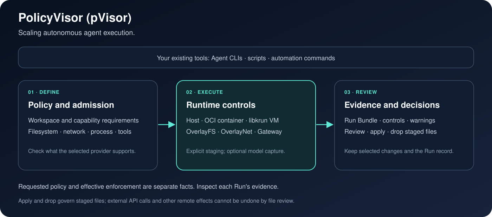

#  PolicyVisor (pVisor)

Run agents and review their changes before choosing what to keep.

运行 Agent，查看变更，再决定哪些改动进入工作区。

[](https://github.com/DeepLink-org/pvisor/actions/workflows/ci.yml)
[](https://deeplink-org.github.io/pvisor/)
[](LICENSE)

pVisor runs Agent CLIs, scripts and automation with execution policies,
copy-on-write workspace staging and execution records. Use your usual command,
inspect the results, then accept selected file changes or discard the stage.
The basic workflow requires no Agent SDK.

Jobs are the main workflow for reviewing changes before accepting them. The
project aims to reduce supervision per task and let each machine support more
sandboxes. VM resource sharing and idle memory reclamation are under active
development, with support that varies by platform.



## Start with one Job

Install the native command from a Python wheel:

```bash
pip install pvisor-sandbox
pvisor --version
```

Wheels are published for Linux x86_64 and Apple Silicon macOS. Staged host
execution on macOS requires macFUSE 5.4.0 or newer with its FSKit extension enabled.
VMs use KVM on Linux and Hypervisor.framework on Apple Silicon. On macOS, they
need a Linux image or rootfs. See the
[installation guide](docs/src/en/start/installation.md) for prerequisites.

You can also install the same command from the rolling nightly build without a
Rust toolchain:

```bash
curl -fsSL https://raw.githubusercontent.com/DeepLink-org/pvisor/main/scripts/install-nightly.sh | bash
```

Stable and nightly GitHub Releases include native archives and SHA-256 checksums.
This repository also serves as the Homebrew tap:

```bash
brew tap DeepLink-org/pvisor https://github.com/DeepLink-org/pvisor.git
brew install DeepLink-org/pvisor/pvisor
```

The stable workflow tests the formula before updating `Formula/pvisor.rb` on
the default branch, using the built-in GitHub token.

Platform requirements and executor setup are covered in the
[installation guide](https://deeplink-org.github.io/pvisor/en/start/installation/).

Run an installed Agent CLI from your project directory:

```bash
pvisor spawn --safe -- claude
pvisor review last
pvisor apply last --path src
# Or discard the remaining staged changes:
pvisor drop last
```

Replace `claude` with your Agent CLI or script. `--safe` requests the safety preset
and keeps workspace changes in Job storage for review. Admission can refuse an
executor that cannot satisfy the preset. `last` selects the latest Job in the
default store; use the printed Job ID when managing several Jobs. With
`--stage PATH`, you choose a stage explicitly and address it by its path.

**Ordinary host Jobs without staging write directly to the workspace.** Staging
covers the configured filesystem view; HOME, rootfs and explicit mounts have
separate lifetimes. See [staging and storage](docs/src/en/reference/cli.md#暂存与存储).

For a minimal VM Job with a Linux image:

```bash
pvisor spawn --executor vm --rootfs image=ubuntu:24.04 -- /bin/echo hello
```

The [examples](examples/pvisor/README.md) cover filesystem isolation, selective
apply, network policy, model request capture and interactive review.

## What a Job gives you

| Capability | What it does |
| --- | --- |
| Policy admission | Resolves the executor and requested capabilities before dispatch, and records the available controls and observations. |
| Workspace staging | Keeps writes in an overlay for inspection before you apply them to the target workspace. |
| Selective apply | Applies selected paths, checks recorded preimages for conflicts, and tracks progress in a recovery ledger. |
| Execution records | Produces a Run record and Run Bundle with results, filesystem changes, boundary observations and artifact references. |
| Network and model control | OverlayNet applies network policy; optional Gateway support adds model protocol handling and request/response capture. |
| Checkpoint and fork | Supports logical filesystem checkpoints and forks; execution snapshots are separate, restricted VM capabilities. |

Execution is bounded, recoverable and checkable within the documented scopes.
Inspect the Run Bundle's evidence and warnings to see which controls were
installed; requesting a policy does not prove enforcement. Logical checkpoints
do not capture process memory, and replay does not roll back an external service.

## Execution boundaries

A Job can run as a host process, through the native OCI container executor, or
in a Linux VM. Each executor has different isolation boundaries, controls and
prerequisites.

| Executor | Boundary and current limits |
| --- | --- |
| Host | Uses platform controls and optional filesystem staging. Selective network proxying is cooperative unless a mandatory network boundary is configured. |
| OCI container | Delegates execution through an OCI runtime. It does not satisfy the `--safe` preset; delegated result provenance remains a limitation of this implementation. |
| VM | Runs a separate Linux guest through `pvisor-vm`, with virtio-fs and a userspace network data plane. Supported native VMM targets are Linux x86_64/KVM and macOS ARM64/HVF. |

pVisor trusts the host kernel, its supervisors, and the host account's management
code and configuration. The project does not claim a hardened boundary between
mutually hostile tenants sharing that account.

The following limits apply across executors:

- Remote API calls, database writes and sent messages are outside `apply`/`drop`
  and remain in effect. Dropping a stage also leaves files that have already been
  applied in place.
- Apply does not provide a multi-file transaction against other writers. Stop
  concurrent editors and other apply processes while accepting a batch. Conflict
  detection and recovery records do not make arbitrary concurrent writes safe.
- Proxy records cover traffic through the proxy. Missing observations do not
  prove that an action never happened.
- Crash recovery is incomplete. Attempt completion publishes several durable
  records separately, so a host-process crash between them can require reconciliation.

See [capabilities and evidence](docs/src/en/concepts/capabilities-and-evidence.md),
[staging semantics](docs/src/en/concepts/staging.md) and the
[security documentation](docs/src/en/security/index.md) before relying on a boundary.

## Other ways to use pVisor

The repository also provides these entry points, each with its own contract:

| Entry point | Scope |
| --- | --- |
| `pvisor spawn` | Native Jobs: run, review, apply/drop, inspect, checkpoint and fork. |
| `pvisor run`, `build`, `pull`, `exec` | Experimental Docker-style CLI subset, with one Linux VM per container and no central Docker daemon. This is separate from the OCI executor used by Jobs. |
| `pvisor-daemon` | Single-node services for sandbox APIs, cache and optional memory pools. Sandbox serving implements partial OpenSandbox 1.1.0 and E2B Python SDK 2.59.0 profiles on Linux/KVM. |
| `containerd-shim-pvisor-v2` | Linux containerd integration with its own lifecycle and platform requirements. |
| Rust library `pvisor` | Embeddable execution runtime and durable Job service. |
| `pvisor-tui`, `pvisor-replay` | Interactive Job frontend and replay/continuation tools. |

The container CLI does not implement the Docker Engine API. The daemon's sandbox
API does not expose native Job stage/apply or checkpoint/fork semantics. SDK
support is limited to the partial profiles described above. External
orchestrators handle cross-node placement, workflow scheduling and retries.

Use the [container command profile](crates/pvisor-cli/README.md#docker-command-profile-experimental),
[daemon contract](crates/pvisor-daemon/README.md) and
[shim guide](crates/pvisor-shim/README.md) for supported operations and limitations.

## VM density and current maturity

pVisor includes a shared compressed image pool, optional RAM sharing, VM
pause/offload controls and experimental guest-idle/model-wait integration.
Support depends on the platform, RAM backing and execution profile. Some features
require opt-in, and availability varies across frontends.

The runtime feature `workload-aware-memory-offloading` currently enables only
vCPU wait observation. It does not automatically reclaim memory. Shared memory
pools and Apple Silicon shared kernel baselines are separate opt-in mechanisms.
See the [runtime experiments](crates/pvisor/README.md#explicit-runtime-experiments)
and [VM implementation](crates/pvisor-vm/README.md) for their contracts.

The project is a developer preview. Architecture reviews and targeted tests cover
individual behaviors; they do not establish stable crash recovery, isolation
between hostile tenants or full OCI/SDK compatibility. Assess platform integration,
release-artifact validation and long-running fault tests for the revision and
configuration you use. Memory sharing alone does not establish sandbox density
or net memory savings. Consult the
[benchmarks](docs/src/en/benchmarks/index.md) for measured workloads and conditions.

## Architecture and development

The workspace has 13 crates, grouped by the responsibilities they own:

| Layer | Crates and responsibility |
| --- | --- |
| Applications | `pvisor-cli` owns `pvisor`, `pvisor-tui` and `pvisor-replay`; `pvisor-daemon` and `pvisor-shim` own service integrations. |
| Runtime | `pvisor` owns admission, Jobs, Sessions/Attempts, executors and driver orchestration. |
| Shared contracts and persistence | `pvisor-core` defines policies, Operations, Events and shared records; `pvisor-journal` owns durable event storage. |
| Filesystem | `pvisor-overlay-core` owns shared overlay/apply mechanics; `pvisor-overlayfs` supplies the host filesystem adapter; `pvisor-vm` supplies virtio-fs. |
| Network and models | `pvisor-overlaynet` owns network policy transport and the VM data plane; `pvisor-gateway` owns model protocols and capture. |
| Virtual machine and guest | `pvisor-vm` owns the VMM and RAM lifecycle; `pvisor-guest` owns guest process execution and reaping. |
| Replay | `pvisor-replay` implements replay using Core and Journal contracts, independently of the runtime and CLI parser. |

For local development:

```bash
mise run doctor -- dev
mise run build -- release           # Supported executables for this host
mise run test -- pvisor pvisor-cli   # Runtime and frontend tests through nextest
mise run test                    # Workspace Rust tests, then Python suites
```

Run checks for the affected packages when making focused changes. `mise run build -- PROFILE COMPONENT`
supports `debug`, `release` and `performance` profiles and `all`, `product`,
`daemon`, `shim` and `shim-vm` components. Builds prepare the customized guest
firmware from [`fw/`](fw/README.md); published wheels do not require a local kernel
build toolchain. See the [engineering guide](docs/src/en/community/development.md)
for dependencies, platform setup and validation.

## Development environment

Install [mise](https://mise.jdx.dev/installing-mise.html) 2026.8.5 or newer, then run
`mise trust`, `mise install --locked`, and `mise run setup`. The checked-in `mise.toml`
and `mise.lock` pin a reproducible default toolchain. CI and wheel builds use mise
2026.10.18. You can select compatible local tools in the gitignored
`mise.local.toml`; see [local tool overrides](CONTRIBUTING.md#local-tool-overrides).
`uv.lock` fixes Python development dependencies in
`.venv`. Use `mise tasks ls` to list tasks and `mise run test` to validate.
The timed peer TCP recovery test reserves all nextest execution slots while it
runs; other tests keep their normal parallelism. See [.config/nextest.toml](.config/nextest.toml).
See [contributing](CONTRIBUTING.md) for the development loop and platform prerequisites.

Task implementations that need more than a short command live in `scripts/tasks/`.
Their names and shared environment are declared in `mise.toml`. CI installs tool
subsets for Python, semspec, documentation and release checks. Only full setup
prepares guest targets. The optional Podman Go contracts use their pinned
`setup-go` environment; install native libraries and virtualization prerequisites
with the host package manager.

## Guest firmware

The customized libkrunfw sources, guest kernel configurations, patches and bundle
tests live in [`fw/`](fw/README.md). CLI, daemon and single-wheel builds use this
source-built firmware by default, with verified kernel downloads and build caches
keyed by their inputs. Use `mise run fw -- build` to build the firmware independently
and `mise run fw -- test` for bundle/ABI regression tests. The directory README covers
toolchain requirements, cache settings and corresponding-source export. Published
wheels install without a kernel build toolchain.

## Documentation and community

- [First run](docs/src/en/start/first-run.md): the run-review-apply workflow
- [Why pVisor](docs/src/en/why/index.md): goals, use cases and the trust ladder
- [CLI reference](docs/src/en/reference/cli.md): commands and configuration
- [Architecture](docs/src/en/design/architecture.md): component boundaries and execution flow
- [Experimental features](docs/src/en/design/experimental/index.md): stages and validation gates
- [中文文档](https://deeplink-org.github.io/pvisor/zh/start/first-run/)

Contributions: [CONTRIBUTING.md](CONTRIBUTING.md). Security reports:
[SECURITY.md](SECURITY.md).

## License

[Apache License 2.0](LICENSE). See [NOTICE](NOTICE) for third-party attributions
and separately licensed bundled components.
