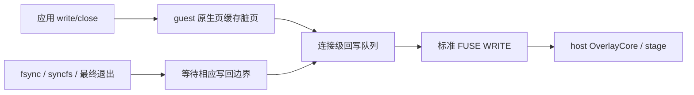

# 下沉元数据与合并写回，到底节省了多少时间？

## 主要结论

**明确收益来自热 open 的本地闭环，以及同一文件内小块写入的合并；跨文件短提交没有测到普遍加速。**

**SDK Immutable share：** 首次 stat 216.702 → 109.434 ms（缩短 49.5%；95% CI [-118.245, -97.381]）。单 fd 小块流写总耗时 322.367 → 6.281 ms（缩短 98.1%；95% CI [-342.426, -290.583]）。4 MiB 多文件写入总耗时 7.274 → 7.626 ms（未检出差异；95% CI [-0.369, 0.797]）。固定组合任务完成时间（默认→写回开启） 4571.354 → 3909.050 ms（缩短 14.5%；95% CI [-775.047, -453.708]）。

**普通 --safe CLI：** 首次 stat 237.754 → 234.911 ms（未检出差异；95% CI [-24.076, 33.353]）。单 fd 小块流写总耗时 310.778 → 6.579 ms（缩短 97.9%；95% CI [-343.853, -288.712]）。4 MiB 多文件写入总耗时 7.691 → 7.611 ms（未检出差异；95% CI [-0.395, 0.763]）。固定组合任务完成时间（默认→写回开启） 6010.071 → 5260.332 ms（缩短 12.5%；95% CI [-947.614, -514.710]）。

固定七个写阶段合计（默认→写回开启）：SDK 746.964 → 443.992 ms（缩短 40.6%；95% CI [-340.543, -257.527]）；CLI 776.688 → 495.768 ms（缩短 36.2%；95% CI [-376.735, -239.495]）；这不是所有写法的通用收益：普通 CLI 的 tiny 从 71.334 增至 90.472 ms（+26.8%，CI [10.827, 21.940]），boundary 从 109.571 增至 122.309 ms（+11.6%，CI [6.222, 21.825]）。

这些结果量化当前开关所控制的整组能力：元数据侧同时包括目录镜像、惰性 open 和缓存保留策略；写回侧同时包括 Linux WRITEBACK_CACHE、连接级跨文件调度和脏页份额调整。不能将整个写回收益归因于额外的自研队列，也不能把各用例百分比相加为 Agent 收益。

## Motivation

Agent 连续访问同一目录、频繁 open/stat、反复提交短写时，宿主往返可能比本地操作更贵。决策需要同时回答：哪些时间真正省掉了，哪些只是从 write/close 推迟到同步，以及跨文件批量调度有没有减少协议请求。大量新文件、一次性大块写和每次 fsync 也必须纳入，避免只展示容易合并的流写。

## 实验设计

### 四组开关与边界

| 臂 | guest cache | writeback | 含义 |
|---|---:|---:|---|
| 0 | 0 | 0 | 保留普通 Linux/FUSE 缓存，关闭扩展下沉和写回 |
| 1 | 1 | 0 | 仅开启目录镜像/惰性 open 等下沉机制 |
| 2 | 0 | 1 | 仅开启当前整组写回机制 |
| 3 | 1 | 1 | 两组机制同时开启 |

全新会话的当前默认通常对应臂 1：guest cache 开启、writeback 关闭。下沉贡献用 0→1，写回贡献主要用 1→3，组合效果用 0→3；CSV 另外列 0→2 与 2→3。四组使用完全相同的 host/guest 二进制和固件。`guest cache=0` 不关闭原生页缓存、dentry/inode 或 FUSE 原生属性缓存；各臂保留相同的现有最大 1 MiB 传输预算，未单独比较旧 4 KiB 缓冲。这里比较当前代码的功能开关，不是回退整个项目到优化前版本；臂 0/1 未协商 FUSE_WRITEBACK_CACHE，不能当作 ext4 等原生文件系统的异步写回对照。

SDK 为显式 Immutable input lower；rootfs 保持 Mutable。普通 CLI 使用真实 `--safe`，工作区 lower 为 Mutable，不具备目录镜像资格。两类结果独立统计；SDK 未配置 preimage 日志，CLI 保留真实 --safe 的 stage/日志/策略路径，两者绝对耗时不是同语义排名。未改变独占写入和可见性契约，未使用 DAX。

### 负载与计时

前 17 阶段沿用既有目录缓存负载：2048 路径 stat、深路径、扫描、64 MiB 全字节读取、1000 次热 open/fstat 与 open/read、稀疏/随机/跨步/全量宽目录访问、空闲 1.3s 后 stat。之后按以下顺序运行七类写入：

| 用例 | 文件与系统调用形状 | 逻辑写入量 | 主要覆盖的边界 |
|---|---|---:|---|
| defer | 16 文件，各一次 256 KiB write/close | 4 MiB | 低于高水位，已有大块请求 |
| tiny | 200 文件，各一次 4 KiB write/close | 800 KiB | 小写入与 CREATE 成本 |
| boundary | 256 文件，各一次 64 KiB write/close | 16 MiB | 字节/句柄边界 |
| pressure | 24 文件，各一次 1 MiB write/close | 24 MiB | 总量超过 16 MiB，可能触发背压 |
| overwrite | 16 个已创建 upper 文件，交错 64 轮，每次重开、覆盖 4 KiB、关闭 | 4 MiB，最终 64 KiB | 同页重复修改与短提交 |
| stream | 一个新文件，8192 次 1 KiB write，最后 close | 8 MiB | 相邻小写入的合并空间 |
| fsync | 16 文件，各写 4 KiB 后 fsync，再 close | 64 KiB | 应用显式要求同步 |

目录、路径、输入缓冲和覆盖写的初始文件在写循环计时外准备，并先 syncfs。每个用例连续记录写循环到 close 返回、随后 syncfs、两者总时间；期间不插入打印、读回或 sleep。总计按每次样本直接测得再聚合，分项中位数未必能相加。随后客机核对全部字节。这些阈值按总写入量设计；没有直接测量待处理字节峰值或阻塞计数，不能仅凭总量断言发生了背压。重复覆盖写针对同一 upper inode，不含 truncate 或临时文件 rename，不能代替真实 Agent 的原子替换行为。完整进程退出后，宿主再次核对 529 个结果文件；每个单独计数用例也做对应完整校验。使用重复字节模式；最终大小、内容和旧/新版本均有断言。

完成时间从宿主调用执行器到进程正常退出并收齐输出日志，包括启动、元数据阶段的 1.3s 空闲、全部写入/同步、读回校验和 PID 1 最终同步。这是基准包装器的 completion_ms，不是此前的 worker_ms。它用于检查成本是否转移到退出；此固定合成序列没有真实 Agent 的操作权重，不能作为整个 Agent 的加速倍数。压缩证据和宿主字节校验均在此计时之后。

### 环境、统计与证据

- B-FS-ENG；Apple M4（10 个逻辑 CPU、宿主 24 GiB RAM）、macOS 27.0.1/HVF，每 VM 2 vCPU、4096 MiB，冻结 Ubuntu 26.04.1 rootfs、静态 musl 负载，不启动完整发行版 init；热宿主缓存、新 VM 与 upper。不同于此前 Alpine 样本，不合并绝对耗时。没有宿主 CPU affinity/cgroup 或无外部干扰保证，保留既有 Host listener。完整有效批次启用独立磁盘保护：启动前至少 5 GiB，运行/归档期间每 0.2s 采样，低于 1 GiB 中断整批，仅清理自有子进程；保护器源码、参数和所有观测单独保留。采样前结束本任务的构建和测试；保留全部慢有效样本，未做事后剔除。
- 每个 cohort/臂 3 warmups、30 正式样本，seed 20261019，每轮八条件随机交替，共 264 个校验成功任务。配对 bootstrap 5000 次；差异为开启减关闭的中位数差。95% CI 包含 0 记为未检出差异；先检查分布，分离簇列比例及各簇中位数，不作整体排名。不报告 P99；多个指标未作多重比较校正。
- B-FS-DIAG 单独 48 个 fresh VM，guest cache 固定为 1，writeback 0/1；每个模式独立运行，overwrite 与热 open 使用 prime-only 差分。诊断耗时不进入性能分布，请求数受定时回写调度影响，不是固定承诺。
- 文件、输入、rootfs、冻结 harness、host 源码、固件源码和收据前后校验。固件使用此前已构建的 `bbed1fcf`；当前合并后的 0044 与原 0044+0045 在固定内核上应用结果逐字节一致，保留原固件的对应源码与构建收据，没有伪造重编版本。
- 磁盘容量有限：校验成功的 stage/runs/config 在计时后以 zstd 压缩保留。独立重读校验全部成员、SHA-256、链接、权限、uid/gid、纳秒时间、扩展属性及完整压缩帧后，才移除原始临时目录；失败现场不压缩清理。每个任务的日志、Run Bundle、字节校验和归档清单可直接阅读。

## 实验数据和分析

所有时间单位 ms，每臂 n=30；普通值为中位数，分离分布为样本比例/簇中位数。

### 下沉元数据：原生缓存之上的增益

#### SDK Immutable share

| 操作 | 原生缓存（臂 0） | 下沉开启（臂 1） | 差异 95% CI | 判断 |
|---|---:|---:|---|---|
| 2048 路径首次 stat | 216.702 | 109.434 | [-118.245, -97.381] | 缩短 49.5% |
| 立即重复 stat | 1.288 | 1.285 | [-0.119, 0.171] | 未检出差异 |
| 深路径首次 stat | 310.490 | 176.448 | [-142.332, -106.668] | 缩短 43.2% |
| 深路径热 stat | 1.957 | 1.868 | [-0.322, 0.101] | 未检出差异 |
| 首次枚举及 stat | 118.457 | 103.862 | [-20.295, -7.888] | 缩短 12.3% |
| 热枚举及 stat | 85.505 | 1.817 | [-86.041, -75.854] | 缩短 97.9% |
| 首次读取 64 MiB | 822.952 | 784.593 | [-73.020, 24.009] | 未检出差异 |
| 热读取 64 MiB | 614.163 | 672.066 | [26.881, 108.967] | 增加 9.4% |
| 1000 次热 open/fstat | 149.342 | 1.015 | [-152.846, -146.262] | 缩短 99.3% |
| 1000 次热 open/read | 191.750 | 200.931 | [-0.999, 21.094] | 未检出差异 |
| 宽目录单文件 stat | 0.212 | 0.155 | [-0.080, -0.045] | 缩短 26.6% |
| 单文件重复 stat | 0.001188 | 0.001208 | [-0.000041, 0.000125] | 未检出差异 |
| 空闲 1.3s 后 stat | 144.186 | 4.117 | [-144.856, -137.806] | 缩短 97.1% |
| 宽目录两个远隔名字 | 0.240 | 0.537 | [0.277, 0.317] | 增加 123.3% |
| 宽目录随机 32 名字 | 2.297 | 5.181 | [2.742, 3.002] | 增加 125.5% |
| 宽目录跨步 32 名字 | 2.278 | 4.609 | [2.161, 2.473] | 增加 102.4% |
| 宽目录全量 2048 名字 | 136.826 | 67.285 | [-72.278, -67.592] | 缩短 50.8% |

#### 普通 --safe CLI

| 操作 | 原生缓存（臂 0） | 下沉开启（臂 1） | 差异 95% CI | 判断 |
|---|---:|---:|---|---|
| 2048 路径首次 stat | 237.754 | 234.911 | [-24.076, 33.353] | 未检出差异 |
| 立即重复 stat | 1.212 | 1.291 | [-0.082, 0.128] | 未检出差异 |
| 深路径首次 stat | 371.177 | 393.214 | [-10.672, 34.315] | 未检出差异 |
| 深路径热 stat | 1.806 | 1.852 | [-0.061, 0.201] | 未检出差异 |
| 首次枚举及 stat | 152.342 | 155.267 | [-7.726, 9.094] | 未检出差异 |
| 热枚举及 stat | 125.606 | 124.718 | [-8.730, 4.320] | 未检出差异 |
| 首次读取 64 MiB | 1000.984 | 998.620 | [-45.938, 85.375] | 未检出差异 |
| 热读取 64 MiB | 639.735 | 652.427 | [-35.025, 56.273] | 未检出差异 |
| 1000 次热 open/fstat | 167.077 | 0.922 | [-181.950, -163.022] | 缩短 99.4% |
| 1000 次热 open/read | 203.756 | 206.495 | [-15.659, 7.650] | 未检出差异 |
| 宽目录单文件 stat | 0.223 | 0.228 | [-0.013, 0.023] | 未检出差异 |
| 单文件重复 stat | 0.001000 | 0.001000 | [-0.000042, 0.000042] | 未检出差异 |
| 空闲 1.3s 后 stat | 154.133 | 150.730 | [-7.801, 1.116] | 未检出差异 |
| 宽目录两个远隔名字 | 0.276 | 0.279 | [-0.014, 0.026] | 未检出差异 |
| 宽目录随机 32 名字 | 2.440 | 2.431 | [-0.131, 0.025] | 未检出差异 |
| 宽目录跨步 32 名字 | 2.387 | 2.409 | [-0.077, 0.061] | 未检出差异 |
| 宽目录全量 2048 名字 | 143.907 | 143.564 | [-4.860, 2.371] | 未检出差异 |

立即重复访问已可由原生缓存闭环；下沉的收益需由首次访问、到期访问或 open 路径具体判断。导入元数据期限为 24h，原生属性期限为 1s，因此到期用例同时反映期限策略。普通 CLI 的工作区目录镜像不生效，不能拿 SDK 的批量收益解释 CLI。

### 写回：写循环、同步和总成本

#### SDK Immutable share（guest cache 均为 1，臂 1→3）

| 用例 | 关闭 写 / sync | 开启 写 / sync | 关闭总计 | 开启总计 | 总计差异 95% CI | 总计判断 |
|---|---:|---:|---:|---:|---|---|
| defer | 7.272 / 0.001417 | 6.953 / 24/30：0.588；6/30：1.148 | 7.274 | 7.626 | [-0.369, 0.797] | 未检出差异 |
| tiny | 69.083 / 0.001667 | 78.733 / 7.047 | 69.085 | 85.691 | [13.138, 22.496] | 增加 24.0% |
| boundary | 109.716 / 25/30：0.001750；5/30：0.007292 | 114.997 / 2.154 | 109.717 | 116.585 | [-0.193, 14.614] | 未检出差异 |
| pressure | 17.573 / 0.001937 | 15.505 / 25/30：0.541；5/30：1.564 | 17.575 | 16.197 | [-2.282, 0.362] | 未检出差异 |
| overwrite | 201.633 / 0.001937 | 195.000 / 6.943 | 201.635 | 201.763 | [-27.286, 29.234] | 未检出差异 |
| stream | 322.365 / 0.002042 | 4.508 / 17/30：0.279；13/30：2.482 | 322.367 | 6.281 | [-342.426, -290.583] | 缩短 98.1% |
| fsync | 7.493 / 0.001042 | 8.427 / 0.469 | 7.494 | 8.925 | [0.806, 1.851] | 增加 19.1% |

#### 普通 --safe CLI（guest cache 均为 1，臂 1→3）

| 用例 | 关闭 写 / sync | 开启 写 / sync | 关闭总计 | 开启总计 | 总计差异 95% CI | 总计判断 |
|---|---:|---:|---:|---:|---|---|
| defer | 7.689 / 0.001500 | 7.108 / 0.670 | 7.691 | 7.611 | [-0.395, 0.763] | 未检出差异 |
| tiny | 71.333 / 0.001625 | 82.031 / 7.414 | 71.334 | 90.472 | [10.827, 21.940] | 增加 26.8% |
| boundary | 109.569 / 0.001709 | 120.412 / 16/30：1.186；14/30：2.820 | 109.571 | 122.309 | [6.222, 21.825] | 增加 11.6% |
| pressure | 18.705 / 0.001917 | 18/30：16.285；12/30：34.204 / 24/30：0.569；6/30：5.377 | 18.707 | 22.543 | [-2.429, 10.621] | 未检出差异 |
| overwrite | 25/30：197.933；5/30：330.444 / 0.002000 | 193.641 / 5.860 | 25/30：197.934；5/30：330.447 | 198.265 | 分离分布，不排名 | 分离分布，不排名 |
| stream | 310.776 / 0.002084 | 4.813 / 10/30：0.441；20/30：2.269 | 310.778 | 6.579 | [-343.853, -288.712] | 缩短 97.9% |
| fsync | 42.929 / 0.001646 | 35.514 / 0.173 | 42.931 | 35.699 | [-9.331, -2.898] | 缩短 16.8% |

write 缩短而 total 没有缩短，只说明等待转移到了同步。新文件创建没有下沉成异步事务；CREATE、路径检查、句柄创建和同步语义仍有成本。一次 256 KiB/1 MiB 的大块 write 本来就能形成大请求；跨文件调度不必然继续减少请求数。

### 固定组合任务完成时间

| cohort | 全关（0） | 仅下沉（1） | 仅写回（2） | 全开（3） | 0→3 差异 95% CI | 判断 |
|---|---:|---:|---:|---:|---|---|
| sdk | 5209.671 | 4571.354 | 4617.358 | 3909.050 | [-1402.223, -1105.955] | 缩短 25.0% |
| cli | 6204.196 | 6010.071 | 5601.468 | 5260.332 | [-1047.824, -616.902] | 缩短 15.2% |

### 七个写入阶段的合计（派生补充）

逐任务相加七个 write/close+syncfs 总计，再对样本求分布与配对 CI；没有相加各用例的中位数或百分比。该指标排除组目录准备、阶段间读回校验、元数据与启动，不能替代完整完成时间，也不是强制落盘时间。表中另列完整任务的默认→开启对照，其边界与上一节相同，仍包含启动、元数据和校验。

| cohort | 默认（臂 1） | 写回开启（臂 3） | 差异 95% CI | 判断 |
|---|---:|---:|---|---|
| sdk / 七写阶段合计 | 746.964 | 443.992 | [-340.543, -257.527] | 缩短 40.6% |
| sdk / 完整任务 | 4571.354 | 3909.050 | [-775.047, -453.708] | 缩短 14.5% |
| cli / 七写阶段合计 | 776.688 | 495.768 | [-376.735, -239.495] | 缩短 36.2% |
| cli / 完整任务 | 6010.071 | 5260.332 | [-947.614, -514.710] | 缩短 12.5% |

不能用这一合成任务的权重替代真实 Agent trace，也不能将它与此前其他固件批次拼接成性能排名。

### 宿主请求数：调度合并与协议合并的区别

以下每行是独立诊断 VM 减 empty；overwrite 减去已创建/同步 16 个文件的 prime-only VM。入站协议字节包含请求头和各类输入参数/数据，不是纯 WRITE payload、宿主磁盘 I/O 或 VM exit 次数。读回校验属于该 VM 的完整计数。各实例全部保留 final_record，inclusive spans 没有相加为 CPU 归因。

| cohort / 用例 | WRITE 关→开 | CREATE 关→开 | 入站协议 KiB 关→开 |
|---|---:|---:|---:|
| sdk / defer | 16 → 16 | 16 → 16 | 4108.3 → 4107.1 |
| sdk / tiny | 200 → 200 | 200 → 200 | 948.8 → 934.8 |
| sdk / boundary | 256 → 256 | 256 → 256 | 16574.4 → 16556.4 |
| sdk / pressure | 24 → 26 | 24 → 24 | 24594.2 → 24592.7 |
| sdk / overwrite | 1024 → 794 | 0 → 0 | 4356.9 → 3479.3 |
| sdk / stream | 8192 → 25 | 1 → 1 | 8833.6 → 8198.1 |
| sdk / fsync | 16 → 16 | 16 → 16 | 77.1 → 76.0 |
| cli / defer | 16 → 16 | 16 → 16 | 4108.3 → 4107.1 |
| cli / tiny | 200 → 200 | 200 → 200 | 948.8 → 934.8 |
| cli / boundary | 256 → 256 | 256 → 256 | 16574.4 → 16556.4 |
| cli / pressure | 24 → 24 | 24 → 24 | 24594.2 → 24592.5 |
| cli / overwrite | 1024 → 842 | 0 → 0 | 4356.9 → 3664.0 |
| cli / stream | 8192 → 21 | 1 → 1 | 8833.6 → 8198.7 |
| cli / fsync | 16 → 16 | 16 → 16 | 77.1 → 76.0 |

这些计数是独立 fresh VM 的单用例诊断，不是正式完整序列中的逐阶段 trace；不据此精确分摊某个计时样本。

跨文件队列提交的仍是带单个文件 handle/offset 的标准 FUSE WRITE；没有多文件 WRITE opcode，也没有多文件原子提交。相邻小块和同页反复覆盖可在原生页缓存中合并，多个文件各自已经形成的大请求则主要改变提交时机与等待方式。四个 cohort/writeback 组合的热 open/fstat 相对 prime-only 的 OPEN/READ/FLUSH/RELEASE 增量均为零，惰性 open 保留。

### 为什么短提交没有普遍加速

源码中的 `fuse_pvisor_wb_queue` 按 `fuse_file`（ff/打开句柄）入队；同一个打开句柄复用队列项，但重开同一 inode 会形成新的句柄项。`fuse_pvisor_wb_work` 先提交整批数据，再逐句柄等待；已关闭的句柄仍各自发送 `fuse_pvisor_wb_flush`，最后释放。因而这层合并的是提交调度，没有合并每次重开的 OPEN/FLUSH 生命周期。实现见 [0042 写回补丁](../../fw/patches/0042-fuse-batched-writeback.patch)；宿主 [OverlayFs open/flush/fsync](../../crates/pvisor-vm/src/devices/virtio/fs/overlay.rs) 仍保留句柄和 preimage 同步边界。

诊断样本中，overwrite 的 OPEN 两臂都是 1040 次（含 16 次读回）；FLUSH 为 1040→1024。WRITE 虽从 1024 降到 SDK 794 / CLI 842，控制请求仍大量存在。SDK 总耗时未检出差异；CLI 关闭臂分布分离，不能给出单一整体排名。它与单 fd 流写 8192→SDK 25 / CLI 21 次 WRITE 是不同的优化空间。

对于每个文件本来只有一次 write 的 defer/tiny/boundary，WRITE 与 CREATE 没有减少。单纯推迟等待不能消除这些操作，额外队列和页缓存路径也可能净增加成本。源代码与计数支持这个机制解释，不能将 inclusive spans 相加成精确 CPU 归因。

当前证据不足以支持对“新建文件/频繁重开提交”全面默认开启写回。继续评估的重点应是原生 writeback-only 对照，以及真实编辑轨迹；若优化句柄级重复工作，需要保留凭据、锁、异步错误与生命周期语义，不能直接删除 FLUSH。

### 当前实现与适用范围

元数据镜像在每个 FUSE 目录的 `pvisor_dir` 中，以名字红黑树和顺序表保存目录项/属性，并与原生 VFS dentry/inode 协作；文件字节仍由 Linux 页缓存承接。它是减少宿主元数据往返的内核路径，不是新块设备，也没有额外复制一份所有文件内容。未测其完整内存成本。

队列按 1 MiB 或首笔待处理后约 10 ms 触发，持有 inode/handle 引用；每连接最多 256 个待处理句柄，16 MiB 未完成字节高水位，宿主后台请求上限 64。复用页缓存不等于零拷贝，标准 FUSE 写回仍可能使用临时页和发生数据拷贝。高水位是背压边界，不是整个 Linux 页缓存的内存上限；脏页最低份额预留仍服从全局预算。应用显式 fsync/fdatasync 保持同步；syncfs/卸载及最终退出排空连接队列，异步错误必须在后续同步/最终退出报告。仅后台已接收不等于任务成功。

本报告的 syncfs 总时间描述当前 guest→host 回写边界；不能据此声称断电持久化。fsync 用例单独保留强制同步成本。同一 guest 的后续读取使用页缓存保持可见性；写循环刚返回时，host 的 stage 仍可能只看到部分数据，外部读取须等待同步/最终成功边界。输入/工作区由 guest 独占修改；未覆盖宿主同时修改、崩溃恢复或多文件事务。

### 局限与验证

- 四臂不能拆开普通 Linux writeback、额外跨文件队列和脏页预算三者的单独贡献。若要回答“自研队列是否优于只开原生 FUSE writeback”，还需独立的仅原生 writeback 对照，本次未测。
- 未测 DAX、Linux/KVM、磁盘冷缓存、完整 Agent trace、VM exit 或完整宿主 CPU/内存成本。native Linux 的热缓存不是无缓存基线；本实验也不是 Kata/Docker 比较。
- 新基准的 5 项常规测试与磁盘保护的 3 项测试通过，macOS 二进制扩展属性随归档独立验证；现有快照归档的 15 项 Linux-only 测试在该平台跳过。既有固件 flat bundle 对齐测试失败未被改写，本次未重跑该项，也未重编等价固件。
- [复现说明](README.md#lowering-and-cross-file-writeback)、完整配对 CSV（本地归档：`.data/derived-tables-20261018/lowering-writeback-summary.csv`）、请求数 CSV（本地归档：`.data/derived-tables-20261018/lowering-writeback-requests.csv`）。原始计时 `.data/lowering-writeback-final-formal-20261016/`，独立诊断 `.data/lowering-writeback-final-profiles-20261016/`，冻结源码/输入/收据 `.data/lowering-writeback-build-20261016/`；预检保留且不拼入正式样本。此前 `.data/lowering-writeback-formal-20261016/` 在 111 个成功任务后遭遇宿主 ENOSPC，连 stdout/完成记录持久化也失败；该批整批作废并保留，未补跑单个任务或拼入当前批次。

验证日志、报告生成器和最终源码/制品一致性收据保留在 `.data/lowering-writeback-validation-20261016/`。

| 制品 / 证据 | SHA-256 |
|---|---|
| pvisor | `04ec88f417f8c6e8a572a20e3acebf7c34a13d1e6d096273cc45d1abc16331e3` |
| sdk | `2f08d389f8723d981e0505e5eee38f1e8bc4ff6d2320d4793afc6f9b4c5a3611` |
| guest | `70c46a0403dcb2cb5bcd3d4549dbd22ddb0186714cc08753bc9f782e2c4a5687` |
| libkrunfw.5.dylib | `49ffcbd8b6d74f03f760a83b1f6bbf2364159b730d00feb73877face907dae93` |
| timing/report.json | `ca641eeed89abbf50e23ce07f8e9e341fc47974311118aed529c26fa5319a8bf` |
| timing/summary.json | `6050ab13feb84b10bd306a0272798bfee8ef3dd88bbe1ca28985b247b07e367a` |
| timing/derived-write-sum.json | `04fe661e4e13cff893e209c9089e55f520adcf9af6142a9c8f0ae9078a74a46d` |
| profiles/report.json | `8ed09a28c669f3149106648b275da0f0c81b950badbd75ab0e08c47186a2a00e` |
| profiles/request-checks.json | `963528a5a5ba42809689a4f651fa3345ddccc48e76854e693ce6402d7afd6cfb` |
| environment | `a4edd8ddc16bb1c086498b7b3580772db674c07d37f1191b4165a305164453c0` |
