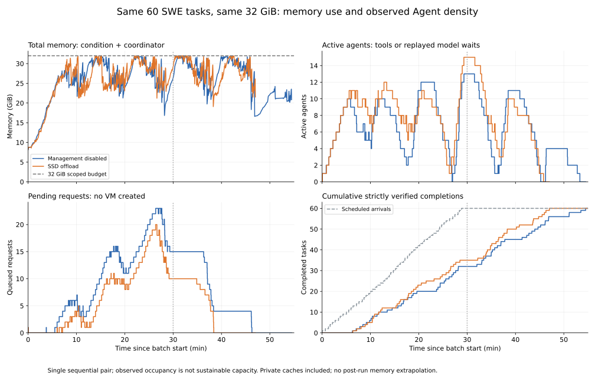

# Agent density under a fixed memory budget: SWE drain comparison

Historical engineering evidence from gpu02, 2026-10-26. This is one
baseline-first/offload-second pair using a frozen runtime, not a measurement
of current main or a rerun of the refactored harness.

Both arms use the same 60 tasks and arrivals, two vCPUs, 250% whole-VM CPU,
32 GiB scoped RAM, total CPU 6000%, swap 0 and unrestricted offload concurrency.
FIFO admission reserves 8 GiB, credits half of clean unmapped inactive cache,
and keeps startup reservations. Queue wait never expires; execution and
experiment fault bounds still apply. No real model is called.

| Metric | Management disabled | SSD offload | Change vs. baseline |
|---|---:|---:|---:|
| Verified tasks | 60 | 60 | +0.0% |
| Batch makespan (min) | 54.51 | 47.01 | -13.8% |
| Effective throughput including drain (tasks/min) | 1.101 | 1.276 | +16.0% |
| Mean active agents, common first 30 min | 7.08 | 8.09 | +14.3% |
| Peak active agents (observed) | 13 | 15 | +15.4% |
| Mean queued requests, common first 30 min | 9.58 | 6.77 | -29.3% |
| Peak queued requests | 23 | 20 | -13.0% |
| Total memory-time integral (GiB min) | 1,385.29 | 1,231.15 | -11.1% |
| Queue wait P50 (min) | 6.67 | 4.05 | -39.4% |
| Queue wait P95 (min) | 17.44 | 10.87 | -37.7% |
| Queue wait maximum (min) | 18.66 | 11.71 | -37.3% |
| Scheduled arrival to verification P95 (min) | 23.26 | 18.38 | -21.0% |

Changes are descriptive `(offload / baseline - 1) * 100%`, computed before
rounding. They are not randomized causal estimates or confidence intervals.
Both arms completed all 60 tasks with no rejection, VM failure, OOM or swap.
Active agents include tool execution and replayed model waits; requests waiting
for VM creation are excluded. Occupancy peaks are not sustainable capacity.

Total memory-time integrates condition plus coordinator memory, including
private image, overlay and backing caches. Guest RAM PSS is a separate measure
and must not be substituted for total memory savings. Common OS/shared-code
cache is outside the scoped budget; physical SSD placement is fixed without a
hard IOPS quota. Memory is plotted only while observed, not extrapolated to zero
after completion. Both arms accumulate queues; batch drainage is not proof of
sustainable throughput at this arrival rate. The original online exploration
criteria did not pass; this report evaluates the offline all-tasks-complete goal.

The frozen binary SHA256 is
`08da082749523a93f7a75a8e329c7753a8254c16d74064c1f00365908fc1fc2f`.
The historical acceptance recorded 120 actual VM exits and 7676 unchanged frozen
files. Local harness tests are reported separately from these historical runs.

The delivery cost remains visible: replay response-delivery P99 was 14.9 ms versus 101.0 ms. The table emphasizes queue-inclusive latency; this does not mean resume is free.
