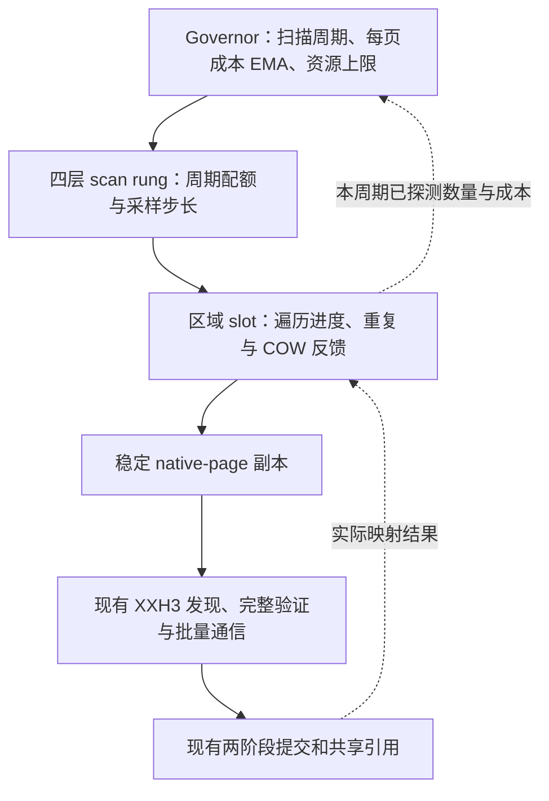

# UKSM 扫描设计收敛

本文规定下一步扫描策略的目标，不表示运行时代码已经完成迁移。
现有实现和平台支持仍以 [README](README.md) 为准。

## 范围与基线

以 [UKSM 0.1.2.6 / Linux 5.17 的固定实现](https://github.com/dolohow/uksm/blob/acb96fbc9e04e7aa967e8e9af011494c77f58aed/v5.x/uksm-5.17.patch)
为算法基线，以 [FAST'18 论文第 5 节](https://www.usenix.org/system/files/conference/fast18/fast18-xia.pdf)
解释分层扫描。具体状态转换以固定实现为准，不混用不同版本的参数。
采用其设计并独立实现 Rust，不移植 GPL 内核代码。

本次收敛的处理变量是扫描调度：扫描周期、层内采样进度、全局评估、成本估计、
采样步长和区域升降级。保留当前 hash、传输与通信优化，不在同一步试验新的
内容算法、区域摘要、位图索引、锁分片或 extent 映射。

UKSM 已有实践是选择设计基线的理由，不是用户态版本已经通过性能验证的证明。
内核扫描线程和多个 VM worker 加跨进程池的成本边界不同。

## 保留的实现

| 部分 | 保留内容 |
| --- | --- |
| 内容发现 | 对完整 native page 计算 XXH3-128，只作候选发现 |
| 内容身份 | SHA-256 对象身份、完整 backing 字节比较和屏障内 live-byte 复核 |
| 候选存储 | 独立、有界、可淘汰的指纹观察记录；不为首次独有内容分配 payload |
| 对象存储 | 被引用固定的共享槽位，与可淘汰观察记录分开管理 |
| 批量通信 | discovery、物化和 release 的有界批量交换，保持现有协议版本与结果顺序 |
| 传输检查 | 长度、数量、token、offset、FD 检查及覆盖整个交换的绝对期限 |
| backing 缓存 | 按确切 `Arc<File>` 所有者缓存验证，不按可复用裸 FD 缓存 |
| 提示传递 | 会话内页编号、随 RPC 回复携带的有界 ready hints，不传 VM 地址 |
| 采样成本 | 复用有界 snapshot buffers，在适用后端于屏障外准备分配 |

不改写既有实验的源码收据、制品或测量数据，也不把新策略结果合入旧样本。

## 状态模型



### 三种进度不能混为一谈

1. **扫描周期**：一次 sleep/scan 周期。每层有本周期的 `pages_to_scan`，
   用完后等待 governor 的下一周期；运行时可把它拆成多个有界传输批次。
2. **层内采样轮次**：采样点遍历该层区域组成的逻辑线性空间。每层保留自己的
   当前 slot、逻辑 offset、步长和已完成标记。
3. **全局评估轮次**：非空层都完成采样轮次后进行评估。该标记不阻止一层继续
   消耗本扫描周期尚存的配额。原版 `uksm_do_scan` 明确区分了这两个条件。

不能用“所有区域当前配额都归零”同时表示这三种进度；也不因修复这个混淆而
取消原版的全局评估。

### 区域与层级

- 每个区域只属于一个层级。仍使用现有、不会跨 RAM mapping 的最多 2 MiB 区域，
  作为内核 VMA slot 的用户态适配；不引入第二套 RAM 拓扑。
- 层级持有区域槽位的索引、累计页数和当前扫描位置。固定拓扑不要求复制内核的
  `sradix_tree` 容器，但要保留其逻辑线性空间与跳步采样语义。
- 区域保留现有有界的页排列遍历，避免反复采同一小组地址。排列进度不能因为
  休息、批次截断或层级迁移而重置。
- 区域升降级时迁移索引成员，不迁移 RAM 或对象所有权。空层不取得工作配额。
- 8 ms 软选择窗口、16 MiB 探测字节上限及 VM 每批最多 1 MiB 副本仍是运行时
  分块限制，不是层内采样轮次或全局评估的定义。

## 成本、配额与步长

设扫描周期休息基准为 `Ts`，层级预算比例为 `p_i`，该层逻辑页数为 `P_i`，
每 native page 的估计处理成本为 `s`，期望层内覆盖时间为 `Tcover_i`。
按原版关系计算：

```text
周期工作预算_i = Ts × p_i / (1 - p_i)
周期探测配额_i = max(1, floor(周期工作预算_i / s))
覆盖采样点数_i = max(3, floor(Tcover_i × p_i / s))
采样步长_i     = max(1, floor(P_i / 覆盖采样点数_i))
```

空层配额为零。所有计算需有整数溢出保护；native page 大小是成本与字节上限的
输入，不能把 4 KiB 的页数常量直接用于 16 KiB 后端。

成本随实际工作更新，不把本批候选数、snapshot 数和探测数混为同一个分母：
记录探测数、实际复制数、成功映射数，明确每项反馈的阶段。
单次高成本不能直接把下一轮扫描压到长期无进展。EMA 沿用原版的 20% 新观测、
80% 历史值；观测超过历史值十倍时，先按历史值两倍逼近。
不把内核的 500 ns 初值直接当作跨进程用户态每页成本，初始成本须单独校准。

### Governor 参数与成本适配

收敛基线采用原版 Full 的四层预算关系和覆盖时间：

| 层级 | 预算关系 | 覆盖时间 |
| --- | --- | --- |
| 0 | 固定 0.2% | 1000 ms |
| 1 | 固定 0.4% | 500 ms |
| 2 | 产品工作上限的 25% | 200 ms |
| 3 | 产品工作上限的 100% | 50 ms |

休息基准为 100 ms。保留当前产品侧保守的 10% 工作/休息上限作为首个迁移配置，
因此四层比例为 0.2% / 0.4% / 2.5% / 10%；不照搬原版 Full 的 95% 默认上限，
也不把这组用户态比例声明为原版已经验证的参数配置。

原版通过 `task_sched_runtime` 记扫描线程 CPU；当前接口没有把 daemon 的逐请求
CPU 成本回传给 VM。第一步沿用完整工作墙钟作为保守成本输入，包含屏障与 IPC
等待，并单独观测 VM worker 和池进程 CPU。不能称为内核 CPU 记账的等价实现，
也不能把单 VM 比例外推成整机预算。

原版 governor 的扫描后休息及最长一秒的响应性保护，与运行时的安全资源上限
分开处理。已保留的产品休息下界不因截断 governor 等待而被放宽。
固定两秒快速窗口、固定层级字节配额和额外层级等待不再组成另一套平行策略；
迁移后只保留原版配额/步长模型与明确的运行时资源保护。

## 区域反馈

- 在区域本次采样经过的边界进行评价，不只在全 VM 当前配额耗尽时统一评价。
  由于发布和提交发生在元数据选择之后，评价必须等本批实际结果回来，不能提前
  消费尚未收到的合并或 COW 反馈。
- 对齐原版净合并率与抖动过滤：COW 比例严格超过 50% 时该次净收益为零；
  否则以合并数扣除 COW 数计算，净重复率达到 10% 才具备提升条件。
  50% 边界、完整遍历后回到底层的行为均需独立参考用例。
- 仅实际映射成功才计为合并；发布取得对象但未提交不计为合并。
- COW 反馈只使用后端已经证明的共享后私有化。live-byte 复核失败保持独立的
  变化计数与冷却，不能仅为套用原版阈值就冒充一次已确认的 COW fault。
- 原版能够知道一个区域的页被另一个区域合并，维护额外的 `pages_bemerged`
  反馈。现有跨进程 ready hint 不是这种证明。保留全局评估，但不伪造这项
  二次提升；除非将来有真实且可验证的反馈，否则明确保留这个适配差异。
- `Observed` 只表示首次观察，`Limited` 表示容量或锁拥塞，不作为低重复率的
  证据。保留当前存储反馈分类，不为追求相似状态转换而制造错误的收益统计。

## 提示只改变顺序

文件 READ 与 daemon ready hints 进入同一预算仲裁，均消耗所属层的本周期配额，
不能创建新周期、续期快速窗口或绕过工作上限。
提示总量继续有界、允许丢弃和过期；提示最多占可用工作的一半，保留后台探索。
不足预算的提示保留或按既有容量规则淘汰，不能扣除尚未检查的后台配额。

提示页仍要重新捕获和完整验证。短期观察冷却可以按既有合同提前结束，
长时间不稳定冷却和设备忙重试不能被提示解除。
随 RPC 回复传递提示的方式保持不变，不新增异步推送或通知通道。

## 不由扫描策略决定的安全职责

- 对象发布和引用释放继续在 CPU/设备屏障外进行；采样及最终映射复核仍在屏障内。
- 指纹碰撞、内容变化、无容量和协议故障继续走既有回退或 fail-stop 路径。
  不因为 governor 判断“值得合并”就放宽映射授权。
- Linux 的有界引用维护继续独立于内容发现。只有完整页的 present-anonymous
  PTE 才用于证明 COW；缺失、文件或未知状态保留引用。
- HVF 的旧 shadow 必须在屏障内解除。没有对应原生验证前，保留其兼容节奏，
  不能仅因公共调度器收敛就直接启用会延迟所有权清理的新节流策略。
- 断连不等于映射消失，引用等待进程退出证明的规则不变。
- 不新增公开 API、可变共享内部状态或逐页 Hash 缓存；VMA 水位与 extent 方案
  属于后续独立工作，不能声称原版 governor 已解决用户态逐页映射成本。

## 实施与验收

1. 用固定实现中的规则建立独立 Rust 参考用例：成本 EMA、周期配额、层级步长、
   区域迁移、全局评估标记和完整遍历后的处理。
2. 先收敛公共扫描状态及 Linux 调用方，再接入两类提示的统一仲裁。
   不同时改动 hash、协议、槽位布局或 backing 缓存。
3. 继续运行稀疏页不被触碰、映射边界、4/16 KiB 几何、公平性、错误传播、
   快照缓冲和 COW 生命周期测试。旧固定配额/32 轮断言若不再适用，必须用
   新模型的覆盖与预算断言替换，不能只删除覆盖。
4. 用相同输入和工具链冻结 A/B 制品，分别观察启动、发现速度、稳态 CPU、
   COW 后旧槽释放和 VMA/内核成本；增加错峰加入与持续 READ 场景。
   不由合约测试推导性能收益，不用原版内核论文数据替代用户态实测。
5. HVF 单独完成原生采样、CPU/设备 COW、shadow 解除与写后保留验证后，
   才迁移其调度适配。跨平台差异和未测部分单独报告。

## 单宿主恢复重构的实施状态

后续讨论将目标扩展为单个 node-local daemon 管理同宿主 2–3K VM，并允许
daemon 重启后重新接管。该目标不能由降低扫描频率或增加连接上限替代。

- 已接入物理 store 的本地 backing 引用、延后释放、发布可用性门控和有界新代际
  连接。已有页不再按当前连接的 offset 查 backing；新连接不复用旧 token。
  `ColdRamAccountingScope` 明确区分当前池和失联后的本地显式 pin。
- 当前仍是可写槽位协议的兼容桥：断连引用可能保留到进程退出，旧 FD 也可能
  保留整个池。四个本地存活会话的上限不是全宿主退役内存预算。
- v4 物理池已接入进程生命周期 witness 和保守退役预算。记录绑定确切 backing
  inode；即使页引用已释放，COW VMA 仍可能持有文件，因此 witness 保留至进程
  退出。管理探测不取得 witness。旧 owner 的服务锁已可独占取得且记录、socket
  验证通过时，manager 重启可替换其失效 endpoint，发布新代际。退役文件按完整
  逻辑长度从新分配预算中扣除，不按超时或连接断开回收；不够时只拒绝新分配。
  每池最多 256 个记录、每进程最多 32 个 witness。此实现保守，可能在旧 VM
  退出前耗尽可用预算；不是按活跃页计费的 sealed-segment 方案。
- 尚需实现发布前封存的共享 segment、旧内容重新收录与重连清单恢复。已有
  v3/更早物理池缺少 witness，不允许原地恢复；不能在重启时清零退役预算。
- 尚需实现宿主级工作准入、在途 snapshot 限额和有界异步池服务。现有每连接
  线程及默认连接上限未改，不声称已具备 2–3K 真 VM 承载能力。
- 文件内容寻址/DAX 集成和上文 UKSM governor 迁移仍未实施。先保持数据安全
  边界与连接失败隔离，再逐步替换调度和服务实现；hash/批量协议优化保留。

这里记录的是分阶段实现状态，不宣布完整重构或性能 A/B 已完成。
