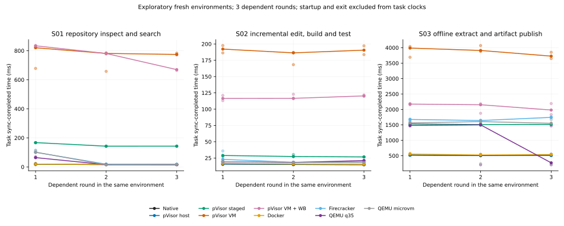
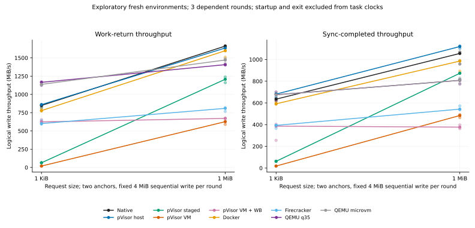
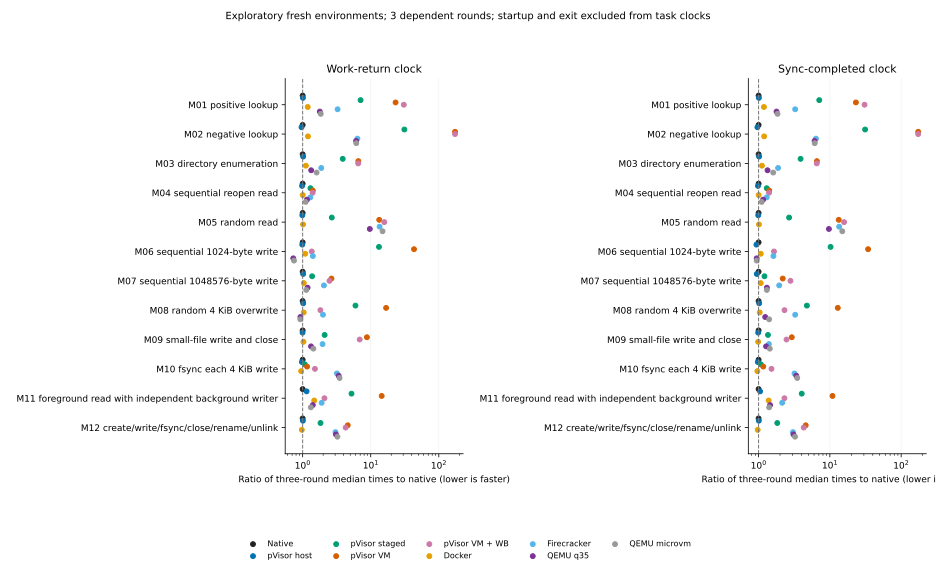
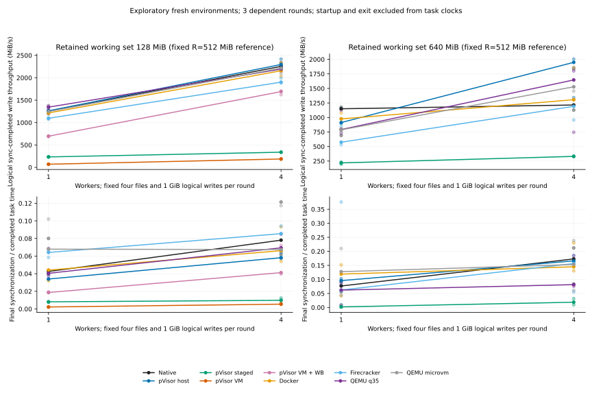

# How long do file-heavy tasks take?

## Motivation {#motivation}

An agent inspects repositories, searches, builds incrementally and publishes artifacts, so file reads and writes dominate these tasks. Choosing between host, staged, container and VM is a trade-off between isolation needs and waiting, and the decision needs complete task time rather than startup alone.

On the measured tasks, pVisor host approaches direct execution, and guest writeback shortens batch artifact writes when VM isolation is required. Writeback helps only when writes can merge before synchronization: extraction and publication shorten clearly, while read- and metadata-heavy inspection shows no benefit, and synchronizing after every 4 KiB write makes writeback slower than the default VM. At a 640 MiB working set, both VM configurations timed out in this cohort.

## Experiment design {#interpretation}

Measure the time to finish a complete task — repository inspection, incremental build or artifact publication — as complete-task time. That time is what a file-heavy task costs in the chosen mode; shorter time means more tasks finish in the same budget.

Nine configurations on one machine — native, pVisor host, staged, default VM, VM with guest writeback, Docker, Firecracker, QEMU q35 and QEMU microvm — use the same inputs, programs and tools. Images and VM disks are prepared beforehand.

| Workloads | Coverage | Question answered |
| --- | --- | --- |
| 3 complete tasks | Repository inspection/search; edit, incrementally compile and run; offline extraction, artifact generation and synchronized publication | Do caching and writeback benefits reach real workflows? |
| 12 basic operations | File queries, directory traversal, repeated reads, writes of different sizes, small files, per-write synchronization, mixed reads/writes, creation and deletion | Which access patterns benefit, and which retain extra waiting? |
| 4 resource combinations | 128 or 640 MiB working sets, 1 or 4 concurrent writers; fixed 1 GiB written per round | Do tasks finish as working sets or concurrency grow, and how does throughput change? |

Each workload/configuration uses three fresh environments in randomized order, three rounds each, on Linux x86_64 / Ryzen 7 9700X / Btrfs. The process tree shares two CPUs and 2 GiB with swap disabled; VMs use 2 vCPU / 512 MiB. Host caches stay warm, and the median is taken across three environments, not nine independent samples.

Task completion includes the work and final synchronization; Ready stops at test-program readiness and excludes tasks, exit and cleanup. Every environment has a 90-second limit; outputs, final contents and isolation are checked, and after a first failure the remaining planned observations are marked unexecuted. Initial image acquisition, cold disks, tail latency and larger concurrency need separate measurements.

## Data and analysis {#results}

Whether writeback helps depends on whether writes can be merged and how often the task must synchronize.

### Startup and complete tasks {#complete-task}

Nine configurations from the same cohort; each cell reports the **N=3 median**. Ready is in **ms**, from three fresh environments for a fixed workload. Tasks are in **s**: sum three consecutive completed-round times inside each environment, then take the median across three environments, excluding startup and exit. Ranges and per-round observations are in the expandable details.

| Mode | Ready (ms) | Repository inspection (s) | Incremental build (s) | Extraction/publication (s) |
| --- | ---: | ---: | ---: | ---: |
| Native | 2.63 | 0.055 | 0.051 | 1.733 |
| pVisor host | 18.31 | 0.054 | 0.051 | 2.038 |
| pVisor staged | 23.07 | 0.525 | 0.090 | 4.703 |
| pVisor VM | 111.88 | 2.155 | 0.543 | 11.271 |
| pVisor VM + writeback | 115.65 | 2.128 | 0.346 | 5.928 |
| Docker | 70.15 | 0.057 | 0.054 | 2.053 |
| Firecracker (stock kernel) | 355.85 | 0.151 | 0.081 | 4.305 |
| QEMU q35 | 690.86 | 0.105 | 0.061 | 4.065 |
| QEMU microvm | 319.05 | 0.143 | 0.062 | 3.851 |

Writeback improves tasks that write artifacts in batches; read and metadata costs remain in repository inspection. pVisor host inspection and compilation are close to direct execution. Staging and VM paths add startup, read and synchronization costs that need separate budgets for each task.

Complete-task ranges and changes across three rounds

Units: **s**. Each cell is the N=3 median [minimum–maximum] of the sum of three completed-round times within each environment; workflows are reported separately. Completion includes work and final synchronization/publication, excluding Ready and exit.

| Runtime | Repository inspection/search | Edit, compile, execute | Extraction and artifact publication |
| --- | --- | --- | --- |
| Native | 0.055 [0.053–0.056] | 0.051 [0.049–0.053] | 1.733 [1.724–1.808] |
| pVisor host | 0.054 [0.053–0.054] | 0.051 [0.050–0.166] | 2.038 [1.963–3.531] |
| pVisor staged | 0.525 [0.524–0.527] | 0.090 [0.088–0.223] | 4.703 [4.623–4.830] |
| pVisor VM | 2.155 [2.040–2.253] | 0.543 [0.504–0.543] | 11.271 [10.954–11.488] |
| pVisor VM + writeback | 2.128 [2.059–2.238] | 0.346 [0.337–0.350] | 5.928 [5.901–6.624] |
| Docker | 0.057 [0.053–0.062] | 0.054 [0.053–0.058] | 2.053 [2.030–2.146] |
| Firecracker (stock kernel) | 0.151 [0.141–0.157] | 0.081 [0.063–0.082] | 4.305 [4.299–4.336] |
| QEMU q35 | 0.105 [0.101–0.105] | 0.061 [0.059–0.062] | 4.065 [2.169–5.487] |
| QEMU microvm | 0.143 [0.128–0.147] | 0.062 [0.061–0.074] | 3.851 [2.703–4.827] |

Points represent three independent environments; lines connect the medians for corresponding rounds. Every compilation round contains a real edit; every publication round produces a new directory, so later rounds do not become empty operations. Publication and compilation contain mergeable small writes, while repository inspection mainly reads and queries metadata; writeback does not cover every cost. Repetition also does not automatically qualify an ordinary mutable workspace for sealed-input caches. Assess each task independently rather than extending publication gains to all tools.

### Small-write merging and synchronization boundaries {#cache-status}

Units: **ms**, **N=3 medians** of summed completed times across three rounds in each environment. The small-write task writes 4 MiB per round in 1 KiB calls. The per-write synchronization task writes 1 MiB per round, synchronizing immediately after every 4 KiB write.

| Configuration | Dense small-write completion (ms) | Per-write synchronization completion (ms) |
| --- | ---: | ---: |
| Native | 25.61 | 298.14 |
| pVisor host | 24.77 | 608.67 |
| pVisor staged | 193.37 | 356.77 |
| pVisor VM | 649.99 | 404.73 |
| pVisor VM + writeback | 36.49 | 543.49 |
| Docker | 31.66 | 355.65 |
| Firecracker (stock kernel) | 45.98 | 1015.66 |
| QEMU q35 | 24.17 | 1043.30 |
| QEMU microvm | 24.62 | 1160.67 |

With buffered merging allowed, dense small writes with writeback (36.49 ms) sit close to Native (25.61 ms) and Docker (31.66 ms), while the default VM is clearly slower. Synchronizing after every write limits merging, so writeback becomes slower there; the default VM is shorter than the same-cohort Firecracker and QEMU references on this workload. Include final synchronization when evaluating sustained writes; write-call return alone is insufficient.

Request size, synchronization boundaries and all mechanism results

Units: **ms**, N=3 medians of summed completed times across three rounds. Sequential writes transfer 4 MiB per round. Per-write synchronization writes 1 MiB per round, calling fsync every 4 KiB. The namespace task handles 128 files per round, retaining content readback and directory synchronization after deletion.

| Runtime | 4 MiB / 1 KiB writes | 4 MiB / 1 MiB writes | fsync every 4 KiB | Create, sync, rename, unlink |
| --- | --- | --- | --- | --- |
| Native | 25.61 | 18.60 | 298.14 | 198.68 |
| pVisor host | 24.77 | 17.35 | 608.67 | 212.09 |
| pVisor staged | 193.37 | 20.63 | 356.77 | 335.82 |
| pVisor VM | 649.99 | 29.89 | 404.73 | 682.79 |
| pVisor VM + writeback | 36.49 | 36.82 | 543.49 | 696.58 |
| Docker | 31.66 | 21.72 | 355.65 | 165.90 |
| Firecracker (stock kernel) | 45.98 | 29.67 | 1015.66 | 564.97 |
| QEMU q35 | 24.17 | 21.24 | 1043.30 | 547.26 |
| QEMU microvm | 24.62 | 22.26 | 1160.67 | 585.23 |

A 1 MiB request size requires only four application writes per round, with different merging opportunities from 1 KiB requests, which require 4,096 writes. Per-write fsync further limits deferral. These two measured request sizes are anchors; connecting lines do not establish results for intermediate sizes. The left plot shows work-phase throughput; the right includes final synchronization. For workloads such as per-write fsync, work itself also includes synchronization. Reporting only write return would omit drain costs.

The horizontal axis shows same-cohort median ratios, with Native = 1; smaller means shorter. Mechanisms remain independent, without a total score. Descriptive N=3 levels establish neither confirmed speedups nor stable tails. The mixed task records foreground reads and overall completion separately, preventing background-throughput gains from hiding slower responses. The following table shows first-round N=3 medians; background writes and foreground reads use different files.

| Runtime | First-round foreground read ms | First-round mixed-task completion ms |
| --- | --- | --- |
| Native | 3.83 | 13.23 |
| pVisor host | 4.01 | 15.69 |
| pVisor staged | 5.86 | 30.47 |
| pVisor VM | 13.21 | 70.84 |
| pVisor VM + writeback | 11.41 | 24.33 |
| Docker | 4.55 | 17.61 |
| Firecracker (stock kernel) | 11.51 | 22.32 |
| QEMU q35 | 8.51 | 24.17 |
| QEMU microvm | 8.31 | 13.14 |

### Working-set and concurrency boundaries {#resource-boundary}

Each round writes **1 GiB**, varying only the **128/640 MiB** working set and **1/4** concurrent writers. At 128 MiB, all nine configurations finish; the N=3 medians of summed three-round completion times follow (unit **s**, four files and 1 GiB total written per round):

| Configuration | 128 MiB, 1 writer (s) | 128 MiB, 4 writers (s) |
| --- | ---: | ---: |
| Native | 2.676 | 1.571 |
| pVisor host | 2.722 | 1.494 |
| pVisor staged | 13.182 | 9.247 |
| pVisor VM | 41.545 | 15.751 |
| pVisor VM + writeback | 4.195 | 2.073 |
| Docker | 2.822 | 1.550 |
| Firecracker (stock kernel) | 3.006 | 1.825 |
| QEMU q35 | 2.566 | 1.685 |
| QEMU microvm | 2.605 | 2.414 |

At 128 MiB, the writeback VM sits in the same range as the container and reference-VM configurations, while the default VM's continuous synchronized writes cost clearly more. Four writers share the fixed 1 GiB per round, so summed completion is correspondingly shorter. At a 640 MiB working set, both default and writeback-enabled pVisor VMs have two cells that do not finish within 90 seconds; all four cells lack complete N=3 results. Timeouts are neither zero throughput nor ordinary durations.

Working-set/concurrency curves and failure details

Each round fixes logical writes at 1 GiB, four files and 4 KiB requests, varying only the 128/640 MiB working set and 1/4 workers. Throughput uses completed time; points represent independent environments. Missing points identify cells without complete N=3 results, not zero throughput. Working-set changes also affect retained data and final synchronization costs; four points cannot locate a capacity knee.

| Workload | Configuration | Attempted failures / subsequently not executed | Result |
| --- | --- | --- | --- |
| 640 MiB working set, 1 worker | pVisor VM | 1 / 2 | 90-second timeout; no time median |
| 640 MiB working set, 1 worker | pVisor VM + writeback | 1 / 2 | 90-second timeout; no time median |
| 640 MiB working set, 4 workers | pVisor VM | 1 / 2 | 90-second timeout; no time median |
| 640 MiB working set, 4 workers | pVisor VM + writeback | 1 / 2 | 90-second timeout; no time median |

Timeouts establish only that these configurations did not complete within the protocol limit. They cannot be converted into normal durations or precise throughput, and the symptom alone does not identify a root cause. Resolve these completion issues before expanding the scan to assess sustained bulk writes.

### Startup waiting ranges {#quick-results}

Median Ready times for the common static payload are: pVisor VM 111.88 ms, Firecracker 355.85 ms, QEMU q35 690.86 ms and QEMU microvm 319.05 ms. Assess startup waiting time separately from subsequent task time.

Ready and ranges for nine configurations

Units: **ms**, common static-payload Ready before the fixed metadata workload, with three fresh environments per configuration. Startup observations from all workloads are not pooled into more independent samples. Medians and ranges exclude namespace preparation, task execution, exit and cleanup. This differs from the old Python Ready and from full-distribution boot.

| Runtime | Ready ms | Min–max ms |
| --- | --- | --- |
| Native | 2.63 | 0.81–2.64 |
| pVisor host | 18.31 | 16.57–19.51 |
| pVisor staged | 23.07 | 22.34–28.14 |
| pVisor VM | 111.88 | 111.37–112.75 |
| pVisor VM + writeback | 115.65 | 115.32–138.86 |
| Docker | 70.15 | 68.53–75.74 |
| Firecracker (stock kernel) | 355.85 | 354.80–388.50 |
| QEMU q35 | 690.86 | 685.43–707.84 |
| QEMU microvm | 319.05 | 299.70–327.80 |

### Reproduction configurations and data coverage {#configuration-details}

Storage paths, timing details and valid sample counts

<!-- measurement-status:start -->

The plan covers 19 workloads × 9 configurations × 3 fresh environments: 513 total. Of 505 attempted environments, 501 passed and 4 failed; another 8 were not executed under the predefined rule. Complete results cover 167 / 171 workload/configuration cells, each with N=3. Each passing environment runs three rounds, yielding 1503 valid round records; these rounds are dependent, not independent samples.

<!-- measurement-status:end -->

Compare Native, pVisor host, staged, default CLI VM, CLI VM with guest writeback explicitly enabled, Docker, Firecracker, QEMU q35 and QEMU microvm. All nine configurations alternate in randomized order within one cohort, using identical static-workload bytes, offline inputs and Python/git/C tools; earlier five-mode observations are not merged. Inputs are read-only, and outputs use each mode's workspace. Ordinary CLI ownership is Mutable, with no claim of Immutable-lower cache eligibility. Both pVisor VMs disable host writeback; the product path disables DAX. Guest writeback is explicitly set to 0/1.

| Configuration | Workspace storage path |
| --- | --- |
| Native / pVisor host | Host Btrfs directory |
| pVisor staged | FUSE staging filesystem |
| pVisor CLI VM, both writeback configurations | virtio-fs, OverlayFS and staged output |
| Docker | Prepared private rootless overlay2; output in the container writable layer, input through a read-only bind |
| Firecracker / QEMU q35 / QEMU microvm | Private ext4 root/work images and virtio-blk; the same official stock kernel, module initrd and minimal PID1 |

Reference VMs start only the minimal userspace needed by the common workload, without distribution services. Firecracker explicitly uses Writeback and QEMU uses cache=writeback, retaining FLUSH. After normal unmount and VMM exit, outputs are exported read-only for the common host oracle. Docker outputs are copied after exit. Disk preparation, container creation and output export are excluded from Ready and task clocks. Ready runs from the common pre-executor launch marker to payload Ready, including reference-VM kernel startup. Differences in kernels, storage stacks and cache boundaries are part of the measured configurations; these results do not isolate VMM overhead.

| Layer | Fixed workloads | Purpose |
| --- | --- | --- |
| 12 mechanisms | Positive/negative lookup, directory enumeration, sequential reopen reads, fixed permuted reads, 1 KiB/1 MiB sequential writes, 4 KiB permuted overwrites, 256 small files, per-write fsync, foreground reads/background writes, create–sync–rename–unlink | Separate request size, reuse, synchronization and metadata costs |
| 4 resource cases | 1 or 4 workers, 128 or 640 MiB working sets; four files, 4 KiB writes and 1 GiB logical writes per round | Compare concurrency and working sets without assuming steady state or a capacity knee |
| 3 complete tasks | Repository inspection/search; edit–incremental compile–execution check; offline extraction–small-file/32 MiB artifact generation–synchronized publication | Report workflows independently, without a universal summed score |

Linux x86_64 / Ryzen 7 9700X / Btrfs, without clearing the host page cache. The repository and offline package each contain 1,024 files of 4 KiB; publication additionally generates 128 small files of 4 KiB and a 32 MiB stream-written artifact. The whole serial campaign and private Docker daemon/container share a parent with a two-CPU quota, 2 GiB memory and zero swap. All VMs are configured with 2 vCPU/512 MiB; actual guest MemTotal is recorded separately in the provenance summary. The host does not delegate cpuset to the user cgroup. The daemon and observer inherit CPU 0, 1 affinity; the Docker payload sets and records its actual affinity separately. No hard cpuset constraint is claimed for early runc execution.

Native/host/containers use parent-group memory; VMs also have a guest-memory boundary, so available cache capacity is not equivalent. Resource cases use a fixed 512 MiB reference; 128/640 MiB does not represent Native's or containers' actual memory ratio. Larger working sets also increase retained data and final synchronization volume.

Each workload/configuration plans three independent fresh environments in randomized mode order, each with three consecutive rounds retaining state and validation-warmed pages. Nine round records per cell represent only three independent environments; different workloads do not warm each other. Ready runs from the common pre-executor launch marker to payload Ready, excluding namespace preparation, tasks and exit. Task completion includes work and final synchronization, retaining periodic fsync, file/directory sync and checked close. Preparation, additional full validation and exit are recorded separately; workflow content acceptance and program-execution checks remain inside work time. Every incremental-build round edits one compilation unit; the initial full 100-unit build is untimed preparation.

Each executor-process run has a 90-second deadline. Normal exit, round results, namespaces and staging isolation must pass. Deterministic data are checked byte-for-byte; compiled artifacts are executed during the task, then fully read back after exit and checked for ELF format and the expected file inventory. After the first failure in a workload/configuration, its remaining planned observations are explicitly skipped without replacement or zero-time samples; cells with fewer than three valid environments receive no median. Retain valid slow samples and failures, with no quiet, external-interference or full-inventory gates. N=3 is exploratory: it supports neither stable tails nor cold-disk claims or general rankings across machines.

### Historical data {#reference-fs}

Separately retained historical measurement scopes

The former seven-tool N=5 Ready/resident statistics and provenance, the historical N=30 statistics, and the earlier five-mode layered comparison each retain their original scope. They do not populate the new 19-workload tables or support cross-cohort improvement estimates.

### Sources and reproduction {#run}

[Workflow plot SVG](../../../overrides/assets/benchmarks/filesystem-layered-references/workflow-rounds.svg) · [Request-size plot SVG](../../../overrides/assets/benchmarks/filesystem-layered-references/write-request-size.svg) · [Resource plot SVG](../../../overrides/assets/benchmarks/filesystem-layered-references/resource-workers.svg) · [Mechanism plot SVG](../../../overrides/assets/benchmarks/filesystem-layered-references/mechanism-relative-time.svg)

[All layered statistics](../../../overrides/assets/benchmarks/data/filesystem/layered-references/filesystem-layered-references-levels.csv) · [Ready](../../../overrides/assets/benchmarks/data/filesystem/layered-references/filesystem-layered-references-ready.csv) · [Failures and missing observations](../../../overrides/assets/benchmarks/data/filesystem/layered-references/filesystem-layered-references-failures.csv) · [Provenance summary](../../../overrides/assets/benchmarks/filesystem-layered-references/provenance.json)

In the complete local statistics, write_ops/read_ops count explicit logical workload operations, not guest→host requests or all I/O inside child tools.

2026-10-17, an independent user-configuration cohort. Complete CSV/JSON, raw records, frozen entry points and tool/firmware receipts remain locally in `benchmark.new/filesystem/.data/user-layered-references-v2-20261017/`. [Reproduction steps](https://github.com/DeepLink-org/pvisor/blob/main/benchmark.new/filesystem/README.md#user-workloads). The separate [cache and asynchronous-write engineering analysis](../lab-notes/filesystem-io-performance-analysis.md) explains implementation switches and request counts; it does not fill gaps in the user comparison.
