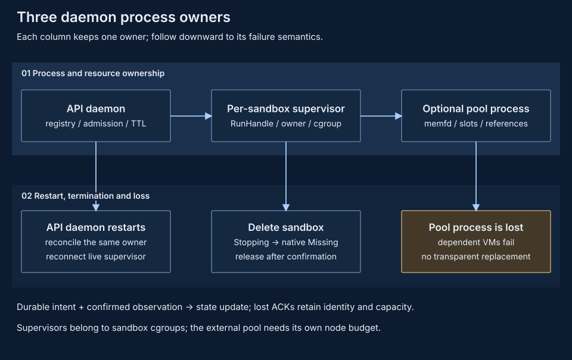

# Single-node daemon architecture

Manage local sandboxes through `pvisor-daemon`: one process accepts resource-bounded creation requests, persists ownership and intentions, controls the native runtime, expires sandboxes and routes access to their prepared services. External orchestration chooses hosts and coordinates business work; it is not a pVisor product control plane.

## Responsibilities {#architecture}



| Owner | Responsibility | Outside its scope |
| --- | --- | --- |
| Caller | Workload, prepared image, input versions, retries and business effects | Assuming a timeout proves no execution occurred |
| Daemon | Local admission, ownership, intentions, runtime reconciliation, TTL, authenticated endpoints | Cross-host scheduling or training transactions |
| Native supervisor | Embedded pVisor/VM, RunHandle, acknowledged vCPU controls, cgroup identity, vsock bridges | Stage/apply/checkpoint API or automatic node sharing |
| Prepared image | Supervise argv, initialize and authenticate execd/egress | Replacing lifecycle API authorization |
| Native pVisor | VM execution embedded by supervisors; public Job workflow remains separate | Automatic exposure of stage/checkpoint APIs |
| Native node runtime | Separate immutable backing protocols | Automatic daemon acquisition/sharing |
| Daemon pool component | Optional detached pool enabled by `serve --memory-pool` | Pool-process/host-reboot recovery; node acquire/release |
| Independent `pvisor-cache` | OCI prepare/publish/serve/list/stat/read | Daemon lifecycle ownership |

The Runtime trait has one implementation: VM-only NativeRuntime. Detached supervisors embed `pvisor::PVisor` with only VmExecutor and retain RunHandles across daemon restart. No host/OCI/pull fallback exists. The executable's `serve` command constructs NativeRuntime using required `--images-dir`/`--cgroup-root`; synchronous internal VM dispatch runs before Tokio, and the hidden supervisor command is dispatched. See [operations](operations.md#deployment).

Responsibility convergence means assigning every node-local resource a clear owner, not merging every service into the daemon process: sandbox lifecycle, native immutable backing and unlosable live RAM have different authorities and failure boundaries. Shipping in one package, a unified entry point or fewer ports cannot substitute for the missing runtime adapters, and establishes neither faster startup, lower memory nor higher density. Define acquisition, cancellation, termination and pin-release contracts before wiring a new path, and evaluate through fixed-budget measurement; convergence does not establish live-VM takeover, shared cold-pool arbitration, automatic node acquisition or density advantages.

## Admission and capacity accounting {#admission}

Before creating native VMs, bound the total resources of accepted sandboxes on the node. The daemon admits by the sum of hard limits; it does not queue, choose hosts, or infer available capacity from low RSS samples.

Creation must provide a local prepared-image key in `image.uri`, a non-empty argv, and a `resourceLimits` containing only `cpu` and `memory`. CPU accepts integer/decimal cores or millicores; memory accepts bytes and supported decimal/binary suffixes. Amounts must be positive, exactly representable and overflow-checked. An optional platform must match the local Linux architecture. Unsupported snapshot/template, resource requests, network policy, credential proxy, secure access, volumes, image auth, lifecycle hooks and non-empty extensions fail before native creation. Environment and metadata maps are bounded and validated.

```json
{
  "image": {"uri": "prepared-agent-1.1.0"},
  "entrypoint": ["sleep", "600"],
  "resourceLimits": {"cpu": "500m", "memory": "256Mi"},
  "timeout": 600,
  "metadata": {"purpose": "local-example"}
}
```

This is a request-shape example, not a validated image recipe; no image is pulled during creation.

| Boundary | Admission rule |
| --- | --- |
| Sandbox count | Registry records must not exceed `max_sandboxes` |
| CPU | The sum of `cpu_millis` over all records plus the new request must fit the configured capacity |
| Memory | The sum of `memory_bytes` over all records plus the new request must fit the configured capacity |

Serialized durable insertion is the reservation barrier: concurrent creations cannot double-spend capacity. Rejection returns `429 CAPACITY_EXCEEDED`; no pending allocation is produced. There are no tenant quotas or authenticated per-tenant resource accounts. Paused, Terminated, Failed and uncertain records keep their full CPU/memory/count charges until explicit deletion or verified failed-create cleanup. Pause does **not** release logical CPU.

Logical admission totals, installed limits on each supervisor/VM tree and node-wide physical occupancy are different quantities. The daemon, helpers, caches and host need headroom beyond sandbox limits. There is no implicit CPU/RAM oversubscription, pressure-based admission or measured node-wide physical budget. Native [shared working sets](shared-working-set.md) do not authorize lowering daemon reservations.

## Actual controls and physical memory {#reservations}

For platform prerequisites (Linux x86_64, `/dev/kvm`, a delegated cgroup v2 hierarchy) and their checks, see the [operations guide](../../guides/daemon/index.md#prerequisites).

The native supervisor embeds `pvisor::PVisor` in a separate child process outside the daemon's lifecycle, configures only `VmExecutor`, and holds the RunHandle. The sandbox cgroup limits the whole supervisor/VMM/helper tree: total CPU rate **10–8000 millicores**, hard memory, zero swap, `pids.max=512` and group OOM. vCPU count rounds the quota up (at most 8); guest RAM rounds down to MiB; the hard memory limit also covers host-side overhead. Full limit/readiness checks remain at create, Inspect and resume; endpoint resolution authenticates the live Running state and checks deletion fences, without repeating full health/cgroup checks per data request.

The startup callback checks started/delete/tombstone markers under the owner lock and joins the identity-bound cgroup **before exec** through a pre-opened `cgroup.procs` FD. The supervisor verifies membership at startup and does not migrate already-running Tokio processes; supervisor/Tokio allocations and later VM/helper children all count toward the sandbox budget. Invoking the hidden command outside that cgroup fails closed.

## Lifecycle controls {#control}

Confirm node-local native state before reporting control completion or releasing resources. The daemon serializes operations per sandbox; operations on different sandboxes proceed independently.

| Operation | Durable/native order | Response |
| --- | --- | --- |
| Create | Persist `Pending` and reservation → create/start → verify configuration and service readiness → persist `Running` | 202 JSON |
| Pause | Query → persist `Pausing` → acknowledged vCPU pause → confirm Paused → persist `Paused` | 202 empty body |
| Resume | Query → persist `Resuming` → acknowledged vCPU resume and readiness → confirm Running → persist `Running` | 202 empty body |
| Delete | Persist `Stopping` → confirm native absence and hold the owner lock exclusively → publish tombstone → reclaim cgroup/private run storage → confirm Missing → durably remove the registry record | 204 |

Pause/resume return the live state in an authenticated native acknowledgement; the daemon consumes it without a second post-control Inspect. When the target state is already observed, success may be returned without repeating native control; a native error is never a control success. Accepted lifecycle operations run in self-owned async tasks; HTTP disconnects do not cancel them. Losing a create response is not an idempotent-retry contract; blind resubmission may create another sandbox.

Private IPC verifies same-UID peer, owner, sandbox ID, generation and a secret token; persistent identity binds the boot ID and cgroup device/inode. IDs are never reused or restarted. IPC loss means unknown, not Missing or cleanup evidence. Persistent delete intent and the supervisor's exclusive lock block late starts; cleanup uses identity-bound `cgroup.kill`, never stores PIDs or kills by PID, and releases capacity only after the cgroup is empty and the owner lock is released. A replaced or lost cgroup without persistent tombstone evidence under the same boot does not prove the object is absent.

Cleanup uses ownership binding and does not depend on image/startup validation; a removed rootfs/firmware does not block it. The persistent tombstone supports retrying interrupted reclamation and ends with a minimal ID barrier. Cleanup errors retain the reservation. See [storage](storage.md#gc).

## Expiration {#expiration}

An omitted/null timeout means manual cleanup. A TTL is at least 60 seconds and bounded by the configured maximum (default one day, maximum one year). Renewal supplies a future RFC3339 time within the cap; an existing deadline must be extended, and expired or non-renewable states are rejected.

Maintenance scans once per second with at most eight concurrent cleanup tasks. Cleanup rechecks expiration under the same lock as renewal, so a stale scan cannot delete a renewed sandbox. Pending delete intent is retained and retried after cleanup failures.

TTL is best-effort cleanup, not a hard execution deadline. Slow native commands, upload/header waits and same-sandbox controls delay deletion. New proxy requests are rejected after expiration; established response streams have no total timeout. Maintenance stops while the daemon is down; stronger deadlines need independent host supervision.

## Service access and concurrency {#endpoints}

Only execd 44772 and egress 18080 are published. Endpoint discovery and every data request's endpoint resolution authenticate the live supervisor, require the current RunHandle to be Running, check deletion fences and resolve the current publication, without trusting persisted observation caches. Discovery returns a daemon-routed authority and does not expose supervisor loopback addresses. Resolution does not repeat service health probes or full cgroup reconciliation per data request. Create, Inspect and resume retain full configuration/readiness checks; upstream connection failures are handled by the API adapter and are not readiness evidence. Proxy connection establishment shares the lifecycle lock with control/deletion, so daemon-managed deletion or port reuse cannot race a connection.

The proxy streams real upstream command/file/health/metrics traffic, including multipart and SSE. Upload plus response-header wait is capped at 120 seconds; established responses have no total timeout. WebSocket, CONNECT and arbitrary application ports are unsupported. Traffic/output quotas belong to the upstream services.

## Concurrency and failure boundaries {#documents}

The [registry commit lock](storage.md#commit) serializes capacity checks and durable mutations. A per-sandbox lifecycle lock orders controls and proxy connection establishment; slow VM operations do not hold a global runtime mutex. This keeps unrelated sandboxes moving while preventing two creations from spending the same reservation or a connection from racing daemon-managed deletion.

Durable intentions and live observations have different authority. Persist `Stopping` before native deletion, and release capacity only after absence is confirmed. Lost IPC or an acknowledgement leaves work to reconcile; it cannot authorize a replacement VM or reusable capacity. A [daemon-only restart](storage.md#reconcile) reconnects surviving supervisors using the same ownership state. Host reboot loses live VMs.

Conservative reservations trade utilization for explicit cleanup accounting: paused, failed and uncertain records remain charged until verified removal. Low RSS and native cache sharing do not reduce those reservations; admission and physical working-set accounting remain separate.

## Independent execution semantics {#integration}

Native pause/resume controls the same Attempt's live vCPUs through the RunHandle; it is not cgroup freeze, memory offload, checkpoint/restore or VM reconstruction. Admission accounting is retained. Execd forwarding is not Gateway routing, capture or inference-idle CPU release.

Ordinary Jobs keep their independent [checkpoint/fork semantics](../execution-model.md). The daemon cannot stage/apply files, restore native VM state, acquire node backing or coordinate model responses. Wiring those paths requires explicit adapters with lifecycle/evidence contracts, not renaming the retired distributed control.

## Compatibility and evidence {#invariants}

The partial API profile is pinned to **OpenSandbox 1.1.0**, `release-1.1.0`, commit `b1a29cf93a823a95913f7943010febb3f29de05c`. It is not full API or unmodified SDK end-to-end conformance. The prepared execd/egress image contract has no validated end-to-end recipe yet; see [operations](operations.md#image-contract).

Native VM execution is wired in the runtime. Stage/apply, checkpoint/fork and offload APIs, Gateway inference-wait coordination and automatic node-resource acquisition are not implemented. Historical Cluster results do not validate daemon SDK conformance, performance or density; no node-wide physical-memory gain is established.

Implementation ownership: `crates/pvisor-daemon/src/daemon/{models,store,mod,api}.rs`, `crates/pvisor-daemon/src/runtime.rs` and `crates/pvisor-daemon/src/main.rs`. Validation and resource arithmetic live in `daemon/models.rs`; serialized reservation insertion and lifecycle orchestration in `daemon/mod.rs`; native KVM/cgroup preflight and controls in `runtime.rs`; streaming forwarding in `daemon/api.rs`. The retired Cluster implementation is not this architecture.
