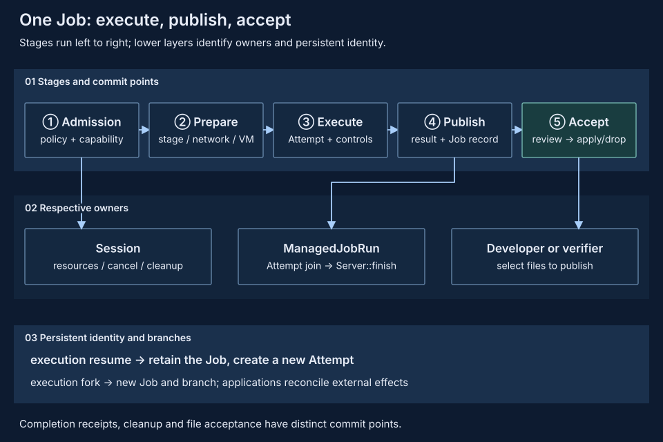

# Job, Operation, Attempt and Event

A Job ties together persistent work, an Operation describes a request, an Attempt identifies an execution, and Events record facts observed during processing. They connect work identity, execution requests, runtime activity and observations. Candidate files and recoverable state can outlive execution.

| Concept | Responsibility |
| --- | --- |
| **Job** | Provides a persistent identity linking execution, state and candidate results. |
| **Operation** | Describes the requested operation and its policy and placement decisions. |
| **Attempt** | Identifies one execution and its resources and outcome. |
| **Event** | Records facts about request handling, policy decisions and execution results. |

## Job: work identity and persistent records {#job-identity}

<a id="run-the-internal-job-record"></a>

Job identity survives tool-process exit: callers may still inspect results, review candidate files or continue their work. Each current Job has one internal Run record, whose ID is independent of the OS PID. Disk `run-*` IDs, `run.json` and Run Bundle retain their existing names. See [Job usage and storage](../reference/jobs.md) for creation, addressing and review commands.

Daemon `sb-*` sandbox IDs differ from native Job IDs. Reusing native execution does not automatically expose the full Job workflow. See [single-node Daemon](daemon/index.md) for interface boundaries.

??? info "Daemon identity and interface scope"

    The [single-node daemon](daemon/index.md) manages OpenSandbox-profile `sb-*` sandboxes through VM-only NativeRuntime. Private supervisor records bind each generation to native Run/Attempt IDs; sandbox IDs are not public Job IDs. The API does not implement stage/apply, checkpoints or Run Bundle export. Native execution is embedded, but the Job workflow below is not automatically exposed; external orchestration owns cross-host identities.

## Operation: requests and admission {#operation-admission}

<a id="operation-the-object-being-processed"></a>

Job describes the user's work; Operation describes what pVisor processes. The current production operation is `run.execute`, containing the program, arguments and working directory along with effective policy decisions and Placement. pvisor owns admission, actual rewrites, scheduling and execution; core defines the records.

Forming a request or passing admission does not establish that execution has occurred or controls have been installed. File and network accesses are handled at driver boundaries; they are not individually promoted to public Operations.

??? info "Admission configuration and capability checks"

    Admission resolves the driver network configuration once, applies scoped policies and carries that final configuration into Attempt preparation. Gateway, explicit proxy and VM networking consume it rather than re-reading the original configuration. Guest workspace overlays require an explicit executor opt-in; executor names are descriptive records, not capability checks. The actual VM network attachment path determines non-bypassable network markers; the backend name is not used for this decision.

## Attempt: execution identity and lifecycle {#attempt-lifecycle}

<a id="attempt-one-execution"></a>

Attempt identifies one execution by an executor. Each current `PVisor::run` creates one Attempt. Session in pvisor owns preparation, cancellation, cleanup and terminal publication; Session is the lifecycle owner.

Cancellation requests, tool-process exit and completion publication are separate stages. Session still needs to finish cleanup and result storage, followed by durable Job state publication, before callers have a completion result they can reconcile.

## Event: facts observed during execution {#execution-events}

Events are externally observable facts; Trace records them. They describe requests, actual rewrites, placement and results. They are not the operation itself and do not guarantee replay of external effects from logs alone. See [Operation and Event](operations-events.md) for fields and causality.

Events provide observation rather than replacing completion evidence. A valid Attempt completion receipt can exist even when the terminal Event is missing.

## Confirming Attempt completion {#attempt-completion}

Process exit, Bundle storage and terminal-event publication can occur at different times. An Attempt with retained storage uses `completion.json` to bind its result to the saved Bundle, avoiding completion decisions based on an isolated status field or file after a failure.

Session advances normal finalization serially:

1. Stop managed writers, clean up attachments and check observations; synchronize and seal staged files under the stage contract.
2. Save the Bundle, fixing the result, observations and warnings known during finalization.
3. Save the Run state projection and commit the completion receipt binding that result and Bundle.
4. Publish `Completed` and the `run.completed`, `run.failed`, `run.cancelled` or `run.hibernated` terminal event. The durable Job service publishes Job state after joining the Attempt.

Once the receipt commits, terminal-event write failure is an audit gap reported through the run return and logs. It neither rewrites the bound Bundle nor publishes an opposite terminal state. Reconcile the execution result and event coverage separately: a valid completion receipt may exist without terminal events.

A valid receipt supplies the result used to reconcile state. A missing receipt retains candidate files and yields Unknown; mutating operations that require a stopped state refuse to proceed. Corruption, digest mismatch or foreign identity must produce an error rather than rewriting records to manufacture success.

The receipt binds the Attempt result and Bundle without spanning Journal, apply ledgers, snapshot publication and external services in one transaction. In-memory execution has no such disk receipt. [Records and version matrix](records-and-versions.md#execution-records) owns legacy reading rules; [Failure semantics](failure-semantics.md#reconciliation) owns lost-response recovery.

??? info "Completion validation and recovery details"

    An Attempt with retained storage confirms its result through `completion.json`. The receipt contains `RunResult` and a BLAKE3 digest of the saved Bundle bytes. Validation checks Run/Attempt identity, terminal state, exit code and start/finish times. Run and execution Job states project that result. A terminal field, Bundle file or process exit alone cannot confirm completion.

    The durable Job service also owns completion publication. `ManagedJobRun` gives the actual Attempt join and `Server::finish` to a runtime task; frontends hold a wait adapter. A failed or dropped frontend wait requests cancellation, while accepted completion work continues reconciling and publishing as long as the Tokio runtime remains alive. Runtime shutdown and host-process exit retain their own recovery boundaries.

    After owner exit, when the Attempt is no longer held, reads and recovery check its receipt. A valid receipt reconciles Run and an execution Job still targeting that Attempt. Old results cannot overwrite a Job that has advanced to another Attempt or withdrawn continuation rights. A missing receipt retains the stage and yields Unknown. `review` supplies no unconfirmed execution result; `apply`, `drop` and capture requiring a stopped Attempt refuse execution. Corrupt data, digest mismatch or foreign identity returns an error rather than rewriting records to manufacture success.

    Source entry points: `pvisor/src/session/lifecycle.rs`, `runtime/attempt.rs`, `runtime/completion.rs`, `runtime/registry.rs` and `runtime/job_service/views.rs`. Tests in `completion.rs` cover repeated commit, identity/digest checks, missing receipts and state projection. Platform and process-fault coverage require separate acceptance.

## Result acceptance and external effects {#result-acceptance}

<a id="effect-consequences-of-execution"></a>



For staged files, the current workflow is:

```text
run → stop → review → apply selected files → review remaining changes → apply or drop
```

Successful process exit and successful file application are separate results. Files from a failed command remain reviewable; later drop does not undo files already applied.

Network requests and external service changes are effects too. File staging neither delays them until approval nor rolls them back.

## Identity across restoration and branching {#checkpoint-lineage}

<a id="checkpoint-filesystem-snapshot"></a>

Checkpoints retain reusable state. Restoration and branching determine how that state relates to subsequent work:

| Operation | State and identity relationship |
| --- | --- |
| Workspace branch | Reuses file progress and conflict baselines from a logical checkpoint and retains lineage; it does not continue process execution. |
| VM execution restore | Restores a supported execution checkpoint, retaining the Job ID and creating a new Attempt. |
| VM execution branch | Creates a new Job and private writable layers from an execution checkpoint, retaining lineage. |

Checkpoint restoration differs from Pause/Resume of a live VM: it restores a saved execution point, while live resume continues the original VM. See [state preservation and branching](../concepts/resource-reuse.md) for checkpoint purposes and scope, and [environment snapshots](environment-snapshot.md) for capture and persistence mechanisms.

??? info "Checkpoint operations and support boundaries"

    Default `fork --state workspace` snapshots the upper layer of a stopped staged Run. The embedded API also supports cooperative AgentCtl quiescence. Checkpoints preserve staged files, the conflict baseline captured at first modification and lineage. They do not save process memory or external service state, or freeze all lower layers. The manifest is published only after snapshot contents are synced to disk. Embedded callers use `restore_logical_checkpoint(checkpoint, destination_upper, destination_preimages)` to restore files and conflict baselines together.

    Native VM `checkpoint --kind execution` seals a consistent CPU, RAM, device and filesystem execution point. Suspend requires the original VM termination receipt; resume retains the Job ID and creates a new Attempt, while execution fork creates a new Job and private writable layers. Apply/drop are unavailable while suspended; kill first withdraws continuation rights. See the [CLI reference](../reference/cli.md#full-vm-execution-checkpoints) for profile and compatibility limits.

    See [Review and apply](../guides/review-apply.md) for steps and [Capabilities and evidence](../concepts/capabilities-and-evidence.md) for guarantees.
