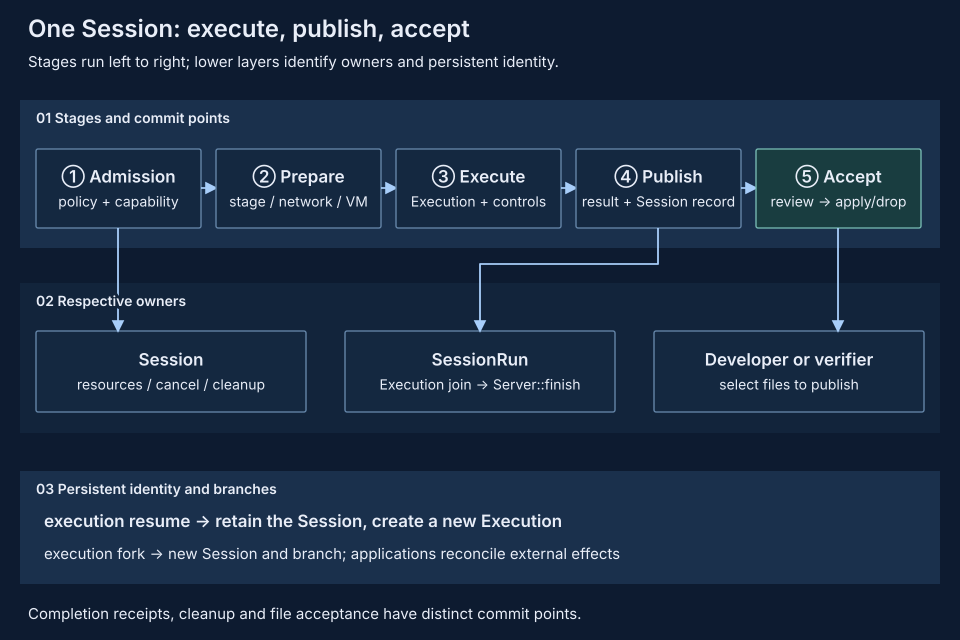

# Session, Operation, Execution and Event

A Session represents the user's persistent work, a Run stores its internal record, an Execution identifies one execution, and Events record facts during processing. Records and files awaiting acceptance have lifetimes that continue after execution ends.

See [Sessions and storage](../concepts/sessions.md) for creating and finding Sessions from the CLI. Each current Session has one internal Run record; disk `run-*` IDs, `run.json` and Run Bundle names remain unchanged for compatibility.

The [single-node daemon](daemon/index.md) manages OpenSandbox-profile `sb-*` sandboxes through VM-only NativeRuntime. Private supervisor records bind each generation to native Run/Execution IDs; sandbox IDs are not public Session IDs. The API does not implement stage/apply, checkpoints or Run Bundle export. Native execution is embedded, but the Session workflow below is not automatically exposed; external orchestration owns cross-host identities.



## Operation: the object being processed

Session describes the user's work; Operation describes what pVisor processes. The current production operation is `run.execute`, containing the program, arguments and working directory along with effective policy decisions and Placement. pvisor owns admission, actual rewrites, scheduling and execution; core defines the records.

Events are externally observable facts; Trace records them. They describe requests, actual rewrites, placement and results. They are not the operation itself and do not guarantee replay of external effects from logs alone. See [Operation and Event](operations-events.md) for fields and causality.

## Run: the internal Session record

Run identifies a command, configuration and result independently of the OS PID. After the process exits, local records let `status`, `apply` and `drop` refer to the same work. Use `status --review` to inspect the Run Bundle and staged changes.

## Execution records within a Session

Execution identifies one execution by an executor. Each current `PVisor::run` creates one Execution. The private execution flow uses `ExecutionContext` to own preparation, cancellation, cleanup and terminal publication. `Session` retains the durable state across executions.

Admission resolves the driver network configuration once, applies scoped policies and carries that final configuration into Execution preparation. Gateway, explicit proxy and VM networking consume it rather than re-reading the original configuration. Guest workspace overlays require an explicit executor opt-in; executor names are descriptive records, not capability checks. The actual VM network attachment path determines non-bypassable network markers; the backend name is not used for this decision.

Workspace fork creates a file branch from a logical checkpoint; execution fork restores a new Session from a supported machine checkpoint. Both retain lineage, with restoration scope determined by checkpoint kind.

The durable Session service also owns completion publication. `SessionRun` gives the actual Execution join and `Session::finish` to a runtime task; frontends hold a wait adapter. A failed or dropped frontend wait requests cancellation, while accepted completion work continues reconciling and publishing as long as the Tokio runtime remains alive. Runtime shutdown and host-process exit retain their own recovery boundaries.

## Execution timeline

Session lifecycle and live VM controls share one `Execution` owner, selected through `ExecutionContext::execution()` or `RunHandle::execution()`. Status, subscriptions, cancellation, SDK controls and Host command dispatch belong to this owner; RunHandle owns completion waiting. RunControlHandle, RunCancellation, ExecutionService and forwarding control aliases are removed. Executors report startup/readiness directly to Execution. Typed admission, dispatch, success, failure and completion facts pass through one state transition function; status and pending controls are projections of those facts. Native effects execute outside the state lock, ordered by the existing transition locks, model-wait arbitration and guest idle epochs. At most 32 controls remain pending, while cancellation can proceed during a native wait. Late startup notifications and control replies cannot undo pause, cancellation or terminal publication.

Retained Executions append facts to `execution-EXECUTION_ID.jsonl` through `pvisor-journal`; unstored Executions use a memory journal. Accepted appends and their state updates continue when a caller stops waiting. Confirmed runner rejections retain their healthy live state and allow subsequent controls; unknown native outcomes block further controls. History-write failures mark a gap while preserving confirmed outcomes and cleanup. Replay tests reconstruct projections without invoking a backend; unfinished controls are never automatically retried after owner loss. Completion and checkpoint receipts retain their authority.

`status --json` exposes the applied journal position and bounded progress alongside counts and small observation samples. It excludes full request history and launch plans; see [machine-readable output](../reference/json-output.md#envelopes) for schema 3.

`Execution::snapshot()` synchronously reads the latest coherent status/progress projection; `subscribe()` publishes the same `ExecutionSnapshot`. Journal writes publish that projection under the transition lock, so a local query never waits on its own runtime or opens a socket. The wait coordinator uses Execution's shared cancellation token and does not reinterpret every rejected control as an uncertain effect. Known manual rejections preserve healthy execution; unreleased automatic pauses and unknown outcomes still cancel.

`Session` owns the durable phase across Executions, with a private state field and typed capture, restore, completion and termination transitions. Storage modules acquire leases and persist the resulting record. Record reads and locked recovery share one completion projection. A stale receipt cannot overwrite a restored successor or restore withdrawn continuation rights. Status queries project the effective `state` once; CLI text and JSON render it without inferring running from liveness. `paused` describes a live VM; `hibernated` describes confirmed native termination.

One host instance socket serves each Execution. Same-process queries, workspace inspect and execution capture call the registered owner directly. Overlay and capture listeners and their stage discovery links are removed. The owner holds one bounded inspect table and closes it before writable workspace teardown. Accepted capture tasks survive frontend timeout while request receipts, Session locks and suspended-head termination checks remain in force. Guest AgentCtl remains a separate guest-facing protocol.

## Execution completion {#execution-completion}

An Execution with retained storage confirms its result through `completion.json`. The receipt contains `RunResult` and a BLAKE3 digest of the saved Bundle bytes. Validation checks Run/Execution identity, terminal state, exit code and start/finish times. Run and execution Session states project that result. A terminal field, Bundle file or process exit alone cannot confirm completion.

Session advances normal finalization serially:

1. Stop managed writers, clean up attachments and check observations; synchronize and seal staged files under the stage contract.
2. Save the Bundle, fixing the result, observations and warnings known during finalization.
3. Save the Run state projection and commit the completion receipt binding that result and Bundle.
4. Publish `Completed` and the `run.completed`, `run.failed`, `run.cancelled` or `run.hibernated` terminal event. The durable Session service publishes Session state after joining the Execution.

Once the receipt commits, terminal-event write failure is an audit gap reported through the run return and logs. It neither rewrites the bound Bundle nor publishes an opposite terminal state. Reconcile the execution result and event coverage separately: a valid completion receipt may exist without terminal events.

After owner exit, when the Execution is no longer held, reads and recovery check its receipt. A valid receipt reconciles Run and an execution Session still targeting that Execution. Old results cannot overwrite a Session that has advanced to another Execution or withdrawn continuation rights. A missing receipt retains the stage and yields Unknown. `review` supplies no unconfirmed execution result; `apply`, `drop` and capture requiring a stopped Execution refuse execution. Corrupt data, digest mismatch or foreign identity returns an error rather than rewriting records to manufacture success.

The receipt binds the Execution result and Bundle without spanning Journal, apply ledgers, snapshot publication and external services in one transaction. In-memory execution has no such disk receipt. [Records and version matrix](records-and-versions.md#execution-records) owns legacy reading rules; [Failure semantics](failure-semantics.md#reconciliation) owns lost-response recovery.

Source entry points: `pvisor/src/execution_context/lifecycle.rs`, `runtime/execution/mod.rs`, `runtime/completion.rs`, `runtime/registry.rs` and `runtime/session_service/views.rs`. Tests in `completion.rs` cover repeated commit, identity/digest checks, missing receipts and state projection. Platform and process-fault coverage require separate acceptance.

## Effect: consequences of execution

For staged files, the current workflow is:

```text
run → stop → review → apply selected files → review remaining changes → apply or drop
```

Successful process exit and successful file application are separate results. Files from a failed command remain reviewable; later drop does not undo files already applied.

Network requests and external service changes are effects too. File staging neither delays them until approval nor rolls them back.

## Checkpoint: filesystem snapshot

Default `fork --state workspace` snapshots the upper layer of a stopped staged Run. The embedded API also supports cooperative AgentCtl quiescence. Checkpoints preserve staged files, the conflict baseline captured at first modification and lineage. They do not save process memory or external service state, or freeze all lower layers. The manifest is published only after snapshot contents are synced to disk. Embedded callers use `restore_logical_checkpoint(checkpoint, destination_upper, destination_preimages)` to restore files and conflict baselines together.

Native VM `checkpoint --kind execution` seals a consistent CPU, RAM, device and filesystem execution point. Suspend requires the original VM termination receipt; resume retains the Session ID and creates a new Execution, while execution fork creates a new Session and private writable layers. Apply/drop are unavailable while suspended; kill first withdraws continuation rights. See the [CLI reference](../reference/cli.md#full-vm-execution-checkpoints) for profile and compatibility limits.

See [Review and apply](../guides/review-apply.md) for steps and [Capabilities and evidence](../concepts/capabilities-and-evidence.md) for guarantees.
