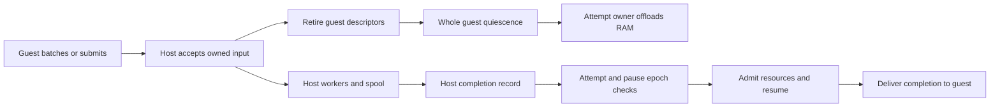

# Agent asynchronous I/O and completion queues (EXP-003)

Let pVisor own the inputs, execution and results of downloads, model calls and bulk writes. After submitting work, the guest can compute further or offload memory when the whole guest is waiting. The host continues I/O, retains completion results, and lets the existing Attempt owner resume the guest and deliver them.

| Item | Current status |
|---|---|
| Stage | **Restricted PoC, 2026-10-18; M0 native wait loop and host write-buffer foundation implemented, complete Agent IOCP pending implementation and validation** |
| Initial profile | Linux x86_64/KVM, shared file RAM, one Attempt exclusively owning its stage; disabled by default |
| Filesystem path | Initial Linux host write buffer: WB=0, DAX=0; guest batch transfer and larger caches follow later |
| Agent path | Proposed scoped submit / wait / cancel / ack; the first version assumes a thin adapter is allowed, with compatibility choice pending |
| Resource objective | Reduce host interactions and guest resident time; improve useful throughput under fixed CPU/memory budgets |
| Interface status | Task and completion protocols below remain proposed contracts; the host buffer uses a private experimental environment variable and M0 provides default-off embedded Gateway configuration; no public Agent task API or CLI feature switch |

## 1. Problem statement {#problem}

### 1.1 Asynchronous writes need transferable inputs

The guest page cache can coalesce small writes and return ordinary write calls early. Linux FUSE writeback-cache already provides this behavior; partial-page writes may also require reads, even for O_WRONLY files. [FUSE I/O modes](https://docs.kernel.org/filesystems/fuse/fuse-io.html)

The early `0042-fuse-batched-writeback.patch` used 1 MiB/10 ms submission conditions, a 16 MiB high watermark and a 256-handle limit. Current 0048/0049 accounts actual dirty and temporary WRITE pages, with a soft target of one eighth of available guest RAM bounded to 16–256 MiB, retaining 256 handle leases. See the [VM cache contract](https://github.com/DeepLink-org/pvisor/blob/main/crates/pvisor-vm/README.md) for submission conditions. Data remains in guest pagecache. Host filesystem requests hold a guest RAM lease until used-ring publication. Larger guest buffers allow more coalescing while increasing dirty data awaiting transfer and potentially the RAM that offload must preserve.

The pipeline needs an explicit ownership handoff: the host must own the input bytes, target object and budget before backend I/O can run independently of guest RAM. Moving synchronous pwrite to a thread or passing guest addresses to io_uring retains that memory dependency. io_uring read/write data buffers must remain valid until completion. [liburing buffer lifetime](https://github.com/axboe/liburing/blob/master/man/io_uring.7)

### 1.2 Existing mechanisms and integration gaps

| Existing mechanism | Reusable foundation | Missing integration |
|---|---|---|
| Guest writeback, host buffer and filesystem operation barriers | Small-write coalescing, host byte ownership, object ordering, freeze | Guest transfer fence, object concurrency, blocked replies independent of RAM |
| Gateway `ModelWaitLifecycle` | enter before upstream, delivery barrier before replies, cancellation cleanup | M0 now invokes native offload/resume; full result spool and resource readmission remain |
| OverlayNet host TCP | Egress authorization, host sockets, backpressure | Independent HTTP/TLS downloads, result spool, completion wakeup |
| VM pause/offload/resume | CPU stop, device RAM gate, reclamation and restoration | M0 now owns pauses and fences stale waits; resource reservations are not released or reacquired |
| AgentCtl cooperative quiescence | Fixed participants, generation, matching ACKs | Scoped VM guest transport and I/O task protocol |

These observations refer to current `feature/emb_meta`: `fw/patches/0042-fuse-batched-writeback.patch`, `crates/pvisor-vm/src/devices/virtio/fs/worker/scheduler.rs`, `crates/pvisor-gateway/src/model_wait.rs`, `crates/pvisor-overlaynet/src/vm.rs` and `crates/pvisor/src/runtime/agentctl.rs`. Embedded Gateway configuration can now explicitly install an Attempt-bound native model-wait prototype, disabled by default. AgentCtl currently uses a host Unix socket; the VM executor removes its environment variables, so Host credentials cannot simply be forwarded to the guest.

Ordinary HTTPS retains TLS state in the guest. The current TCP bridge gives each flow 64 KiB of host receive credits, plus a separate 64 KiB smoltcp buffer. Guest inactivity eventually causes backpressure. A full download needs a host-owned application request and result destination to continue while the guest is offloaded.

### 1.3 Relationship to existing experiments

[EXP-001](../vcpu-idle-offload/index.md) retains its automatic wait-observation route without Agent or guest-kernel changes and remains an M0 observation prototype. [EXP-002](../guest-stage-cache/index.md) owns filesystem metadata and deferred-binding design. EXP-003 introduces explicit cooperative waiting and host task ownership, reusing their control and object mechanisms; their stages and evidence remain independent.

## 2. Core design {#core-design}

### 2.1 Pipeline submission, execution and completion



The guest produces batch N+1 while the host accepts N. Host workers execute independent objects concurrently and serialize operations with object dependencies. Offload requires every runnable activity in the guest to enter an acknowledged wait. One waiting LLM request or low CPU utilization does not establish that condition.

The authoritative completion queue lives on the host. A guest shared ring can transport batches while running; when the guest is absent, background tasks must not write guest buffers, publish used rings or refault RAM. After copying inputs to host storage, retire the original virtqueue handoff promptly and deliver final task results through independent completion records.

### 2.2 Three write watermarks

| Watermark | Meaning | Remaining guest RAM dependency |
|---|---|---|
| accepted | Required authorization, object binding and copy-up are complete; the host owns bytes and resource credits | None; the corresponding RAM lease can be released after guest descriptor publication |
| completed | Backing execution has ended, possibly with partial effects; actual length or error is recorded | None |
| durable | Actual file synchronization covers the agreed scope; namespace durability also requires relevant directory/journal synchronization | None |

Ordinary cached WRITE can reply after accepted. O_SYNC/O_DSYNC, direct I/O, explicit fsync/fdatasync, lock acquisition and unfinished namespace mutations retain their respective completion requirements. Close does not imply disk durability; known asynchronous errors still require contractual delivery. Accepted promises ownership within the current process lifetime. Tasks requiring recovery after process failure additionally need recoverable spool/log state and its durability barriers.

Maintain sequence numbers per logical object and backing-binding generation. Multiple FDs/hardlinks to the same mutable object share ordering; an old lower FD retains its binding across copy-up. Independent objects may complete out of order. A synchronization barrier waits for every operation before its cut; the greatest completed sequence is insufficient as a contiguous completion watermark.

Completion watermarks may advance past recorded failures. A successful durable barrier must report failures within its cut; in-memory error records themselves have no durability guarantee.

Initial background entries hold only host bytes, stable object FDs/references, offsets, flags, sequences and error state. Background work remains part of existing filesystem admission and dirty tracking. RAM offload drains only guest-memory references. Machine snapshot/capture filesystem barriers wait for relevant queues to reach completed or reject capture; synchronization and publication transactions separately establish storage durability. READ, GETATTR, TRUNCATE, copy-up, rename/unlink, FLUSH and RELEASE first drain relevant objects, reducing visible state required initially. Pending-range read overlays and metadata merging follow later.

### 2.3 Transfer guest dirty data before pausing

Dirty guest pagecache bytes that have not produced a FUSE WRITE are not transferred by draining host queues. Pausing vCPUs also stops guest writeback timers.

Add a proposed transfer fence: the guest stops producing new writes for the batch, submits dirty data through the target cut, and waits until those bytes reach host accepted. It then enters cooperative quiescence; the Attempt owner pauses CPUs and drains short-lived device RAM references. The fence allows backend writes to continue and does not wait for completed/durable. Without guest cooperation, only already transferred requests can proceed; untransferred dirty pages remain part of saved guest RAM.

An early WRITE reply alone does not complete this handoff. The current guest worker can next submit timestamp SETATTR; READ/FLUSH can also wait for completed while retaining RAM leases. Later work must adopt delayed metadata and prove no such requests remain before parking, or add host-owned requests with deferred reply tickets. During offload those tickets retain results only; restoration reacquires RAM access before replying and publishing used rings. This changes existing descriptor/freeze contracts and is not provided by the current host buffer.

Guest buffers serve short coalescing windows. Longer backlogs use bounded host memory or a private spool. Offload occurs only when expected waiting can cover transfer, reclamation and restoration costs; brief queue waits can use ordinary asynchronous execution.

### 2.4 Bulk writes and object lifetimes

Pin the file object before asynchronous acceptance. Background workers must not reopen an old pathname. Object retention must cover pending data, delayed inode metadata, LOOKUP/FORGET, open handles and queue references, handling unlink, same-name replacement, hardlinks and copy-up correctly.

The historical close → unlink → first syncfs ENOENT is fixed by host object retirement: guest WB sessions retain the original nodeid after unlink or overwrite-rename, pin an upper native O_PATH reference or keep logical lower attributes, and release it at final FORGET. Delayed MTIME/CTIME after last-handle close still targets the original object, without ignoring unknown ENOENT or modifying a replacement name or immutable lower. The VM crate already contains this fix and independent SDK evidence; M1 still needs joint validation of blocked writes, RAM offload and Attempt teardown.

The legacy VM virtio-fs host server path returns ENOSYS for FUSE_SYNCFS; the guest may treat that as success and disable subsequent calls. New host-buffer sessions add a real synchronization/error barrier. Disabled sessions retain legacy behavior, so guest syncfs success in those sessions alone does not prove host storage durability. Per-file fsync/fdatasync retain their existing path.

The first version covers explicitly supported ordinary cached writes. Validate append, overlapping writes, mmap, truncate and namespace concurrency separately. Repair exit errors and define synchronization semantics before expanding guest buffer sizes or default enablement.

### 2.5 Agent tasks and a scoped guest channel

Initial tasks describe complete work: download to a private blob/stage, model call to a result, and bulk writes from an adopted blob. Submit first copies or seals inputs. Task references bind Job, Attempt, generation, operation ID, parameter digest and capability scope. Wait/poll reads completion state, cancel returns cancellation outcome, and ack releases result references eligible for reclamation.

Ack can release blob/spool data, while lightweight operation ID, parameter digest and dispatch/result records remain until the Attempt ends. Collected or unknown results do not cause redispatch, preserving deduplication facts.

A new guest channel grants only the current Attempt's task capabilities; existing explicit vsock support is a possible transport. It does not forward Host control credentials. Within one Attempt, retries with identical operation IDs and parameters deduplicate; conflicting parameters fail. A disconnected waiter does not prove the task never executed. Cross-Attempt retries of remote POST/LLM effects require provider idempotency keys or reconciliation. Pending cancellation and unknown outcome are recorded separately.

Downloads reuse OverlayNet egress authorization and reauthorize every redirect. LLM tasks reuse Gateway credentials, protocol conversion and capture. Results enter bounded memory/spool first. Bulk filesystem tasks pass through the existing filesystem owner, Core operation locks, preimage/Journal handling, dirty tracking and cache invalidation. The supervisor cannot directly modify an active upper.

LLM integration can initially reuse enter / before_delivery for one waiting interval. Existing SSE restoration happens on the first nonempty network chunk, which may be a heartbeat. Sleeping through a full inference requires independent result spool, byte/deadline limits, a deliverable-data condition and disconnect semantics. Avoid restoring the VM for every heartbeat or token.

### 2.6 Attempt control and restoration ownership

Task tables and spool belong to the existing Attempt; existing runtime retains ownership of Run terminal state. Automatic waits hold an invalidatable pause epoch. The same control owner arbitrates manual pause, cancellation, termination and lease loss. Current stage RunLease is a storage ownership lock, not existing CPU admission.

Record completion in host state first. Check Attempt/generation, wait epoch, valid ownership and manual pause reasons; reacquire required runtime resources, restore through existing native control, and wait for ACK before guest delivery. Old completions cannot revive a new Attempt, and automatic resume cannot remove manual pause. When completion races with offload, latch the event first; the same owner decides whether to skip reclamation or finish it and then restore, preventing lost wakeups.

VM offload closes and drains the RAM gate; its current timeout causes control failure, so it cannot probe whether the guest is idle. Establish quiescence and input adoption before reclamation. An intentionally parked participant is represented by its wait epoch instead of being declared dead by ordinary heartbeat expiry.

RAM offload retains the same host process and independent queues, allowing background work to continue. Machine checkpoint/fork/migration must drain queues or completely capture recoverable task state. The first version drains or explicitly rejects pending work, keeping a RAM-only snapshot from masquerading as a complete task snapshot.

Attempt exit stops submissions, cancels cancellable tasks, drains adopted stage writes, fixes result/unknown remote-effect records, seals the stage, generates the Bundle, and releases its lease, in that order. Background tasks cannot write after stage sealing or publication of Run terminal state.

### 2.7 Memory budgets and asynchronous errors

Bound guest dirty bytes, host pending bytes, spool bytes, FD/object counts, task counts and completion size, plus per-Attempt/runner/node totals. Apply backpressure at data admission limits. Reserve capacity for fsync, cancellation, exit and control messages so full queues can still drain. Adopt large tasks in chunks. Retain short-write, ENOSPC/EIO and worker-failure state by object and sequence; later synchronization and final Job completion must observe failures.

Trading memory for performance requires comparing actually reclaimed guest memory against host pools, spool pagecache, guest/host duplicate peaks and offload backing. Bounded queues absorb bursts; sustained input above backend throughput requires backpressure. Estimate backlog bytes from input rate times permitted backlog duration, then constrain it by the total budget.

### 2.8 Implementation plan and quick validation {#implementation-plan}

| Stage | Reviewable increment | Validation focus |
|---|---|---|
| M0 | Attempt wait ownership and real Gateway/native adapter | One controlled workload declares whole-guest waiting with x-pvisor-inference-idle; delayed LLM running/pause/offload, delivery and control races |
| M1 | Fix object retention after unlink, define host sync barriers, add a host-owned WRITE queue | Guest offloads while backing writes block and host continues writing; read/write dependencies, cross-FD/hardlink ordering, errors and complete exit |
| M2 | Guest transfer fence, larger coalescing budgets, batch submission/completion | Candidate 16/64/256 MiB budgets and multiple concurrency windows; requests, throughput, peaks and tail latency; values are experimental points |
| M3 | Scoped guest task channel, complete download/LLM spool, bulk writes from blobs | Download/save avoids guest data round trips; reclaim throughout LLM waits; correct results, authorization and stage state |
| M4 | Guest metadata updates and asynchronous mutation log for an exclusive stage | Pipeline create/rename/unlink with explicit authorization, object/version, quota and failure semantics |

M0 validates the control loop while M1 advances ownership for large-scale asynchronous writes. M2 then tunes memory and concurrency so capacity changes do not hide serialized waits. M4 requires a trustworthy guest execution view, host replication log and read consistency, reusing EXP-002 object/version design. Delaying namespace RPCs alone cannot establish transparent asynchronous completion.

M0 cannot assume an existing all-participant VM AgentCtl transport. Future safe-wait acknowledgment requires adopted inputs and quiescent participants, without requiring every host task to be completed, which would remove the overlap window.

#### M0: implemented native wait adapter {#native-model-wait}

Embedded callers using the `gateway` Cargo feature can select:

```rust
let gateway = pvisor::GatewayDriverConfig::new(proxy)
    .native_model_wait(pvisor::NativeModelWait::Offload);
```

`Pause` stops vCPUs; `Offload` also uses the existing shared file-backed RAM barrier. Disabled by default, the adapter supports Linux x86_64 VMs, requires an enabled Gateway and conflicts with a custom `model_wait`. Session binds a fresh identity and wait state for each Attempt. There is no CLI or configuration-file toggle.

The first version requires a trusted single workload to declare whole-guest quiescence with `x-pvisor-inference-idle: true`, with no outstanding filesystem or device operations. The declaration neither discovers other runnable processes nor submits dirty guest pages. Ordinary requests retain their existing path. Private COW/pager RAM cannot offload; a device-drain timeout still fails the Attempt.

Each Attempt holds at most one wait, including accepted native operations and cancellation cleanup. Missing or foreign Run/Attempt identities and concurrent waits are rejected before upstream dispatch. Entry and delivery await native pause/offload and resume ACKs respectively. Manual pause/resume/offload shares the control lock and revokes the automatic pause epoch on admission, even if the later native operation fails. Delivery after a manual pause waits for explicit resume or cancellation. Dropped handlers clean up only their own pause; unknown ACKs or failed cleanup cancel the Attempt. Execution checkpoint/suspend is rejected while a wait exists.

This prototype retains existing resource admission and the storage lease throughout; it does not release or reacquire CPU reservations. Control observations add `model_wait_epoch`, null for manual operations. SSE still resumes at the first nonempty network chunk, including a heartbeat. Full inference spooling, the general guest task protocol and the guest transfer fence remain unimplemented.

### 2.9 Implemented host write-buffer foundation {#host-write-buffer}

The private experimental variable PVISOR_VM_FS_HOST_WRITEBACK=1 enables the Linux staged virtio-fs host buffer. Unset or 0 disables it; invalid values fail. Guest writeback=0 and DAX=0 are currently required. Each connection permits 64 MiB of payload and 1024 reserved/queued/executing items. Reserve before copying and reply WRITE after full adoption. Adjacent writes sharing a handle, contiguous offset and killpriv semantics batch at 1 MiB / 64 chunks / 10 ms into one pwritev. A single FIFO initially preserves cross-FD/hardlink ordering.

The cache accepts eligible upper regular-file writes; synchronous, direct, append, exported or DAX paths retain existing behavior. Metadata, reads, namespace operations, close and synchronization wait for accepted writes. Errors remain sticky through the session; RELEASE cleans up before returning errors, and capture cannot hide failures. DESTROY/drop drains and joins. New host-buffer FUSE_SYNCFS drains, synchronizes preimages and then synchronizes the host filesystem containing upper. PID 1's final barrier can observe asynchronous errors. The queue retains no guest Reader or RAM lease, although full-queue backpressure and subsequent dependent requests may retain the current virtqueue RAM reference.

With WB=0, close still drains through FLUSH. The initial benefit targets continuously written open files; many small write-close files do not automatically merge across files. This foundation does not implement complete offload, Agent task protocols, guest transfer fences or per-object parallelism. The guest WB=1 unlink error is fixed by independent object retirement; the new host mode still excludes guest WB=1.

Quick experiments retain five fresh environments, three internal rounds per task, and a separate Ready metric excluding exit, without host-interference gates. Also measure accepted, completed, durable and Job completion times, total CPU, memory across controlled processes/cgroups and kernel caches, resident-memory time integral, offload/load latency, wake count and backing requests. Work deferred to exit must remain visible. Follow benchmark/README.md to register or reuse a protocol before measurement; raw evidence stays in benchmark .data/, separate from user rankings.

### 2.10 Current validation record {#validation}

2026-10-17: static review of existing writeback, Gateway, OverlayNet, VM RAM gates and Attempt control is complete, and the host write-buffer foundation is implemented. At that point guest transport, automatic restoration and new performance experiments remained unimplemented; subsequent M0 progress appears below. Pending complete-IOCP checks include offload without RAM access during blocked writes, unlink/syncfs after last-handle close, completion holes, short writes/ENOSPC, synchronization/exit with full queues, and completion racing with manual pause/cancellation.

Linux foundation validation: just test pvisor-vm -- --test-threads=8 passed 486 tests and skipped 8, including 25 new cache/protocol checks; the filesystem/API/snapshot subset passed 192. Hardware checks failed where the sandbox hid /dev/kvm; the complete suite passed with access to actual KVM. CLI and VM shim consumer compilation checks passed. The existing guest_writeback_case on real KVM passed normal and fault modes with host buffering enabled and guest WB=0: 256 files and a continuous 32 MiB write, close/read/rename/delete/unmount checks passed; after a file-size limit caused an actual 64 KiB short write, final guest status was 125. These are correctness results, not throughput or latency improvement measurements.

2026-10-18: the M0 native adapter passed Linux validation. `just test pvisor pvisor-gateway -- --features gateway --test-threads=8` passed 980 tests and skipped 8; the subsequently extended native-wait suite passed 12 targeted tests covering ACK barriers, dropped entry/delivery, parallel and stale identity rejection, manual ownership, cancellation, cleanup failure and configuration conflicts. CLI and shim consumers compiled; the runtime also compiled without `gateway`.

On real KVM, `native_model_wait_case` passed `running`, `pause`, `offload`, `manual` and `cancel`: the guest calls a delayed local supplier through Gateway; ordinary forwarding stays running; automatic entry receives pause/offload ACK before upstream dispatch; completion does not override manual pause; cancellation causes no automatic resume. Successful delivery checks an 8 MiB guest-content digest. Complete `result.json` files and control observations remain locally under `/tmp/pvisor-iocp-m0-*-20261018*/`; firmware uses repository build cache `581b3346…`, with its source receipt at `/tmp/pvisor-iocp-firmware/libkrunfw.SOURCE`. These cases establish control and content integrity, not reduced residency, density or performance gains. macOS/HVF is unvalidated. Outstanding M1–M4 gates remain. Eight targeted existing object-retirement and host-input/RAM-independence tests also passed; they do not constitute real-VM integration under blocked backing. The selected crate passed `cargo clippy --locked -p pvisor --features gateway --lib --no-deps -- -D warnings`. Strict Clippy including dependencies encountered five `unnecessary_cast` findings in unchanged `pvisor-vm/src/devices/virtio/fs/guest_index.rs` and cannot be recorded as passing.

## 3. Alternatives and comparison {#alternatives}

| Route | Potential benefit | Cost and scope |
|---|---|---|
| Enlarge guest pagecache only | Coalesce small writes and absorb bursts | Dirty data still depends on the guest; submission before offload and global memory pressure remain |
| Host-owned asynchronous WRITE queue | Transparent benefit for ordinary tools; storage waits overlap guest offload | Requires object lifetime, visibility, error, synchronization and budget contracts |
| Complete Agent I/O tasks | Downloads/models/bulk saves run independently for longer and reduce data crossing the VM | Thin adapter and scoped task transport; arbitrary existing TLS programs cannot automatically become complete tasks |
| io_uring or worker-thread backend | Reduce thread/syscall costs and increase backend concurrency | Compare after host input adoption; ordering, buffer lifetime and completion handling still apply |
| Guest exclusively owning a writable execution view | More metadata operations complete locally and replicate in batches | Highest authorization, Journal, copy-up, recovery and failure-semantic cost; deferred to M4 |

Establish host input adoption and the Attempt completion loop first, then measure buffer capacities and backend executors. Complete tasks can connect download-to-blob and subsequent stage writes within the host, creating room to remove guest protocol processing and data round trips. The general filesystem path retains transparency and expands asynchronous coverage according to dependencies.
