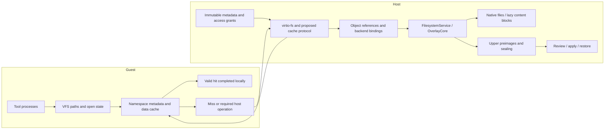
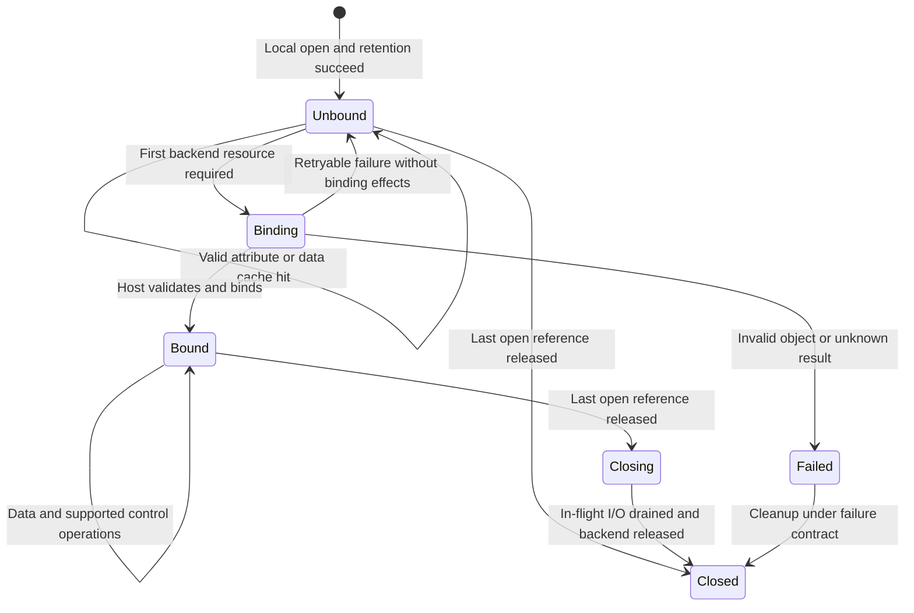

# Guest kernel filesystem cache and deferred backend binding (EXP-002)

Let the guest kernel use a versioned filesystem view to complete cached path resolution, attribute queries and ordinary read-only open locally. Call the VMM for missing data, stage mutations and durability. The host retains authoritative stage, baseline observation, access policy, review/apply and restoration state.

First reuse FUSE caching and read-only zero-message open, then add paged metadata import and stage consistency.

| Item | Current status |
|---|---|
| Stage | **Design stage (RFC), 2026-10-11; not implemented or accepted** |
| Implementation audience | Guest-kernel, VMM, filesystem and performance researchers |
| Initial scope | Linux x86_64/KVM; exclusively owned, physically immutable read-only export; regular files and static access grants |
| Main mechanism | Metadata import, object references, guest open state, data binding on first backend access |
| Stage extension | Host commits mutations; guest updates caches through the protocol; current writable-open/copy-up contract retained initially |
| Switch | No runtime switch or CLI interface yet; disabled by default after prototype integration |
| Languages | Rust for new host and guest-userspace code; small C patches for necessary guest-kernel extensions |
| EROFS | Optional immutable-lower representation; not required initially and does not own stage writes |
| Performance | No real VM measurements for this proposal; request reduction and end-to-end benefit accepted separately |
| Later profile | Frozen execution baseline, exclusive stage, protocol-managed cache updates |
| Interface status | Types, fields and messages below express proposed semantics, not a wire ABI or public Rust API |
| Implementation entry | [Milestones, responsibilities and acceptance matrix](#implementation-plan) |

First validate existing FUSE caching and zero-message open, then investigate paged metadata import and mixed stage views. Initial results apply only to the named read-only profile. Writable stage, live baseline and other platforms require separate acceptance.

## 1. Problem statement {#problem}

### 1.1 Why move filesystem requests into the guest?

File traversal and tool initialization repeatedly resolve paths, query attributes and open files. Some files are opened only to inspect metadata, with no content read. Existing guest FUSE caches some entries, attributes and pages, but metadata misses and current ordinary OPEN still traverse the guest kernel, virtqueue, VMM and host service; OPEN also creates a backend handle. A prepared host lazy-image index does not establish guest-local access to that knowledge.

Identify requests the guest kernel can complete from a stable view by supplying immutable-lower metadata and protocol-managed stage state, while preserving host mutation, authorization and durability ownership. Traversal, open/fstat/close and mixed stage views expose metadata delivery, open lifetime and cache coherence as separate problems.

The existing [Writeback comparison](../../../lab-notes/filesystem-performance-analysis.md#writeback-ab) supports improvement for that write workload with writeback disabled, without detected full-task acceleration. This proposal targets structural metadata/open costs and requires independent end-to-end evidence. Writeback, copy-up and durability costs still need separate diagnosis.

### 1.2 Foundations and design gaps

Guest virtio-fs/virtqueue calls `FilesystemService` directly in the host runner, sharing OverlayCore with host FUSE. VM lazy images have no intermediate host FUSE mount; the host image backend still supplies metadata and block reads. See [Current architecture](https://github.com/DeepLink-org/pvisor/blob/main/crates/pvisor-vm/README.md) and [Shared service](../../overlayfs.md).

| Foundation | Reusable behavior | Additions or verification |
|---|---|---|
| Guest FUSE cache | Paths, attributes and data pages | Admission, validity, metadata import and local-open conditions |
| FUSE zero-message open | No-OPEN prototype on a read-only connection | Handleless data service, FLUSH/RELEASE and connection-wide limits |
| VM OverlayFs | Inodes/handles, object I/O leases, mutation/freeze | Unbound opens, object retention and update protocol |
| OverlayCore | Lower/upper composition, copy-up, preimages and conflicts | Explicit cache semantics while retaining current contract |
| Lazy-image paged index | Versioned attributes, directory index, content descriptors/checksums | Guest consumer, stable object mapping and permission completeness |
| Existing snapshot | CPU/device/RAM quiescence and filesystem rebinding | Cache modes, object references and unbound FD save/restore |

Read-only open observes the baseline in live mode; writable open performs copy-up. See [Open classification/preparation](https://github.com/DeepLink-org/pvisor/blob/main/crates/pvisor-overlay-core/src/service.rs) and [Preimage observation](https://github.com/DeepLink-org/pvisor/blob/main/crates/pvisor-overlay-core/src/core.rs). Local-open admission must include observation requirements as well as data access.

Ordinary OverlayFs open currently requires a backend handle. Existing FUSE flags do not establish that this proposal can simply be enabled. See the [VM open implementation](https://github.com/DeepLink-org/pvisor/blob/main/crates/pvisor-vm/src/devices/virtio/fs/overlay.rs).

Host OverlayFs already provides owned-view caching, mutation-effect collection and notification-failure handling. Reuse its semantic lessons and test cases from the [Host cache contract](https://github.com/DeepLink-org/pvisor/blob/main/crates/pvisor-overlayfs/README.md). Its mount adapter is not guest update transport; keep private state within its API boundary.

### 1.3 Goals and measurement boundaries

Complete path resolution, attributes and ordinary read-only open without filesystem VMM requests when metadata, permissions, retention and versions are complete. Valid data hits also stay local; missing data, stage mutation and required host observation/effects use the backend. Evaluate cold start, steady state and complete Attempts.

Zero requests means no filesystem VMM requests within the specified operation window. Metadata import, first protocol probes, reference reclamation and teardown are recorded separately. It does not mean a VM has no hardware exits, scheduling or other device activity.

## 2. Core design {#core-design}

### 2.1 Architecture and responsibilities

1. Use guest VFS dentry, inode, page cache and open state to cache the exported namespace and metadata.
2. Keep stage mutation, copy-up, data service, baseline observation and durability in the VMM; guest caches are execution-view replicas.
3. Ordinary read-only open creates guest open state; bind backend resources on first access requiring them. A valid guest data hit does not force backend access merely because read was called.
4. Retain current host paths initially for writable open, creation, truncation, removal, rename and other operations with existing side effects.
5. Demonstrate fewer requests under the same contract before extending to stage and recovery; accept each stage separately.



The guest owns caches, local open state and protocol-granted object references. The VMM owns sessions, trusted mappings, native handles, authorization and request lifecycle. OverlayCore owns composition, copy-up, preimages and stage semantics. Runtime/supervisor continues to arbitrate Attempt, freeze, seal, save and restore.

Metadata construction/import fixes the source revision, validates indexes and preserves raw Unix path bytes/hardlink identity. Caches retain image/backend content validation and never treat holes in sparse lazy placeholders as real file content.

### 2.2 Local and VMM operation boundaries

Local completion requires valid entries, complete metadata, established object retention, locally decidable access, and no required host observation or side effect.

| Operation | Conditional guest-local path | Required backend access |
|---|---|---|
| LOOKUP, GETATTR, stat/lstat | Valid directory entries and attributes | Missing pages/fields, policy or observation requirements |
| Negative lookup | Complete directory index and valid stage covering state prove absence | Incomplete index/version gaps; errors do not mean absence |
| READDIR | Valid directory view and version-bound cookies | Missing pages, changed stage version or unsupported cursor semantics |
| O_PATH | Valid path cache and object references | Missing path, permission or retention conditions |
| Regular-file O_RDONLY open | Complete static permissions, retained object, compatible observation contract | Live observation, dynamic policy, special files or unknown capability |
| O_WRONLY/O_RDWR open | Current VMM behavior initially | Copy-up, permissions and error timing |
| O_CREAT/O_TRUNC/O_TMPFILE and similar | Cached preparation inputs | Host creation/truncation/temporary-object effects |
| read, pread, mmap faults | Valid versioned data pages | Missing/invalid data or absent required backend binding |
| write, truncate, shared writable mmap | Existing path or explicit rejection of uncovered forms | Stage mutation, copy-up, preimages and writes |
| unlink, rename, link, mkdir, attribute changes | Atomic application of host-returned cache effects | Mutation authorization, preimages and stage commit |
| fsync, seal, checkpoint | Existing flush/quiescence contract | Host synchronization, sealing and capture |

Linux usually handles O_PATH in VFS already; operations already lacking FUSE OPEN do not count as a new reduction. Flags such as O_TRUNC can produce effects before any read/write. See [Linux open semantics](https://man7.org/linux/man-pages/man2/open.2.html).

Initial exclusions are live/mutable lower, external upper writers, shared mutable stage across VMs, dynamic host policy, special files and unaccepted locking/I/O forms. Extensions require independent profiles/cases. A complete guest upper, full in-kernel overlay and changed apply semantics remain separate architecture evaluations.

Target operation example:

```text
open("a", O_RDONLY) → guest validates view/permissions, retains object A, creates local open state
fstat(fd)           → returns valid cached attributes of A
read(fd)            → returns a cache hit; otherwise fetches data for A
close(fd)           → releases open state; cached object references follow reclamation protocol
```

### 2.3 Objects, versions and references

The following semantic model supports review; it is not a final serialization layout.

| Concept | Required information | Lifetime/use |
|---|---|---|
| Session identity | Attempt, stage, base revision, protocol, permission semantics, policy version | Host validates before mount/restore; tokens do not cross sessions |
| Object identity | Host-assigned/recognized object ID, incarnation, type, hardlink group | Stable while referenced despite path/inode-number reuse |
| Backing identity | Physical/remote backing identity and generation | Copy-up/replacement may change backing; existing opens retain current VM semantics |
| Directory version | Directory and relevant covering state | Creation, removal, rename, whiteout/opaque updates |
| Attribute version | Owner, mode, size, times, link count and other attributes | Validated independently of directory/data versions |
| Data version | Data and valid ranges | Updated by writes/truncation; directory version alone cannot validate pages |
| Object reference | Granted retention/access scope, owner, budget, reclaim state | May precede a data FD; eviction retains references needed by opens |
| Open state | Object/backing binding, flags, credentials context, offset, binding state | dup/fork share one open description; separate opens are independent |

Directory entries are isolated by session, parent, raw basename, relevant directory version and policy version. Attributes use object identity/attribute version; data pages use object/backing identity/data version. Implementations may combine/compress fields while preserving these distinctions.

#### 2.3.1 Deferred binding retains the old object

```text
fd = open("a", O_RDONLY)   # locally opens object A
unlink("a")               # VMM mutates stage
create("a")               # creates object B under the same name
read(fd)                  # must still access A
```

An unlinked open file persists until its relevant references are released. First read carries A's reference rather than looking up path a again. See [Linux unlink semantics](https://man7.org/linux/man-pages/man2/unlink.2.html).

An immutable lower can retain its entire revision without a host data FD per guest open. Stage may retain a native object, descriptor or private backing; prove lifetime after unlink and resource bounds. Data FDs can be deferred, but object retention is already established. Missing retention falls back to the original host open path.

Stage metadata carries an already-effective host retention reference before guest-local opens acquire references within it. The host may conservatively retain cached objects until the guest releases both cache and open references, at an object/FD cost. Delivering a path and pinning only at first read does not meet this requirement.

Incarnation differs from data version. Writes to the same mutable file remain visible to other opens under the existing contract; each write does not create a new object. Preserve current VM behavior in which existing lower handles retain their original backing after copy-up.

#### 2.3.2 Reclamation

Caches and opens hold separate references. Eviction releases only the cache portion; in-flight I/O retains object/RAM leases. Use bounded batch release or existing FORGET-like mechanisms, with session teardown as final reclamation boundary.

Removed stage objects await reclamation until the last recognized reference is released. Budget exhaustion rejects admission or uses the original path; referenced objects remain valid. Existing supervisor ownership terminates a guest that does not respond to reclamation.

### 2.4 Metadata packages and merged caches

#### 2.4.1 Physical and view stability

Physical immutability covers data, metadata, namespace, ancestors, mount identity and hardlink aliases for the agreed lifetime. Read-only mounts, digest paths and frozen baseline express other properties and do not independently prove physical stability. See the [Lower contract](https://github.com/DeepLink-org/pvisor/blob/main/crates/pvisor-overlay-core/README.md).

A read-only export can be cached as a whole. A mixed view additionally requires one owner of upper/work, all mutations through VMM, provable/handled higher-priority lower changes and fixed policy or reliable policy updates. Reject admission before enablement if these conditions fail; a longer TTL cannot resolve uncontrolled external changes.

#### 2.4.2 Paged import

Bootstrap delivers bounded version/checksum metadata, root/necessary pages and capabilities; fetch additional metadata pages on demand. Represent directory indexes, inode attributes, symlinks, hardlink groups and content locations explicitly. Package construction, page delivery and inode/dentry creation are separate costs.

[pvisor-paged-v1](../../shared-image-cache-storage.md) provides fields/building foundations, while the guest format requires review. It currently omits xattr, so it does not establish complete ACL/security input. Incomplete permissions exclude local open; missing attribute fields require backend queries.

Before kernel consumption, limit bytes, records, page references, depth, name/target lengths and offset arithmetic. Reject cycles, duplicates, out-of-bounds references and unknown required features. Retain both host validation and kernel boundary checks. Fix format version/endian layout; do not map native Rust/C struct memory.

#### 2.4.3 Merged lookup and negative cache

Check valid stage covering state before the explicit lower order. Whiteout, opaque and non-directory ancestors hide lower results; directory rename updates relevant subtrees/path caches. Synthetic configuration and mounts keep their existing owners rather than being replaced by package metadata.

Absence requires a complete validated index and valid stage state; unloaded pages do not establish absence. Readdir cookies bind a view/version, with explicit restore/seek/concurrent-mutation semantics. Network, integrity and version errors never become negative entries.

### 2.5 Local open and deferred binding

#### 2.5.1 Local-open steps

1. Obtain a consistent cache view and resolve components/symlinks.
2. Validate type, flags, permission inputs, path grants and observation requirements.
3. Acquire an open reference from established retention; the object survives until future I/O.
4. Create guest open state and return an FD without reading content.

Missing conditions use the original open path. O_CREAT, O_TRUNC, O_TMPFILE, permission clearing and current writable copy-up remain host operations. Deferred copy-up or shifted preimage timing is a separate contract migration.

#### 2.5.2 Open state machine



Concurrent first accesses in Binding share one result. Wait outside inode-table/global-view locks. Close, cancel and freeze cannot leak unknown handles. Async requests retain open state; current INTERRUPT gives no actual cancellation guarantee, so cleanup awaits results or enters session failure.

#### 2.5.3 Data requests

Requests carry recognized object references, backing/data-version conditions, open context, offset and length. The VMM validates session, grant, lifetime and bounds, then supplies data from retained native backing or lazy backend.

The proposed protocol can combine BIND and first READ to avoid an extra round trip. The initial read-only FUSE prototype may instead serve inode plus fh=0 and cache read-only backing per object. This differs from a new BIND RPC and requires separate verification.

Read, mmap faults and executable loading can request data; valid guest pages complete locally. See [FUSE I/O caching](https://docs.kernel.org/filesystems/fuse/fuse-io.html). Writes initially retain existing paths with correct partial success, sizes/times, errors and preimage order.

Mixed-stage data caching has separate admission. Lower old-open and copied-up new-open bindings may use different backing, while an ordinary FUSE inode generally shares one page-cache address space. Prove pages are not reused across incompatible backing; initially restrict data caching if needed, then investigate page ownership or a separate semantics migration. Conceptual data-version fields alone do not solve this.

#### 2.5.4 Errors and close

Local open preserves existence, permissions, type, flags and promised observation/effect errors. Deferring host FDs shifts host resource-exhaustion errors; profiles need explicit semantic review, beyond final data checks.

An unbound read-only FD can release open state locally, with separate FLUSH, RELEASE, FORGET, atime and reference-reclamation verification. Zero-message open alone does not establish a request-free open/fstat/close window. First connection probes count in startup, with steady-state counts reported separately.

### 2.6 Stage mutation and consistency

#### 2.6.1 Mutation effects

Host versioned results cover affected entries, attributes, backing, hardlink aliases, data ranges, whiteout/opaque and subtree changes. Guest caches apply authoritative effects rather than guessed local outcomes.

Namespace mutation, data writes and policy changes update relevant versions. Old metadata/read replies fill caches only under valid object/version conditions. Failures may have partial data/visible effects; report or recover actual effects.

#### 2.6.2 Visibility order

Complex mutations use a verifiable preparation, fence and publication protocol:

1. Determine scope/expected versions; widen the fence when aliases/subtrees are uncertain.
2. Guest blocks new cached reads/opens in scope and coordinates admitted work; VMM coordinates native I/O.
3. VMM records preimages, performs copy-up/mutation under the current contract, and generates versions/effects.
4. Guest atomically applies effects, rejects stale replies and acknowledges agreed visibility.
5. Release the fence before returning the result; host requests follow the same publication order.

Define the actual linearization point, cross-queue order and ACK in executable interleaving tests before implementation. Initial stage PoC may use a conservative whole-view fence, then measure/refine it. Never await guest ACK while holding locks needed by response threads.

Coordinate object retention with mutation fences. New opens cannot acquire an invalid reference after deletion committed but before cache update; existing opens retain their old object. Metadata and I/O in one causal chain cannot combine incompatible versions.

#### 2.6.3 Transport and unknown commits

Mixed stage requires reliable updates, sequence detection, gap recovery and backpressure. Evaluate reply extensions or a separate control channel; host `/dev/fuse` notification does not establish an existing guest virtio-fs capability.

Lost updates, sequence gaps and token/version mismatch first disable affected cache paths, then enter verified resynchronization. Retain existing open bindings; dropping all FDs does not rebuild valid semantics. Fail the session if consistency cannot be reestablished.

Request IDs correlate operations; initial scope provides no durable exactly-once guarantee. READ can retry under explicit object conditions. Mutation timeout/cancel does not blindly resend; reconcile trusted stage/log state or use existing failure recovery.

#### 2.6.4 Minimum message categories for review

These categories specify information and causality. Encoding, errors, limits, compatibility and reuse of existing opcodes are milestone-review decisions.

| Category | Required information | Success/failure boundary |
|---|---|---|
| View initialization | Session, protocol/profile, base/stage, policy version, budgets, index root and initial sequence | Local operations start only after full admission; failure leaves no partly usable view |
| Metadata-page fetch | View, page/object and expected version; reply checksums, completeness and reference grants | Old pages do not replace newer state; missing page differs from absence |
| Data access/binding | Retained object reference, backing/data conditions, authorized open context, offset/length | May combine first READ; distinguish no effects, acquired resources and unknown result |
| Stage mutation/effects | Existing operation input, expected versions and correlation; actual effects/sequence in reply | Host retains preimages/authorization; partial success publishes actual effects |
| Update ACK/resync | Applied sequence, gaps, fence scope and recovery view | Disable affected caches during gaps; ACK does not establish durability |
| Reference release | Session, object/binding references, batch and owner | Explicit duplicate/late-release contract; retain live references |

Existing control owners continue to schedule quiescence, seal and snapshot. These messages do not create separate terminal-state or Host-authority control channels.

### 2.7 Semantic and permission invariants {#invariants}

1. **Host authority is preserved.** Guest caches cannot grant reads, stage mutation, apply, seal or Host-control privileges.
2. **Execution view and conflict baseline stay separate.** Preserve visible compose B, apply baseline A and upper C independently. Modification of B still applies against A; B's digest cannot replace A.
3. **Object identity is stable.** Open retains object identity/lifetime; rename, unlink, same-name recreation and eviction do not retarget an old FD.
4. **Equal content does not mean one inode.** Model deduplication, hardlink groups, entries and open state separately.
5. **Merged caches respect coverage.** Upper, whiteout, opaque, directory rename and policy determine visibility. Immutable lower alone does not establish an immutable merged result.
6. **Observation contracts remain intact.** Live content-open and negative-lookup observations do not silently disappear on a hit; initial profiles permit skipping these observations.
7. **Errors do not mean absence.** Propagate timeouts, corruption, denied access, version mismatch and backend failures distinctly.
8. **Commit and visibility have explicit ordering.** Stage effects and cache updates share a linearization rule; late responses cannot replace newer state.
9. **Lifetimes are bounded.** Object references, backend handles, in-flight requests and caches have owners, budgets and release protocols.
10. **Snapshots retain open semantics.** Freeze/rebind does not replace the original object by reopening its current path.

#### 2.7.1 Permissions, baseline observation and trust

The host trims invisible paths, protected aliases and object grants before metadata delivery. Mode/owner/ACL/xattr inputs must be complete. Preserve raw path bytes; symlinks cannot request arbitrary host paths. Content digests do not grant cross-tenant access.

Guest Linux checks permissions locally; VMM still validates host-recognized authorization for data/mutations. Session tokens, guest uid and mutation lists cannot replace Host-control credentials or alter host permission ledgers (Host/Guest authority separation).

Profiles requiring per-operation host policy/audit callbacks exclude local open. Policy changes revoke new cache admission and coordinate references; resume only after rebuilding permission/retention contracts.

Live baseline observes apply baseline on first content-open; negative lookup may record Absent. Moving these events to read/write changes current semantics. Initial stable read-only profiles need no such read observations; frozen-stage mutations still record true baseline preimages on the host. Guest digests/events do not become sole conflict evidence.

Verify atime, force-sync attribute queries and access checks under the profile; incomplete semantics use backend access. Read-only mounts or modified timestamps do not establish source stability.

### 2.8 Lifecycle and recovery

#### 2.8.1 Failures and mode changes

| Event | Required behavior |
|---|---|
| Import failure/unsupported capability | Reject before cache enablement; preserve existing configuration without a partial view |
| Incomplete metadata | Admit verified ranges/capabilities, fetch missing fields; do not infer absence or permission success |
| Integrity/protocol error | Explicit error, no cache contamination or conversion to ENOENT |
| Object/incarnation mismatch | Resynchronize or return object error; old FDs do not reopen the current path |
| Resource exhaustion | Reject admission or reclaim unreferenced state under budgets; preserve valid FDs/in-flight requests |
| Unknown mutation result | Stop affected progress and reconcile actual effects; do not report success or safe rollback |
| Guest/VMM exit | Existing supervisor ends session and drains/releases references/handles |
| seal/apply/drop | Existing Host lifecycle boundary, with no concurrent stage writers |

Connection-wide no-open cannot revert the original path per inode through a return value. Define admission/fallback before mount; live protocol-mode changes require drain, preserved bindings and a separate design.

#### 2.8.2 Snapshot, fork and rebinding

Capture binds base revision, stage identity/state, protocol/cache mode, permissions/policy, object references and open bindings. Guest RAM inode/dentry/FD/page-cache state and VMM devices correspond to the same quiescent cut.

Reuse existing control ownership: stop admission, park CPUs, drain executed device accesses and publish completion, save consistent RAM/device/Host filesystem state, then finish existing backing commit/seal. Unexecuted ring requests follow current save/restore semantics. Virtqueue drain does not persist guest dirty pages; seal still requires stopped writers and data/directory synchronization.

Required guest flush/ACK runs while CPUs and its device path still execute. Do not park CPUs or close that path before awaiting a guest reply. Capturing whole-VM dirty state and exporting durable stage are separate acceptance targets.

Before resume, validate revision, mode and permissions and reconstruct trusted mappings. Unbound FDs retain the original object for future binding; Bound FDs retain backing, flags and offset. Deleted stage objects with live references need independently saved backing, beyond the current namespace.

Native FD numbers are not persistent restore identifiers. Separate evictable caches from required open references. Fork uses independent upper/reference owners while sharing valid immutable base. Reject unsupported snapshot profiles rather than extending capability from one read-only PoC.


### 2.9 Implementation and acceptance {#implementation-plan}

Researchers working on guest kernels, VMMs, filesystems and performance first validate read-only caching/local open in real VMs, then import metadata, then integrate stage updates and recovery. All milestones remain incomplete. Commands below are future implementation-validation entry points, not tests executed for this proposal.

Preserve the [Design invariants](#invariants). Record stage scope, protocol mode and accepted profiles independently; read-only results do not accept writable workspaces.

#### 2.9.1 Milestones and decision gates

| Stage | Deliverable | Gate for continuation |
|---|---|---|
| M0: contract/baseline | Current behavior, scope, diagnostics, frozen inputs/artifacts | Local operations and necessary host work identified |
| M1: read-only prototype | FUSE cache, connection-wide no-open, handleless data service | Real KVM semantics, complete interpretable counts and bounded reclamation |
| M2: metadata import | Versioned package, kernel importer, complete permissions, bounded paging | Cold/warm correctness, errors/misses/negative-cache semantics |
| M3: stage awareness | Retention, mixed opens, effects, update transport/fences | Identity, aliases, partial failures and interleavings pass |
| M4: lifecycle | Seal, snapshot, restore, fork, exit and compatibility | Consistent RAM/device/Host state, recoverable opens and contained failure |
| M5: performance/integration | Registered A/B, resources, maintenance decision, experimental switch | Useful net benefit and preregistered non-target/resource budgets met |

M1 can run without guest-kernel changes. It validates primed mechanisms, not packaged metadata or cold-start improvement. M2 first accepts package import. M3/M4 research can be divided after shared semantics settle; jointly review object retention and update draining rather than assuming the other work package owns them.

##### M0: fix the contract and baseline

1. Pin Linux x86_64/KVM, guest kernel/configuration, VMM, rootfs, lower, upper/work and tools. Record sources and artifacts.
2. Review open, copy-up, live/frozen baseline, negative lookup, directory cookies, permissions and error timing. Separate current guarantees, prototype scope and proposed changes.
3. Define read-only admission evidence: physically immutable source, stable revision, static grants, retention, complete permission fields and exclusively owned session lifecycle. Read-only mounts/content digests alone are insufficient.
4. In independent diagnostics record INIT, LOOKUP, GETATTR, READDIR, OPEN, READ, FLUSH, RELEASE, FORGET and failures, split into initialization, priming, operation window and teardown.
5. Review existing FUSE hits and O_PATH behavior; discuss reductions only for requests that actually occurred.

Deliver contract/admission/capability matrices, diagnostic harness, full counts and review questions. Unproved source stability excludes M1; failures do not become performance baselines.

##### M1: minimal prototype on an independent read-only connection

1. Use a restricted read-only share, retaining current writable workspace paths. Negotiate/verify no-open per connection; do not return ENOSYS globally on a mixed writable mount.
2. Serve fh=0 READ and supported data requests using trusted inode/object identity. Retain the immutable revision from local open through first read.
3. Reuse bounded read-only backing per object. Define owners for concurrent first access, failure, eviction, FORGET and teardown; repeated opens do not grow host FDs without bound.
4. Verify the full open/fstat/close window. Record first OPEN/FLUSH probes separately; omit FLUSH/control operations only when the profile permits.
5. Validate read, concurrent pread, mmap faults and exec. Valid guest hits create no new data binding. Retain full byte verification.
6. Record resource exhaustion/error timing; review contract changes separately. Reject or exclude unsupported locks, special files and I/O forms.

Exit gate: real KVM read-only semantics pass, declared steady metadata/open request targets are met, no hidden FLUSH/error access/FD leak, with probing/priming/resources recorded. Expand to import/stage after mechanism benefit; explain absent performance improvement before enlarging scope.

##### M2: metadata packages in the guest kernel

1. Choose eager or bounded paged import. Reuse lazy-index construction experience but define guest format, version, checksums, completeness and capabilities independently.
2. Import root/necessary inode and directory records, raw Unix names, symlinks, hardlink groups and content descriptors. Separate unloaded, complete absence and errors.
3. Kernel import checks lengths, offsets, counts, depth, references and cycles. Existing xattr omissions do not establish ACL/security support; initial inputs satisfy an explicit permission profile.
4. Maintain small C patches on the pinned kernel, reusing VFS/FUSE. Prefer Rust for protocol/host parsing; a complete filesystem rewrite is outside initial scope.
5. Give import/fetch explicit locking and budgets. Coalesce page misses outside global-view locks; eviction retains objects needed by FDs/I/O.
6. Measure construction, delivery, parsing, inode/dentry creation, first lookup and steady queries separately. A warm traversal is not accepted package import.

Exit gate: new-guest cold queries are correct, complete indexes prove negative results, misses/old versions are handled, corrupt packages cannot cause kernel out-of-bounds access, and import/memory meet preregistered budgets. Paged packages explicitly identify first queries still requiring VMM.

##### M3: stage-aware mixed views

1. Begin with frozen baseline, exclusive upper/work and VMM-mediated mutations. Exclude external writers, live mutable lower and shared mutable stage.
2. Grant effective retention with stage metadata. Validate local open followed by unlink/rename/recreation/eviction; first read binds the old object rather than reopening a path.
3. Review per-object local-open capability/kernel extension. Connection-wide no-open cannot selectively skip qualifying reads; preserve O_WRONLY/O_RDWR, creation, truncation and current VMM/copy-up behavior.
4. Collect actual pre/post effects on entries, attributes, data, backing, aliases, whiteout/opaque and subtrees. Partial failures still publish actual state.
5. Implement sequences, fences, reliable transport, ACK, gap recovery and bounded backpressure. Start with a whole-view fence, then use diagnostics to refine scope.
6. Reuse host owned-view semantics/test lessons through explicit input/result contracts. Keep private cache state private; host FUSE notifications do not establish guest transport.
7. Accept data caches separately. Retain lower old-open and copied-up new-open semantics, proving shared FUSE page caches do not confuse backing; restrict data capability until proven.
8. Add executable interleavings: late pages, mutation/local-open races, cross-queue publication, ACK waits, lost updates, repeated release, unknown commit and partial failure.

Exit gate: sequential semantics, concurrent linearization, lifetimes and invalidation coverage pass. Cache faults cannot leave usable stale views. If complexity/fencing cost is excessive, record limits and retain M2 read-only capability.

##### M4: restoration and runtime lifecycle

1. Reuse Attempt/supervisor, CPU/device quiescence and filesystem-freeze ownership. Required guest flush/ACK completes while CPUs/device paths remain available.
2. Save protocol mode, base/stage, policy, references and bindings; separate caches from required references. Native FD numbers are not persistent identities.
3. Cover Unbound, Bound, Binding, in-flight I/O and undrained updates. Frozen state is explicit, without threads awaiting the frozen guest.
4. Deleted open stage objects retain restorable backing; unsupported capture explicitly rejects the profile instead of reopening the current name.
5. Fork gets independent upper/reference owners, sharing only valid immutable revision. Parent/child writes, eviction, release and exit remain isolated.
6. Accept whole-VM capture/restore separately from seal/export. Virtqueue drain does not flush guest dirty pages; update ACK does not mean durable commit.
7. Reject unknown required features/incompatible snapshot modes. Upgrades/live switching need separate designs; per-inode fallback cannot bypass connection-wide no-open.

Exit gate: enabled profiles retain existing seal/snapshot/fork contracts, with reviewable cleanup/restoration. Record KVM, HVF, architectures and mount profiles separately.

##### M5: performance acceptance and product integration

Register protocols/budgets before freezing artifacts. After formal performance passes, decide actual experimental-switch integration: disabled by default, capability checks, consistent CLI/Host request/runner spec/restore mode.

Expand only with scoped net benefit, permitted non-target regression and acceptable resources. Retire routes whose benefit is absent or maintenance exceeds gains, preserving conclusions. Update user performance articles only when user-facing conclusions change.

#### 2.9.2 Work packages and integration points

| Work package | Main integration | Deliverable |
|---|---|---|
| Guest-kernel cache | [fw](https://github.com/DeepLink-org/pvisor/blob/main/fw/README.md), FUSE/VFS patches/configuration | Import, local open, page ownership, version checks, kernel budgets |
| VMM filesystem | [virtio-fs](https://github.com/DeepLink-org/pvisor/tree/main/crates/pvisor-vm/src/devices/virtio/fs), [VM API](https://github.com/DeepLink-org/pvisor/blob/main/crates/pvisor-vm/README.md) | Trusted references, handleless service, binding, queues/updates and capture |
| Stage/observation | [OverlayCore](https://github.com/DeepLink-org/pvisor/blob/main/crates/pvisor-overlay-core/README.md), [FilesystemService](https://github.com/DeepLink-org/pvisor/blob/main/crates/pvisor-overlay-core/src/service.rs) | Composition/copy-up, baseline, actual effects, partial failures and seal |
| Host-cache lessons | [OverlayFs](https://github.com/DeepLink-org/pvisor/blob/main/crates/pvisor-overlayfs/README.md) | Owned-view contracts, invalidation/failure cases within adapter boundaries |
| Image/import format | [Shared-image design](../../shared-image-cache-storage.md) | Revision, index, content checks, complete permissions, format/build evidence |
| Guest userspace | [pvisor-guest](https://github.com/DeepLink-org/pvisor/blob/main/crates/pvisor-guest/README.md) | Necessary initialization/ACK, keeping ordinary stat/open in kernel |
| Lifecycle/integration | [runtime](https://github.com/DeepLink-org/pvisor/tree/main/crates/pvisor/src/runtime), [environment snapshot](https://github.com/DeepLink-org/pvisor/tree/main/crates/pvisor/src/environment_snapshot) | Admission/freeze/restore/fork/configuration/Host authority |
| Validation/performance | [semspec](https://github.com/DeepLink-org/pvisor/blob/main/tools/semspec/DESIGN.md), [benchmark](https://github.com/DeepLink-org/pvisor/blob/main/benchmark/README.md) | Candidate cases, fault/interleaving tests, real VM harness, raw evidence/statistics |

Review shared identity/profile/failure contracts before splitting work. Owners define shared APIs without duplicate DTOs. `pvisor-vm`, `pvisor-overlayfs` and `pvisor-journal` retain current boundaries; unconverted crates receive necessary local changes rather than workspace-wide rewrites. Read each directory README before edits.

#### 2.9.3 Correctness acceptance matrix

These are candidate cases, not human-approved semspec. Record profile, initial state, interleavings, result, errors and release behavior; distinguish unit and real VM tests.

| Case group | Operations/interference | Required verification |
|---|---|---|
| Metadata hits | lookup/stat/lstat/readdir, complete/missing pages | Fields/order/cookies; missing pages do not establish absence |
| Local read-only open | O_RDONLY → fstat → close without data | Retention/permissions; declared complete-window counts |
| Existing local paths | O_PATH, existing dentry/attribute hits | Comparison with legacy behavior; no credit for existing zero requests |
| Side-effect opens | O_CREAT/O_EXCL/O_TRUNC/O_TMPFILE, writable open | Errors/copy-up/preimages/effect timing preserved |
| Permissions/policy | Denied paths/aliases, mode/uid/gid, absent ACL/xattr | No unauthorized success; dynamic policy callbacks preserved |
| First access | Concurrent first reads, failure/close races | One controlled binding, correct bytes, no leaks/deadlocks |
| Valid data hit | read/pread/mmap/exec, EOF/short reads | Correct page version/backing; no forced host data FD |
| Old-FD lifetime | Local open then unlink/rename/recreate/eviction | Old FD retains its object; new open sees the new object |
| Identity versus content | Equal-content files, hardlinks, reused inode numbers | Deduplication does not create aliases; true links stay coherent |
| Copy-up/cache | Lower FD, new upper FD, write/truncate, late pages | Binding semantics preserved; no incompatible page reuse |
| Merged coverage | Whiteout/opaque, directory rename, non-directory ancestors | Lower hiding and complete subtree/alias updates |
| B/A/C and observation | Compose B, baseline A, upper C; live/negative lookup | Apply compares A; admission excludes or preserves host observation |
| Update interleavings | lookup/open versus mutation, cross-queue reordering | Linearization and stale-fill rejection |
| Update faults | Lost updates, sequence gaps, delayed ACK, queue saturation | Affected caches disabled, resync/failure rather than stale access |
| Partial/unknown mutation | Short write, later failure, timeout, INTERRUPT | Actual effects reported; no blind replay or claimed rollback |
| Format/path | Non-UTF-8 names, symlinks, bounds/cycles/corruption | Raw bytes and grants correct; illegal imports rejected |
| Budgets/reclamation | Large trees, FD/reference pressure, FORGET, close/exit | Bounded state/queues, valid references retained, final owner baseline |
| Snapshot/fork | Unbound/Bound/deleted open objects, in-flight work | Original object restored, mode/permissions valid, stage isolation |
| Seal/exit | Dirty pages, pending updates, guest/VMM crash | Durability preserved, bounded failure; drain alone is insufficient |
| Admission rejection | Mutable lower, external writer, special files | Reject before enablement or scoped backend path, no partial mode |

Controlled interleavings first validate protocol/lifetimes, then real KVM validates syscall/VFS behavior. Host mocks do not accept kernel semantics.

#### 2.9.4 Validation entry points after implementation

Choose commands for actual edits, covering target crates, affected consumer compilation and necessary platform checks:

```bash
just test pvisor-vm
just test pvisor-overlay-core
just test pvisor-overlayfs
just test pvisor-guest
just test pvisor
```

For firmware patches/configuration:

```bash
just fw build
just fw test
```

Firmware tests check build/bundle contracts, not real guest filesystems. Record kernel, patches, configuration, VMM/firmware hashes and `libkrunfw.SOURCE`. Missing `/dev/kvm`, `/dev/fuse`, permissions or platform produce explicit failures/skips and uncovered scope.

Public API edits require external tests through `api`, existing boundary guards and warnings-denied rustdoc. Keep internals private. Follow [Semspec design](https://github.com/DeepLink-org/pvisor/blob/main/tools/semspec/DESIGN.md) for case changes with `just semspec lint docs/src/zh/cases`; runner edits use `just test-semspec`. AI does not approve/revoke, edit real `REVIEWED.toml`/`.approved/`, or weaken claims/checks/xfail.

#### 2.9.5 Performance protocol

##### 2.9.5.1 Registry and reproduction

Formal engineering comparisons belong to [B-FS-ENG](https://github.com/DeepLink-org/pvisor/blob/main/benchmark/README.md#b-fs-eng); request diagnostics belong to [B-FS-DIAG](https://github.com/DeepLink-org/pvisor/blob/main/benchmark/README.md#b-fs-diag). Recheck the [Registry](https://github.com/DeepLink-org/pvisor/blob/main/benchmark.new/registry.csv) and [Filesystem entry](https://github.com/DeepLink-org/pvisor/blob/main/benchmark.new/filesystem/README.md) before implementation/measurement. `filesystem/ab.json` and `diagnostic.json` require concrete single-condition commands; prepare the repeatable harness before measuring.

Existing paired DAX experiments test a separate mechanism. Independent condition samplers do not automatically form randomized pairs; generate explicit ordering, execution records and same-round statistics.

Store inputs, harness, frozen sources, artifacts, logs, samples and validation in the experiment's `.data/`; derived CSV/conclusions belong to engineering reports. Research A/B does not update user tables.

##### 2.9.5.2 Controls and budgets

Prefer identical binaries, firmware, inputs and configuration with only the real cache mechanism toggled. Required kernel/artifact differences use one frozen baseline plus the tested change, recording identities and differences.

Fix complete VM-group CPU affinity/quota, guest vCPU/RAM, host memory/swap limits, temporary storage, tool caches, I/O concurrency, writeback, sync, baseline, permissions and seal. Additional guest memory/host-thread budget does not establish cache benefit.

Preregister target workloads, minimum useful improvement, allowed regressions, import/update cost and memory/FD limits. Count guest metadata/inodes/dentries/pages, host references/FDs, requests/update queues and helper/node costs. Explain actual shared-memory charging without omission or double counting.

##### 2.9.5.3 Workloads and cache conditions

| Workload | Question | Required separation |
|---|---|---|
| lookup/stat, negative lookup, traversal | Does metadata import remove requests? | New guest, imported/uninstantiated, steady, updated version |
| open/fstat/close | Does local open work? | Initial probes, priming, steady; all FLUSH/control requests |
| Small-file open/read/close | Does binding/reuse help? | First data access, warm guest, reference/FD reclamation |
| Sequential/concurrent reads, mmap, exec | Data service/page-cache cost | Miss/hit, same FD/reopen, full bytes |
| create/write/truncate/rename | Does stage maintenance regress? | Legacy path, fences/effects, partial failures and seal |
| git/rg/Cargo/npm tools | Does request reduction help tools? | Each tool/full task, input/tool-cache conditions |
| Large directories/multiple VMs | Do import/references reduce density? | Peaks, eviction, quotas, throughput/tails |
| checkpoint/restore/fork | Added lifecycle cost? | Save/restore, bound/unbound opens, private stage |

Define host and guest cache temperatures separately. New guest does not mean cold host disk; primed data/interpreters affect first access. Cold experiments use isolated reproducible inputs/environments rather than casual drop_caches on a shared machine.

##### 2.9.5.4 Sampling and validity

At least 30 formal samples per condition, preregistered seed with randomized balanced pairs, and three recorded warmups per group. Diagnostics, tuning and failed reruns remain separate from the frozen formal batch.

Every run validates output, all data, unchanged host originals, merged upper and durability boundaries. Retain failures and handling: verification, nonzero exit, changed artifacts/inputs, budget mismatch, OOM or external build/test interference follow the declared protocol. Filtering failures cannot establish zero failures; valid slow runs are retained.

Preflight confirms instruments/workloads before freezing. New issues stop the batch, with repair/refreeze and retained failure evidence; do not append until significance appears.

##### 2.9.5.5 Timing and statistics

Report internal tool time and complete Attempt time separately. The latter includes per-run metadata preparation/delivery, startup/import, tools, seal, requested checkpoint/export and teardown. Offline image construction is separate; first-use/reuse costs include new import rather than moving it outside timing.

Publish samples, condition medians, same-round paired changes and 95% bootstrap confidence intervals. Examine distributions first. Separated clusters require proportions/conditions and no overall tool ranking. Intervals crossing zero mean no detected difference, not proved equality; 30 samples do not establish reliable P99.

Report CPU, IO, peak/steady memory, references/FDs, hits and reclamation. Concurrent throughput/density require separate workloads/budgets, beyond single-VM extrapolation.

##### 2.9.5.6 Independent diagnostics and mechanism evidence

Disable performance-affecting profiling/tracing in formal timing; run separate diagnostics. Record final counts, sequences and resources for all PID/component/instances. Explain missing/extra records and failures rather than ignoring thread instances. Inclusive spans cannot sum into exact attribution.

Metadata/open zero-request acceptance applies to the declared steady window, counting FLUSH/RELEASE/FORGET and all other operations. Initialization, priming, import, reclamation and teardown have independent records/costs. Data hits also establish no implicit host FD creation.

Report stages as semantic correctness, fewer requests, improved target workloads, then complete-task/resource net benefit. Earlier gates cannot replace later ones; metadata/open improvement alone does not solve writeback regression.

#### 2.9.6 Review and handoff

Each stage submits small independently reviewable changes with:

1. Supported profiles, admission evidence, operation/error contracts and exclusions.
2. Identity/versions, linearization, message limits, ownership and recovery.
3. Owning crates/APIs, kernel patches/configuration, formats and compatibility.
4. Correctness passes/failures/skips, real platforms and uncovered scope.
5. Frozen sources/artifacts/inputs, reproducible commands, raw evidence and statistics.
6. Cold/warm lifecycle performance, budgets, maintenance cost and continuation/retirement advice.

The first handoff is M0 contracts plus the restricted M1 read-only loop. Select later routes using retention/import/update evidence. EROFS remains an independent lower comparison rather than automatically expanding into a full writable-filesystem rewrite.

### 2.10 Implementation and maintenance rules {#maintenance}

1. Distinguish existing implementation, proposed protocol, restricted prototype and accepted capability. Message fields/names remain semantic drafts before review.
2. State object retention, permissions, baseline observation and version conditions for every local operation; references cannot rely only on paths.
3. Separate directory, attribute and data versions from backing identity. Lost updates and unknown commits enter explicit recovery/failure paths.
4. Follow [Benchmark rules](https://github.com/DeepLink-org/pvisor/blob/main/benchmark/README.md), locate the registered experiment before measurement, and store raw data in its `.data/` directory.
5. Keep implementation in existing crates and `fw/`; follow directory READMEs and API boundaries. Registration does not create an empty CLI switch.
6. Follow the [Semspec design](https://github.com/DeepLink-org/pvisor/blob/main/tools/semspec/DESIGN.md). Candidate acceptance, test PASS and human approval remain separate; AI does not edit real approval ledgers/snapshots.

## 3. Alternatives and comparison {#alternatives}

### 3.1 Filesystem routes

| Route | Expected mechanism benefit | Cost and boundaries | Choice |
|---|---|---|---|
| Extend existing FUSE TTL only | Fewer repeated cached metadata requests | Does not import cold metadata or directly remove ordinary OPEN; requires stability/invalidation | Low-cost control |
| FUSE cache + metadata import + deferred binding | More local metadata operations and ordinary read-only opens | Retention, complete permissions, stage updates and page ownership | Recommended route, independent read-only prototype first |
| EROFS immutable lower + host stage | Native read-only directory/inode/open path | Image/block service, mixed view, device snapshots and stage coherence | Independent lower comparison |
| Complete guest upper/native writable filesystem + stage export | Potentially more guest-local writes/namespace operations | Changes preimages, authoritative stage, seal/apply and restore contracts; broader engineering scope | Separate architecture evaluation |

These are mechanism hypotheses requiring validation. Compare identical inputs, permissions, budgets and lifecycle boundaries; read-only lower results do not establish writable-workspace benefit.

#### 3.1.1 First extend the existing FUSE path

Linux FUSE has connection-wide no-open, allowing subsequent open/release in the kernel. See the [Linux 6.12 implementation](https://github.com/torvalds/linux/blob/v6.12/fs/fuse/file.c). It fits an independent read-only prototype. Mixed writable views require per-object/operation capability or kernel extensions to skip only qualifying opens; preserve existing writable open.

First use known inputs and priming to validate local operations and handleless data service, including priming cost. Then add paged metadata import. A primed prototype does not establish package import or improved cold startup.

#### 3.1.2 EROFS as an optional lower

EROFS supplies guest-native read-only inode/directory/content layout and is an alternative immutable lower. See [EROFS documentation](https://docs.kernel.org/filesystems/erofs.html). Existing host mechanisms still own stage. Format, data-block service and mixed-view integration need adaptation; EROFS alone does not supply remote lazy access or stage coherence.

Current x86 firmware enables OverlayFS/tmpfs/virtio-blk but not EROFS/ext4; VMM blk is also outside default features. See [Firmware configuration](https://github.com/DeepLink-org/pvisor/blob/main/fw/config-libkrunfw_x86_64) and [VMM features](https://github.com/DeepLink-org/pvisor/blob/main/crates/pvisor-vm/Cargo.toml). Device and snapshot lifecycle require separate review.

### 3.2 Eager versus paged import

| Strategy | Advantage | Cost and conditions |
|---|---|---|
| Eager import | Local first metadata queries after import; complete absence proofs | Startup absorbs construction/delivery/kernel-object cost, including unvisited trees |
| Demand paging | Less metadata for small working sets and bounded allocation | First misses call VMM; completeness, coalescing and stale-page rejection are more complex |
| Root/necessary pages first, then paging/bounded prefetch | Fast entry with cache expansion as needed | Distinguish delivered, validated and instantiated state; bound prefetch/eviction |

Start with bounded root/necessary pages and retain eager import as a control. Choose using cold start, first lookup, traversal, peak memory and multi-VM density rather than primed query latency alone.

### 3.3 C, Rust and API ownership

| Location | Preferred route | Reason and cost |
|---|---|---|
| Guest FUSE/VFS extension | Small C patches | Reuse kernel interfaces/caches; explicitly maintain lifetimes and input bounds |
| Host protocol/objects and guest-userspace control | Rust | Existing crates/ownership/API model; explicit protocol/object budgets remain necessary |
| Custom Rust kernel filesystem | Separate research package | Safe filesystem abstractions, no_std tools and pinned-kernel adaptation add initial maintenance cost |

Use Rust for new host object management, data service, stage updates and restoration; guest-userspace control remains in `pvisor-guest`. Prefer small C patches for necessary guest FUSE/VFS extensions, reusing kernel caches.

Firmware pins [Linux 6.12.109](https://github.com/DeepLink-org/pvisor/blob/main/fw/Makefile). That series lacks complete filesystem abstractions in its Rust kernel crate; kernel Rust requires safe abstractions and no_std tooling. See the [Series source](https://github.com/torvalds/linux/blob/v6.12/rust/kernel/lib.rs) and [Kernel Rust guidance](https://www.kernel.org/doc/html/v6.12/rust/general-information.html). A custom Rust kernel module separately budgets interfaces, backports and cross-architecture validation.

Cross-crate contracts belong to owner APIs; avoid equivalent DTOs or exposure of private VMM/Core state. Migrate one boundary at a time, with uniform declarations and explicit Unsupported errors. Kernel patches follow Linux licensing and corresponding-source delivery.

### 3.4 Budgets and net benefit

Budget metadata pages, guest inodes/dentries/open state, retained objects, host FDs, content pages, in-flight I/O and update queues. Existing node/cache/helper costs count toward the machine budget. Shared metadata/content does not make per-VM VFS/page-cache state free.

Wait for metadata/data misses outside global-view locks. Coalesce per-object/block requests with bounded prefetch. Update overload suspends admission or resynchronizes rather than accumulating without bound. Report eviction/reclamation costs separately.

Expected early benefit is metadata-heavy traversal and open followed only by attribute checks. New-file WRITE/CREATE still calls VMM; this proposal does not establish that existing small-file write regression is solved. First cold reads still depend on data service, copy-up, hashing and durability.

```text
Full cost = metadata preparation/delivery + VM startup/import + tools
          + seal + requested checkpoint/export + teardown
Candidate net benefit = backend work removed - added import/maintenance/reclaim/restore cost
```

Report offline shared-image construction separately from per-Attempt import, including first-use and reuse costs. Formal A/B compares total latency, CPU, memory, IO and throughput; diagnostics explain request reductions. Register benefit/tolerance gates before measurement and evaluate confidence intervals with complete correctness.

### 3.5 Research questions and decision gates

| Question | Required evidence |
|---|---|
| Eager metadata or demand paging? | Cold start, first lookup, traversal, peak memory and multi-VM density |
| Which open/close requests disappear on read-only connections? | Complete INIT/LOOKUP/GETATTR/OPEN/FLUSH/RELEASE/FORGET counts and semantics |
| How to retain unbound stage objects? | Unlink/rename/recreation/eviction interleavings and FD/reference bounds |
| How to update mixed views precisely? | Alias/subtree coverage, reordered replies, partial failures, linearization/backpressure |
| Which kernel extensions are needed? | Minimal pinned-kernel patch, build/restore compatibility and maintenance cost |
| FUSE cache or EROFS? | Controlled engineering A/B with identical inputs, permissions, budgets and cold/warm states |
| Does product lifecycle retain net benefit? | End-to-end startup/seal/save/restore and resource results |

Each question produces reviewable code, tests and raw evidence through the [Implementation work packages](#implementation-plan). Decide stage extensions and product scope after read-only mechanisms succeed.
