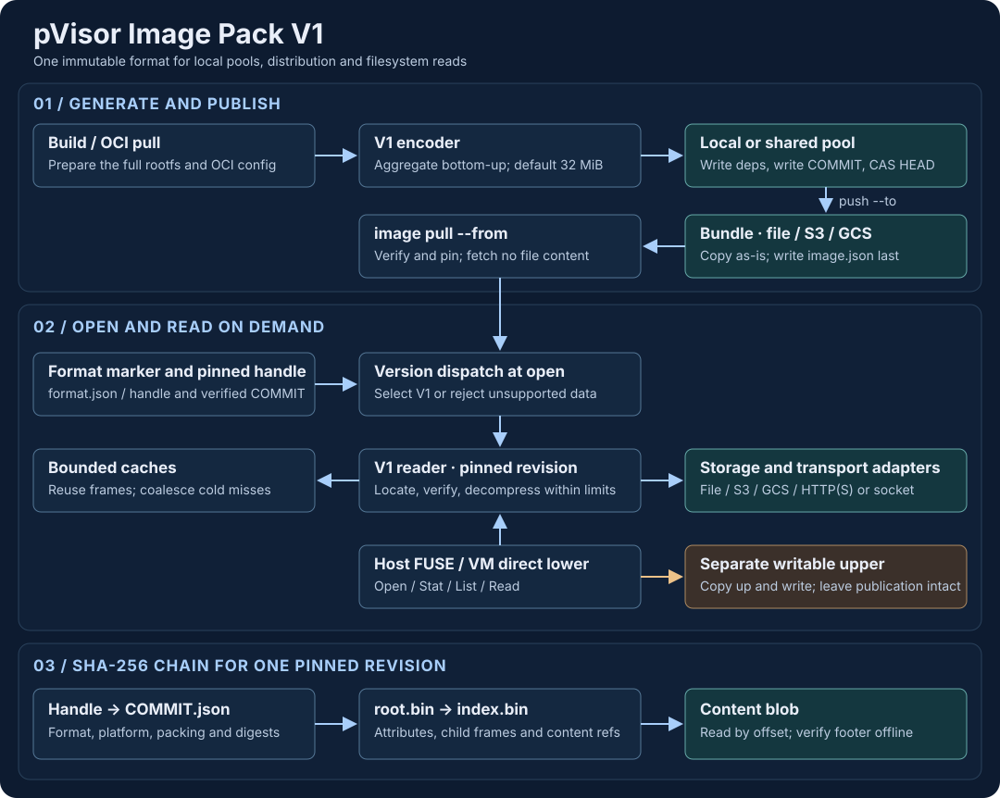

# pVisor Image Pack V1 design

pVisor Image Pack uses one immutable storage format for local image pools and remote distribution. Readers select the format version from the data and load only the index and content needed for directory lookups and file reads.

> **EXP-004 · Initial implementation.** New images use Image Pack V1. [Prerelease Lazy Image V2](../../lazy-image-v2.md) remains readable and can be exported as-is. The socket protocol stays at version 2.

## Problem statement {#problem}

The current layout already supports directory-local indexes, small-file packing and on-demand decompression, but hardcodes one format across object storage, socket metadata reads, directory ordering and VM lower admission. Packing targets also share constants with reader limits. Changing the packing granularity could change which existing images a reader accepts.

V1 establishes a distinct format family, a reader boundary and canonical packing order. One pVisor process can read different formats without changing the CLI or filesystem operation model. Ordinary OCI pulls still download and apply the full layers. V1 adds no xattr, ACL, DAX or online garbage collection support.

## Core design {#design}

### Architecture and ownership {#architecture}



| Component | Owns | Does not own |
| --- | --- | --- |
| Image catalog and CLI | Tags, platforms, OCI digests, pinned handles and the `build` / `pull` / `push` user contract | Binary encoding, version detection or storage access |
| Image Pack service | Format dispatch, pinned revisions, prepare and publication commit boundaries | OCI acquisition, VM projections or writable layers |
| `v1` format implementation | Control records, index and content layout, packing, validation and read behavior for that version | Filesystem, S3, HTTP or socket connections |
| Storage and transport adapters | Bounded GET / Range, immutable writes, CAS, mirrors and connections | Decoder selection, inode interpretation or changing references |
| Host FUSE / VM direct lower | Uses `Open / Stat / List / Read`; owns mount and projection lifecycle | Resolving tags again or changing pack content; a separate upper handles writes |

The image cache module in `pvisor` owns the implementation. Start with one private dispatch entry and a concrete `v1` implementation; extend dispatch when a second format exists. Keep the existing responsibilities of [`PortableCache`](https://github.com/DeepLink-org/pvisor/blob/main/crates/pvisor/src/image/cache/portable.rs#L250-L340), the [object storage adapters](https://github.com/DeepLink-org/pvisor/blob/main/crates/pvisor/src/image/cache/client.rs#L263-L342) and the [direct lower](https://github.com/DeepLink-org/pvisor/blob/main/crates/pvisor/src/image/cache/direct.rs#L529-L573). The CLI, daemon and OverlayFS do not receive version-specific storage DTOs.

### Format identity and version dispatch {#versions}

- `format.json` is the storage-root marker: `{"format":"pvisor-image-pack","format_version":1,"packing":{"blob_target_bytes":33554432}}`. Each root holds one format and one write policy; one process can connect to roots of different formats. The new local pool uses `<image-store>/image-pack-v1` instead of `pool-v2` and does not write `pool-format.json`.
- Handles use `pvisor-image-pack:v1:<image-key>:<platform>:<revision>`. `image-key` is the SHA-256 of the canonical source reference bytes; `revision` is the SHA-256 of the **original bytes** of `COMMIT.json`. Both are 64 lowercase hexadecimal characters. Object paths use `linux-amd64` or `linux-arm64-v8`; the caller-facing OCI platforms remain `linux/amd64` or `linux/arm64`. The OCI manifest digest identifies the source, independently of the packing revision.
- Prepare or read by name parses the root marker before reading HEAD with the corresponding version. Only an explicit writer may initialize the marker at an empty, uninitialized root. Opening a pinned handle parses its family and version, checks the root marker when available, and verifies the `COMMIT` digest, format and platform before using the version decoder. A socket limited to admitted revision objects uses the handle and digest-verified `COMMIT` for the same binding without requiring the global marker.
- Refuse unknown families or versions, missing required markers and cross-version records. Do not probe multiple decoders or fall back to OCI or another name. File extensions and environment variables do not decide decoding. The selected format defines directory order; authenticated image capabilities govern snapshot retention and stable namespaces, independent of string-prefix checks.
- Image Pack versions are separate from the socket envelope (stays at version 2), catalog schemas, OCI versions and pVisor releases. A change to how an existing reader interprets bytes, routing, addresses or hard limits requires a new format version. Each released version has its own reader and frozen artifacts; writers emit only explicitly selected, supported versions. The V1 implementation only writes V1.

### V1 objects and verification chain {#layout}

```text
format.json
meta/<image-key>/identity.json
meta/<image-key>/platforms/<platform>/HEAD.json
meta/<image-key>/platforms/<platform>/revisions/<revision>/
  COMMIT.json  manifest.json  config.json  root.bin  index.bin  objects.bin
meta/<image-key>/platforms/<platform>/uploads/<upload-id>/
  plan.json  progress.json
data/blobs/<aa>/<bb>/<encoded-object-sha256>
```

`aa` and `bb` are the first and next two hexadecimal characters of the digest, respectively. Object paths are relative to the storage root. A standalone publication carries one pinned revision and its dependencies, without HEAD, upload records or other revisions. It adds `image.json` and the original `configs/<sha256>.json`, verifiable by OCI config ID. Ordinary images and prepared templates keep their respective `image.json` records and share the underlying object format.

| Record | Fields and constraints |
| --- | --- |
| `identity.json` | `format_version`, `image_key`, canonical `reference`; the reference digest equals the key. |
| `HEAD.json` | `format_version`, `image_key`, `platform`, `revision` with `sha256:`, `manifest_digest`, `generation`, `published_at` (Unix seconds) and `publication_id`; points to a complete commit. |
| `COMMIT.json` | `format`, `format_version`, `image_key`, `platform`, `manifest_digest`, `packing` and `metadata`. `metadata` has exactly `manifest.json`, `config.json`, `root.bin`, `index.bin` and `objects.bin`, each described by `{sha256, bytes}`. `packing.blob_target_bytes` records the effective raw payload target. |
| `manifest.json` / `config.json` | The first records `format_version`, `reference`, `platform`, `manifest_digest` and nullable `config_digest` and `layer_digests`. The second records `format_version`, `architecture`, `env`, `entrypoint`, `cmd` and `totals` (files and bytes). Launch configuration and the original OCI configuration in a distribution bundle serve different purposes. |
| `root.bin` / `index.bin` | `root.bin` is the uncompressed root `Record`; `index.bin` contains independently compressed directory and chunk-reference frames. The root record and parent references bind data digests, positions, encoded and decoded lengths, and counts. |
| `objects.bin` | Key-sorted, duplicate-free list of `(object_key, encoded_bytes)`. Offline verification or export cross-checks the list against the reachable objects from the root. Ordinary open does not read it. |

JSON control objects use UTF-8. V1 schemas reject unknown or duplicate fields. Readers hash stored bytes without reserializing. The writer uses compact JSON with a fixed field order and sorted maps, and excludes publication times, upload IDs and host paths from `COMMIT`. Validate object keys, platform, lengths and offsets before using them for object access.

### Binary records and read rules {#binary}

`root.bin`, `objects.bin` and frame payloads use bincode 2.0.1 `standard` (little-endian, variable integers). Encode fields in the order shown. Enum numbering starts at 0; `Digest` is 32 raw bytes and `Bytes` is `Vec<u8>`. A `Box` adds no bytes. Decoding must consume the exact payload.

| Type | Ordered fields or variants |
| --- | --- |
| `FrameRef` | `offset:u64, encoded:u32, decoded:u32, digest:Digest, count:u64`; digest covers the referenced compressed frame. |
| `Record` | `name:Bytes, attrs:Attributes, directory:Option<FrameRef>, content:Option<Content>, digest:Option<Digest>`; the file digest covers the full plaintext file. |
| `Attributes` | `kind:u8, size:u64, mode:u32, uid:u32, gid:u32, inode:u64, nlink:u64, mtime:i64, mtime_nsec:i64, target:Option<Bytes>`. Kinds: directory 0, regular file 1, symlink 2, special 3; special entries do not support regular-file reads. |
| `Content` | 0 `Empty`; 2 `Chunks(FrameRef)`; 3 `PackedFrame(blob:Blob, frame:FrameRef, slot:u32)`. Variant 1 is prerelease V2 only; V1 rejects it. |
| `IndexFrame` | 0 `Leaf(directory:u64, depth:u8, prefix:u64, entries:Vec<Record>)`; 1 `Branch(directory, depth, prefix, children:[Option<FrameRef>;16])`; 2 `Range(directory, depth, prefix, children:Vec<(first:Bytes, ref:FrameRef)>)`; 4 `ChunkBranch(first:u64, children:Vec<FrameRef>)`; 5 `BlobChunks(first:u64, chunks:Vec<ChunkRef>)`. Variant 3 is prerelease V2 only. |
| `Blob` / `ChunkRef` | `Blob` is `digest:Digest, bytes:u64` for the entire encoded object, including its footer. `ChunkRef` is `blob:Blob, frame:FrameRef, digest:Digest, bytes:u32`; the last two validate the plaintext chunk. |
| `DataFrame` | 0 `Slots(offsets:Vec<u32>, bytes:Bytes)`. Slots are zero-based, and offsets strictly increase from zero to the payload length. A large-file chunk occupies the only slot in its own frame. |

- **Directories.** Basenames are 1–255 raw bytes, excluding NUL, `/`, `.` and `..` (`.` and `..` are disallowed as whole names). The root has an empty name and inode 1. Symlink targets are raw bytes up to 16 KiB, excluding NUL. A directory indexes its immediate children; an empty directory has no child frame. Hard links share inode and attributes; independent files with equal content keep distinct inodes.
- **Routing and pagination.** Use XXH3-64 with fixed seed `0x707669736f727632`, taking 4 bits per level starting at the most significant end. Leaves over 64 KiB split. Full hash collisions use bounded raw-name range nodes. Enumeration sorts by `(hash, name_bytes)` and returns at most 256 entries per page; cookies are opaque to callers and bound to the revision and directory. Report absence only when the verified index shows no entry.
- **Frames.** Empty files have no data object. Regular files of at most 64 KiB stay whole, with a 16 KiB frame payload target and at most 1,024 slots. Split large files into 1 MiB frames with a potentially shorter last frame. The chunk tree uses consecutive zero-based ordinals; branches have at most 16 children, leaves at most 256 references.
- **Compression and integrity.** Independent Zstd frames (writer level 3) precede a standard seekable table: encoded and decoded lengths per frame, then frame count and magic, without seek-table checksums. Paths, directory ownership and attributes stay in the index. The reader fetches ranges using verified `FrameRef`s without fetching the footer for offsets. The full encoded SHA-256 addresses the blob; export verifies the entire object, seek table, frames and reachable slots.

### Generation, publication and import {#publication}

1. `build` and ordinary OCI `pull` prepare the rootfs and OCI config, then encode using the pool policy. The writer observes HEAD and its CAS token, writes and verifies immutable dependencies, writes `COMMIT.json`, then updates HEAD by CAS. Previous HEAD does not influence layout; only complete objects with matching bytes are reused.
2. `image push --to` snapshots the local tag's image once and exports its verified encoded dependencies and OCI config without changing the handle. The SHA-256 of the original `image.json` bytes names the standalone publication root. Upload dependencies first, then write `image.json`; a prepared template updates `refs/<name>.json` by CAS afterward. [Repository URLs](../../../reference/shared-image-cache.md) select writable local directories, S3 or GCS, or read-only HTTP(S).
3. `image pull --from` verifies the published root descriptor, format version, OCI config (mandatory for ordinary images) and pinned root metadata before atomically updating the local catalog. An existing name requires explicit `--refresh`; failure preserves the old reference. Running readers use pinned handles and ignore HEAD or tag changes.

A failed upload may leave unreferenced objects; a CAS conflict cannot overwrite the winner. On lost commit acknowledgment, reconcile exact bytes and the publication ID, or return an unknown outcome. V1 export checks the inventory against reachable references and rejects blobs that contain any unreachable frame or slot. Files removed since a prior revision stay out of the new canonical layout.

### Canonical aggregation and pool policy {#packing}

1. Sort each directory's direct small files by raw basename bytes; identical content within that directory uses its first slot. Frame those direct files first, then append unsealed child tails in child-name byte order. Do not reopen a sealed child blob.
2. Pack large files separately in file-offset order. Seal the remaining tail at the end of each large file and at the root directory.
3. Seal before appending a frame that would exceed the raw payload target or the 64 MiB encoded object limit (including the seek table), or when the object already has 4,096 frames. Seal immediately at the payload target or frame-count limit. Blob bytes consist only of the ordered encoded frames and seek table.

A new pool defaults to a **32 MiB raw payload** target. Set host-side `PVISOR_IMAGE_BLOB_TARGET_MIB=64` to initialize a 64 MiB pool. The first write fixes the policy in `format.json`; an omitted setting then uses the stored policy, and a conflicting explicit value is refused. Only `32` and `64` are accepted; push has no per-publication packing options. `COMMIT` records the effective policy. Readers follow compressed offsets and lengths from the index.

Existing objects do not change layout under the same writer policy. Identical encoded blobs are shared; changes to ordering, grouping or compressor output can change a blob digest. Per-file physical deduplication across directories or policies is not guaranteed.

### On-demand reads, errors and resource bounds {#reading}

For a cold VM `read`, virtio-fs forwards the request to the direct lower. The reader finds the directory entry or chunk tree in the pinned revision. It fetches the covering frames by compressed range, verifies length and SHA-256, decompresses within window and output limits, and checks the slot or chunk. Host FUSE shares these semantics; the socket service can decode content for the client. Guest `mmap` uses virtio-fs and the guest page cache. Copy-up, full export and full verification may read all content.

| Constraint | V1 boundary |
| --- | --- |
| Format hard limits | 1 MiB for control objects and `root.bin`; 64 MiB for `index.bin`, `objects.bin` and content pack objects; 64 KiB for decoded index frames; at most 72 KiB for decoded pack slot frames; global decoded frame limit of 1 MiB + 128 B and Zstd window limit of 2 MiB. |
| Inventory and reads | At most 1,000,000 entries including the root and 2,000,000 content spans per image. An object can hit its size limit first. Socket Read/Metadata limit is 1 MiB per request, independently of the storage chunk size. |
| Host caches | Retain bounded LRU caches and coalesce cold misses for the same key. Initial budgets are 16 MiB per image index and 64 MiB for service content, each with 4,096 entries, and four open images per reader service. Budgets do not bound whole-process RSS or disk usage. |
| Errors | Integrity failures, range overflows, missing dependencies, decompression-limit violations, network failures and authorization failures return errors. They do not yield synthesized bytes or `ENOENT`. A reader may discard and refetch a corrupt local encoded cache entry. A mirror can serve only objects for the same pinned publication, never a different revision. |

The digest chain verifies that bytes match a pinned handle; it does not establish publisher identity. Clients must trust the configured publisher and initial reference. Keep AWS credentials, endpoint configuration and host projection paths out of distribution records. V1 does not treat mutable directories as immutable images.

### Migration and verification gates {#validation}

1. **Format and dispatch.** Freeze a minimal complete artifact and byte vectors for `COMMIT`, raw basenames, directory splits and collisions, slots and chunk boundaries. Check handles and digest chains independently.
2. **End-to-end preservation.** Extend existing [Lazy Image Scrut scenarios](https://github.com/DeepLink-org/pvisor/tree/main/tests/spec/lazy-image) for the new identity and explicit migration. Preserve idempotence, exact reads, atomic refresh, read-only operation, CAS conflicts, lost acknowledgments and rejection of unreachable slots. Cover filesystem, loopback HTTP, the signed S3 fixture and socket reads. Record real S3 and KVM / HVF separately.
3. **Aggregation.** Check object and footer frame counts for 32/64 MiB targets, reads across frames and objects, and matching handles when packing into a fresh pool versus one with a previous HEAD. Measure read amplification, latency and incremental upload volume on real S3 separately.

Old raw/paged V1 is still rejected. Pinned prerelease radix V2 images and publications remain readable. To rebuild or publish in the new format, prepare the OCI source in the new pool, publish, then rebind references. No in-place rename, deletion or rewrite of existing instances occurs.

## Alternatives and comparison {#alternatives}

| Decision | Choice and trade-off |
| --- | --- |
| Reuse `pvisor-v1:` or establish a separate family | Use a separate family. Historical and formal V1 share a number but are byte-incompatible; the new namespace allows a clean refusal of old data. |
| Probe every object or use one version per root | Use one version per root and dispatch at open. Upgrades require a new root but do not need mixed-version semantics for object sharing, CAS or GC. |
| One object per frame or multiple frames per blob | Group independent frames to reduce object count. Changes may require reuploading a whole blob; random reads still fetch the requested frame. |
| Per-publication tuning or one pool policy | Fix framing and traversal order and allow a blob target only as a pool initialization policy. Publications in the same pool cannot split deduplication by picking different options. |
