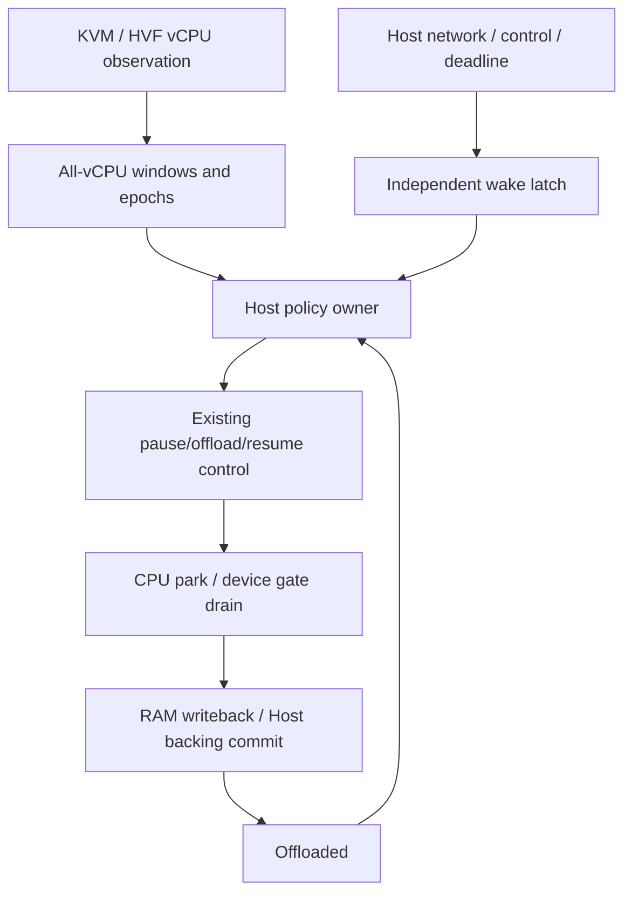
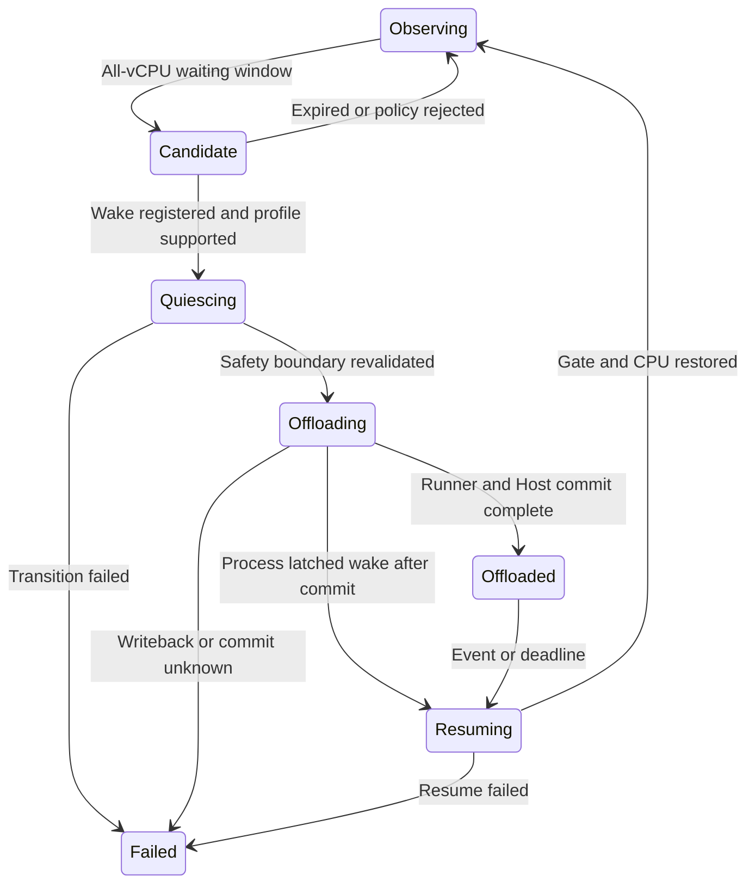

# vCPU idle observation and automatic RAM offload (EXP-001)

| Item | Current status |
|---|---|
| Stage | **Observation prototype stage (M0); not all exit gates passed** |
| Main goal | Reduce residency during VM waiting windows and restore automatically on host events |
| Default behavior | Existing behavior retained; no automatic-offload switch |
| Preferred route | pVisor vCPU/host observation without Agent or guest-kernel changes |
| HVF | Wait/timeout observation and all-vCPU aggregation integrated; compilation/runtime validation pending |
| KVM | Real VM API and experiments validated; KVM_RUN remains Unknown, with no reliable idle signal |
| Foundations | Pause/resume, RAM offload, device memory gate and Host backing commit |
| Main additions | Waiting-window observation, all-vCPU aggregation, policy owner, wake/deadline and lost-wakeup prevention |
| Pending | Complete idle sources, wake/deadline, automatic offload, HVF validation and offload-benefit experiments |

An Agent waiting for a model response, input or an external tool may retain resident VM RAM without useful execution. Short waits allow CPU sleep; longer waiting windows can justify offload to reduce memory-time cost. Resume continues the same live Attempt rather than creating a persistent checkpoint or restarting it.

The host decides whether to offload using window length, memory pressure, device safety, restoration budget and supported profiles. A blocked thread alone does not trigger immediate offload.

## 1. Problem statement {#problem}

### 1.1 Waiting windows and resident memory

An Agent waiting for a model, network or external tool may retain resident VM RAM without useful computation. CPU sleep reduces execution cost; memory reclamation additionally needs a sufficiently long window, safe parking and timely restoration of the same Attempt.

Three questions guide the design: identify useful waiting across relevant vCPUs, restore reliably on network/control/timer events, and establish whether memory-time savings cover observation, commit and restore costs.

### 1.2 Backend foundations and observation gaps

| Backend | Existing integration | Proposed route | Limits |
|---|---|---|---|
| HVF | WaitForEvent/Timeout and wait channel in `vmm/macos/vstate.rs`; virtual timer read in `hvf/mod.rs` | Wait enter/leave sequence, available deadline, independent owner aggregating all vCPUs | WFE may be synchronization; other timer/IRQ sources need validation, beyond a single register |
| KVM | vCPU threads and `vmm/linux/vstate.rs` run loop | First observe candidate CPU-time/scheduling windows; investigate optional host KVM events | An unreturned KVM_RUN may be executing; low CPU may mean host preemption; Hlt currently means Stopped and retains that semantics |

KVM tracepoint/eBPF or userspace halt handling are candidate routes. Kernel interfaces, privileges, overhead and compatibility remain unverified. The first stage changes neither irqchip nor global sysctl and requires no privileged tracing. Ambiguous states remain Unknown and reject automatic actions.

Current real KVM M0 experiments found no reliable waiting signal; HVF wait integration has no real-hardware validation. [Validation](#validation) preserves results and uncovered scope separately. Automatic-policy wake/deadline integration remains pending.

### 1.3 Goals and scope

Discover waiting windows from pVisor vCPU and host events, offload RAM automatically, and restore when execution is needed, without changing the Agent or guest kernel. Observation determines when offload may help; existing CPU/device quiescence and backing commit determine how to offload safely.

Excluded scope includes proof that all Linux processes are blocked, general checkpoint/migration, frozen guest time, arbitrary devices or every memory-mechanism combination, and promised production-density multipliers.

## 2. Core design {#core-design}

### 2.1 Architecture, ownership and integration



- `pvisor-vm` owns backend observation and CPU/device control. Public contracts belong in `api.rs`; the experiment does not expose private VMM modules.
- `pvisor` owns policy, Host backing commit, Attempt lifecycle, configuration and explainable events.
- Event sources such as OverlayNet notify wake before guest RAM access or potentially blocking channels.
- One control owner serializes automatic policy with manual pause/resume/checkpoint/cancel; existing completion ownership remains intact.

Observation states, snapshots and `VcpuObservationControl` are implemented in `api.rs`; see [Validation](#validation). The Host automatic-policy owner, wake/deadline and automatic-offload state machine remain proposed.

### 2.2 Aggregation and candidate windows

M0 defines Executing, HandlingExit, WaitingForEvent, HostDescheduled, ManualPaused, Stopped and Unknown. Candidates require every online vCPU to wait and policy conditions to hold. HostDescheduled is not guest idle; waiting states are opportunities, not Linux runqueue truth.

### 2.3 Wake, deadlines and commit order

Required information includes Attempt identity, CPU topology generation, observation sequence, idle epoch, pending wake sequence, park reason, available deadline and clock domain.

Latch wake throughout Candidate/Quiescing/Offloading/Offloaded; preserve already-pending events. Revalidate observation and event sequences after entering the stop boundary. Wake arriving during Host backing commit waits until commit completes, then restores immediately; RAM writers do not reopen earlier.

Network data, EOF, errors and connection completion are semantic wake sources. Socket writable/ordinary ACK events do not unconditionally trigger wake. Wake precedes virtqueue/memory-gate access and is handled by an independent owner. Device threads do not synchronously resume while holding queue/proxy locks. Recheck pending events/rings after restoration rather than relying only on fresh EPOLLET edges.

The earliest valid timer deadline must cover the profile, with explicit guest/host time conversion and advance margin. Unknown or short deadlines skip offload. A watchdog provides PoC fault tolerance, not exact timer support. Existing pause retains wall time; freezing time does not hide expired timers.

### 2.4 States and failures



Busy, unsupported and short-window results are normal rejections before a destructive transition. Existing drain timeout calls fail_control; a poisoned runner cannot continue as though policy merely rejected offload. Cancelling an initiated transition requires proof of restored state before returning to Observing.

Automatic wake releases only the automatic park owned by that owner/epoch. Manual pause, snapshot freeze and failure states preserve their control semantics. The guest cannot forge Host authority or bypass limits. Misclassification can harm performance; lost wake, missing timers or skipped commit can break correctness.

### 2.5 Initial profiles

- Ordinary writable shared file-backed RAM, raw offload, same live Attempt.
- One vCPU first; expand after SMP aggregation/epoch acceptance.
- Network wake initially uses existing OverlayNet IPv4 TCP, with explicit timer/control-wake support.
- No in-flight virtio-fs requests; skip slow I/O and preserve existing RAM leases during discard.
- Exclude cold pager/pool, restored private COW, unguarded devices and unknown wake sources.
- Remain observe-only until backend deadline/wake is validated; clearer HVF integration points do not establish macOS-wide support.


### 2.6 Current constraints {#constraints}

- Guest-kernel notifications are not required initially; PV notifications remain a possible precision improvement.
- Observation supplies opportunity signals rather than proof that every Linux process is blocked. Safe offload still requires CPU/device quiescence and backing commit.
- Initial scope is ordinary file-backed RAM. Cold pager/pool and whole-VM offload are mutually exclusive; private restored COW does not support this discard route.
- Platforms/devices with incomplete deadline/wake support remain observe-only.
- Automatic wake does not release manual pause, snapshot freeze or failure stops, or grant guest Host-control authority.

Existing manual-offload data supports baseline cost analysis. Automatic policy has no established production-density benefit; observation results do not authorize automatic offload, and a design does not establish acceptance.

### 2.7 Implementation and acceptance {#implementation-plan}

> M0 observation API, backend integration and experiments are implemented. Automatic idle/offload remains pending. Completed and unvalidated work are recorded separately in [Validation](#validation); no fixed schedule is promised.

#### M0: baseline and observe-only

- [ ] Review current backend idle, IRQ, timer, offload, device gate and Host commit paths.
- [x] Define cross-backend observations and Unknown semantics within the VM public API boundary.
- [x] Register vCPU identity/topology generation, enter/exit sequence, waiting windows and rejection reasons.
- [ ] Collect HVF wait/timeout observations; validate low-cost KVM candidates and distinguish guest wait from host preemption.
- [x] Integrate one VM-local collector that records without pause/offload; the Host policy owner remains pending.
- [ ] Validate cross-platform overhead, exit cleanup and capacity. KVM bounded sampling and engineering A/B are complete; HVF remains unvalidated.

Exit gate: explain real workload waiting windows without interpreting absent KVM exits, low CPU or manual pause as precise idle. Platforms lacking reliable information return Unknown.

#### M1: controlled wake loop

- [ ] Add an independent wake latch covering candidate, drain, offload and park windows.
- [ ] Register network data/EOF/errors/connection completion before RAM access or bounded-send waits.
- [ ] Define deadline clock domain, restoration margin and timer cancel/reprogram rules.
- [ ] Deliver wake to the existing Host control owner, preserving backing-commit order after runner ACK.
- [ ] Arbitrate automatic, manual, snapshot, cancel and failure states.
- [ ] Recheck queue/backend after resume, retaining consumed edges.

Exit gate: fault injection and controlled interleavings prove no lost wake; profiles with unknown deadlines reject automatic deep parking. Mock passes still require real VM validation.

#### M2: restricted single-vCPU raw-offload PoC

- [ ] Keep disabled by default; name and connect proposed enable configuration only after implementation review.
- [ ] Check ordinary file-backed RAM support; exclude pager/pool/private COW.
- [ ] Reject in-flight filesystem I/O and unguarded devices early; real drain failure is not routine policy rejection.
- [ ] Define initial grace, deadline guard, reentry cooldown and wake-frequency suppression.
- [ ] Restore the same Attempt under real delayed-network, timer and control wake, verifying all content.
- [ ] Preserve fail-stop/unknown behavior for offload/store/restore failures and actual terminal state.

Exit gate: correctness, authority and lifecycle negative controls pass. Mark only validated platforms/profiles as restricted PoC.

#### M3: SMP and additional events

- [ ] Aggregate all online vCPUs; test cross-CPU wake/IPI and migration/topology races.
- [ ] Keep RAM resident when one CPU runs; do not reuse old epochs after exit/restore.
- [ ] Expand to vsock, terminals and signals without synchronous transitions under proxy/queue locks.
- [ ] Cover multiple connections, streaming, backpressure, restore storms and deadline races.

Exit gate: record each support-matrix cell. SMP mocks do not replace real guest validation.

#### M4: benefit experiments and continuation decision

- [ ] Register the automatic-policy question, role, runner and statistics under `benchmark/README.md`.
- [ ] Use identical tasks/hardware/budgets/artifacts, randomized paired on/off runs across rounds; manual policy can be a separate control.
- [ ] Separate waiting, compute, short blocking, streaming, timer-heavy and restore-storm workloads.
- [ ] Measure memory-time integral, cgroup/PSS/cache, complete-group peaks, CPU/IO, restore and full-task latency, failures and useful throughput.
- [ ] Explain observer/global-scanner costs outside the measured group; low PSS or configured capacity does not establish production density.
- [ ] Retain failures, interference and provenance; correctness failures do not count as benefit and samples are not selected for appearance.

Promotion gate: net resource benefit on explicit workloads while meeting QoS, with reproducible tests and explainable actions. Adjust or retire policies when thrash, CPU/IO or restore cost offsets savings.

#### Suggested code ownership

| Owner | Responsibilities | Validation |
|---|---|---|
| `crates/pvisor-vm/src/api.rs` and private backends | Observation contracts, wait/deadline, CPU control and device gate | API boundary, states/epochs, timers and RAM correctness |
| `crates/pvisor/src/executor/vm/` | Observation/control channels, backing commit and profiles | Drain/commit/wake concurrency and fail-stop |
| `crates/pvisor/src/runtime/` | Attempt arbitration, automatic policy and events | Authority preserved across manual/automatic/snapshot/cancel |
| `crates/pvisor-overlaynet/src/vm.rs` and later device sources | Wake-before-RAM and external socket lifecycle | Data/EOF/errors/backpressure/already-pending events |
| Existing crate and product integration tests | Mock interleavings and real VM validation | Separate platform passes, failures and skips |
| `benchmark/` | Registered policy experiments | Independent data/receipts/samples outside this directory |

These responsibilities do not predefine new files or dependencies. Implementation follows the existing code structure.

#### Required negative controls

| Scenario | Expected behavior |
|---|---|
| Compute busy, host CPU congestion | Low CPU does not establish guest wait; misclassification still preserves the safety boundary |
| Sleep/futex deadline, timer cancellation | Timers retained, time not frozen; unknown deadlines reject offload |
| Wake in any offload window | Latched and eventually delivered without requiring a repeated guest event |
| Slow filesystem I/O retaining RAM lease | Skipped early; actual transition failure is fail-stop |
| Manual pause or snapshot freeze | Network/automatic deadline cannot release it |
| Network arrival during backing commit | Resume after commit; RAM writers do not open early |
| KVM Hlt/guest shutdown | Shutdown semantics preserved |
| Cancel/exit while offloaded | Correct cleanup and terminal state; no permanently unwakeable owner |
| Unsupported pager/pool/COW | Explicit rejection without runtime-state changes |

#### Validation record template

Record date, platform, stage/profile, source SHA and dirty manifest, binary/firmware/rootfs identity, commands, results, failures/skips, uncovered cases, evidence paths and conclusion. See [Initial implementation and validation](#validation) and the [KVM engineering report](https://github.com/DeepLink-org/pvisor/blob/main/benchmark/pvisor/vcpu_idle_report.md).

Use targeted `just test PACKAGE` by default; real VM/special runners follow existing contracts. PASS and semantic approval stay separate; AI does not edit real ledgers. Update user documentation and formal support matrices after successful experimental implementation.

### 2.8 Initial implementation and validation {#validation}

#### Current conclusion

**M0 observe-only observation and real VM experiments are delivered; the automatic-offload loop remains pending.** KVM measurements show current userspace integration points cannot identify waiting: sleep/busy/short-timer/SMP observations are almost entirely Unknown. Low CPU, unreturned KVM_RUN and shutdown HLT retain their existing meaning rather than being reclassified as idle to complete the policy.

HVF wait paths are integrated, but this Linux workspace has no actual macOS compilation or runtime validation. M0 has outstanding exit gates; M1/M2 are unimplemented, with no new automatic-offload CLI switch.

#### Actual code and API

- `crates/pvisor-vm/src/api.rs`: `VcpuObservationControl`, states/rejection reasons, per-CPU records and aggregate snapshots; public contracts are concentrated here.
- `crates/pvisor-vm/src/vcpu_observation.rs`: default-disabled per-VM collector, no background threads/event queue, O(vCPU count) memory, session/sequence/topology generation/idle epoch, accumulated waits and rejection reasons.
- `crates/pvisor-vm/src/vmm/{builder,mod}.rs`: collector lifecycle and CPU injection.
- `crates/pvisor-vm/src/vmm/{linux,macos}/vstate.rs`: backend observation; manual park and stop retain existing control semantics.
- `crates/pvisor/examples/vm_vcpu_observe.rs`: real SDK VM, bounded sampling and guest correctness workload.

```rust
use pvisor_vm::api::VcpuObservationControl;

handle.set_vcpu_observation(true)?;
let snapshot = handle.vcpu_observation()?;
handle.set_vcpu_observation(false)?;
```

This API does not pause/resume/offload. Enabling during execution does not kick CPUs; state remains conservatively Unknown until the next observation point. KVM Executing marks entry, KVM_RUN stays Unknown, and return becomes HandlingExit; HLT remains stopped. HVF WaitingForEvent represents a wait/select window that may immediately consume ready events rather than precise sleep or Linux runqueue state.

Configured CPU online state reflects backend lifecycle, not guest Linux CPU-online. Stopped/unstarted slots do not count as all-CPU idle. Even a valid all-waiting result rejects automatic action with WakeDeadlineUnavailable.

#### Experiments and results

Registered as **B-VCPU-IDLE-ENG**, engineering A/B, outside user benchmark articles. See the [Protocol](https://github.com/DeepLink-org/pvisor/blob/main/benchmark/pvisor/vcpu_idle_plan.md), [Report](https://github.com/DeepLink-org/pvisor/blob/main/benchmark/pvisor/vcpu_idle_report.md) and [Reproduction entry](https://github.com/DeepLink-org/pvisor/blob/main/benchmark/pvisor/README.md#vcpu-observation-m0).

Matrix: sleep, busy and 2 ms short timers with 1/2 vCPU, plus a 2-vCPU case with only CPU 0 busy. Each fresh VM has 256 MiB RAM, a 3-second workload and 10 ms sampling. Observer off/on uses seeded randomized pairs, five pairs per case, 70 VMs total. Guest multiprocessing and affinity checks prevent GIL serialization; each worker verifies SHA-256, execution interval, exit and output.

| Item | Actual result |
|---|---|
| Original preflight | 0/14 valid; all passes/failures retained; Python 3.14 forkserver bootstrap error |
| Independent preflight after explicit-fork fix | 14/14 valid, 0 failures |
| Formal batch | 70/70 valid, 0 failures/timeouts, 35 complete pairs |
| Periodic sampling | 10,613 snapshots, 16,666 CPU-state records |
| Unknown | 16,657 records, 99.946% |
| WaitingForEvent / all-waiting epochs | 0 / 0 |
| Paired task wall-time difference | 95% CI includes 0 for every case; no difference detected |
| Median paired VM CPU difference | +48.253–+88.676 ms; 2-vCPU busy CI includes 0, others positive |
| Snapshot plus JSON Value construction time | Descriptive median 24.566 µs; excludes JSONL writing |

Overhead includes collector, sampler and evidence I/O rather than pure integration-point cost. GNU debug, one host and n=5 per case, without cgroup limits or continuous interference detection, establish no release, P95/P99, production density or machine-wide saving. Offload was not called; no reclamation or restore-latency result exists.

#### Validation and artifact boundaries

- Final `just test pvisor-vm`: 345 passed, 8 skipped, including real KVM busy-loop/OUT/HLT special tests and SMP/session/concurrent-sampling/exit/capacity/statistics regressions.
- Python runner: 16 unit tests passed, covering explicit fork with default forkserver, timeout, provenance, topology and output rejection.
- Example debug build and formatting checks passed; Linux VM library Clippy passed. Tests Clippy was blocked by existing dependency warnings in pvisor; unrelated code was retained.
- macOS/HVF compilation and runtime remain unvalidated; lost-wakeup, complete timer/deadline and automatic restoration are untested.

The measurement binds frozen binary SHA-256 `af6830774dfd9fef042893c7491c38077377cf7032afeb1add3af433ca83f239` and report SHA-256 `036094ed87fcc5ffd7d7c73d28cd932350bbd16499fae6b8ae28f4655e5bf339`. Full provenance/assets are in the report; raw evidence remains at `benchmark/pvisor/.data/vcpu-m0-fork-pairs5-20261007/`.

**Two issues were fixed after measurement: snapshot timestamps consistent under the lock, and per-CPU wait accounting truncated by disable.** Final unit tests cover these fixes, but the frozen binary was not replaced and real A/B was not rerun. Results above belong to the earlier frozen version. Concurrent external development means old receipts reject current sources; future measurement needs a new build/cohort rather than edited historical results.

#### Gates and experiments for the next version

1. **KVM signal first:** investigate host KVM halt/wake interfaces, VM/vCPU correlation, preemption separation and bounded privilege/overhead. Preserve irqchip, HLT shutdown and global sysctl initially; remain Unknown without a reliable source.
2. **HVF on real hardware:** validate wait integration, short timers, single-busy-CPU SMP and pending events under the same matrix. Add host-congestion controls and lower-cost aggregate-only sampling; a wait window does not establish a future deadline.
3. **M1 correctness:** inject wake-before-RAM events during candidate/drain/commit/park; cover timer reprogram/cancel, manual pause, cancel and failure. Prove events retained and authority preserved.
4. **M2/M4 reclamation A/B:** after the loop passes, compare off/on for ordinary file-backed raw RAM, one vCPU and explicit network/timer profile. Register/complete an independent protocol; measure waits of 0.1/1/5/30/60 seconds, compute/streaming/short timers/restore storms and repeated/random working sets. Fix group budgets; include cgroup/PSS/cache/helper, memory-time integral, CPU/IO/peaks, full-task latency and valid results. These experiments remain unmeasured, with no assumed saving multiplier.

The experiment exposed the Linux observation gap before automatic-policy implementation. It supplies no benefit claim for an automatic-offload policy that remains pending.

## 3. Alternatives and comparison {#alternatives}

### 3.1 Waiting-observation routes

| Route | Advantage | Cost and limits | Choice |
|---|---|---|---|
| Existing userspace vCPU/host points | Reuse VMM without Agent/guest-kernel changes | HVF waits need timer/IRQ validation; KVM_RUN does not establish waiting | M0 route, observe-only with incomplete information |
| Host KVM observation extension | Potential halt/wake sources | Interfaces, permissions, VM/vCPU correlation, preemption separation and overhead unvalidated | Next Linux research focus |
| Guest PV cooperation | Potentially clearer waits/deadlines | Guest protocol/kernel adaptation; Host retains authority and safety control | Optional, independently accepted extension |
| Low-CPU/fixed-time heuristics | Simple candidate discovery | Does not prove guest waiting or supply complete wake/deadline | Insufficient standalone offload basis |

Every route uses existing quiescence and backing-commit boundaries. Observation changes opportunity precision/cost while retaining safe park/wake protocols.

### 3.2 Policy and full cost

Start with explainable grace, deadline guard, minimum re-park interval and thrash suppression, then investigate pressure-aware policy. Experiments determine parameters; one manual-offload result does not set production defaults.

The target is reduced memory-time integral while preserving task QoS. Include complete cgroup/PSS/cache/helper costs, CPU/IO, peaks, restore latency, throughput, failures and valid results. Short blocking uses CPU sleep; longer windows reclaim RAM; longer parks may later justify compressed backing.

### 3.3 Implementation choices and gates

First establish whether host-only observation is useful. Guest PV remains optional; precision ambitions should not indefinitely expand the first version.

Retain the host-driven observe-only route first. After reliable observation and wake/deadline pass, validate single-vCPU raw offload with ordinary file-backed RAM. Compressed backing, additional devices and SMP expand under separate benefit/correctness gates.

Automatic policy requires reliable signals or explicit rejection, no lost wake, complete timer support and real VM restoration. Then compare memory-time, CPU/IO, full-task latency and useful throughput under identical tasks/budgets; adjust or retire routes when costs offset benefit. See [Implementation](#implementation-plan) and existing [Validation](#validation).
