# Architecture overview

Agent execution requires ongoing management of tool processes, file and network access, task state and resources. In local workflows, pVisor constrains access, isolates file changes and supports result review. On cluster execution nodes, pVisor provides managed sandboxes for inference, evaluation and training frameworks, supporting concurrent tasks and branches through lifecycle management, image and memory optimization, and state reuse. Both scenarios share the same underlying mechanisms; the frameworks own cross-node scheduling and task orchestration.

## 1. Overall architecture and component responsibilities {#architecture}

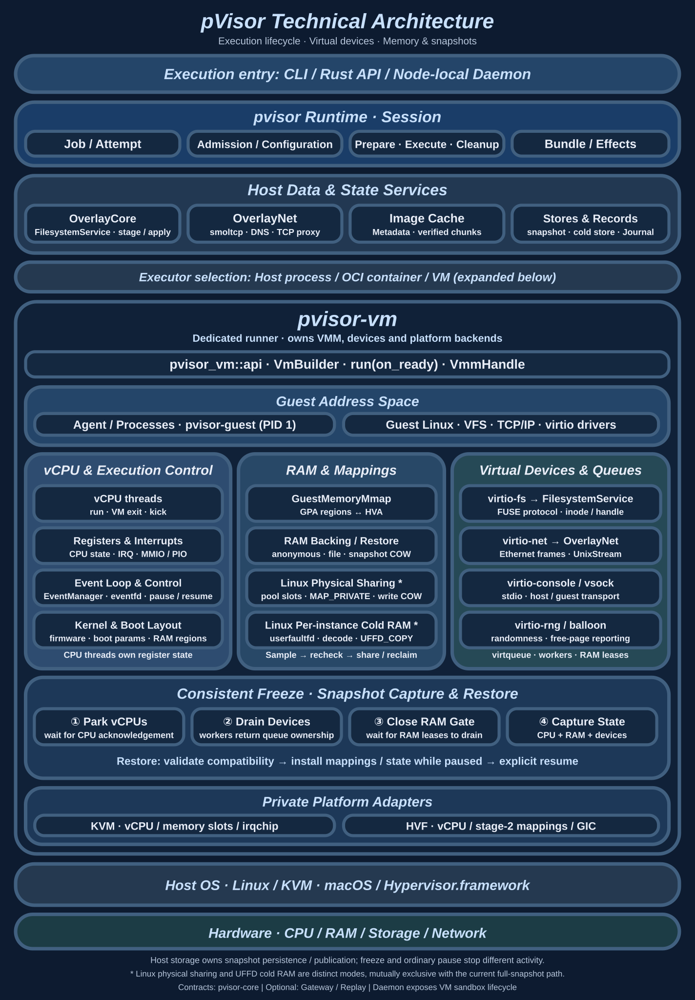

pVisor organizes task execution on the Host and manages execution environments through file, network and state services. The components have the following responsibilities and relationships:

| Components | Responsibilities and relationships |
| --- | --- |
| **Runtime and Executor** | The Runtime organizes task execution and resource management; the Executor carries out requests in a specific execution environment. |
| **OverlayCore and OverlayNet** | Manage file views and candidate changes, and network egress, respectively, enforcing access rules on file and network interactions. |
| **Image Cache** | Provides reusable image metadata and content for demand reads. |
| **VMM and guest** | The Host-side VMM manages VM resources and devices; the guest kernel and tool processes execute tasks. |
| **State storage and execution records** | Preserve recoverable state and execution facts for task restoration, result review and failure reconciliation. |

The Runtime starts and manages execution environments through Executors. In the VM path, the VMM runs the guest to execute tools; guest file and network requests pass through virtual devices to OverlayCore and OverlayNet, while Image Cache supplies image content for file reads. OverlayCore retains candidate changes produced during execution. State storage and execution records preserve supported recovery state and execution facts, respectively, for subsequent restoration and review.

## 2. A task from start to finish {#execution}

Consider a VM tool execution: an Agent reads `config.toml`, queries an external HTTPS service and modifies the configuration. Workspace staging is enabled, retaining file changes as candidates for subsequent review. See the [local workflow quick start](../start/first-run.md) for enabling staging and default write behavior.

### Job, Attempt and Session

Three concepts connect task identity, actual execution and resource management:

| Concept | Role in this execution |
| --- | --- |
| **Job** | Gives the managed task a persistent identity linking state, records and candidate results. |
| **Attempt** | Identifies one actual execution; the example's reads, queries and modifications occur within this execution. |
| **Session** | The internal Runtime object managing this execution's resources, organizing preparation, cleanup and result persistence. |

An Agent's application task can include multiple model interactions and tool calls; the caller decides how to map them to Jobs. See [Execution model](execution-model.md) for Job/Attempt identity changes during checkpoint restoration and branching.

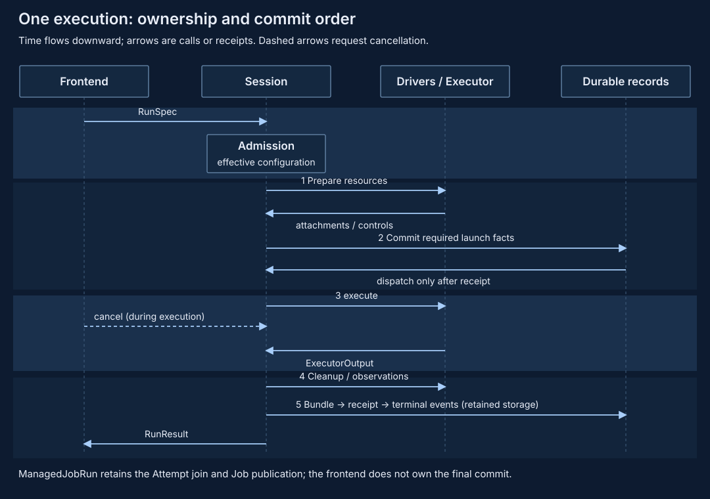

Execution proceeds through three stages:

1. **Preparation.** Resolve requests and policies, check executor capabilities, and prepare file, network and execution resources.
2. **Execution.** Commit required launch records before starting tools, associating execution with the current Attempt. Tools read the configuration, query the service and retain file changes in the stage.
3. **Completion.** After tools exit, clean up resources and check installed controls. When storage is retained, save the Bundle, commit an Attempt completion receipt binding the result to its Bundle digest, then publish terminal events. File candidates still await caller review and acceptance; see the [Attempt completion protocol](execution-model.md#attempt-completion).

Cancellation requests, tool exit and task completion are distinct events; Runtime and the durable Job service must still finish cleanup and save results. See [Execution model](execution-model.md) for preparation failure, cancellation and completion rules, and [Core architecture](architecture.md) for the call sequence.

### Effective policy and installed controls {#_2}

Admission produces a consistent effective configuration for drivers and executors. Successful policy resolution does not establish enforcement; installed controls and observed results still require checking. See [Execution model](execution-model.md) and [Core architecture](architecture.md) for configuration propagation and policy narrowing.

## 3. VM execution and Host/guest interaction {#os-foundations}

In the VM path, tool processes use system calls provided by the guest kernel. Requests for Host-provided file and network resources pass through virtual devices to Host services. The VMM manages vCPUs, guest RAM and device execution, coordinating tool execution with resource access.

### Processes, kernels and virtual machines {#_3}

Ordinary instructions and most guest-kernel work run through hardware virtualization. Only device requests requiring Host services enter their corresponding host implementations. Guest tmpfs operations and kernel-cache hits do not automatically become OverlayCore requests. See [VM subsystem](vm-runtime.md) and [Isolation mechanisms](isolation.md) for kernel and control-point differences across execution environments.

### Virtio: carrying I/O through shared queues

In the pVisor VM path, virtio-fs connects guest file access to Host-side file services. Guest tools read and modify files through ordinary file interfaces. Requests within the managed file view are handled by Host-side OverlayCore according to access rules, and results are returned to the guest.

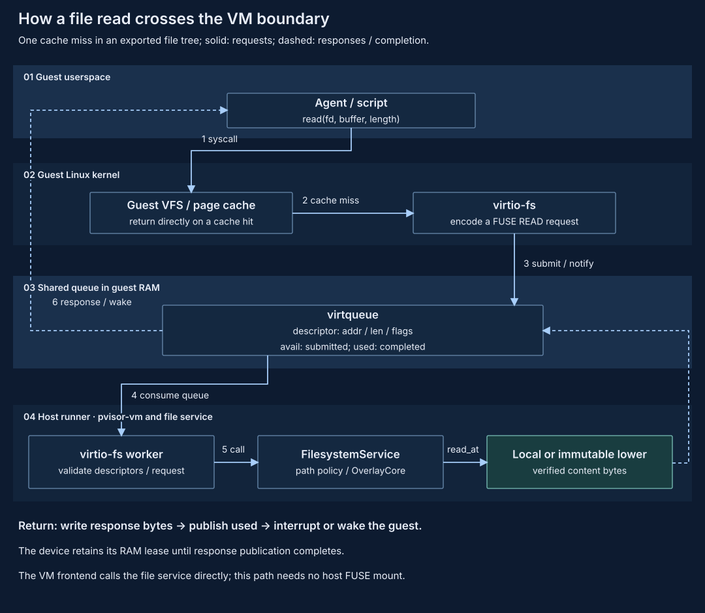

For a file read that misses the guest page cache:

1. The guest tool reads a file, and the guest kernel routes the request to the virtio-fs driver for that file's mount.
2. The Host device implementation validates the request and calls the file service. OverlayCore handles authorization and the file view to access the required content.
3. The Host writes results into guest buffers and notifies the guest to continue execution.

Requests and responses travel through shared queues and buffers in guest RAM. Access to that memory must remain valid while devices process them.

Host and VM file-access adapters reuse file-service semantics while owning their protocol state and request lifecycles. See [Shared filesystem service](overlayfs.md#filesystem-service).

## 4. File staging: copy-up and conflict detection {#file-mechanism}

File staging lets an Agent keep modifying an independent file view while preserving the target workspace until the caller reviews and accepts candidate changes.

### Layered views and private changes {#staging-layers}

Lowers supply existing file contents, the upper holds this execution's candidate changes, and the merged view is what tools see. Lookup checks the upper first, then lowers in priority order. This avoids copying the full directory tree upfront; it does not establish an immutable lower snapshot or deduplicated backing content.

On the first in-place edit of lower `config.toml`, OverlayCore copies the required contents into the private upper. Subsequent edits go to that layer, and tools read their own changes. The target workspace awaits Apply. Regular files generally use whole-file copy-up rather than block deltas.

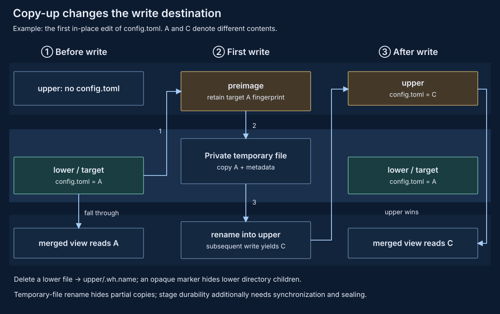

Staging must also represent deletions and directory changes. Candidates must satisfy completion and durability conditions before Apply. See [OverlayCore details](overlayfs.md#detailed-design) for deletion markers, directory materialization and synchronization policies.

### Preimage fingerprints and conflict detection {#staging-conflicts}

While an Agent produces candidate C based on target file A, an external edit may change the target to D. The upper retains C but cannot alone identify the target state it depends on. A preimage stores the target's content and metadata fingerprints so Apply can detect conflicts; it is not a complete copy of the old file.

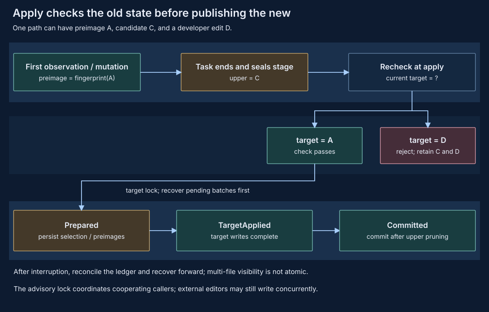

Conflict checks concern the target workspace that will receive changes. With additional lowers, tool-visible content may differ from the target baseline and must be tracked separately. See [Preimages and conflict baselines](overlayfs.md#preimages) for observation timing, live lowers and frozen layouts.

### Accepting candidates and recovery boundaries {#staging-acceptance}

Apply checks conflicts for selected paths, writes accepted candidates to the target workspace and records application progress. Unselected candidates remain available. Progress records support reconciliation and recovery after interruption; see [OverlayCore details](overlayfs.md#detailed-design) for batch stages and path dependencies.

Multi-file Apply is an ordered sequence of operations. External readers may see intermediate states, and the target lock coordinates only cooperating callers; it is not an atomic transaction against arbitrary editors. Drop discards remaining candidates without undoing accepted changes or external effects such as HTTPS requests already sent.

## 5. Images: shared contents and demand reads {#image-mechanism}

Agent execution environments often use similar tools and dependencies, while an individual task accesses only some files. pVisor separates image directory structure from file contents, allowing identical content to be reused across images and supported demand-loading paths to fetch content as tasks access it.

**Content sharing** reduces duplicate storage: each image retains its own paths, permissions, directories and hard-link identities, while the V2 content pool reuses equal content within its supported layouts. Large-file chunks can be shared across images; small files are packed in groups, so partially overlapping sets do not guarantee per-file physical deduplication. Sharing image content does not establish shared guest RAM across VMs.

**Demand reads** reduce upfront preparation by fetching required content when files are accessed. A run pins the image, platform and content version at startup rather than following mutable tags, preventing mixed versions within a task. Content sharing determines what can be reused; demand reads determine when to fetch it.

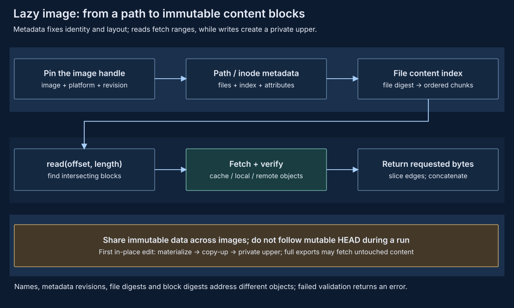

The file service uses pinned-version metadata to locate content. Cache hits are read directly; misses fetch and verify content from a local or remote backend before returning the requested range. See [Shared image cache](lazy-image-v2.md) for indexes, content blocks and version publication rules.

Docker-style local storage also uses the V2 compressed pool, but retains all encoded content after pull rather than fetching only a remote working set. See [Image V2 design](lazy-image-v2.md) and [Lazy image benchmarks](../benchmarks/lazy-image-startup.md) for the two paths' disk, read and memory costs.

Demand-loaded images supply base content for the file view, while task modifications enter a private upper. A first ordinary file modification may need to fetch original contents before copy-up; complete export or snapshot can also read previously untouched content. See [Shared filesystem service](overlayfs.md#filesystem-service) for VM integration and metadata projection.

Demand loading reduces preparation before execution while shifting some costs to first access. Benefits depend on the accessed files, cache state and write behavior. Evaluate cold-cache reads, warm-cache reuse, metadata access and copy-up costs separately.

## 6. Network access control and model interaction {#network-mechanism}

In the VM execution path, guest network requests pass through the virtual network device to OverlayNet on the Host, which checks access policy and establishes outbound connections. The guest and OverlayNet maintain one TCP connection, while the Host and external service maintain another. OverlayNet forwards data between them, placing outbound access under a common egress control point.

### From a hostname to two TCP connections

For `api.example.com:443`, the application requests a hostname, while connection establishment uses an IP address. pVisor's synthetic DNS retains a stable name/address mapping within an Attempt so OverlayNet can recover the logical destination when a connection request arrives. The synthetic address associates the connection with a hostname; it is not the external service's actual address.

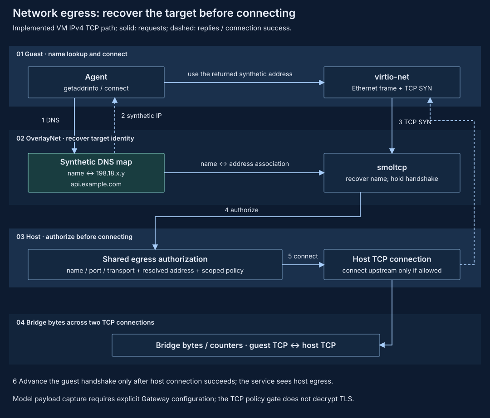

OverlayNet first checks the hostname, port and transport, then checks the Host-resolved addresses against the applicable policies. The guest handshake proceeds and data forwarding begins only after authorization and a successful outbound connection. Policy denial or connection failure is not reported as an established connection. See [OverlayNet](overlaynet.md#vm-request-path) for address visibility, supported protocols and transport implementation.

Selective Host/container network policy primarily relies on explicit proxies, whose coverage depends on applications using them. This differs from the VM egress path. See [Network control](../guides/policies/network.md) for executor-specific support.

### Egress authorization and model observations {#_7}

OverlayNet controls whether a connection may be established, but cannot read model messages inside ordinary TLS ciphertext. Gateway handles model requests routed through explicit protocol configuration, providing routing, protocol conversion and optional recording. It observes only model interactions that pass through it; other network requests and file writes remain managed by their respective paths.

Allowing an HTTPS connection therefore does not mean its model calls have been recorded. See [Gateway design](gateway.md) for model protocols and recording scope.

## 7. Memory sharing, write isolation and compression {#resources}

Agent execution environments may contain identical tools, dependencies and initial state, while subsequent changes must remain independent. Sharing reduces duplicate content, copy-on-write keeps each instance's modifications private, and compression reduces the space needed to retain content. Mechanisms depend on supported configurations and are not all enabled by default.

### Address mappings and shared content {#_4}

GVA is a guest-process virtual address, GPA a guest physical address, and HVA the Host mapping used to access guest RAM. Two VMs using GPA `0x1000` need not share a physical page; sharing depends on underlying content and mappings.

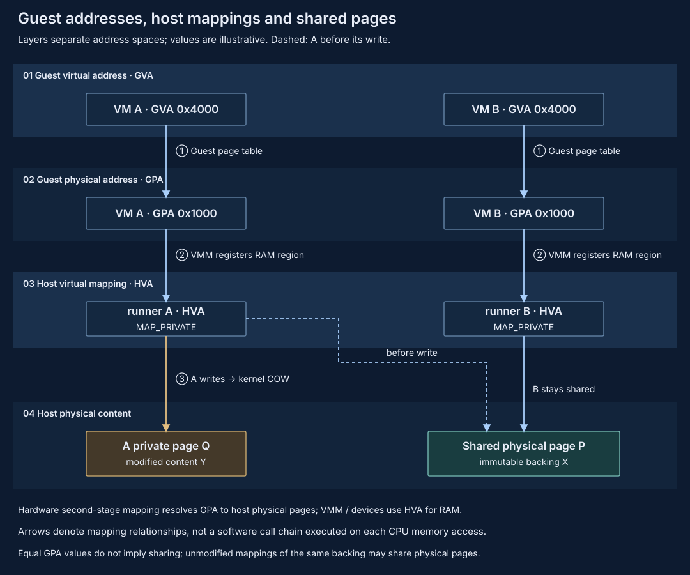

Address relationships and content sharing are different layers. The arrows do not represent software calls made on every memory access. See [Memory architecture](memory-optimization/index.md) for registration and mapping details.

### Sharing paths and private writes {#_5}

Sharing can start from a common baseline or discover equal pages during execution. The paths establish sharing at different times:

| Path | How sharing is established |
| --- | --- |
| Restore from a common baseline | Supported snapshot restoration paths create private COW mappings from the same verified baseline, reusing unmodified content. |
| Deduplicate running pages | The optional Linux physical pool identifies equal resident pages across VM instances and establishes shared mappings after rechecking their contents. |

For example, A and B initially read the same baseline. A's write creates its own page while B keeps reading the baseline. Copy-on-write preserves sharing benefits and independent modifications, deferring some allocation and copying until writes occur.

Live deduplication must recheck contents before replacing mappings to avoid losing changes made after sampling. Shared content must remain retained while mapped. See [Memory deduplication](memory-optimization/deduplication.md) for pool reference management, failure scope and supported configurations.

### Cold-content compression and demand restoration {#_6}

Unique content may also be stored in fewer bytes. Per-instance compression creates compressed objects and reclaims original resident memory only after confirming unchanged content and a reliable recovery source. Subsequent access requires decoding and restoration, adding CPU, allocation and waiting costs.

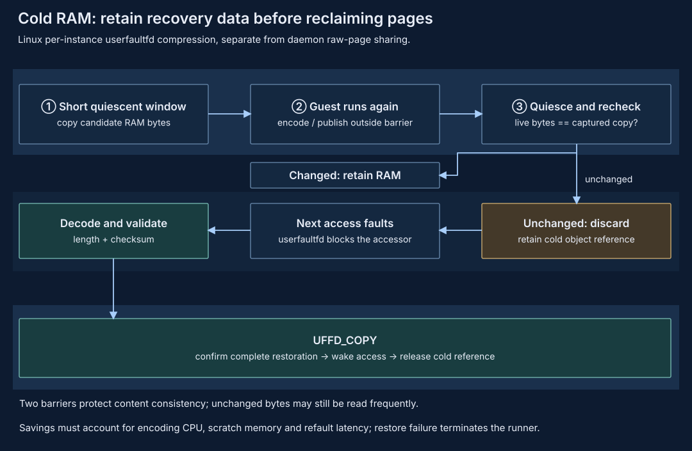

Per-instance cold compression remains an experimental Linux path. Unmodified content is not necessarily infrequently read. See [Per-instance compression](memory-optimization/compression-local.md) for reclamation conditions, budgets and fault recovery.

Lifecycle management determines when a running VM pauses, offloads resident memory and resumes execution; sharing and compression reduce the resource cost of retained content. Pause stops vCPUs, Offload saves RAM and requests resident-page reclamation once device-access conditions are met, and Resume continues the original VM. This differs from creating a durable checkpoint; see [Sandbox lifecycle management](../concepts/lifecycle.md#live-lifecycle).

These mechanisms have separate compatibility conditions, and their benefits cannot simply be added. Capacity evaluation must account for management overhead, restoration peaks and task latency. See [Memory architecture](memory-optimization/index.md) for combinations and measurement methods, and [Whole-VM offload](memory-optimization/offload.md) for offload implementation.

## 8. Execution checkpoints and state restoration {#snapshot-mechanism}

An execution checkpoint preserves a task's execution position so it can continue later. It must retain mutually consistent CPU, memory, device and captured filesystem state. **Pausing** vCPUs stops guest instructions, while Host-side device processing may continue. **Freezing** additionally coordinates device access to establish a safe capture window. A **checkpoint** is the recoverable state saved and durably published from that window.

For example, while a file read is pending, the Host may still be writing its result into guest memory. Saving memory before that write and device state after completion would restore a request marked as completed without its result data. Memory and device state must therefore be captured within the same coordinated window.

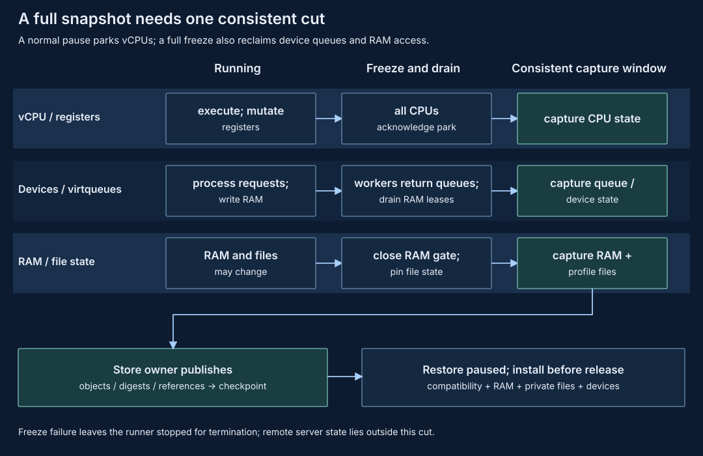

The VMM first stops vCPUs and coordinates devices to finish in-flight processing, allowing consistent machine-state capture. The higher-level state store saves the captured content, filesystem state and references needed for restoration, then publishes the checkpoint. Restore first validates compatibility and installs memory, CPU, device and file state while paused; execution continues only after installation completes. Failed freezing or restore validation must not release execution. See [VM requests and consistency](vm-runtime.md#freeze) for device coordination and failure handling, and the [Snapshot subsystem](environment-snapshot.md#consistent-cut) for capture and durable publication.

Execution checkpoints restore only the captured machine and filesystem state; they cannot undo changes already made by remote services. Current native Job full VM checkpoints require no network device, private RAM and an owned complete rootfs, so the preceding networked task cannot directly use this capability. See [Job checkpoint design](job-checkpoint-cli.md) for the full support conditions.

Workspace checkpoints preserve file progress without continuing the execution position held in CPU and memory. See [State preservation and branch reuse](../concepts/resource-reuse.md) for when to use each kind, and [Trajectory replay](replay.md) for reusing model context and tool history.

## 9. Execution events and durable records {#boundaries}

During task execution, components such as Runtime and Gateway produce events describing policy decisions, execution results and model interactions. An Event describes an observed fact. Journal stores events in commit order and returns a receipt identifying the event, its record position and durability. Successfully committing a record does not mean the task succeeded; a failure event can also be saved successfully.

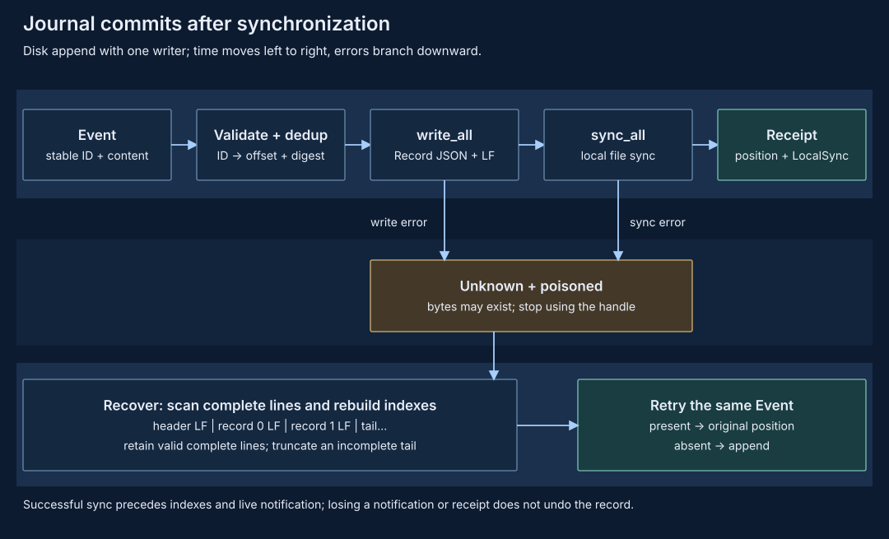

A disk Journal validates an event, writes its record and completes local synchronization before returning a LocalSync receipt. Live notifications support timely display, while complete history is read from Journal. The event ID identifies the same event, position gives commit order within one Journal, and causal references describe known dependencies. Commit order is not necessarily the order in which events occurred. See [Operation and Event](operations-events.md) for event fields and [Journal design](journal.md#append) for appends and receipts.

A record may have been written even if the caller did not receive its receipt. The caller therefore cannot assume it was not committed. After recovery, retrying the original event ID with identical content returns the original position if the record exists, or appends the event if it does not. Reusing an ID with different content is rejected. See [Journal recovery](journal.md#recovery) for handling unknown commit outcomes, handles and file recovery.

A Journal receipt confirms an event's record position and durability; an Attempt completion receipt binds the execution result to its Bundle. The Attempt receipt does not form one transaction covering Journal, file acceptance records and external effects. A missing terminal event does not establish that the task never completed; consult the [Attempt completion protocol](execution-model.md#attempt-completion). Event deduplication covers record appends, not exactly-once execution of commands or remote requests. Recovery must reconcile records with actual effects; see [Failure semantics and retries](failure-semantics.md#reconciliation) and the [Records and version matrix](records-and-versions.md).

Checkpoints preserve recoverable execution state, while Journal preserves observed execution events. Reading event history alone neither restores a VM nor repeats external operations.

## 10. Design tradeoffs and outcome evaluation {#principles}

The preceding architecture explains how pVisor manages execution boundaries, task state and resources. Research and evaluation ask a further question: while preserving execution correctness and isolation semantics, can these designs reduce task costs and support more concurrent tasks?

Benefits depend on the workload: access scope, the proportion of private writes and how often reclaimed content is accessed again all affect whether resource savings translate into more completed tasks.

Compare correct task completions, end-to-end latency and resource use with the same tasks, inputs, versions, correctness requirements and resource budgets. Include environment preparation, execution, waiting and restoration costs. Evaluating file-review benefits also requires actual review time, rejection and rework data; machine runtime cannot stand in for human effort.

See [Research directions](research/index.md) for hypotheses and evaluation methods, and [Benchmarks](../benchmarks/index.md) for existing measurements and their scope. [Experimental features](experimental/index.md) maintains exploratory designs and implementation stages. The [vCPU idle observation approach](experimental/vcpu-idle-offload/index.md) and [guest filesystem cache approach](experimental/guest-stage-cache/index.md) each document their own platform scope, validation results and remaining work.

## 11. Module collaboration and integration with higher-level systems {#results}

pVisor organizes execution through Runtime, enforces access rules through file and network services, manages resources through lifecycle, image and memory mechanisms, and separately retains candidate changes, recoverable state and execution events. Together, these modules provide a managed execution environment in which callers can inspect results, handle failures and, where supported, continue or branch tasks.

In local workflows, callers can review and accept candidate file changes. In execution infrastructure, higher-level frameworks assign tasks, collect feedback and decide subsequent actions, while pVisor manages sandboxes on execution nodes. Available capabilities differ by integration path. See [Choose an integration method](../guides/infrastructure/integration.md) for interfaces and support scope, and [Single-node daemon architecture](daemon/index.md) for the Daemon's runtime, resource pool and API boundaries.
