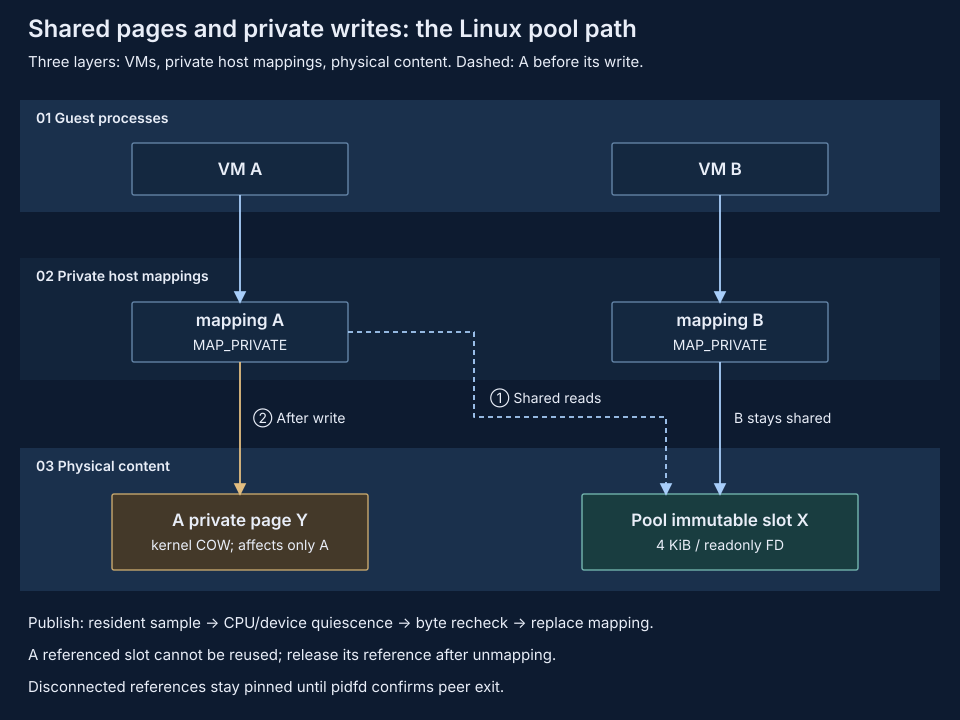

# Memory deduplication

Share identical content across pVisor instances while preserving independent writes and exits. Deduplication removes duplicate copies; it neither compresses unique content nor saves complete machine state.

## Architectural goal {#architecture}

Share known-identical immutable RAM baselines first. For duplicate private pages created during execution, explicitly select either the daemon physical pool or Linux KSM. Instances own checkpoint saving, compression, and restoration; sharing does not take ownership of the only copy of state. See [Memory optimization](index.md) for common boundaries.

| Approach | Shared content | Main tradeoff |
| --- | --- | --- |
| Immutable baseline + private COW | Unmodified pages restored from a common baseline | No scanning needed, but writes reduce sharing |
| Linux KSM | Identical private anonymous pages found by the kernel | No sharing service, but asynchronous scans consume CPU |
| Linux physical pool | Equal resident raw pages in different VMs | Scanning, slots/references, kernel COW and a separate process failure domain |
| Encoded-pool deduplication | Equal encoded cold objects | May combine with compression, requiring reclamation and restoration |

Encoded-pool deduplication is defined by [Pooled-server compression](compression-pool.md); the Linux physical pool shares raw resident pages and has a separate ownership contract.

## Immutable baseline sharing {#baseline}

Instances map corresponding ranges of the same backing object with `MAP_PRIVATE` for write isolation. Unmodified file pages can be shared; host COW makes writes private rather than directly connecting writable RAM between VMs.

Materialize compressed checkpoints into mappable immutable baselines, then reuse those baselines. Files with identical content but different inodes do not automatically share cache pages, and disk reflinks are not memory sharing. The baseline cache is a regenerable accelerator, not a replacement for persistent checkpoints.

Content validation and immutability are prerequisites for reuse. Instances hold their own backing references and leases; an instance exit or cache eviction must not invalidate another instance's mappings. Kernel-object/storage references should keep shared content alive rather than another instance's heap.

## Linux daemon physical pool {#physical-pool}



Explicit `serve --memory-pool` enables raw-page sharing in the daemon-owned pool. Candidates retain hashes only; content enters a bounded memfd slot after appearing in different VM sessions. With CPUs/devices quiesced, the VM rechecks bytes and maps equal pages using a read-only descriptor and `MAP_PRIVATE`. This path needs no userfaultfd and does not encode or compress unique pages.

References pin slots until mappings are removed; disconnects retain them until pidfd confirms peer exit. The pool owns live shared pages, so its loss fails dependent VMs. It does not supply durable snapshots or process-restart recovery. See [Shared working sets](../daemon/shared-working-set.md) for budgets and failure scope.

### Adaptive region scanning {#adaptive-scan}

The physical pager uses region scheduling inspired by [UKSM's hierarchical
region distilling](https://www.usenix.org/system/files/conference/fast18/fast18-xia.pdf).
The reference implementation is [dolohow/uksm at acb96fbc](https://github.com/dolohow/uksm/tree/acb96fbc9e04e7aa967e8e9af011494c77f58aed).
UKSM prioritizes productive regions and reduces work on regions with frequent
COW breaks. pVisor implements this scheduling idea independently in Rust.

Each eligible RAM mapping is divided into regions of at most 2 MiB. Four levels
allow 16, 64, 256 or 512 page probes per round. A region starts at the lowest
level. After at least eight samples, a successful-merge ratio of at least 10%
can promote it one level when churn is less than half the merge count. Observed
COW, a failed live-byte recheck or early release of shared pages contributes to
churn. Churn reaching half the merge count resets priority to the lowest level;
otherwise an unproductive round demotes it one level. Fully shared regions also
slow down as further samples stop producing new merges.

Every region keeps an exploration quota. A seeded coprime traversal covers all
page offsets before repeating, including partial regions, without storing a
per-page permutation. Regions receive round-robin visits of at most 64 probes.
Only the selected region receives a residency query; sparse RAM is not touched.
A batch examines at most 4,096 indexes, selects at most 1 MiB of candidates and
retains an 8 ms soft selection budget. Complete rounds yield for at least 250 ms.
The constants bound work; they do not guarantee a CPU percentage or a discovery
deadline under arbitrary RAM sizes, cooldowns, VM scheduling or IPC delays.

This policy controls Linux physical-page selection. It does not use guest
application VMA information, install a kernel patch or replace content identity
with UKSM's adaptive partial-page hash. Full hashes, byte comparisons, CPU/device
quiescence and the second live-byte check still gate sharing. The compression
pager retains its separate eviction/refault policy.

Deterministic tests cover coverage, fairness, priority changes, workload changes
and metadata bounds. The Linux x86_64 two-VM correctness probe passed on
2026-10-18: both guests completed content/private-write/file checks, and their
logs recorded scans, successful merges and COW breaks. Reproduce it with:

```bash
cargo build --locked -p pvisor-daemon --example compressed_pool_case
PVISOR_CASE_VM_LIBRARY_DIR=/absolute/firmware \
  PVISOR_EXPERIMENTAL_MEMORY_METRICS=1 \
  target/debug/examples/compressed_pool_case /tmp/pv-scan-check --physical
```

Use a fresh short output path. `result.json` includes guest outcomes and scan
counters. The probe uses two 256 MiB/one-vCPU VMs, keeps the pool alive and does
not require userfaultfd in physical mode. It measures no performance comparison
against linear scanning or UKSM; production CPU, latency and net-memory benefits
remain unvalidated.

## Linux KSM {#ksm}

KSM accepts `MADV_MERGEABLE` advice for suitable private anonymous RAM, with the kernel scanning, merging, and handling COW in the background. It requires neither discovery between pVisor instances nor a userspace service holding shared pages.

Successful registration is not evidence that pages have been scanned or merged, and provides no synchronous completion deadline. Instances register suitable regions only; an administrator or host coordinator owns global scanning budgets so instances do not overwrite each other's global settings.

KSM does not merge file page-cache pages. Adding advice to the current `MAP_SHARED` live backing does not enable deduplication. Anonymous COW pages from private mappings can be candidates, with eligibility and benefits validated on the actual kernel. macOS has no standard Linux KSM capability; UKSM is an algorithmic reference, not a deployment dependency.

The explicit `--memory-pool-mode compressed` alternative deduplicates decoded
64 KiB identities into sealed compressed objects and restores private RAM
locally through userfaultfd. Its component tests and two-VM service-loss
correctness probe are separate from physical-page-sharing evidence; see
[pooled compression](compression-pool.md).

## Key tradeoffs {#tradeoffs}

- **Explicit sharing versus background discovery:** Common baselines need no rediscovery; KSM handles dynamic duplicates at the cost of scanning delay and CPU.
- **Savings versus write costs:** Frequent writes break sharing, reduce benefits, and add COW costs. Initial sharing ratios alone cannot determine capacity.
- **Sharing versus isolation:** Restrict trust domains and assess content-presence side channels. KSM advice has no pVisor-defined domain parameter, so product labels alone cannot establish isolation.
- **Simplicity versus coverage:** The current physical pool uses bounded resident scanning. Arbitrary instant hot-page merging and P2P remain outside its scope; active shared slots and durable machine recovery are designed separately.

The first version does not combine KSM and userspace cold reclamation on the same region, avoiding redundant merging followed by copying and compression. See [Per-instance compression](compression-local.md) for unique but compressible cold content.

## Current integration and evidence {#direction}

`[vm].ram_dedup` is a default-off boolean; `--vm-ram-dedup` enables it and selects the VM executor. The runner explicitly calls `handle.advise_ram_dedup()` at VM startup and writes the best-effort installation report to stderr. Advice failures do not stop the VM. See the [CLI](../../reference/cli.md#vm-ram-dedup) and [configuration reference](../../reference/config.md#all-fields).

On Linux, ordinary private anonymous RAM and private COW mappings restored from snapshots are eligible for `MADV_MERGEABLE`. Live `MAP_SHARED` RAM is skipped, not converted to a private or anonymous mapping. Device windows, huge-page, non-writable or unaligned mappings are excluded; active cold paging or device preparation also blocks advice. On macOS, advice for otherwise eligible mappings reports unsupported. The report records per-mapping accepted, skipped, unsupported or error status; `accepted_bytes` counts only the ranges for which advice was accepted, not merged bytes, memory savings or proof that the KSM scanner is enabled. pVisor changes no global KSM settings and starts no new service.

`ram_dedup` conflicts with `vm.memory_pool`, `vm.ram_compression`,
`vm.cold_ram_compression` ([Linux local live pager](compression-local.md)) and the legacy `PVISOR_EXPERIMENTAL_MEMORY_POOL` opt-in. Advice preserves snapshot baselines, private writes and independently held backing references; it takes no ownership of the only state copy. Cross-workload content-sharing risks require explicit opt-in. Unavailable advice leaves the existing mappings intact, with no fixed saving ratio or scan deadline.

Current unit tests cover default-off configuration and round trips, CLI executor selection, conflict rejection, eligibility and partial reports, unchanged bytes and addresses, and restored COW write isolation and backing lifetime. They allow real advice to be unavailable and do not require a running scanner; they are not production acceptance or evidence of measured merging, savings or density.

The [proof of concept](proof-of-concept.md#correctness-evidence) preserves probes for shared baselines, independent writes, and reference lifetimes. The [cold pool](proof-of-concept.md#ownership) demonstrates encoded-object sharing, not active-page sharing. Existing mappings and experiments do not establish production acceptance for new backends.

Benefit comparisons must include COW, scan CPU, peaks, and application latency. Summed RSS is not unique physical usage. Linux KSM capabilities and statistics are governed by the [actual kernel interface](https://docs.kernel.org/admin-guide/mm/ksm.html).
