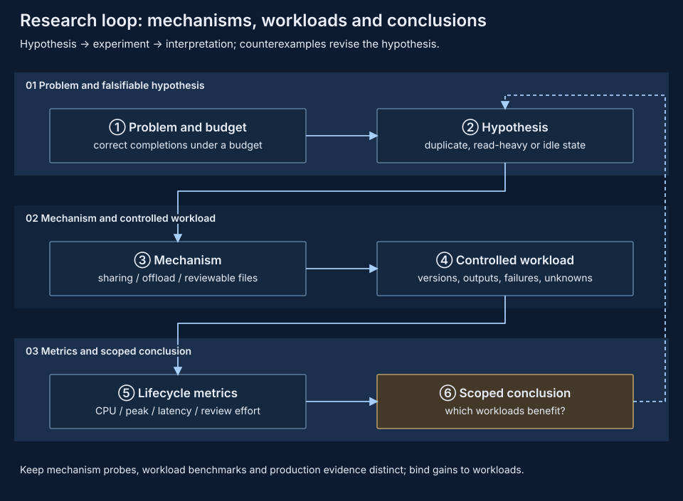
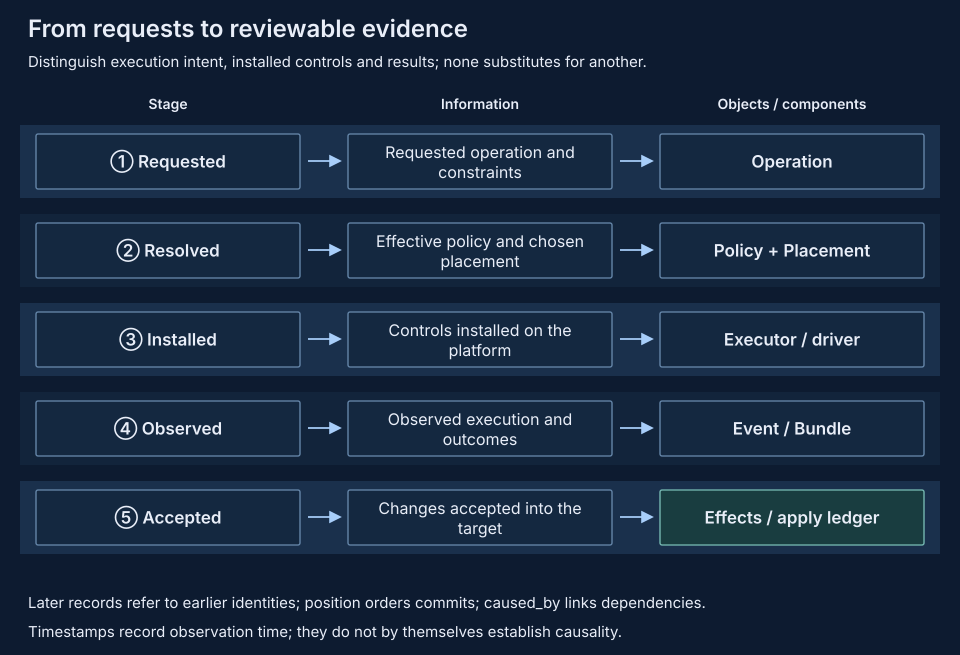

# Research directions

OS and MLSys research concerns correct task completions under a fixed resource budget and the human cost of handling their results. pVisor supplies execution, state and evidence mechanisms; orchestrators and trainers compose workloads and evaluate benefits through controlled experiments. For the full cost narrative across environment preparation, tool execution, model waiting and failure rework, see [Agent task lifecycle cost](agent-lifecycle-cost.md).

## From mechanisms to falsifiable conclusions {#research-loop}

A useful hypothesis specifies workloads and counterexamples. VMs with equal baselines and read-heavy access may benefit from shared pages; private writes reduce sharing, while scanning and COW peaks can erase ready-stage savings. Experiments pin correct outputs and budgets, and conclusions retain their scope.

## Execution and orchestration ownership {#ownership}

pVisor owns individual execution boundaries and observations; the node-local daemon owns sandbox identity and lifecycle. External orchestration (Kubernetes, Ray or training frameworks) owns host selection, queues, dependencies and application retries; trainers own models, sampling, reward and evaluator versions. pVisor does not replace them with a distributed product control plane.

The [daemon API](../daemon/index.md) does not expose native Job staging, execution checkpoints or Run Bundle export, so research integration needs an explicit execution/evidence handoff. Current responsibilities and open items per layer:

| Layer | Current responsibility | To integrate / validate |
| --- | --- | --- |
| Native pVisor execution | Job lifecycle, executor control, staging, optional Gateway and recording | Orchestration adapters and representative workload acceptance |
| Sandbox daemon | NativeRuntime VM admission, persistent supervisor identity, lifecycle and real service proxy | Bootstrap provisioning/validation and SDK profiles; no stage/checkpoint API or density evidence |
| Native node resources | Node-local immutable ownership, pins and bounded warming | Daemon integration, complete transient accounting and workload measurement |
| External orchestration | Host selection, queues, dependencies, retries and tenants | Explicit execution/evidence handoff and business side-effect reconciliation |
| Evidence/checkpoint stores | Native integrity, publication and retention contracts | Centralized collection, authorization, replication and cross-host compatibility |

A local record path or an uploaded JSON does not represent complete file transfer; a downloadable checkpoint does not prove compatible restoration on an arbitrary host. Archived measurements from the retired Controller/Worker implementation keep their historical scope and do not describe the current daemon.

## Three kinds of state and evaluation {#state}

| State | Retained content | Separate evaluation |
| --- | --- | --- |
| File checkpoint | Candidate files, conflict baselines and lineage | Branch isolation, publication correctness, copy-up and storage costs |
| Agent trajectory | Model context and tool history | Prefix preparation, re-execution differences and model continuation |
| VM execution checkpoint | CPU/RAM/device/file state of supported profiles | Consistency, compatibility, restoration and fork costs |

Tool re-execution produces fresh observations; remote service state and training metadata are retained separately. Execution success, task reward and file acceptance are evaluated independently: reward is computed by the evaluator, and a pVisor success is only an execution result.

## The execution contract of one rollout {#rollout-contract}

Inputs include the task ID, attempt ID, repository commit or image digest, workspace, agent command, policy, resource budget and random seed. Outputs include the end state, exit code, file candidates, the Run Bundle, the native trajectory, and the Gateway Journal when capture is enabled. The trainer associates these artifacts with model versions, sampling parameters, reward and evaluator versions. Environment-preparation failures, permission denials and upstream request failures have their own categories; infrastructure failures are handled by predetermined rules when evaluating model problem-solving.

The minimal integration order: first follow the [rollout guide](../../guides/rl-rollouts.md) to collect and score candidates for one offline task; then increase concurrency with separate workspaces so each attempt's files and records stay independent; finally attach native Agent trajectories and validate prefix preparation, tool re-execution and model continuation separately. Replay tools produce fresh observations, so a replayed run's new observations and the old session text are not simply the same experimental input.

What still needs experimental evidence: completed rollouts per second, tail latency, disk and resident memory per candidate, fork/checkpoint cost, tool re-execution cost and reward delta. Pin model-serving capacity and separate substrate bottlenecks from model-serving bottlenecks. Async queues, cross-node fault tolerance, reward deduplication, shared-prefix benefits and large-scale sampling still require integration and measurement.

## Levels of benefit evidence {#evidence}

- **Mechanism evidence:** verify bytes, mappings, write isolation, references and failure states.
- **Workload evidence:** pin tasks, inputs, output checks, model capacity and total resources; record correct completions, first results, restoration tails, CPU, peaks and memory-time.
- **Product evidence:** include preparation, SDKs, guest services, reclamation, sustained concurrency and failure scope.
- **Supervision evidence:** measure actual review effort, rejection and rework; machine CPU cost does not measure human attention.

Native pool or offload probes alone do not establish complete daemon density. Orchestration and RL adapters remain research/planning work, with benefits requiring their own workload validation; when injecting host loss, daemon/orchestrator downtime, partitions or full disks, a timeout or control identity does not prove that external side effects stopped, and retry policies must reconcile unknown side effects. This direction establishes neither cross-host restoration, exactly-once external side effects, nor daemon density advantages.

## Research questions {#questions}

- What minimal handoff between execution and orchestration preserves requested policy, installed controls, observed results and complete evidence?
- Which retained inputs and runtime compatibility checks make restoration portable, and which side effects need business reconciliation instead of replay?
- Under fixed correctness and audit coverage, how much supervision cost does batch review save, including collection and storage costs?
- Under the same total resources, can immutable sharing or bounded on-demand loading improve first useful results and complete completions?

Research plans do not create a product scheduler and do not replace production acceptance.

## Public materials and writing references {#references}

No formal papers, external reports or talks are currently registered; the public technical material is the design documentation and benchmark evidence in this repository (for example [replay fidelity](../../benchmarks/replay-fidelity.md)). Cite conclusions with the report date, machine, executor, workload and statistical scope. Design-writing practice and open-source expression references are maintained in the repository's [docs/README.md](https://github.com/DeepLink-org/pvisor/blob/main/docs/README.md) and are not repeated here.
