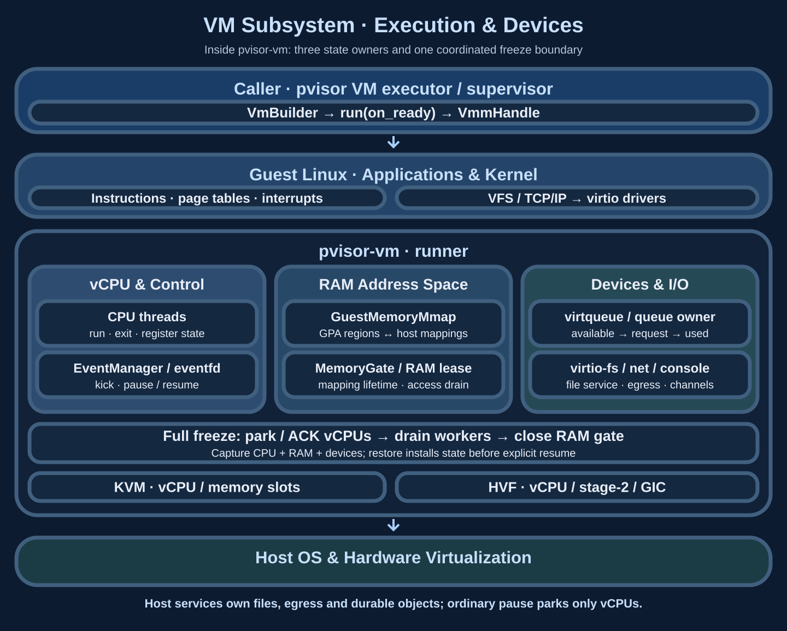

# VM subsystem: execution, devices and consistency

`pvisor-vm` manages guest CPUs, memory and virtual devices, coordinating execution, pausing and restoration. Consistency means CPU, RAM and device state agree, rather than combining states from different execution points during capture or restoration.

The enclosing Runtime prepares file, network and storage resources, supervises the runner, and owns Attempt cleanup and result publication. See [isolation mechanisms](isolation.md) for boundaries across execution environments.

## Components and resource ownership {#architecture}

vCPUs execute guest instructions, RAM mappings provide the guest address space, and virtual devices connect the guest to Host services. Platform backends use Linux KVM or macOS Hypervisor.framework; a uniform Rust API does not imply identical platform capabilities.

| Owner | Main responsibility |
| --- | --- |
| Caller / supervisor | Prepares host resources, supervises and terminates the runner, and owns storage leases and durable publication. |
| VMM | Manages vCPUs, RAM and devices, coordinating control requests and machine-state transitions. |
| Guest kernel and supervisor | Run tools, manage guest processes and access Host-provided resources through virtual devices. |

`VmBuilder` configures and starts the VM; `VmmHandle` controls a running VM. The handle holds a weak reference and does not extend VM lifetime; controls fail after VM exit.

??? info "API and thread ownership"

    | Owner | Retained state | Boundary |
    | --- | --- | --- |
    | Caller / supervisor | Runner process, host sandbox, supplied FDs, file/network services, storage leases | Preparation, supervision, termination and durable publication |
    | `VmBuilder` | CPU/RAM, kernel, device and boot configuration | `run` consumes the builder and enters the runner event loop |
    | Private `Vmm` | vCPU handles, guest memory, device buses, control state and RAM gate | Coordinates machine transitions; internal state stays behind `api` |
    | vCPU / device threads | CPU state, queues, request buffers and RAM leases | Return control or ownership at acknowledged boundaries |
    | `VmmHandle` | Weak reference and controls for a running VM | Does not extend VM lifetime; controls fail after VM exit |

    Public entry points live in `pvisor_vm::api`: traits declare configuration, execution, control and snapshot contracts, while private modules implement methods, resource management and platform dispatch. Callers import the traits they need without accessing backend, VMM or device fields.

??? info "Execution environment differences"

    Host processes and OCI containers use the host kernel; containers establish boundaries through namespaces, resource controls and Runtime configuration. VM tools use the guest kernel. Host proxy environment variables require program cooperation, whereas a controlled VM virtual NIC provides a common egress. VMs also incur guest RAM, device-processing and startup costs. Controls depend on executor and platform; see [Isolation mechanisms](isolation.md).

## From configuration to execution {#boot}

1. The caller resolves execution settings, prepares rootfs, exported trees, network channels and trusted firmware inputs, then constructs `VmBuilder` in a dedicated runner.
2. The builder establishes RAM regions, kernel and boot parameters, installs selected devices, and asks the platform backend to register memory and create vCPUs.
3. `VmRuntime::run(self, on_ready)` consumes the configuration and delivers `VmmHandle` through its ready callback. The callback must return promptly so the event loop can progress. The function returns an execution result, not a handle.
4. vCPUs enter hardware virtualization. CPU threads or the event loop handle exits requiring host work, device notifications, interrupts and control requests.
5. The guest `pvisor-guest` supervisor manages guest startup and process context; the host Session retains ownership of Attempt cleanup and result publication.

`run` targets a dedicated runner: normal guest shutdown exits that process, while initialization failures return errors. External services cannot treat it as a side-effect-free function in an arbitrary application thread. The caller reconciles ownership and cleans resources when the runner disappears; identity contracts are in the [Execution model](execution-model.md).

## I/O cooperation between guest and Host {#execution}

Ordinary guest instructions and most system calls execute inside the guest. A guest `read` reaches virtio-fs when an exported tree requires backend I/O; cached pages, tmpfs or procfs operations may complete locally. Network connections cross guest TCP/IP and virtio-net to host egress.

Consider a file read that requires Host backend I/O: a guest tool calls a file interface, virtio-fs submits the request, the Host device calls the file service, then writes the result to the guest buffer and signals completion.

vCPU threads execute guest instructions and handle VM exits. Devices may wait for file, socket or worker I/O, while the event loop coordinates device notifications and control requests. These activities can progress independently, so device processing is not always synchronized with guest instruction execution.

The guest driver places request and response buffers in RAM, records GPA, length and direction in a descriptor chain, publishes an available entry and notifies the device. The host validates those ranges before converting GPA into an accessible host mapping. On completion, the queue owner writes the response and publishes a used entry, allowing the guest to reuse its buffers. Validation checks that guest addresses lie within permitted RAM, lengths do not overflow, and buffer access directions are valid.

## Device access and memory validity {#virtio}

A RAM lease protects the mapping a device uses to access guest memory. Ordinary requests retain the lease while accessing buffers and publishing completion, keeping that mapping valid. After writing the response, the device publishes a used entry to notify the guest that the request is complete and its buffers can be reused.

The RAM gate controls whether devices can acquire new memory access. Closing admission and waiting for existing leases to be released establishes a window without device access to RAM. Each state operation determines its own closure and drain ordering.

Supported Host backend READ and eligible read-only OPEN paths can temporarily detach from guest buffers while the Host owns the request and result. Backend completion notifies the resume coordinator before reacquiring memory access and writing back. This allows memory offload when its other conditions are met. Releasing a lease alone does not make Offload immediately safe, and this path does not apply to all requests or writes.

??? info "Virtio queues and concurrency"

    virtio-fs currently retains one normal request queue and one hiprio queue. Overlappable large READs and directory reads use bounded blocking I/O workers; the queue owner handles short requests and mutations requiring serialization. Workers return results, while the owner alone updates available/used rings. Concurrent I/O preserves ring ownership.

## Pause, offload and state restoration {#freeze}

Pausing vCPUs stops guest instructions, while Host devices may still process requests. Complete state capture also requires a consistent boundary for devices and memory access. Ordinary Pause, snapshot freeze and Restore therefore have different conditions.

| Operation | Purpose | Key boundary |
| --- | --- | --- |
| Pause | Stop guest instructions | Acknowledges parked vCPUs; devices may still access RAM. |
| Offload | Reduce resident memory of the same live VM | Stops CPU writes, closes and drains the device memory gate, saves RAM contents and requests reclamation; does not create a complete checkpoint. |
| Full snapshot freeze | Establish a consistent capture window | Coordinates vCPUs, device queues and RAM access, together with filesystem state within the capture scope. |
| Checkpoint restore | Restore saved execution state | Validates and installs mappings, CPU, device and file state while paused; explicitly resumes only after successful installation. |

Offload and full freeze share some safety conditions, but have different purposes and completion criteria; they are not a fixed sequence. The following diagram expands coordination for full snapshot freeze.

Freeze proceeds through **vCPU acknowledgement → device drain → RAM gate closure**. Existing completion paths must be able to progress during drain; their required RAM access cannot be closed prematurely. `VmmHandle` control transactions serialize transitions and release the VMM lock while awaiting workers so device cleanup can execute.

A freeze timeout or failed control state requires the caller to terminate the failed runner, rather than resuming a guest alongside unknown device state. Complete snapshots also need filesystem state within their capture profile and compatibility bindings. Network peers do not roll back with local RAM, so the current native Job execution profile excludes network devices. [Environment snapshots](environment-snapshot.md) owns durable publication and restore contracts.

Offload reclaims resident memory from the same live VM. It also requires stopping CPU writes and closing and draining the device memory gate, but does not create a complete checkpoint. RAM backing alone cannot restore execution after the VMM exits. See [memory offload](memory-optimization/offload.md) for its conditions.

Freeze or reset stops new intake, drains accepted work, publishes results and joins workers. Thaw/restore actively checks the available ring rather than relying on an earlier guest kick. Unfinished Host I/O is not stored in a machine snapshot as replayable requests.

??? info "Control and platform support boundaries"

    Device types and platform capabilities determine available capture operations. There is no general virtual-hardware hotplug guarantee; experimental vCPU observation itself provides explicitly enabled data without triggering Offload; this does not rule out active offload through other lifecycle-management paths.

## Integration with the enclosing system {#integration}

The VM exclusively owns machine state; its caller selects files, networking, storage and failure handling for the Attempt. Memory optimizations pass through VM consistency boundaries. File and network services must not independently retain raw guest pointers. Snapshot stores pin objects and publish recoverable state. Host services and storage can evolve while guest address spaces and queue lifecycles remain centrally managed.

This connects three subjects: [Memory](memory-optimization/index.md) defines mappings and recovery sources, [Filesystems](overlayfs.md#filesystem-service) explains lower lookups and upper writes, and [Networking](overlaynet.md#vm-request-path) explains how Ethernet frames become authorized host connections. They share device/RAM lifecycles while retaining their own service state.

| Source entry, relative to `crates/pvisor-vm/src/` | Focus |
| --- | --- |
| `api.rs`, `builder.rs` | Configuration, ready callback, resource and platform contracts |
| `vmm/mod.rs`, `handle.rs` | VMM state, control transactions and freeze ordering |
| `backend.rs`, `vmm/linux/vstate.rs`, `hvf/` | KVM/HVF adaptation and CPU execution |
| `devices/virtio/fs/worker.rs` | Request dispatch, I/O workers and queue completion |
| `devices/virtio/memory_gate.rs`, `devices/snapshot.rs` | RAM leases, device freeze and restore topology |
