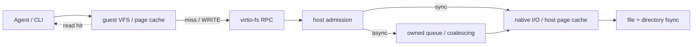

# Filesystem I/O: caching, asynchronous batching and completed throughput

> Note: "local original records" and `.data/` paths refer to local measurement archives that are not published with the repository or the site; they are kept for batch provenance only.

## Conclusions {#conclusions}

### 1. Overall verdict: two write-intensive tasks improve, with complete-task evidence

**Guest WB reduces synchronization-completed time by 36.3% for incremental edit/build/execution checking and by 48.6% for offline extraction/artifact generation/publication; repository inspection shows no detected improvement.** All 19 layered anchors completed: 114 environments, 342 round records, zero failures. These are shallow SDK results with N3 independent pairs per case and three internal rounds, without an arbitrary aggregate score or extrapolation to ordinary-CLI startup or all Agent tasks.

### 2. Causes and evidence: small-write merging helps, while synchronization and read interference set limits

**Merging inside the guest reduces cross-boundary requests.** Separate N1 diagnostics show one-KiB sequential-write WRITE counts falling from 12,288 to 19 with protocol write bytes unchanged at 12 MiB; formal synchronization-completed time falls 93.5%. Offline-publication WRITE falls from 101,779 to 5,599, while protocol bytes increase about 1.2%, so its benefit is not simply less data transferred.

**Fewer requests can still accompany slower completion.** With already-large one-MiB writes, WRITE stays 12→12 and completed time increases 39.0%. At four workers, increasing the working set from 128 to 640 MiB reduces WB's benefit from 87.6% to 56.3%, and the candidate's final-synchronization share rises from 11.9% to 49.2%. The larger working set also retains five times as many bytes; current evidence does not isolate guest-cache capacity, reclaim, or physical I/O as the cause.

### 3. Breakdown: completed throughput and foreground response need separate judgments

| Scope | Observation | Implication |
| --- | --- | --- |
| Incremental build / offline publication | Synchronization-completed time falls 36.3% / 48.6% | Benefits reach two complete local tasks with synchronization and validation retained |
| One-KiB / one-MiB sequential writes | Time falls 93.5% / rises 39.0% | Original request size determines merging opportunity; added large-request costs remain unresolved |
| Mixed reads/writes, M11 | Three-round completed time falls 76.7%, but first-round foreground reads take 25.3% longer | Aggregate throughput cannot establish faster read response; the two figures cover different round scopes |
| Small files, M09 | Completed time falls 17.7%, with WRITE unchanged at 768→768 | Large variation across three pairs prevents attribution to cross-file write merging |

The [layered results and curves](#workload-v2-results) retain all 19 points and N3 exploratory intervals without multiplicity correction. This same-firmware WB off/on contrast does not resolve the earlier [0049-versus-0048](#guest-writeback-tuning) concurrency regression; SDK values do not replace the historical [ordinary-CLI results](#guest-writeback-cli). Guest WB remains disabled by default.

## Motivation {#motivation}

The goal is to let the host own bytes and continue filesystem work while the guest waits for I/O, reducing background dependence on guest RAM. After accepting a WRITE, the queue holds copied bytes and a pinned native file handle. Object lifetime is separate from path names, allowing subsequent close, rename, and unlink to follow the existing ordering boundaries. The [Agent I/O completion design](../design/experimental/agent-io-completion/index.md) owns file-lifetime and error semantics.

Three boundaries matter: accepted means bytes have transferred to the host, completed means the relevant write prefix has been applied, and durable means explicit synchronization has succeeded. Returning from WRITE cannot substitute for file or directory fsync. Queue capacity determines how much burst traffic can be absorbed; once the host page cache accepts bytes, a larger queue need not improve throughput. Whole-VM offload additionally requires other guest-RAM references and device activity to meet transfer conditions. These curves do not measure that process.

Guest data-page hits occur before a request is emitted; host write merging occurs after protocol dispatch. Their positions determine which costs each can remove. Reads, metadata and synchronization still respect the accepted-write-prefix ordering.

## Experiment design {#design}

### Layered workload protocol: mechanisms, resource boundaries, and complete tasks {#workload-v2}

**The implemented executor evaluates 12 mechanism anchors, four resource anchors, and three complete tasks separately, without a seven-tool system score.** The shallow profile declares three independent fresh pairs per case and three internal rounds, planning 114 environments and 342 round records. Actual successes, failures, and missing observations come from the batch's `records.json` and `status.json`. The three complete tasks are separate primary application outcomes; historical data remain independent.

The current contrast changes only guest WB off/on with the same frozen host, firmware, and workload; host WB and DATA are disabled. It uses the SDK path with a two-vCPU/512-MiB guest and a two-core-quota/2-GiB/swap-zero enclosing group. Host write caching, lower read caching, and native contrasts are not connected to this executor. Ready is emitted after the static payload starts and reads actual MemTotal, before case preparation. Setup, including S02's initial full build, is recorded separately and excluded from task work time. Work return, final synchronization, synchronization completion, and exit remain separate; write return does not establish host ownership or physical persistence.

The three fixed tasks use real local tools. S01 traverses 1,024 four-KiB repository files, runs `git status` and `git grep`, and reads all matching files to verify the results. S02 prepares 100 C compilation units, makes an equal edit to one unit each round, compiles it with `cc -O0`, relinks, executes and checks the output, then synchronizes. S03 uses Python `tarfile` to extract 1,024 four-KiB files, generates 128 four-KiB files and a 32-MiB artifact through one-KiB writes, then fully verifies, synchronizes, and atomically publishes the output. Fixtures, generated-byte rules, tool hashes, and calls are frozen. These fixed small local tasks do not represent whole-project builds or network downloads.

Each case gets independent VMs. R1 means a fresh guest with uncontrolled host caching; R2/R3 inherit that case's state, including previous writes, synchronization, and full readback verification for resource cases. The four resource points retain four files, four-KiB requests, logical writes of twice configured RAM per round, and at most one MiB of payload buffers, varying only one/four workers and working sets of 0.25/1.25 times RAM. The guest checks each round; after exit, the host checks final retained state and physical OverlayFS markers. These checks do not establish independent persistence of intermediate states. Analysis sums three rounds within each environment before taking the median of three paired time ratios, retaining all points, ranges, and exploratory 95% intervals from 5,000 environment-pair bootstrap resamples, pointwise and uncorrected for multiplicity. N3 does not become N9 and cannot provide stable confirmation or operation tail latency. Counts use separate N1 diagnostics. Slow observations and failures remain, without quiet-period, interference, or per-round full-inventory gates.

Four current figure groups show normalized mechanism times, resource throughput, enclosing-environment CPU/sampled-memory costs, and complete-task times. A separate progress helper plots resource-round-one submissions by worker zero; these are neither aggregate four-worker progress nor a host applied-prefix frontier. Denser single-axis curves, guest dirty/temp-page peaks, queue occupancy, and operation P99 remain unimplemented. Bounded work cannot establish steady state, saturation, IOCP, or guest-RAM offload. The repository protocol is `benchmark.new/filesystem/WORKLOADS.md`, and the actual entrypoint is `workloads_v2_run.py`. The N5 offline proposal and unimplemented markers retained in `workloads_v2.py` describe that original plan, not current execution inventory.

### Experiment design for the existing results

An independent guest-kernel writeback followup disables the host cache and compares new firmware WB=0, new firmware WB=1, old 0047 firmware WB=1, and native. Five fresh environments per arm, each with three dependent rounds, give 20 environments and 900 rows; diagnostics use a separate N1 per arm. Upstream kernel-source archive, actual configuration, build tools, and patches 0041–0047 match between firmware versions; 0048 is the kernel-code difference. Both use the same host with the object-lifetime fix. Native is an absolute reference. SDK and enclosing budgets follow the table below. Fifteen cells cover 1/4/64/1024 KiB requests, 1/2/4 workers, fsync every 1/16/256 writes or only at the end, 128 one-KiB files, and 8/64/128 MiB pressure.

This followup removes the auxiliary dup/close: final fsync on the original file drains guest writeback, followed by checked close and directory fsync. `applied_ns=0` means unmeasured, not free draining. Completed time includes the full explicit synchronization boundary; the accepted loop still includes configured periodic fsync and small-file close. Three rounds are summed within each environment before forming candidate/baseline time ratios; lower is faster. The five paired environment blocks receive 5,000 bootstrap resamples and pointwise exploratory 95% intervals without multiplicity correction. Changed phase boundaries prohibit pooling with the earlier host-cache curves.

Rootfs reuses a caller-owned prepared directory with its Mutable declaration; this campaign does not recompute a full inventory or newly certify immutable input. Formal profiling is off and diagnostics are separate. Preparation, complete byte verification, and VM exit are outside cell completion time. All original rounds remain; failures and pilots before the entrypoint correction are separate, with no speed-based exclusions.

The 2026-10-17 B-FS-ENG evaluation has separate N5 shape, N5 parameters, independent N30 confirmation, N5 ordinary-CLI and immutable-lower read-cache cohorts. B-FS-DIAG request counts come from separate runs; instrumented timings never enter the performance distributions. The SDK's static Rust payload and native reference are measured separately from ordinary CLI Ready and task-completion times.

| Factor | Executed configuration |
| --- | --- |
| Host | Linux x86_64, AMD Ryzen 7 9700X, NVMe, Btrfs `compress=zstd:1` |
| Cache and bytes | Fresh guest, uncontrolled warm host backing; deterministic high-entropy SplitMix64 bytes with full verification |
| SDK budget | Guest 2 vCPU, 512 MiB; enclosing group on CPUs 0 and 1, two-core quota, 2 GiB, swap 0 |
| Samples | 5 fresh environments per condition; 3 dependent resident rounds each; seeded randomized paired conditions and cell order |
| Default host buffer | 64 MiB payload capacity, 1,024 jobs, 1 MiB batch, at most 64 chunks, 10 ms wait window |
| Correctness | Full guest and host byte verification and normal exit; shape 30/30 and parameters 50/50 valid environments, 0 failures |
| Interference | No quiet-period, external build/test scan, or per-round complete-inventory gate; all valid slow samples and effects of concurrent team activity retained |

Shape and parameters use the same frozen host, payload, and firmware artifacts. Complete source and artifact hashes remain with the raw cohorts. Analysis uses a separate post-collection v2 while preserving the frozen harness and raw records. Btrfs mount compression does not establish a measured physical compression ratio; a fresh guest does not establish cold disk.

This iteration adds strictly validated host-buffer capacity, batch, jobs and delay controls, queue peaks and backpressure counters, and decouples foreground qualification from the background file-I/O lock. A pinned handle lease preserves fd lifetime; native writes still recheck mutable flags. These candidates retain ordering and error boundaries and are evaluated with the ablations below.

| Shape condition | Mechanism changed |
| --- | --- |
| `sync` | Original direct synchronous host write path; host cache disabled |
| `async` | Host-owned asynchronous merging; qualification avoids the background file-I/O lock |
| `async-old` | Qualification retains the file lock shared with background native writes |
| `unmerged` | Host-owned asynchronous writes with `chunks=1, delay_us=0` |
| `owned-sync` | Copy and worker dispatch retained; drain before returning from WRITE |
| `native` | Same static payload on the native filesystem; absolute reference only |

Shape covers 1 KiB–1 MiB blocks, 1/2/4 workers, fsync every 1/16/256 writes or only at completion, 1/8/32 MiB warm upper reads, and small files. Block and worker curves write 4 MiB per round; barrier curves write 1 MiB. Parameters independently vary capacity across 4/16/64/256 MiB, batch size across 64/256/1,024 KiB, and waiting across 0/100/1,000/10,000/50,000 μs. Workloads stream 8/64/128 MiB in 64 KiB blocks and 8 MiB in 4 KiB blocks. The cohorts are never pooled.

Each round records the operation loop, FLUSH draining triggered by checked dup/close, fsync on the original file fd, final checked close, and directory fsync. Total is the sum of these contiguous phases; preparation, complete verification, and VM exit are recorded separately. Configured periodic fsync occurs within the operation loop, so accepted/loop throughput includes its synchronization cost. Both arms explicitly synchronize files and directories, avoiding a comparison between cache-off ENOSYS SYNCFS and cache-on actual synchronization.

A fresh environment is the independent unit: sum bytes and times across its three rounds before calculating completed throughput; average phase durations within that environment. Paired ratios divide candidate throughput by baseline throughput within each pair, then report the median of those ratios and a 5,000-resample paired-bootstrap 95% CI. This differs from dividing the two arms' medians. N5 is not N15, and individual intervals have no multiple-comparison correction. The registered separation rule requires at least 3 samples on each side, an adjacent gap of at least 1.5×, and cluster medians at least 1.7× apart. When detected, clusters and all points remain while the overall median and ranking are withheld. N5 cannot test that rule; an unflagged N5 point does not establish unimodality.

## Data and analysis {#results}

The shape CSV, shape paired ratios, parameters CSV and independent diagnostic counters CSV remain in the corresponding local batches or archives. Raw `protocol.json`, `records.json`, frozen sources, and failures remain in the corresponding benchmark cohorts. Write curves use post-collection v2 and read curves use v4, each with its own analysis-source hashes. Different presentations of the same data do not add independent samples. After collection, four product files received only Rust 2021 formatting matching their crate edition. The formatting receipt records measured and current hashes; frozen sources and executables remain unchanged.

### Layered shallow comparison: complete-task benefits and limits {#workload-v2-results}

**Two write-intensive complete tasks improve; read/query and synchronization-heavy workloads gain little, while large writes and first-round foreground reads regress.** All 19 cases passed three fresh VM pairs and three internal rounds: 114/114 environments, 342/342 round records, zero failures and exclusions. Both arms use the same frozen host, firmware, and payload, changing only guest WB; host WB and DATA are disabled, and DAX is not configured. The guest has two vCPUs/512 MiB, with observed MemTotal of 528,412 KiB throughout; the enclosing group has a two-core quota, 2 GiB, and zero swap.

Times below are medians across three environments after summing synchronization-completed time across each environment's three rounds, in ms. Reductions take the median of three paired `1−candidate/baseline` values, rather than dividing arm medians; positive means faster and negative means slower. Brackets are pointwise exploratory 95% intervals from 5,000 environment-pair bootstrap resamples, without multiplicity correction. N3 cannot provide stable confirmation, test modality, or estimate operation tail latency.

#### Complete tasks: gains reach the workflow

| Task | WB off ms | WB on ms | Paired time reduction [exploratory 95% interval] |
| --- | ---: | ---: | ---: |
| S01 Repository inspection/search | 2,116.7 | 2,121.8 | −0.6% [−4.4%, 2.6%] |
| S02 Edit/incremental build/execution check | 586.7 | 374.3 | 36.3% [34.7%, 36.5%] |
| S03 Offline extraction/artifact generation/publication | 11,512.8 | 6,023.3 | 48.6% [47.2%, 49.1%] |

S02 fully builds 100 C units during setup; task timing covers a real equal edit each round, unit recompilation, relinking, execution checks, and final synchronization. S03 includes local extraction, 128 small files, a 32-MiB stream written in one-KiB requests, complete prepublication byte checks, file/directory synchronization, and atomic publication. High-entropy pattern generation is inside work timing; preparation, subsequent validation, and exit are separate. These SDK task times do not represent ordinary-CLI startup or a whole project's initial build.

#### Mechanisms: small writes benefit, with costs for large writes and read controls

| Mechanism | WB off ms | WB on ms | Paired time reduction [exploratory 95% interval] |
| --- | ---: | ---: | ---: |
| M01 Positive lookup | 155.4 | 154.0 | 1.2% [−0.9%, 2.9%] |
| M02 Static negative lookup | 401.9 | 402.2 | 0.6% [−1.5%, 1.1%] |
| M03 Directory enumeration | 18.9 | 18.5 | 1.0% [0.2%, 18.0%] |
| M04 Sequential reopen read | 36.9 | 37.9 | −2.7% [−3.3%, −0.7%] |
| M05 Random read | 157.1 | 161.8 | −2.1% [−6.7%, −1.8%] |
| M06 One-KiB sequential write | 648.2 | 41.8 | 93.5% [92.1%, 94.9%] |
| M07 One-MiB sequential write | 28.8 | 38.8 | −39.0% [−39.0%, −31.2%] |
| M08 Four-KiB random overwrite | 177.9 | 39.6 | 77.7% [75.9%, 80.0%] |
| M09 Small-file write/close | 890.5 | 732.7 | 17.7% [16.8%, 71.9%] |
| M10 Fsync after every four-KiB write | 423.7 | 429.3 | 1.0% [−32.1%, 12.7%] |
| M11 Independent-file mixed reads/writes | 172.7 | 47.3 | 76.7% [68.5%, 77.0%] |
| M12 Create/write/sync/rename/unlink | 638.7 | 630.2 | −0.1% [−0.4%, 9.8%] |

Small-write merging opportunity aligns with the benefit. Large writes already reach the one-MiB protocol granularity; additional caching, copying, scheduling, and synchronization costs have not been separated. The approximately 2%–3% read-control regressions and M03's small difference remain visible; selecting wins across many N3 intervals cannot establish an overall improvement. M05/M08 cover every block through the fixed permutation `(405i+113) mod 1024`, providing nonsequential anchors rather than independent uniform random samples. M09's three time ratios are 0.281/0.832/0.823, showing substantial variation; unchanged WRITE counts do not support cross-file merging.

Separate N1 counters cover each case's three rounds, setup, validation, and exit, including S02's initial full compilation. They are not task-phase counts or physical disk I/O. Protocol write bytes below differ from Rust's explicit logical counters; tool subprocesses also issue writes.

| Case | WRITE off→on | Protocol write bytes off→on |
| --- | ---: | ---: |
| M06 One-KiB sequential write | 12,288→19 | 12,582,912→12,582,912 |
| M07 One-MiB sequential write | 12→12 | 12,582,912→12,582,912 |
| M09 Small files | 768→768 | 50,331,648→50,331,648 |
| S02 Incremental build | 2,029→316 | 263,552→280,827 |
| S03 Offline publication | 101,779→5,599 | 115,248,419→116,657,443 |

#### Mixed workload: higher throughput, slower first-round foreground reads

M11's three-round synchronization-completed time falls 76.7%, but the first-round foreground-read time ratio is 1.253, a 25.3% increase. First-round mixed completion itself improves 67.5%, separately from the three-round 76.7% result. Faster background writes do not establish faster foreground reads. Without lock-wait, scheduling, and phase-specific counter evidence, the interference's cause remains unresolved.

| Round | Foreground read off→on ms (medians) | Foreground paired time ratio [exploratory 95% interval] | Whole-round synchronization-completed time reduction |
| --- | ---: | ---: | ---: |
| R1 | 9.010→11.448 | 1.253 [1.016, 2.273] | 67.5% |
| R2 | 5.617→4.709 | 0.949 [0.819, 1.056] | 76.7% |
| R3 | 6.562→4.748 | 0.740 [0.724, 0.759] | 83.7% |

#### Resource boundaries: synchronization grows with the working set

Each point fixes one GiB of logical writes per round, four files, and four-KiB requests. R2/R3 inherit the cache history of previous synchronization and full readback verification. Final-synchronization share first divides each candidate environment's three-round synchronization sum by its completed-time sum, then takes the median across three environments.

| Case / workers / working set | WB off ms | WB on ms | Paired time reduction [exploratory 95% interval] | WB-on final-sync share |
| --- | ---: | ---: | ---: | ---: |
| R01 / 1 / 128 MiB | 41,503.4 | 4,126.7 | 90.1% [88.7%, 91.8%] | 6.8% |
| R02 / 4 / 128 MiB | 15,619.4 | 1,943.2 | 87.6% [87.1%, 88.1%] | 11.9% |
| R03 / 1 / 640 MiB | 44,240.5 | 7,124.6 | 83.9% [78.4%, 86.4%] | 33.8% |
| R04 / 4 / 640 MiB | 19,398.5 | 7,573.3 | 56.3% [47.2%, 64.0%] | 49.2% |

Increasing candidate workers from one to four changes median three-round completion from 4,126.7 to 1,943.2 ms at 128 MiB, but from 7,124.6 to 7,573.3 ms at 640 MiB. The larger working set does not show the same concurrency-scaling trend; these cross-case levels have no paired significance claim.

At four workers, the candidate's median three-round final-sync sum rises from 230.5 to 4,048.2 ms as completed-time benefit shrinks. N1 WRITE is 3,365 for R04, fewer than R02's 4,057, so request counts alone cannot explain elapsed time. A 640-MiB working set also retains five times the final bytes of 128 MiB, changing repeated-overwrite and synchronization work; these points do not isolate a pure guest-cache-capacity effect. Dirty/reclaim activity, queue occupancy, and physical write volume are unknown. Neither steady state nor saturation is established.

Progress means pwrite returns to worker zero, not aggregate four-worker progress or host-applied bytes. CPU and sampled memory.current include setup, validation, and exit, preventing exact work-phase shares or guest-RAM-offload claims. Host checks independently verify final retained state and OverlayFS markers; they do not establish intermediate persistence or power-loss durability.

Full-precision CSVs for paired comparisons, arm time levels, environment resources, submission progress, foreground reads and independent counters remain in the corresponding local batches or archives. Provenance records retain batch identities, scope and hashes. Raw samples, failed preflights, and frozen sources remain in the benchmark's local `.data/`. Historical 0049 incremental and ordinary-CLI contrasts remain separately below.

### 0049: guest batching windows and transport metadata {#guest-writeback-tuning}

The new 0048→0049 contrast detects no stable completed-time improvement: 14 of 15 preset incremental intervals cross one, while four-file concurrency has a time ratio of **1.164 [1.022, 1.627]**, a regression signal of about 16.4%. Write-loop time ratios are 0.493 for 1 KiB and 0.420 for 4 KiB, indicating earlier returns. Enabling WB versus disabling it still reduces full-synchronization time at those points by 93.6% and 82.9%. Existing WB benefits, improved foreground responsiveness, and unestablished completed-throughput gains remain separate findings.

This iteration addresses early submission and hot-path statistics in 0048: the early-kick threshold becomes one quarter of the pressure target (1–16 MiB), queue admission reads approximate counters outside the connection lock, and redundant pressure checks and empty-pending scheduling are removed. Real per-folio pressure, exact counting near the threshold, the 10 ms timer, 256 leases, the 1 MiB WRITE ceiling, and both integrity-writeback WRITE barriers remain. Both WB arms use the same frozen host and payload and identical upstream kernel-source archive and actual-configuration digests; the firmware adds only 0049. The contrast measures this set of changes together, without isolating each contribution.

One environment in the first 0049 formal cohort returned ENOMEM during its second 128 MiB synchronization. The entire 20-environment cohort is excluded from performance inference; its 19 successful environments are not salvaged. Replaying the complete history with independent instrumentation localized an order-2 atomic scatterlist allocation at `virtio_fs_enqueue_req+0x159`, using the kernel stack and matching vmlinux disassembly. About 360 MiB remained available/reclaimable after the error, but this allocation could not wait for reclaim. The repaired firmware preallocates 516 SG entries and pointers per request virtqueue at startup and reuses them under the existing queue lock. Per-request argbuf and data-page lifetimes remain unchanged. This is bounded transport metadata, without a second file-content cache; other atomic allocation sites still exist.

Five fresh guests then completed the same history under the original 512 MiB guest/2 GiB enclosing budget: 225 rows, 15 synchronizations of 128 MiB, matching full guest and host bytes, and no recurrence of the recorded allocation failure. This is independent correctness diagnostic evidence, not performance data. The failed cohort, localization, and repaired verification remain in `.data/guest-writeback-tuning-curves-20261017`, `.data/guest-writeback-memory-20261017`, and `.data/guest-writeback-memory-v2-20261017`, respectively.

#### Independent N5 completed-time curves

The new cohort has 20/20 valid environments and 900 complete rows, with no failures or speed exclusions: four arms, five fresh environments per arm, three dependent rounds, profiling off. Preparation, full-byte verification, and exit are outside each cell clock. Completed time retains the write loop, final file fsync, checked close, and directory fsync; accepted still includes configured periodic fsync. Three rounds are summed within each environment before 5,000 paired bootstrap resamples of five environment blocks. Intervals are exploratory and pointwise, without multiplicity correction. The first three columns below are medians of per-environment milliseconds per round; time ratios below one are faster and cannot be replaced by dividing column medians. This cohort's 0048 control is separate from the original 0048 cohort, not an N10 sample.

| Workload | WB=0 ms | 0048 WB ms | 0049 WB ms | 0049 / off [95% CI] | 0049 / 0048 [95% CI] |
| --- | ---: | ---: | ---: | ---: | ---: |
| 1 KiB stream | 226.928 | 9.940 | 14.546 | 0.064 [0.033, 0.135] | 0.882 [0.814, 3.431] |
| 4 KiB stream | 60.048 | 8.782 | 11.027 | 0.171 [0.105, 0.389] | 0.958 [0.361, 2.646] |
| 64 KiB stream | 9.916 | 8.233 | 8.074 | 0.672 [0.439, 3.027] | 0.981 [0.704, 1.942] |
| 1 MiB stream | 8.491 | 8.909 | 9.948 | 1.172 [0.416, 4.191] | 1.105 [0.727, 1.522] |
| 1 worker | 60.770 | 6.930 | 7.425 | 0.118 [0.114, 0.498] | 1.084 [0.960, 2.135] |
| 2 workers | 39.459 | 10.336 | 9.050 | 0.220 [0.191, 0.711] | 1.206 [0.633, 1.532] |
| 4 workers | 30.978 | 12.426 | 14.460 | 0.488 [0.324, 1.240] | 1.164 [1.022, 1.627] |
| fsync each write | 137.633 | 164.799 | 142.810 | 1.054 [0.891, 2.557] | 1.018 [0.188, 1.458] |
| fsync every 16 writes | 23.630 | 11.606 | 20.316 | 0.941 [0.520, 1.236] | 1.726 [0.622, 2.116] |
| fsync every 256 writes | 17.715 | 5.331 | 5.821 | 0.303 [0.159, 1.563] | 1.082 [0.621, 4.229] |
| final fsync only | 17.723 | 4.680 | 4.182 | 0.254 [0.214, 0.643] | 0.989 [0.253, 1.405] |
| 128 one-KiB files | 139.844 | 121.536 | 133.381 | 0.873 [0.838, 1.455] | 1.041 [0.890, 1.503] |
| 8 MiB pressure | 17.741 | 13.365 | 20.395 | 1.150 [0.401, 3.203] | 1.248 [0.773, 4.489] |
| 64 MiB pressure | 179.223 | 108.518 | 196.787 | 0.955 [0.528, 2.626] | 1.893 [0.844, 3.592] |
| 128 MiB pressure | 511.463 | 259.039 | 328.753 | 0.643 [0.409, 1.797] | 1.006 [0.550, 2.580] |

Accepted/0048 time ratios for one-, four-, and 64-KiB writes are 0.493 [0.328, 0.861], 0.420 [0.311, 0.737], and 0.600 [0.265, 0.731]. They do not translate into detected completed-time gains; four workers instead regress. The 128-MiB completed-time ratio is 1.006 [0.550, 2.580], also without incremental evidence. All slow values and raw environment points are retained. Several intervals are wide, and N5 does not establish stable magnitudes. A larger batching window lets foreground writes return earlier, while final synchronization and other phases still have work to finish; these data do not precisely attribute the remaining cost to one component.

Full-precision records of throughput, all environments, environment times, both time contrasts, 0049 incremental throughput and WB enablement throughput remain in the local batch or archive. Independent provenance records connect executed firmware, frozen sources, raw cohorts, analysis and correctness receipts; figure exports also remain local.

#### Request counts and pipelining

Independent N1/arm diagnostics with three rounds verify 12 final profiles, 270 tokens, and 540 component intervals. Actual WB/batched-WB negotiation is off=0/0 and old/new WB=1/1; the host cache stays disabled. Counts below sum all three rounds, and diagnostic timings are not formal performance samples.

| Per-round workload | WB=0 | 0048 WB | 0049 WB |
| --- | ---: | ---: | ---: |
| 1 KiB stream, 4 MiB | 12,288 | 325 | 12 |
| 4 KiB stream, 4 MiB | 3,072 | 16 | 12 |
| 64 KiB stream, 4 MiB | 192 | 15 | 12 |
| 1 MiB stream, 4 MiB | 12 | 15 | 12 |
| 128 one-KiB files | 384 | 384 | 384 |
| fsync each write, 1 MiB | 768 | 768 | 768 |
| 128 MiB pressure, 64 KiB writes | 6,144 | 560 | 620 |

The new firmware sends only four WRITEs per round for one-KiB streams, with exactly 12 MiB of protocol payload over three rounds: merging now happens before requests leave the guest. At 128 MiB, new WB sends more requests than old WB; the small-workload merging ratio does not generalize to every pressure point. Small files and fsync-each-write also show no request reduction. Size buckets give bounds, not exact per-cell maxima.

The controlled pipeline diagnostic delays A's first backing write by 1.5 seconds, then writes pre-opened B after 200 ms. With 0048/0049, B reaches backing 202.9/201.5 ms after A starts, before A completes in both arms. Both exit normally and verify all 2 MiB. This confirms preservation of 0048 pipelining, without assigning a corresponding production speedup to 0049. Pipeline events remain in the local diagnostic batch.

The final firmware passes full real-KVM and error-propagation regressions, including four-thread same-inode multi-FD writes with 6,144 pwrite calls and 114 reopenings, closed-file unlink/rename followed by syncfs, a single 128 MiB write, same-page overwrites, O_SYNC, mmap, and submount unmount. Background EIO still produces the expected supervisor exit 125. Seven firmware contracts pass; that correctness receipt records 50 passing benchmark Python tests. After the subsequent CLI observer repair, the final benchmark Python suite passes 51 tests. The unchanged host implementation retains its 511 passing tests, eight skips, and rustdoc receipt; probes are separately compiled and executed. These results do not cover power-loss recovery, macOS runtime, complete IOCP, or guest RAM offload.

### Ordinary CLI: streaming writes improve; seven-tool totals stay level {#guest-writeback-cli}

Both arms use the same new host and repaired 0049 firmware, changing only guest writeback; host write buffering and DAX stay off. The ordinary CLI uses prepared rootfs/workspace inputs and a fresh private Host+VM per sample. All 10 formal environments, two preflight environments, and two independent diagnostic environments pass actual semspec entrypoints. Five paired environments each contain three dependent rounds, rather than N15. Both the guest and enclosing memory budget are 16 GiB; the observed parent limits are memory.max=16 GiB, swap.max=0, and cpu.max=200000/100000, with CPU 0,1 affinity and launch-service NOFILE=65536. All valid slow samples remain, without quiet-period, interference, or full-inventory gates.

The primary three-round seven-tool total is 4,372.600→4,373.951 ms: time ratio 1.0003 [0.9658, 1.0415], reduction −0.03% [−4.15%, +3.42%]. Ready is 855.526→855.989 ms, ratio 1.0005 [0.9923, 1.0062]. Neither detects improvement. Ready includes the fresh Host+VM and excludes exit. All three separate seven-tool round intervals also cross one. Statistics use median(on)/median(off), with reduction equal to one minus that ratio and 5,000 paired bootstrap draws of the five environments. This differs from the microcurves' median of per-pair ratios. All 32 intervals are pointwise and uncorrected; only the three-round total is the preregistered primary. The first-round cargo reduction of 1.61% [1.05%, 4.87%] is exploratory, without matching support in later rounds.

Streaming writes issue 8,192 one-KiB writes to one 8 MiB file per round, including file fsync and checked close. Round medians are 382.950→16.179, 376.657→10.242, and 373.739→10.616 ms: reductions of **95.78% [91.95%, 97.68%]**, **97.28% [94.92%, 97.67%]**, and **97.16% [96.75%, 97.38%]**. This additional favorable scenario is outside the seven-tool total. The small-file write operation creates 256 files of 64 KiB per round with write/close/stat and no explicit fsync. The seven-tool metric measures tool responsiveness; it does not measure completion of all durable writes. After normal exit, the host separately checks every byte of the 256 small files and three 8 MiB stream files. Exit and host verification are outside these clocks. These clocks also differ from the microcurves' file-and-directory-fsync boundary.

Time ratios below are on/off; values below one are faster. Intervals are 95% pointwise intervals from the same five environment pairs.

| Operation | Round 1 on/off [95% CI] | Round 2 | Round 3 |
|---|---:|---:|---:|
| metadata | 0.9639 [0.9116, 1.1928] | 0.6682 [0.6121, 1.0639] | 0.8715 [0.5210, 1.3056] |
| read | 0.9971 [0.9798, 1.0207] | 1.0196 [0.9432, 1.0524] | 0.9719 [0.9583, 1.0019] |
| write | 0.8641 [0.7831, 1.0912] | 1.0809 [0.7696, 1.4794] | 1.4450 [0.7833, 1.4816] |
| git | 0.9968 [0.9370, 1.0265] | 1.0205 [0.8456, 1.2142] | 1.0289 [0.7945, 1.3335] |
| rg | 1.0038 [0.9922, 1.0221] | 0.9956 [0.9820, 1.0357] | 1.0006 [0.9831, 1.0145] |
| cargo | 0.9839 [0.9513, 0.9895] | 1.0263 [0.8940, 1.1700] | 0.9697 [0.7493, 1.2647] |
| npm | 0.9810 [0.8413, 1.0684] | 1.0418 [0.9729, 1.1223] | 1.0575 [0.9813, 1.1659] |
| hot_open | 0.9960 [0.9923, 1.0112] | 1.0035 [0.9930, 1.0128] | 1.0028 [0.9818, 1.0162] |
| stream_write | 0.0422 [0.0232, 0.0805] | 0.0272 [0.0233, 0.0508] | 0.0284 [0.0262, 0.0325] |
| seven_tools | 0.9850 [0.9247, 1.0118] | 1.0088 [0.9538, 1.0290] | 0.9962 [0.9297, 1.1216] |

Independent N1 diagnostics retain 13 final instances per arm (eight scoped, five unscoped), 54 tokens per mount, and 216 component intervals per VM. Both mounts explicitly report guest_writeback_enabled and guest_batched_writeback_enabled as zero in off and one in on. In third-round workspace streaming, protocol WRITE falls from 8,192 to eight with the same 8 MiB payload. Mean payload grows from 1 KiB to 1 MiB; one FSYNC, three FLUSHes, and two OPENs remain. Small-file WRITE remains 256→256 with 16 MiB, while background markers change from zero to 256; there is no merging across files. Third-round npm WRITE changing from one to zero may reflect work deferred beyond the phase, rather than eliminated persistence work. These independent counts measure neither disk I/O nor time shares; diagnostic timings do not enter formal statistics.

The build, sources, and firmware are frozen. The actual GNU native process mapping is verified using path/inode, the process's Btrfs mount evidence, and a full file hash through /proc/PID/root. An earlier cohort with a Btrfs device-number observer assertion failure remains separate: its product exited normally and passed byte verification. The observer repair is not a product writeback failure, and its samples are not pooled here. This experiment measures WB enablement on the final firmware, rather than 0049's incremental effect over 0048.

Local derived records contain 64 summary rows, 32 comparisons, 10 environment rows and 108 independent counter rows. Local provenance connects frozen artifacts, executed mappings, all raw environments, independent counters and analysis.

### Initial 0048 cohort: guest-kernel merging and writeback pipelining {#guest-writeback}

#### N5 completed time at equal synchronization boundaries

All 20 environments and 900 rows are valid, with no failures or exclusions. Enabling WB versus WB=0 reduces completed time by **94.0%, 83.6%, and 24.5%** for one-, four-, and 64-KiB streams. The one-KiB paired reduction interval is [93.5%, 95.5%]. These gains cannot all be assigned to 0048: **all 15 new-WB/old-WB completed-time intervals cross one; this cohort detects no incremental completed-throughput gain from the refactor.**

The first three numeric columns are milliseconds: divide each environment's three-round sum by three, then take the five-environment median. The final columns are paired ratios of three-round time sums with 95% CI; lower is faster. Dividing the displayed marginal medians does not produce these paired statistics. All planned points remain, without speed-based sample or workload selection.

| Workload | WB=0 ms | Old WB ms | New WB ms | New WB / off [95% CI] | New WB / old WB [95% CI] |
| --- | ---: | ---: | ---: | ---: | ---: |
| One-KiB stream | 217.828 | 9.740 | 12.998 | 0.060 [0.045, 0.065] | 1.284 [0.932, 1.715] |
| Four-KiB stream | 58.842 | 7.184 | 9.634 | 0.164 [0.117, 0.260] | 1.114 [0.944, 1.906] |
| 64-KiB stream | 10.073 | 7.336 | 7.973 | 0.755 [0.666, 0.944] | 1.150 [0.876, 1.211] |
| One-MiB stream | 6.835 | 8.439 | 7.399 | 1.205 [1.035, 1.233] | 1.045 [0.800, 1.291] |
| 1 worker | 59.716 | 7.472 | 8.138 | 0.134 [0.122, 0.153] | 0.999 [0.704, 1.266] |
| 2 workers | 39.381 | 8.279 | 8.892 | 0.222 [0.218, 0.273] | 1.063 [0.970, 1.357] |
| 4 workers | 29.652 | 11.877 | 11.545 | 0.397 [0.372, 0.429] | 1.028 [0.953, 1.162] |
| Fsync every write | 140.492 | 131.925 | 148.548 | 1.111 [1.022, 1.183] | 1.104 [0.935, 1.411] |
| Fsync every 16 writes | 24.087 | 11.729 | 11.951 | 0.490 [0.433, 0.596] | 0.982 [0.913, 1.234] |
| Fsync every 256 writes | 17.571 | 5.438 | 6.447 | 0.350 [0.242, 0.745] | 1.050 [0.927, 2.407] |
| Final fsync only | 17.047 | 4.480 | 4.408 | 0.253 [0.240, 0.358] | 1.003 [0.540, 1.372] |
| 128 one-KiB files | 136.198 | 122.891 | 124.926 | 0.917 [0.810, 1.149] | 1.147 [0.884, 1.214] |
| Eight-MiB pressure | 17.230 | 10.662 | 14.370 | 0.942 [0.647, 0.967] | 1.348 [0.910, 1.550] |
| 64-MiB pressure | 136.022 | 104.850 | 96.295 | 0.695 [0.605, 0.768] | 1.033 [0.673, 1.201] |
| 128-MiB pressure | 339.676 | 273.289 | 266.224 | 0.805 [0.761, 1.185] | 0.951 [0.818, 1.590] |

One-MiB writes and fsync-every-write show approximately 20.5% and 11.1% regressions versus WB=0; small files have no detected gain. Accepted time is not uniformly better than old WB either: the one-KiB time ratio is 1.825 [1.299, 3.855], versus 0.965 [0.832, 0.995] at 128 MiB, both pointwise uncorrected N5 intervals. More active submission and pressure accounting may add costs; this cohort does not isolate their contribution. This evidence does not equate more asynchronous execution with faster normal NVMe tasks.

Full-precision records of throughput, all environments, environment times, both time contrasts, incremental throughput ratios and WB enablement throughput ratios remain in the local batch or archive. Local provenance retains actual firmware selection, source, raw-record, independent-analysis, correctness and published-file hashes; figure exports also remain local.

#### Independent request counts

These are total FUSE WRITEs over three resident rounds in a separate N1 per arm, not matched to individual timing samples. All registered/final instances, 270 phase tokens, and 540 component intervals pass inventory checks. Actual negotiated writeback/batched-writeback flags are 0/0 for off and 1/1 for both firmware WB arms.

| Per-round workload | WB=0 | Old firmware WB=1 | New firmware WB=1 |
| --- | ---: | ---: | ---: |
| One-KiB stream, four MiB | 12,288 | 26 | 176 |
| Four-KiB stream, four MiB | 3,072 | 20 | 15 |
| 64-KiB stream, four MiB | 192 | 27 | 14 |
| One-MiB stream, four MiB | 12 | 17 | 14 |
| 128 one-KiB files | 384 | 384 | 384 |
| Fsync every write, one MiB | 768 | 768 | 768 |
| 128-MiB pressure, 64-KiB writes | 6,144 | 717 | 646 |

New WB reduces requests by about 98.6% at one KiB, but old WB already merged requests; the full reduction cannot be attributed to 0048. Earlier submission can produce more small intermediate writes; this one-KiB run also shows about 0.94% protocol-byte amplification. At 128 MiB, mean request size rises from about 548.4 KiB on old firmware to 608.7 KiB on new firmware. Small files and fsync-every-write eliminate no requests. Exact maximum request size is unavailable; the largest occupied histogram bucket supplies bounds only. Per-round WRITE and size-bucket records remain in the local batch.

#### Implementation and controlled pipeline diagnosis

0048 retains native FUSE page cache/writepages, merging dirty pages before requests leave the guest, with a negotiated one-MiB WRITE limit. Pressure accounting uses actual BDI dirty pages and temporary FUSE WRITE pages, instead of cumulatively counting repeated overwrites of one page. The target is one eighth of actual guest RAM, clamped to 16–256 MiB; the read-only getter reports 67,633,152 bytes in this 512-MiB guest. This is a backpressure target: native global dirty rules remain active, and it is not a hard limit on total page cache or RAM.

Submission and completion use separate queues. Completion first waits for submitted temporary WRITEs, performs integrity writeback that may send SETATTR, then waits again for newly submitted WRITEs. Splitting queues alone initially still blocked later files because early SETATTR held the host metadata lock; those diagnostic results are retained. The final implementation changes that ordering. Concurrent redirtying and native flushers can still cause legitimate queuing; all metadata operations are not guaranteed to run in parallel.

An independent B-FS-DIAG preopens two files, closes A, and writes B after 200 ms. The host artificially delays only A's first backing write by 1.5 seconds. Both columns use one host monotonic clock; this is not normal-device throughput. Both runs exit normally and fully verify two MiB of bytes.

| Firmware, WB=1 | B's first backing write after A begins | B writes before A completes |
| --- | ---: | --- |
| Old 0047 | 1,503.3 ms | No |
| New 0048 | 203.1 ms | Yes |

This establishes progress by a later batch while an earlier batch waits for completion. The artificial 1.3-second difference is not a production-task speedup. Pipeline events remain in the local diagnostic batch. Initial failures, pre-fix comparisons, and final `semspec bench` evidence remain separate in `.data/guest-writeback-pipeline-*`; they are not pooled as repetitions.

Unlink/rename after close can dirty guest timestamps again, so removing a path cannot immediately discard the host object's identity. The new host retains detached regular inodes according to guest ENTRY/FORGET references: upper uses a pinned native O_PATH identity; lower keeps logical metadata without changing physical immutable lower. Snapshots return Unsupported while such identities remain. Real KVM covers closed unlink/replacement followed by syncfs, a single 128-MiB write, 16,384 overwrites of one page, O_SYNC, shared mmap, and submount unmount. Background I/O errors still produce the expected supervisor exit 125. VM unit tests report 511 passed and 8 skipped; five firmware tests pass.

Guest WB remains disabled by default and mutually exclusive with the host write cache. This SDK followup has no new ordinary-CLI WB=1 cohort and does not measure complete IOCP, guest RAM offload, power-loss recovery, or macOS runtime. Dirty pages still consume guest RAM.

### Independent N30 confirmation and ordinary CLI

A separate cohort runs 30 fresh pairs with three dependent rounds at four predeclared cells; the 1 KiB stream is the registered primary metric. Completed throughput is in MiB/s, followed by the candidate/baseline paired ratio and 95% CI. N5 samples are not pooled. The other three predeclared cells have unadjusted secondary intervals. All 60 environments are valid.

| Workload | sync MiB/s | async MiB/s | async / sync [95% CI] |
| --- | ---: | ---: | ---: |
| 1 KiB stream (primary) | 18.456 | 17.659 | 0.936 [0.913, 0.962] |
| 64 KiB stream | 370.645 | 340.875 | 0.956 [0.930, 0.988] |
| 128 files of 1 KiB | 0.925 | 0.904 | 0.985 [0.970, 1.003] |
| fsync each write, 256 KiB | 7.076 | 6.917 | 0.966 [0.931, 0.990] |

A separate ordinary-CLI cohort uses 2-vCPU/16-GiB guests and a two-core/16-GiB enclosing budget, authenticated prepared rootfs/workspace inputs, guest WB=0 and DAX=0. Only host buffering varies. Each arm has five fresh Host/VMs with three rounds; seven tool clocks are summed within each environment before comparing arm medians. Reduction is `1 - median(on)/median(off)`, with 5,000 bootstrap resamples of the five paired environments. This differs from the paired-throughput-ratio statistic above.

| Ordinary CLI primary metric | off ms | on ms | Reduction [95% CI] |
| --- | ---: | ---: | ---: |
| Seven tools, all three rounds | 4347.601 | 4467.797 | −2.76% [−6.99%, +1.09%] |
| Ready (work and exit excluded) | 856.926 | 856.852 | +0.01% [−2.04%, +0.56%] |

Neither the complete task nor Ready improves detectably. The first-round aggregate shows a slowdown signal; all seven third-round tool intervals cross zero. The 32 exploratory intervals are unadjusted, so selecting a favorable hotspot would not establish a batching speedup. Full-precision N30 records, CLI statistics and CLI paired intervals remain in their respective local batches.

### Immutable lower: working sets, cache boundaries, and reuse

A separate cohort fixes the same physical Immutable fixture and varies only root-data caching; native runs the same static payload. Each arm has five fresh environments, 512 MiB guests, 2 vCPUs and a two-core/2-GiB enclosing budget, with host WB=0, guest WB=0 and DAX=0. Each of eight working sets gets five consecutive reopen/read/full-byte-compare/checked-close passes in three resident rounds. All 15 environments are valid. `first` means each cell's first pass in each round and `repeat` means passes 2–5. Bytes and times are summed across rounds first; `first` does not mean first-ever cold-disk access.

Inputs repeat a high-entropy 1 MiB pattern within each file. Complete-file SHA-256 hashes and inventory are verified before and after measurement. The guest retains only a 1 MiB expected pattern and a 1 MiB read buffer; full comparison is timed. Host input pages are prepared outside the measured group and may already be charged to another cgroup, so the experiment does not establish whole-machine memory savings. The external rootfs retains its Mutable declaration; only the owned fixture layer is declared Immutable.

Absolute values below are repeat throughput in MiB/s. Paired ratios are on/off with exploratory N5 95% CIs. Every working set remains, and individual intervals have no multiple-comparison correction.

| Working set MiB | off repeat MiB/s | on repeat MiB/s | first on/off [95% CI] | repeat on/off [95% CI] |
| --- | ---: | ---: | ---: | ---: |
| 1 | 1749.9 | 2583.4 | 1.320 [0.959, 1.414] | 1.452 [1.327, 1.572] |
| 16 | 3035.5 | 3294.3 | 1.031 [1.003, 1.205] | 1.099 [1.038, 1.102] |
| 64 | 3158.5 | 3393.6 | 1.039 [1.005, 1.085] | 1.098 [1.040, 1.100] |
| 256 | 3236.5 | 3365.6 | 0.996 [0.962, 1.081] | 1.051 [1.036, 1.211] |
| 384 | 3243.4 | 3314.7 | 0.990 [0.971, 0.994] | 1.027 [1.015, 1.102] |
| 448 | 2965.9 | 3312.1 | 0.990 [0.970, 1.014] | 1.137 [1.019, 1.272] |
| 512 | 3256.6 | 3279.3 | 0.983 [0.927, 0.997] | 1.005 [0.997, 1.121] |
| 768 | 3171.7 | 3267.4 | 0.992 [0.981, 0.998] | 1.034 [1.012, 1.131] |

Paired repeat throughput improves by 45.2% [32.7%, 57.2%] at 1 MiB, about 9.9%/9.8% at 16/64 MiB and 5.1% at 256 MiB. These clocks include memcmp, and off already reaches about 3 GiB/s with larger working sets. Memory access and comparison still cost time after protocol READ elimination. This cohort is separate from write batching's N30 confirmation; the read gains remain exploratory N5 evidence.

Separate N1 counts show average FUSE READs per repeat pass, passes 2–5 in each round. Off has the same value in all three rounds. With on at 384 MiB, round one has 0 READs, but the next two return to 384. The observed residency boundary therefore lies between 256 and 448 MiB and depends on access history. The configured 512 MiB RAM is not an exact usable data-cache capacity.

| Working set MiB | off each round | on round 1 | on round 2 | on round 3 |
| --- | ---: | ---: | ---: | ---: |
| 1 | 1 | 0 | 0 | 0 |
| 16 | 16 | 0 | 0 | 0 |
| 64 | 64 | 0 | 0 | 0 |
| 256 | 256 | 0 | 0 | 0 |
| 384 | 384 | 0 | 384 | 384 |
| 448 | 448 | 448 | 448 | 448 |
| 512 | 512 | 524.75 | 512 | 512 |
| 768 | 768.25 | 768 | 768 | 768 |

Counts come from independent instrumented environments and cannot be matched to individual performance samples. Extra READs at 512 MiB may include asynchronous readahead crossing marker boundaries; complete final inventory also remains. Throughput differences persist at 448/768 MiB, but the independent counts no longer support repeat-READ elimination as their explanation, so those differences cannot all be attributed to residency hits.

Round breakdowns preserve dependence within each pair and do not increase independent N. Aggregate and per-round curves both remain. The evidence prioritizes repeated access to immutable inputs that fit, followed by admission and eviction experiments under other RAM budgets and contention. Throughput data, paired and round intervals, and the READ inventory remain in the local batch.

### Request size, concurrency, and barriers

All 18 shape cells follow. Absolute throughput is the median of independent-environment completed throughputs, in MiB/s; ratios above 1 favor async. No aggregate ranking weights different workloads together.

| Workload | sync MiB/s | async MiB/s | async / sync [95% CI] |
| --- | ---: | ---: | ---: |
| Block 1 KiB | 19.84 | 18.67 | 0.939 [0.649, 1.162] |
| Block 4 KiB | 67.94 | 60.59 | 0.892 [0.771, 0.945] |
| Block 16 KiB | 213.69 | 188.79 | 0.863 [0.580, 1.163] |
| Block 64 KiB | 421.14 | 324.66 | 0.805 [0.535, 0.999] |
| Block 256 KiB | 574.34 | 448.10 | 0.791 [0.397, 1.153] |
| Block 1 MiB | 608.48 | 332.68 | 0.547 [0.089, 0.974] |
| 1 worker | 76.33 | 60.95 | 0.853 [0.653, 1.177] |
| 2 workers | 101.73 | 92.71 | 0.896 [0.562, 0.999] |
| 4 workers | 134.01 | 111.70 | 0.807 [0.488, 1.014] |
| fsync each write, 1 MiB | 7.63 | 6.11 | 0.837 [0.389, 0.978] |
| fsync every 16 writes | 47.83 | 40.30 | 0.777 [0.489, 0.974] |
| fsync every 256 writes | 57.89 | 56.34 | 0.876 [0.697, 1.148] |
| Final fsync only, 1 MiB | 58.08 | 55.20 | 0.886 [0.591, 0.987] |
| Warm upper read 1 MiB | 1622.23 | 1570.73 | 0.944 [0.399, 1.572] |
| Warm upper read 8 MiB | 1386.92 | 1605.70 | 0.652 [0.561, 1.630] |
| Warm upper read 32 MiB | 762.70 | 950.07 | 1.131 [0.547, 1.372] |
| 128 files of 1 KiB | 1.04 | 0.87 | 0.844 [0.506, 1.194] |
| fsync each write, 256 KiB | 7.11 | 5.06 | 0.712 [0.512, 1.073] |

Native remains in the absolute-throughput panels; the paired panel contains VM conditions so the much larger native ratio does not compress VM differences. With 256 KiB blocks, native operation-loop throughput is about 14,706 MiB/s and completed throughput about 841 MiB/s. The drop after explicit synchronization shows the substantial cost omitted by reporting only WRITE returns.

Across six block sizes, `async / async-old` paired medians range from 0.555 to 0.978, with every interval crossing 1; qualification-lock removal has no established benefit. At 4 KiB, `async / owned-sync` is 1.065 [1.021, 1.221], a local improvement over its own synchronous-dispatch ablation; the comparison with original `sync` remains 0.892. At 4 KiB, `async / unmerged` is 0.893 [0.689, 0.986], so merging does not beat the unmerged condition. Read negative-control intervals are also wide, and all points remain.

### Phase costs and slow samples

Stacked bars use arithmetic phase means across environments, so segments add to mean total time. Hollow points show each independent environment's total after averaging its three rounds. With 1 KiB writes, most time is in the operation loop; larger blocks reduce request count and increase the share spent synchronizing files and directories. These boundaries do not provide precise attribution to locks, copies, the kernel, or the device.

With 1 MiB blocks, async mean total is 25.893 ms versus 6.623 ms for sync. File fsync means are 16.797 versus 3.386 ms, and directory fsync means are 7.483 versus 2.030 ms. One async resident round takes 228.084 ms, including 159.445 ms for file fsync and 66.817 ms for directory fsync; the same environment's other rounds take 6.751 and 6.877 ms. This sample remains in round aggregation and every statistic. It cannot directly establish causation by the 10 ms wait or qualification-lock change.

### Capacity, batching, and waiting

The table retains every parameter condition's paired throughput ratio to default async and its 95% CI. Defaults are 64 MiB capacity, 1 MiB batches, and 10 ms waiting; only the named parameter changes.

| Condition / default async | 8 MiB, 64 KiB blocks | 64 MiB, 64 KiB blocks | 128 MiB, 64 KiB blocks | 8 MiB, 4 KiB blocks |
| --- | ---: | ---: | ---: | ---: |
| `capacity-4m` | 0.993 [0.172, 1.061] | 0.964 [0.816, 1.100] | 0.994 [0.875, 1.133] | 1.001 [0.735, 1.052] |
| `capacity-16m` | 0.982 [0.672, 1.175] | 1.032 [0.794, 1.175] | 0.931 [0.927, 1.081] | 1.142 [0.949, 1.215] |
| `capacity-256m` | 0.951 [0.558, 1.075] | 0.890 [0.465, 1.008] | 0.953 [0.560, 1.093] | 1.009 [0.826, 1.174] |
| `batch-64k` | 0.996 [0.558, 1.129] | 1.013 [0.543, 1.174] | 1.001 [0.713, 1.115] | 1.004 [0.986, 1.205] |
| `batch-256k` | 1.011 [0.744, 1.097] | 1.007 [0.987, 1.059] | 0.998 [0.890, 1.073] | 1.019 [0.868, 1.054] |
| `delay-0us` | 1.037 [0.129, 1.195] | 0.991 [0.288, 1.210] | 1.014 [0.888, 1.173] | 1.107 [0.618, 1.230] |
| `delay-100us` | 1.021 [0.410, 1.101] | 0.942 [0.463, 1.075] | 0.981 [0.504, 0.995] | 1.004 [0.699, 1.147] |
| `delay-1000us` | 0.993 [0.572, 1.209] | 1.063 [0.933, 1.248] | 0.982 [0.369, 1.162] | 1.047 [0.401, 1.315] |
| `delay-50000us` | 0.819 [0.485, 1.090] | 0.900 [0.448, 1.161] | 0.945 [0.679, 1.115] | 1.008 [0.721, 1.029] |

Increasing capacity to 256 MiB shows no stable benefit. For 4 KiB streaming, zero waiting gives 1.107 [0.618, 1.230] and 16 MiB capacity gives 1.142 [0.949, 1.215]; these exploratory signals cannot determine defaults. With 64 MiB pressure, 1 ms waiting gives 1.063 [0.933, 1.248], while at 128 MiB it gives 0.982 [0.369, 1.162], with no consistent advantage. Environment memory peaks cover all cells and the complete lifetime, so they cannot describe a cell's queue occupancy; the shared campaign's kernel `memory.peak` is also not a per-environment peak.

### Independent CLI counts and optimization priorities

The separate B-FS-DIAG cohort runs 1 fresh CLI environment per arm with three resident rounds and checks instance inventory and final records. Counts below are from workspace round three of identical workloads. Profile intervals include tool startup and verification; their timings do not enter the earlier distributions.

| CLI workload | off / on FUSE WRITE | on accepted requests | on backing batches | on backing bytes |
| --- | ---: | ---: | ---: | ---: |
| Single-fd 8 MiB stream, 1 KiB requests | 8,192 / 8,192 | 8,192 | 128 | 8,388,608 |
| 256 files, 64 KiB each, closing each file | 256 / 256 | 256 | 256 | 16,777,216 |

The stream's 64:1 merging matches the 64-chunk limit: with 1 KiB requests, batches reach 64 KiB before the 1 MiB byte cap. Host batching does not reduce these workloads' FUSE WRITE, OPEN, READ, FLUSH, or RELEASE inventories. Ordering boundaries at per-file close also constrain accumulation across files.

Across its entire lifetime, the CLI workspace owner accepts 25,393 writes and 76,273,228 bytes and executes 1,180 batches. Accepted and backing byte counts match, with 0 backing errors. Queue peaks are 401,288 bytes and 65 jobs, with 0 reserve waits. These are whole-owner peaks without per-tool peak instrumentation; the rootfs owner accepts 0 writes. This diagnostic does not support expanding the 64 MiB queue as a remedy for the measured bottleneck.

Next candidates should examine fixed per-FUSE-WRITE protocol work, qualification, and worker-dispatch costs while preserving file ordering, deferred errors, and explicit synchronization. Slower backing and genuinely concurrent producers may change batching's value and require new cohorts.

### Whole-trial resource cost

For the four-cell independent N30 environment, median total CPU is **1.946 CPU seconds** for sync and **2.048 CPU seconds** for async. The paired async/sync ratio is 1.051 [0.994, 1.085]. Its interval crosses 1, so CPU savings are not detected. These are bounded `cpu.stat` deltas including startup, preparation, guest and host verification, and the observer. They cannot be divided into per-request copying or lock costs.

Whole-trial resource data retain trial CPU, sampled memory and sample counts. CPU paired statistics use 30 pairs and 5,000 bootstrap resamples. Sampling every 10 ms can miss short memory peaks; the shared parent's cumulative `memory.peak` is excluded from per-environment peaks. Read-cache fields without comparable sampled memory remain blank rather than becoming zero.

### Coverage and further validation

Warm-upper reads and immutable-lower reopens are different experiments; SDK native throughput and ordinary-CLI startup are reported separately. Independent N30, CLI and read-cache results are not pooled with N5 parameter screening or combined with historical speedup percentages.

| Evaluation question | Completed evidence | Further validation |
| --- | --- | --- |
| Which mechanism matters? | N5 ablations of synchronous, asynchronous, unmerged, synchronous-dispatch, old-lock and native paths; separate counts | Finer attribution of fixed protocol, copying and qualification costs |
| Which request shapes benefit? | Block size, 1/2/4 workers, barrier frequency, small files and warm reads; independent N30 at four cells | Longer steady state and genuinely slow backing |
| Does more buffer help? | 4–256 MiB, batch and delay curves; measured queue peaks and waiting | The queue did not saturate; producers and storage that actually trigger backpressure |
| When does read caching fail? | 1–768 MiB working sets, five reopens, three-round history, N5 and separate READ counts | Other RAM budgets, random/mixed access and cold host cache |
| Does it improve the product path? | Five ordinary-CLI pairs, seven tools, three rounds, separate Ready and counts | Cargo/npm and other actual Agent workflows |
| What are resource and correctness costs? | Whole-trial CPU and sampled memory; 497 VM tests for host caching and 511 for guest writeback; real-VM and injected-error probes | Operation-phase resource attribution and a complete crash-consistency matrix |
| What happens at saturation and at scale? | Current curves measure closed-loop single-VM wall time | Open arrivals, per-request P95/P99, 1/2/4/8 VMs under a fixed parent budget and fairness |
| How far do results generalize? | One NVMe/Btrfs host | ext4/XFS, other hardware, power-loss recovery and whole-VM offload |

Operation-level tails, open-loop arrivals, fair multi-VM contention, power-loss or crash durability, other hardware, and cold disk remain unmeasured. Semantic tests of host-owned bytes and pinned handles also do not establish whole-VM-offload throughput, physical RAM reclaimed, or restoration cost.

Reproduction commands, the full matrix and remaining paper-strength validation are in `benchmark.new/filesystem/CURVES.md`. Batch archival conventions are documented in the [lab-notes index](index.md).
