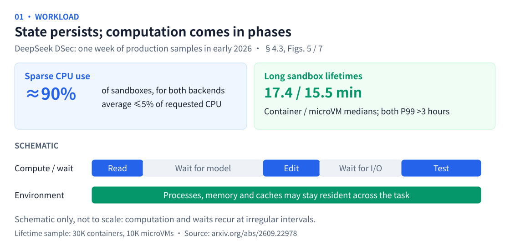
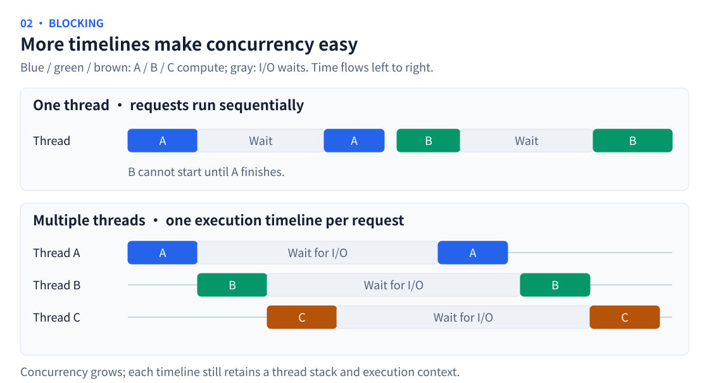
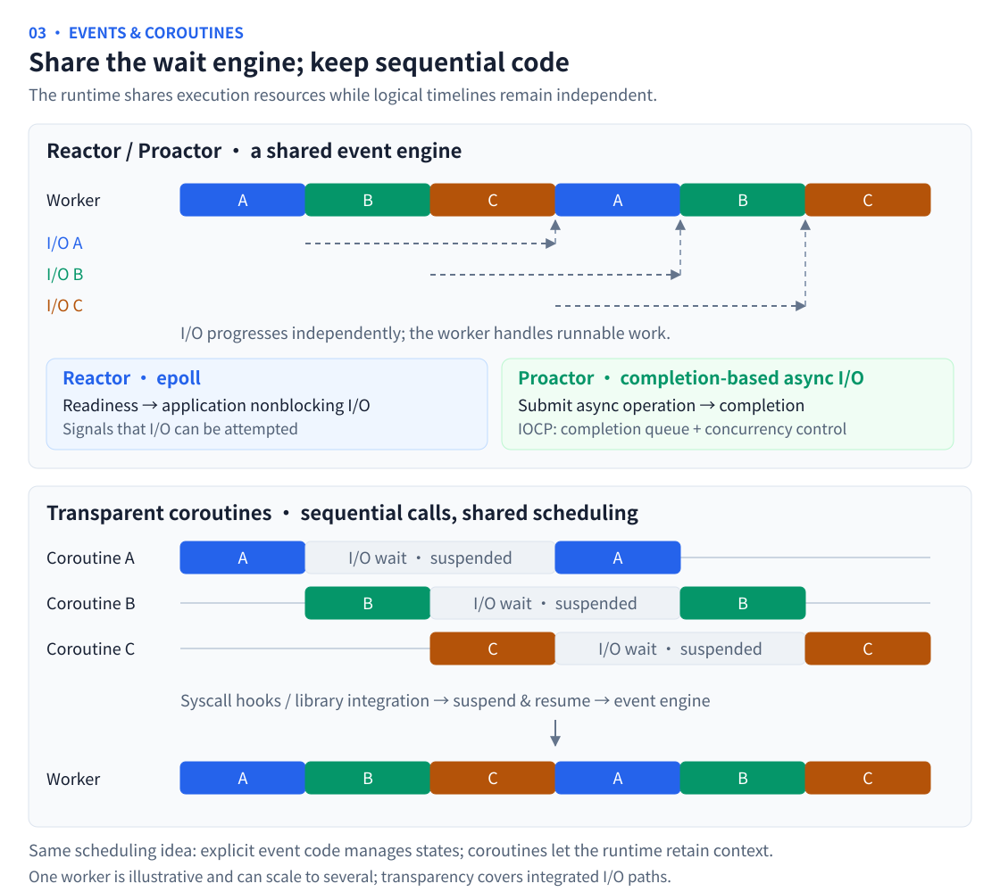
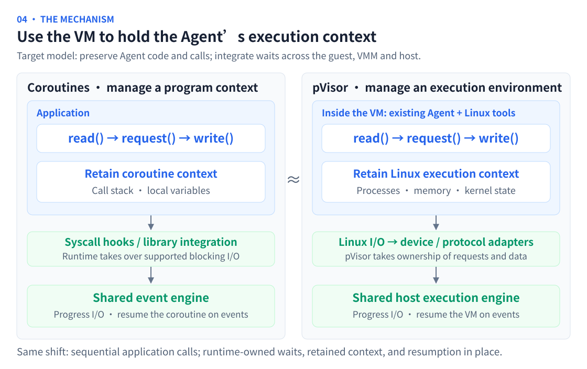
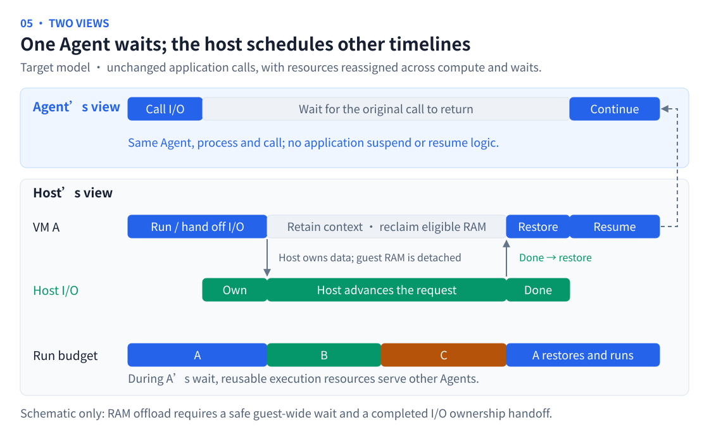

# Why Agents Need pVisor

**pVisor aims to establish a new execution model for Agents: Agents retain their sequential programming model, while a shared execution engine takes over supported I/O, reclaims resources during waits, and resumes the original execution timeline when events are ready.**

Scaling autonomous Agent execution requires changing how resources follow tasks. Faster sandbox startup is a foundation. The larger opportunity is to keep many stateful Agents progressing without retaining a complete resident environment for every timeline throughout its lifetime.

## An Agent's timeline is continuous; its resource demand is intermittent {#waiting-cost}

A Coding Agent typically follows its own timeline: read a repository, request a model response, edit code, run tests, and choose the next step from the results. Tools, child processes, and background services may run concurrently, while the task retains state across turns.

Computation and waiting alternate along this timeline. While the Agent waits for a model response, inference happens in an external service, but its sandbox may still retain memory, caches, and process state.

DeepSeek's **DSec (DeepSeek Elastic Compute)** report provides production evidence. In a week of samples from early 2026, about 90% of sandboxes in both the container and microVM backends averaged at most 5% of their requested CPU. Median lifetimes were 17.4 and 15.5 minutes respectively, with both P99s exceeding three hours. The report also describes sandboxes waiting for the model's next action while retaining state and caches. [DSec §1 and §4.3, Figs. 5 and 7](https://arxiv.org/html/2609.22978v1#S4.SS3)

These observations support **intermittent computation over long lifetimes**. Computation and waits recur across interaction turns without a fixed period. The phase timeline above is illustrative, not a measured DSec trace.

As concurrency grows, residency during waits accumulates. **Continuous logical execution need not require continuous physical resource occupancy.** The unit to optimize is therefore the Agent's complete lifecycle, from receiving an environment to delivering a result.

## A familiar transition in I/O execution models {#io-models}

High-concurrency servers have faced a similar change in resource organization. On a single thread processing requests sequentially, one request waiting for I/O delays later requests. A thread per connection preserves sequential code while allowing several timelines to overlap. When many connections wait, however, each retains a thread stack and execution context.

Event-driven execution centralizes waiting so fewer threads can handle many connections. Reactors commonly use readiness notifications such as epoll; Proactors organize execution around asynchronous completion; IOCP provides completion notifications and concurrent processing. Adopting these models directly often requires splitting sequential code into state machines or callbacks and managing more execution state. [epoll](https://man7.org/linux/man-pages/man7/epoll.7.html), [IOCP](https://learn.microsoft.com/en-us/windows/win32/fileio/i-o-completion-ports)

Transparent coroutines concentrate this adaptation in the runtime. Programs continue to express logic sequentially, while syscall hooks or standard-library integration hand supported blocking I/O to an event engine. The runtime suspends the coroutine during the wait and resumes it at the original call when ready. For example, libco combines socket-function hooks with epoll / kqueue so business logic can retain synchronous calls while executing asynchronously. [libco](https://github.com/Tencent/libco), [Go runtime scheduling](https://go.dev/doc/faq#goroutines)

The figure uses one worker to illustrate sharing; implementations can use several. A Reactor signals that I/O can be attempted; a Proactor signals completion of a submitted operation. Coroutines let applications avoid splitting their state around those events. Transparency means preserving call semantics on integrated I/O paths, rather than automatic, lossless migration of arbitrary multithreaded programs.

**pVisor aims to bring this transition to Agent execution.** Agents continue using their existing code and Linux tools. The execution engine turns supported waits into event-driven progress and resumption. Adaptation is concentrated in the runtime, avoiding a concurrency rewrite for every Agent.

## Use the VM to hold the Agent's execution context {#agent-iocp}

Following the coroutine model, pVisor extends the scheduling unit to the Agent's entire execution environment. A coroutine retains its call stack and local variables. A VM holds the Agent's processes, memory and Linux kernel state, allowing the runtime to preserve and restore its execution context outside the application.

**Transparency to the Agent means running its existing code, using its existing Linux tools and making its existing calls.** File and network I/O crosses Linux and virtual devices into the host, where pVisor takes ownership on integrated device and protocol paths. Changes to the guest kernel, VMM and host services are concentrated at this layer. The Agent needs no asynchronous rewrite or explicit suspend, offload or resume interface. [VM execution path](../design/vm-runtime.md)

## The Agent sees continuous execution; the host schedules events {#execution-path}

Consider a model request on a supported proxy path. The Agent issues the request and waits as usual. pVisor hands it to the host to advance. When the entire guest can safely wait, pVisor retains its context and reclaims offloadable memory, making reusable resources available to other Agents. When a response arrives, pVisor restores that context and returns from the original call. The Agent proceeds to handle the result.

This places several Agent timelines under a shared execution engine: **each Agent retains its logical progress, while pVisor schedules its physical resource occupancy.** Resumption continues the same process and execution attempt. The VM preserves machine context across the wait; the host retains the I/O state needed to keep the operation progressing.

Transparency is bounded by the original call's semantics: results, errors, file ordering and synchronization requirements must remain intact. The host must own independent requests and data before removing I/O's dependency on guest RAM. Model requests also require protocol integration; ordinary TCP forwarding cannot automatically take over a TLS session inside the guest. A guest with runnable background work continues executing.

## Complete one transparent wait path first {#validation}

Start with one I/O path and complete the loop: take ownership → offload safely → advance on the host → wake on an event → return from the original call. Then extend to streaming and more tools. Validation must check call semantics and whether fixed resources support more useful execution after counting host buffers, offload and restoration costs.

Existing foundations include controlled file and network paths, pause and RAM-offload primitives, and an experimental host write buffer. Automatic wait detection, I/O handoff, completion-driven wakeups and resumption scheduling still need end-to-end integration and validation. The two figures illustrate that target mechanism. [Wait and offload experiment](../design/experimental/vcpu-idle-offload/index.md), [Agent I/O completion](../design/experimental/agent-io-completion/index.md)

**pVisor aims to give Agents the familiar execution style of transparent coroutines, with a runtime that turns waits into opportunities to share resources. The VM provides the context and control boundary for that transition.**
