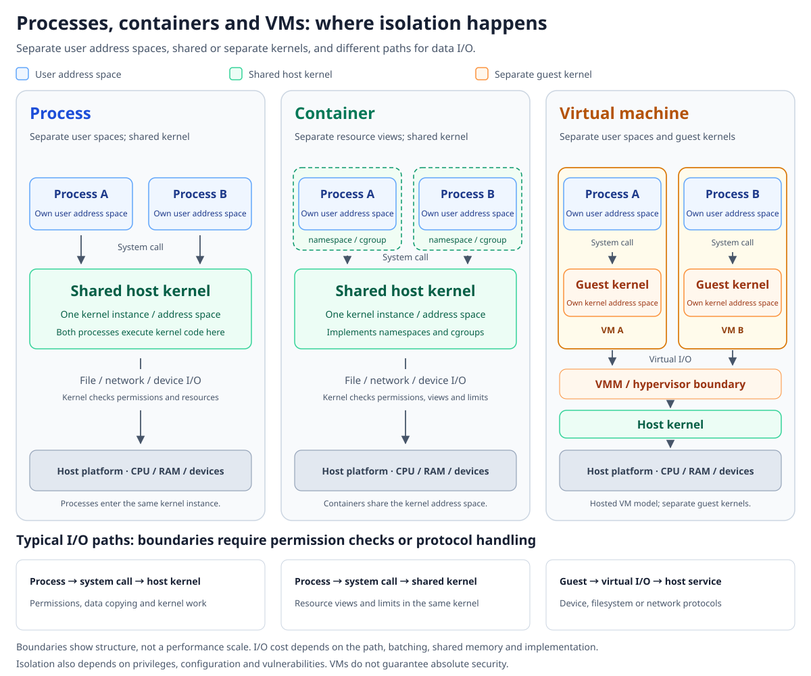
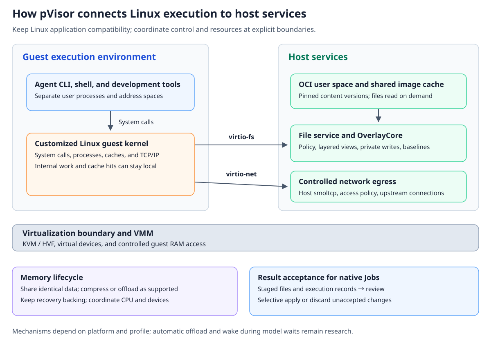

# Why the Agent era needs pVisor

**microVMs lower the cost of an individual sandbox. pVisor aims to reduce the full lifecycle cost of Agent execution, from environment preparation through execution, waiting, and result delivery.**

Having more Agents explore, divide work, and verify results in parallel is an important way to improve problem solving. As scale grows, so do the costs: preparing a thousand environments, retaining a thousand execution states, waiting for a thousand model responses, and finding results worth accepting among all those attempts. Faster sandbox startup does not automatically remove these expenses.

pVisor aims to scale autonomous Agent execution. It uses processes, containers, or VMs as execution boundaries while managing environments, file changes, resource lifecycles, and execution records. Assessing the value of this layer requires looking at the whole task.

## From the price of a sandbox to the cost of a useful result {#cost-per-result}

Suppose a thousand Agents attempt to fix the same bug, and one solution is eventually accepted. This example illustrates the costs; it is not a performance measurement.

The attempts may depend on the same repository baseline, compilers, and packages. Their process state and changes must remain separate. Failed changes can be discarded, while successful changes need review before merging. Identical content offers opportunities for sharing, and attempts still need clear boundaries.

Measuring only the milliseconds and MiB needed to start a sandbox covers just part of this chain.

| Lifecycle stage | Source of cost | What is needed beyond the VM substrate | pVisor mechanisms and direction |
| --- | --- | --- | --- |
| Bringing in an environment | Installing tools, adapting dependencies, and building an execution environment | Image ingestion and environment management | Use Linux OCI images directly and reuse existing environments without requiring users to build a separate VM disk image |
| Preparation and distribution | Repeatedly downloading, copying, and unpacking identical content | Content caching, sharing, and retrieval on demand | Shared image cache, pinned versions, and file content read on access |
| Running tools | File operations, data movement, and communication across boundaries | Compatible system calls and controlled I/O paths | A Linux guest runs programs; host file services and network egress enforce policy |
| Waiting for the model | CPU is idle while state and memory remain resident | Reclamation and restoration policies | Sharing, cold-page compression, and explicit offload already exist; automatically coordinating reclamation with model waits remains under research |
| Retrying after failure | Preparing the environment again and handling failed output | Isolated changes and a reusable starting point | Staging, logical checkpoints and forks of stopped Jobs, and independent disposal of failed changes |
| Investigation and delivery | Inspecting execution, finding changes, and resolving overwrite conflicts | Execution records and a result acceptance workflow | Run Bundle, optional model request capture, apply by path, disposal of unaccepted changes, and refusal to overwrite on conflict |

A VM can host these capabilities, but does not define them. The execution layer must organize file staging, image distribution, idle-state reclamation, and result acceptance. This is the concrete meaning of “pVisor is not another virtual machine”: the product delivers a task workflow from execution through review, with virtualization as one of its isolation mechanisms.

A more useful business metric is:

```text
Cost per useful result
  = Model, environment, machine, control-plane, and result-handling costs across all attempts
    / Number of results ultimately accepted
```

Failed attempts also contribute to the numerator. Machine costs and human time should be recorded separately and converted using explicit unit prices before adding them. End-to-end latency, correctness, and failure rate still need separate observation. pVisor does not change the model's inference price, and resource optimization does not itself improve task success rates.

## Production workloads reveal where costs diverge {#workload-evidence}

DeepSeek's DSec technical report, published in September 2026, describes production sandboxes for Agent training and evaluation. It provides concrete evidence for resource management decisions, moving the comparison beyond the intuition that “Agents should be lightweight.”

| Observation | Published data | Statistical meaning |
| --- | --- | --- |
| CPU usage of DSec containers and microVMs | About 90% of sandboxes use no more than 5% of their requested CPU capacity on average | The denominator is requested CPU capacity, not whole-machine utilization |
| DSec sandbox lifetimes | Medians of 17.4 and 15.5 minutes, respectively; p99 exceeds three hours for both backends | Includes waiting; does not equal a single command's duration or a complete task's duration |
| Historical Azure VM workloads | 60% of VMs have average virtual CPU utilization below 20% | A mixed IaaS/PaaS sample from 2016–2017, sampled every five minutes |

DSec's data comes from production samples in early 2026; the lifetime sample contains 30K containers and 10K microVMs. Azure's data comes from the historical Resource Central study. The periods, workloads, and sampling methods differ, so dividing these figures cannot establish an efficiency multiplier. [DSec §4.3](https://arxiv.org/html/2609.22978v1#S4.SS3), [Resource Central §3.2](https://www.microsoft.com/en-us/research/wp-content/uploads/2017/10/Resource-Central-SOSP17.pdf)

**An environment may need to remain alive while computation happens only some of the time.** CPU overcommit therefore solves only part of the problem. As long as state is retained, memory, file caches, and writable data continue to affect node capacity.

Cloud computing has long dealt with low utilization, short requests, and long jobs. The Borg paper distinguishes long-running services handling requests lasting a few microseconds to a few hundred milliseconds from batch jobs lasting a few seconds to a few days. The Azure Functions study found that 50% of functions had average execution times below one second, excluding cold starts. [Borg §2.1](https://research.google.com/pubs/archive/43438.pdf), [Serverless in the Wild §3.4](https://www.microsoft.com/en-us/research/uploads/prod/2020/05/serverless-ATC20.pdf)

The difference in Agent workloads therefore needs to be understood across the full execution trajectory. Tool execution, model waits, and further exploration alternate; the environment retains state across turns, and earlier feedback determines what happens next and how much longer execution continues. Long-running services typically handle many requests through stable replicas, while Agent exploration may continually create and discard new attempts. What changes is the combination of workload properties and the unit the platform needs to optimize.

## Manage the cost of waiting when duration is unknown {#waiting-cost}

An Agent task may finish after one tool call or go through many rounds of editing, testing, and exploration. Even two tasks with similar total durations may have different resource profiles: one compiles continuously, while the other spends most of its time waiting for the model.

At least three durations need separate observation: **time spent running tools, end-to-end task time, and environment retention time**. Combining them into a single “runtime” makes it difficult to decide whether to optimize startup, execution, or waiting.

During waits, a useful measurement is the integral of physical memory over time, for example in GB·s. Removing ten milliseconds of startup overhead does not automatically offset retaining state for tens of additional minutes. Likewise, pausing a vCPU stops computation without automatically releasing guest RAM.

Reclamation during waits must answer two questions: when reclamation is worthwhile, and whether execution can continue correctly after restoration. Offload incurs write, compression, and restoration costs. Model connections, network timeouts, timers, and external services do not all pause with the guest. Reclamation makes sense only when the expected residency savings cover those costs and restoration meets the latency constraints.

pVisor already has memory primitives for different purposes: sharing identical content, compressing an instance's cold pages, and explicitly offloading a whole VM for restoration within the same process. They have platform and configuration limits and cannot be combined arbitrarily. The [memory subsystem](../design/memory-optimization/index.md) defines these boundaries. The [wait observation and offload experiment](../design/experimental/vcpu-idle-offload/index.md) remains an observation prototype; it has not delivered the full loop of automatically offloading when model reasoning starts and waking when the response arrives.

This defines a research goal: **manage environment retention time separately from the amount of resident resources.**

## Which state should the control plane pay to keep consistent? {#control-plane}

Frequent environment creation and destruction brings management costs that could otherwise be amortized into the task's critical path. The number of object updates, persistence operations, and controller notifications required by an attempt may deserve as much optimization as execution itself.

Kubernetes controllers use asynchronous loops to bring actual state toward desired state. etcd KV operations provide linearizability by default, while watch notifications have their own semantics. Management overhead accumulates as frequent lifecycle operations pass through the API Server, object serialization, etcd persistence, and rate limiting. [Kubernetes controllers](https://kubernetes.io/docs/concepts/architecture/controller/), [etcd API guarantees](https://etcd.io/docs/v3.6/learning/api_guarantees/)

The Kubedirect study at NSDI 2026 used Kubernetes v1.32.0 to scale batches of 100–800 Pods in an 80-node cluster. It found that controllers exchanging state through the API Server formed the main bottleneck. Kubedirect moves reconstructable intermediate state out of this path while preserving state convergence and termination semantics. This points to reducing unnecessary durable coordination while retaining the Kubernetes ecosystem. [Kubedirect §2–3](https://www.usenix.org/system/files/nsdi26-qi.pdf)

| State or operation | Possible strategy | Boundary to preserve |
| --- | --- | --- |
| Observing node load and selecting placement candidates | Tolerate stale views, choose optimistically, and select again after failure | Nodes retain final admission authority to keep resource allocation under control |
| Preparation intermediate state that has not executed and has no side effects | Regenerate after failure and converge asynchronously | An action that has already executed must not be treated as unexecuted |
| Execution identity, permissions, quotas, and result submission | Define ownership, authorization, and commit protocols | Delayed state must not permit unauthorized access or duplicate acceptance |
| External actions such as sending messages or writing databases | Use business-appropriate idempotency keys, deduplication, or reconciliation | A timeout does not mean nothing happened; retrying does not roll back an action |

Agents can tolerate failed exploration, leaving room to optimize replaceable attempts. Important progress and non-repeatable side effects still need protection. The claim that eventual consistency is sufficient should apply only to state suited to that model.

pVisor currently handles execution on a single machine. Cross-node placement, workflows, and retries belong to Kubernetes, Ray, or other external orchestrators. This separation allows execution-path optimization to proceed independently; pVisor does not currently provide a new cluster scheduling system. [Cluster execution direction](../design/research/cluster-execution.md)

## What processes, containers, and VMs isolate {#isolation-boundaries}



Ordinary processes typically have separate user-space virtual address spaces and can also explicitly share memory. Different processes still call the same host kernel. Isolation of user address spaces does not isolate kernel failure domains.

Containers continue to use the host kernel. Namespaces isolate views of resources such as processes, mounts, and networks; cgroups provide resource accounting and limits. Capabilities, seccomp, and LSMs can add access control. **Namespaces and cgroups do not create separate kernel address spaces.**

A VM has its own guest kernel and memory, separated from the host through hardware virtualization and address translation. Guest system calls can complete within the guest. Access to external files or networks then crosses virtual devices into the host path. The host virtualization layer, VMM, and device implementations remain part of the security boundary. [Isolation mechanisms](../design/isolation.md), [executor boundaries](../security/executor-boundaries.md)

Adding boundaries generally adds protocol processing, synchronization, and possible data copying. Stronger isolation does not, however, make every I/O operation slower: guest caches can avoid crossings, shared mappings can reduce copying, and batching can amortize notifications. Comparisons must examine concrete paths instead of ranking processes, containers, and VMs by name alone.

For Agents, an independent guest kernel means the workload does not use the host syscall interface as its own kernel interface. Removing unused drivers and devices reduces the capabilities the guest must carry. Overall security still depends on the host boundary and implementation, and cannot be inferred from kernel size alone.

## Why microVMs are used and what further specialization can change {#runtime-choice}

microVMs have a straightforward appeal: hardware virtualization provides a kernel boundary while preserving the existing Linux tool ecosystem and reducing VMM and device-model overhead. Firecracker already uses a minimal device model and a stripped-down Linux guest. Choosing a microVM is itself a form of specialization for a purpose. [Firecracker design](https://github.com/firecracker-microvm/firecracker/blob/main/docs/design.md)

Unikernels specialize the software stack from another direction, combining the application and required operating-system components into a dedicated image. This is a different dimension from microVMs; a unikernel can also run on a virtualization platform. [Original Unikernels paper](https://anil.recoil.org/papers/2013-asplos-mirage/)

Agents dynamically run shells, package managers, compilers, and subprocesses, making broad software compatibility important. Traditional application-specific unikernels often require adapting software or selecting components in advance. The original Firecracker paper also explains that its need to run unmodified Linux programs led it away from the unikernel approach discussed at the time. [Firecracker §2.1.3](https://www.usenix.org/system/files/nsdi20-paper-agache.pdf)

| Approach | Suitable conditions | Tradeoffs |
| --- | --- | --- |
| Host processes or containers | Prioritize reuse of the host kernel, tools, and caches | Shared kernel boundary; task-level policy and result management are still needed |
| An existing microVM plus an execution layer | Require an independent guest kernel and broad Linux compatibility | Environment distribution, file results, and reclamation during waits require additional integration |
| Application-specific unikernel | The application and its required components can be determined in advance | Dynamic tools, process semantics, and compatibility need individual evaluation |
| pVisor's specialized Linux execution environment | Retain Linux user space while jointly managing host file services, policy, and resource lifecycles | Guest/VMM protocols, platform adaptation, and compatibility require maintenance |

pVisor draws on specialization for a purpose: tailor Linux and devices to execution needs, and let the host provide controlled environment and result services. The current VM path still consists of a Linux guest with separate user-space processes, so it is not a unikernel in the strict sense.

Specialization also involves the trust model. Public clouds serve mutually untrusted tenants and must carefully restrict sharing. Multiple Agents in the same trust domain can use common read-only inputs. The original Firecracker paper's production recommendations include disabling same-page merging and avoiding file sharing to mitigate side channels. pVisor's current [threat model](../security/threat-model.md) does not promise hostile multitenant or side-channel isolation; sharing benefits carry security tradeoffs. [Firecracker §3.4](https://www.usenix.org/system/files/nsdi20-paper-agache.pdf)

## How pVisor turns lifecycle requirements into execution paths {#execution-path}



### Reuse the Linux ecosystem to reduce environment adaptation {#oci-environments}

The pVisor VM executor directly accepts Linux OCI images matching the host architecture, supporting `linux/amd64` and `linux/arm64`. You can reuse an open-source project's existing user-space environment without first converting it into a bootable VM disk. Image pulling does not depend on Docker, Podman, or Buildah. [VM executor](../guides/executors/vm.md)

This reduces the cost of bringing in an environment. OCI format support does not imply support for arbitrary devices, kernel features, or Docker deployment configurations; workloads must still fit the selected guest and network capabilities. The current kernel also makes specific tradeoffs: for example, the generic x86_64 configuration removes capabilities such as ACPI/PCI while also disabling guest CPU vulnerability mitigations. This is not a security improvement in every respect. The [firmware documentation](https://github.com/DeepLink-org/pvisor/blob/main/fw/README.md) and [platform matrix](../reference/platforms.md) maintain the configurations and limits.

### Treat environment content as shared input {#shared-environment}

Prepared or published images can be read through a shared cache by version, file, and content block. The VM connects directly to the file backend and retrieves content on access, without fully materializing the environment for each execution. Preparing an image absent from the cache for the first time may still require a full download and extraction. Full export, snapshots, or copy-up may also need to fetch data that has not yet been read. [Shared image cache](../reference/shared-image-cache.md)

Three things need to be distinguished here: deduplicating disk content, reusing the host cache, and sharing the same physical pages among guests. These are different optimizations. DSec's Firecracker experiment used virtio-pmem and DAX to eliminate duplicate guest page caches, reducing peak host memory by 40.2%. This demonstrates the value of optimizing resource paths and shows that improvements can happen within a microVM. [DSec §8.4](https://arxiv.org/html/2609.22978v1#S8.SS4)

### Keep system calls local and handle external access at device boundaries {#device-boundary}

Ordinary instructions and most system calls execute inside the guest. Cache hits, tmpfs, and procfs operations can stay there. Requests for exported file trees cross virtio-fs into the host file service; network traffic crosses virtio-net into controlled host egress. pVisor places its control points at these device boundaries. [VM execution path](../design/vm-runtime.md), [file service](../design/overlayfs.md), [network data plane](../design/overlaynet.md)

This division lets compatibility and control work together. Guest Linux provides mature process semantics; the host file service manages visible views, staged writes, and conflict baselines; network egress enforces access policy. The [shared filesystem service decision](../design/decisions/0007-shared-filesystem-service.md) explains these responsibilities.

Requests across the boundary can also be optimized according to their specific semantics. Directory mirroring reduces metadata round trips when the underlying content is stable and paths for modifying it are controlled. Lazy read-only open defers binding a host handle until data is needed. Both must preserve authorization, object lifecycles, and error-handling contracts. A read-only mount alone does not guarantee that the underlying physical content never changes. [VM file protocol and applicability](https://github.com/DeepLink-org/pvisor/blob/main/crates/pvisor-vm/README.md)

### Separate execution completion from result acceptance {#result-acceptance}

During a staged run, file changes first enter the Job's stage. After execution, you can inspect changes and records, then choose apply or drop. If host files have changed, pVisor refuses to overwrite them directly. Failed attempts can therefore leave inspectable artifacts without handing over an entire machine as the result. [Staging semantics](../concepts/staging.md)

Logical forks of native Jobs require the source Job to be stopped. They reuse staged file state and conflict baselines, not arbitrary process memory. Dropping files does not undo external API actions, database writes, or messages already sent. [Logical checkpoints and forks](../guides/fork-checkpoint.md), [failure semantics](../design/failure-semantics.md)

These capabilities belong to the native Job workflow. The separate daemon currently provides a local VM lifecycle API, without stage/apply, checkpoint/fork, or offload APIs. Capabilities from the two entry points cannot be treated as interchangeable. [Daemon integration boundaries](../guides/daemon/boundaries.md)

## Validate the choice against complete tasks {#validation}

A smaller kernel, fewer VM exits, and lower memory use in one component can explain where gains come from. The choice of approach ultimately depends on whether those gains improve complete tasks.

Comparisons should use the same tools, inputs, and result validation, and declare the same security constraints. A baseline using an existing microVM should also have a reasonably stripped-down guest and implement the task semantics being compared. The difference between a full Ubuntu cold start and a stripped-down pVisor environment alone cannot establish the need for a custom runtime.

| Question | Evidence to observe |
| --- | --- |
| Is preparation cost amortized? | Environment readiness time on first use and reuse, network bytes, and the amount of data actually materialized |
| Is waiting cheaper? | Whole-node physical memory integrated over time, including the VMM, caches, shared services, and restoration headroom |
| Is restoration worthwhile? | p99 of the first tool call after restoration, connection and timer behavior, and peaks when many instances restore together |
| Do parallel attempts produce more useful work? | Completion throughput and result acceptance rate under fixed resource and latency constraints, using the same validation |
| Do failure and delivery costs fall? | Repeated work before retrying, record completeness, review time, and conflict-handling outcomes |

Similar environments and multiple waiting rounds are worth testing. Heavy writes, low environment reuse, and frequent wakes should also be included. Sharing, compression, and offload each have costs; evaluations should not select only workloads that favor one mechanism.

pVisor's case for its own runtime must rest on demonstrated benefits to complete tasks from jointly optimizing the guest, file service, and resource lifecycle. If an existing VMM plus an execution layer can achieve the same result with lower maintenance costs, reusing it also serves the product goal.

**Cheap sandbox startup is a starting point. Every stage from acquiring an environment to delivering an acceptable result deserves optimization.**
