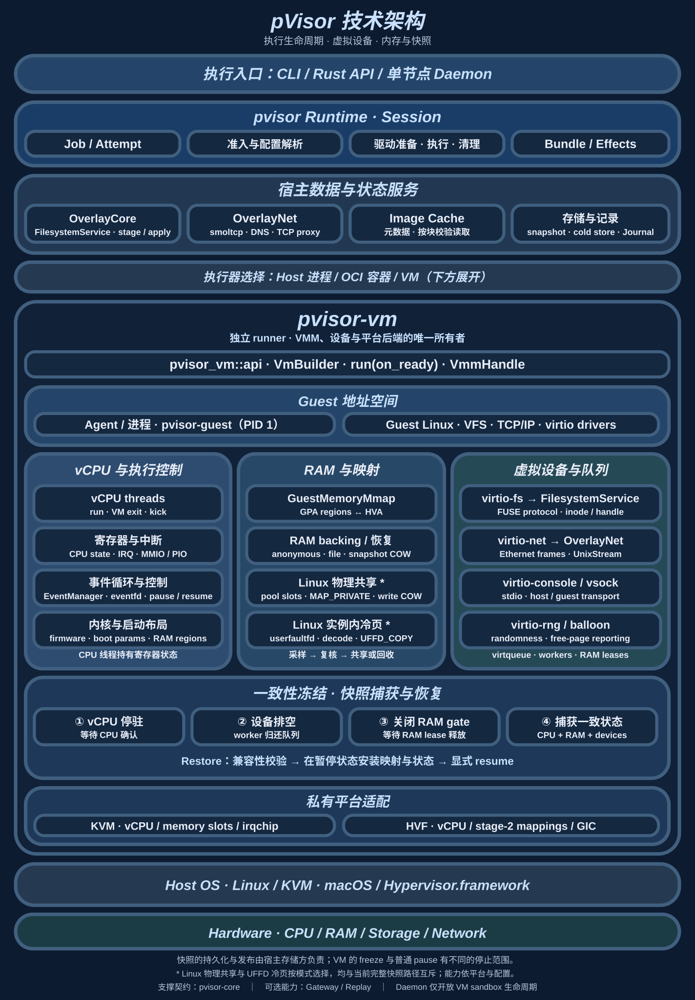

# 核心架构

pVisor 将 Agent CLI、脚本和自动化命令组织成可管理的 Job：在启动前确定策略与执行边界，运行时管理文件、网络和机器资源，结束后保留可审查的结果。Operation 描述处理请求，Event 描述处理过程中发生的事实。

这条主线分成两个职责：**core 提供定义，pvisor 提供实现。** 外部调用方提交执行请求，通过运行句柄控制一次执行，通过 Event 观察它的过程和结果。

总体框图与一次任务的端到端走读见[设计与底层原理](index.md)。下列合同覆盖 crate 所有权、API 边界与宿主权限路径。

## 定义与实现

| 所有者 | 职责 |
| --- | --- |
| `pvisor-core` | Operation、策略决定、Placement、Outcome、Event，以及跨组件交互契约；共享纯校验与策略求值 |
| `pvisor` | 请求解析、能力准入、实际策略改写、放置选择、调度、执行和 Attempt 生命周期 |
| `pvisor-journal` | Event 提交、回执、去重、因果引用校验和恢复 |
| `pvisor-overlay-core` | 文件授权接入、写时复制、preimage、review/apply/recovery/drop |
| `pvisor-overlayfs` | 宿主 FUSE 挂载与文件操作接入 |
| `pvisor-overlaynet` | 网络解析、代理转发和 VM 网络接入；落实 core 定义的策略 |
| `pvisor-guest` | VM 内 PID 1 与命令启动契约 |
| `pvisor-gateway` | 可选的模型协议路由、转换和调用观察 |
| `pvisor-daemon` | 单节点 sandbox API、持久归属、原生 VM supervisor 与 guest 协议适配 |
| `pvisor-cli` | CLI、TUI、cache/replay 前端与 Host Job 应用适配；消费 runtime |
| `pvisor-shim` | containerd Runtime v2 shim（`io.containerd.pvisor.v2`）；OCI container 与可选 VM 两种执行层的生命周期、exec 与 FIFO/PTY IO |
| `pvisor-vm` | VM、设备、冻结、snapshot 与 RAM 映射；统一 api、私有平台实现 |
| `pvisor-replay` | Agent 轨迹回放机制；消费 Core/Journal 合同，前端位于 CLI |

[Daemon](daemon/index.md) 的 VM-only `NativeRuntime` 在独立 supervisor 中使用持久 `RuntimeJobService` 启动执行，并复用进程内 `AttemptService` 控制同一 live Attempt。它保留 RunHandle，可跨 API 重启继续持有 VM；daemon 自行负责 SDK 鉴权、准入和确认清理。原生 Job 的 stage/apply、checkpoint/fork 和 Gateway 接口仍有独立归属，不因复用 runtime 自动暴露给 SDK。

core 不拥有执行循环，也不启动进程或打开控制 socket。pvisor 实现 AgentCtl 客户端／服务端和审批 socket；驱动实现各自的文件、网络与隔离边界。默认核心不依赖 Gateway、TUI 或 replay，捕获通过 `gateway` feature 启用。

## 技术分层与资源归属 {#technical-layers}



执行入口提交配置，Runtime 组织 Session 和 Attempt，宿主服务提供文件、网络、镜像和持久存储。Host、OCI 和 VM 是不同的执行路径；图中向下展开 VM 的内部状态及其与宿主的关系。crate 依赖表达代码复用，资源归属决定谁负责停止、同步和释放。

### 宿主数据服务 {#host-services}

文件路径在 `FilesystemService` 汇合。Host 的 FUSE / FSKit 适配器与 VM 的 virtio-fs 入口共享 OverlayCore 的授权、分层查找、copy-up 和 preimage 语义；inode、handle、协议权限与队列仍由各入口持有。VM 直接调用文件服务，不建立中间宿主 FUSE 挂载。暂存的候选文件与目标工作区分别发布，具体写入和恢复顺序见[文件系统设计](overlayfs.md#filesystem-service)。

OverlayNet 拥有连接授权与转发，VM 的 virtio-net 将 Ethernet frame 交给宿主用户态数据面。显式代理与 VM 网卡接入具有不同的覆盖范围。可选 Gateway 消费模型协议请求，负责路由、转换、凭据委托和捕获；普通网络转发不会自动产生模型语义。接入关系见[网络设计](overlaynet.md)和[Gateway](gateway.md)。

镜像缓存为文件服务提供固定 revision 的元数据和校验后的内容读取。VM 持有运行中的映射与设备状态，宿主存储层持有镜像对象、RAM backing、快照目录和发布事务。缓存命中、文件内容共享与 RAM 物理页共享发生在不同层次，各自的引用和回收规则见[共享镜像缓存](lazy-image-v2.md)与[内存机制](memory-optimization/index.md)。

### VM 内部状态 {#vm-ownership}

`pvisor_vm::api` 接收配置和资源所有权，`VmRuntime::run` 在独立 runner 内启动 VM，并通过 ready 回调交出 `VmmHandle`。handle 提供控制，不延长 VM 生命周期；调用方仍负责监管 runner、绑定文件和网络资源，以及快照兼容性与持久化。

| 状态 | 所有者与协作边界 |
| --- | --- |
| Guest 进程 | `pvisor-guest` 作为 Linux PID 1 启动工作负载、回收后代，并在报告退出前同步可见的 virtio-fs 挂载 |
| vCPU 与执行控制 | `pvisor-vm` 持有 CPU 线程、寄存器、中断和事件循环；KVM / HVF 适配留在 crate 内 |
| RAM 与映射 | `pvisor-vm` 管理 GPA 与 HVA、backing 和映射生命周期；宿主存储适配器管理被引用的文件或块 |
| 虚拟设备 | 队列 owner 发布 used ring；worker 与 RAM lease 保持请求缓冲区在处理期间有效 |
| 冻结与恢复 | VM 协调 CPU 停驻、设备排空和 RAM gate；调用方在冻结窗口内保存并发布匹配的机器与文件状态 |

普通 pause 只确认 CPU 停驻，设备仍可能访问 RAM。完整冻结需要同时处理 CPU、队列和内存引用；恢复先校验兼容性，在暂停状态安装映射与设备状态，再显式 resume。物理共享、冷页和 offload 按平台、backing 与 profile 选择，不能假定同时可用。调用与失败后状态由 [VM 设计](vm-runtime.md#freeze)和[环境快照](environment-snapshot.md)维护。

源码入口：`pvisor/src/session/lifecycle.rs`、`pvisor-overlay-core/src/service.rs`、`pvisor/src/image/cache/backend.rs`、`pvisor-vm/src/api.rs`、`handle.rs` 和 `devices/virtio/`。

## API 边界与迁移状态 {#api-boundaries}

crate 的逻辑职责和 Rust 可见性需要分别检查。当前只有 `pvisor-vm`、`pvisor-overlayfs` 和 `pvisor-journal` 已采用唯一 `api` 入口；其他 crate 保留既有接口，不能因为架构图已经分层就假定整个 workspace 完成迁移。

| crate | 当前公开边界 | 实现与资源归属 |
| --- | --- | --- |
| `pvisor-vm` | `pvisor_vm::api`；`VmBuilder`、`VmmHandle` 通过 trait 使用 | backend、VMM、设备、RAM 和平台分派私有 |
| `pvisor-overlayfs` | `pvisor_overlayfs::api`；配置、mount、session 与 metrics 契约 | `fs`、`mount`、`observation` 私有；不拥有 apply 或 Run 生命周期 |
| `pvisor-journal` | `pvisor_journal::api`；`JournalStore`、`TraceProducer`、`DurableFiles` | `journal`、`trace`、`persistence` 私有；Event/Receipt 由 Core 定义 |
| `pvisor-core` | 领域模块与根级 re-export，尚未迁移 | 共享身份、协议、纯校验与策略定义；不拥有执行资源 |
| `pvisor-overlay-core`、`pvisor-overlaynet` | 现有公开模块与根级接口，尚未迁移 | 文件语义、双入口文件服务、网络代理与出口数据面 |
| `pvisor`、Gateway、Replay、Daemon 等 | 保留各自既有入口，未统一成单一 `api` 模型 | 继续按实际生命周期与领域边界演进 |

已迁移 crate 的 `api` 声明公开数据、字段和 trait 方法；不透明 owner 可以从私有实现重新导出，但状态保持私有。方法体、校验、平台分派和资源管理放在实现中，公开 trait 没有默认方法体；调用方通过所属 crate 的 `api` 导入合同。API 在支持的平台和 feature 间保持同一声明形状，实际能力用能力查询和明确的不支持错误表达。

迁移按 crate 进行：同时调整该 crate 的调用方、README、公开文档和边界检查，保留外部 API 合同覆盖。尚未迁移的 crate 不应临时套一层全量 re-export 或重复 DTO 来制造一致外观，也不能公开内部模块绕过编译边界。硬件/私有状态检查留在 crate 内；外部调用方只依据所有权、生命周期、失败后状态和同步合同。

这套 Rust 边界不自动提供稳定线上协议或旧记录兼容性。前端 self-exec owner 时校验同一二进制身份；后续 CLI 按实例协议兼容，不要求二进制摘要相同。磁盘格式由各自 reader 检查。版本对应关系见[记录与版本矩阵](records-and-versions.md)。状态依据 `lib.rs`、VM 的 `runtime_modules.rs`、各 `api.rs` 与目录 README 静态核对；不代表本次重新运行了契约测试或平台验证。

## Host 与 Guest AgentCtl {#host-agentctl}

Host AgentCtl 是内置 Job CLI 操作的权限路径。Guest AgentCtl 是每个 Attempt
面向工作负载 `Hello`/`Sync`、客户端状态、directive 与 checkpoint 静默点的
协作路径。两者使用独立 schema、凭据与端点：guest 协作 token 不能授权
宿主 Job、VM、暂存文件或 daemon supervisor 控制。Bundle 的 `agentctl`
快照仍描述 Guest 协作，不是 Host 授权回执。

### Job owner 与请求所有权 {#host-job-service}

`pvisor spawn` 保留终端前端和一个 self-exec owner。两者直接继承 stdio，
通过私有 socketpair 传递取消与退出信息。owner 留在原 session，使用独立
进程组。交互执行沿用原控制终端，退出后恢复前台进程组；终端 Ctrl-C 可以
直接到达工作负载。Linux 将 owner 设为 subreaper，保留 pidfd 后代回收。

进入执行器前，owner 绑定私有 socket，并将 `live_control` 写入宿主 Job
记录。规范地址为：

```text
/tmp/pvisor-host-<UID>/jobs/<job-id>/<attempt-id>/control.sock
```

各级目录属于同 UID、不是符号链接、权限为 `0700`；socket 为 `0600`。
记录固定路径、device/inode、协议、owner PID 和启动二进制身份。客户端核对
对端 UID，并在连接前后核对 socket 身份。执行器将整个权限根目录排除在
Guest 视图之外。公布终态时清除发现记录；owner 只删除自己持有的 socket
inode。保留存储的嵌入式运行也发布相同记录。

活 status、kill、原生 VM 状态转换、执行捕获及运行中 inspect 由启动时的
owner 二进制执行。已停止 Job 的 status、review、apply、drop 和 inspect
直接在调用方执行。封存检查点的恢复和 fork 直接启动新 owner。有效 owner
仍持有 stage 时，apply/drop 拒绝执行。持久操作在 Job 根目录的 `job.lock`
上获取独占 `flock`，检查其属于当前用户、权限 `0600`、硬链接数为 1。
诊断记录包含锁协议、PID 和操作名。未知 Job schema 拒绝修改。只有原持有
进程已死且没有有效控制端点时，才能清除残留持有者信息。只读 inspect 使用
stage 声明的 lower 可变性；声明缺失或 lower 已重绑定时使用 Mutable，读取
不保证时效性。

### 现存内部通道与清理顺序 {#owner-internal-control}

运行时仍保留以下内部通道；它们属于 Job 所在进程，没有新增用户级常驻进程。

| 通道 | 当前调用方与实现 | 后续收敛 |
| --- | --- | --- |
| Overlay 控制 | `registry.rs::RunControlServer` 使用 stage 中的 `control.sock` 链接发现私有端点；owner status 通过它查询自己，TUI 仍读取 observations，旧 inspect 挂载表与新 owner inspect 重复 | 先迁移 TUI 观测与 SDK 调用，再删除旧 inspect 分支、监听和链接发现 |
| 原生 execution capture | `job_execution.rs::Server` 保留 `execution.sock`；owner 接到 capture 后，runtime 仍通过此端点调用自己 | 改为 owner 内直接调用，保留请求回执、操作锁、冻结和 suspended head 的终态确认 |
| 显式 VM 调试路径 | `--vm-socket` 与嵌入式 `host_vm_exchange` 使用另一套异步交换；记录发现路径使用 `LiveControlRecord::exchange_checked` | 共用有界、可取消的传输，保留 SDK 对外接口适配 |

清理先统一调试传输，再把 owner 启动消息收窄到 run、fork、resume。
当前 `JobCommand` 仍序列化全部命令，只有这三个命令实际经 socketpair 启动；
其他命令的序列化、owner 终端分支和对应往返测试可以随之移除。
`OwnedTree.excluded` 的生产调用均为零，`Completion.signal` 没有读取方，
恢复路径的 `vm_control_socket(None)` 恒为空，也属于可删除的遗留。
这些清理尚未实现；内部通道合并必须同步迁移调用方和合同测试。

### 线上契约与升级 {#host-wire}

实例契约名为 `pvisor-instance-control-1`。Core 的 version-1 Host envelope
携带关联信息、精确 Job/Attempt 目标及类型化结果/错误。
`runtime/host_transport.rs` 保留换行 JSON framing，单帧上限 1 MiB。
同一 owner 最多接纳八个连接，修改复用已有操作锁。公共 socket 不接收终端
描述符或 Guest token。内部 CLI DTO 只用于 self-exec owner 的启动。

调用方与 owner 的二进制可以不同，只要求实例协议匹配。不兼容的 Job 协议
会指出该 owner 记录的二进制，不阻塞其他 Job。升级前使用旧二进制等旧 Job
结束，并停止旧 `--pvisor-internal-host`。新 CLI 不连接旧的
`<generation>.sock`。没有 live 发现字段的旧记录只提供磁盘状态，不自动发现
旧 VM。daemon supervisor 的监听、私有凭据、framing 和准入保持不变。

### 取消与验证边界 {#host-limits}

owner 安装信号处理后才解除 SIGINT/SIGTERM/SIGHUP 屏蔽。前端回收自己的
owner 子进程；owner 负责取消、断线和后代清理。Linux 使用 subreaper 收养、
`/proc` 发现和 pidfd。macOS 保留出生身份校验与轮询限制：不能保证回收遗漏的
已重挂父进程孤儿，数字 PID 信号也不是原子的 pidfd 操作。已加载 Mach-O UUID
校验不等于逐字节内存认证。收回监听并未建立新的 macOS 隔离保证。

响应丢失、超时或取消之后，副作用仍可能已经发生。记录发现路径报告不确定，
不自动重试。当前 `--vm-socket` 调试路径仍等待旧异步交换，Ctrl-C 不会中断
响应等待，底层断线错误也可能缺少不确定性提示；这属于待统一的实现缺口。
任一路径断线后都应先核对状态。检查点的局部回执不提供通用 exactly-once 交付。
传输和进程测试不能证明 Guest 正确性或真实 VM TUI 已得到验证。

## 一条生产执行路径

实际顺序是先解析 RunSpec，确定有效策略与执行器能力，再准备文件、网络和运行附件。必要启动事实提交成功后才调用 `RunExecutor::execute`。准备本身可能创建目录或 socket，所以提交失败仍需要清理已准备资源。

执行器返回 `ExecutorOutput`，Session 继续做清理、控制观察核对和结果保存。

例如，请求允许网络访问而 workspace 策略拒绝全部网络时，准入形成有效网络配置，再将同一配置交给网络驱动和执行器；准备阶段不应重新读取可变配置，避免记录与实际出口不一致。

源码入口：`pvisor/src/runtime/run.rs::resolve_run`、`pvisor/src/session.rs`、`pvisor/src/runtime/job_service/managed.rs`。

`RunSpec` 是调用方的执行配置输入；`Operation` 是结构化的操作描述。目前唯一生产操作是 `run.execute`，包含程序、参数和工作目录。执行器实际消费有效 RunSpec 及准备好的驱动附件。`PVisor::resolve_operation` 使用同一准入路径，供启动前审查，不能代替实际执行及安装证据。

准入保留请求与有效操作的快照。实际策略变化记录为 Rewritten，选定的 VM／Overlay 放置记录为 Placed。拦截发生在实际驱动边界：文件操作进入 OverlayFS／OverlayCore，网络流量进入 OverlayNet。它们共享策略定义，但当前并没有将每个文件或网络操作都提升为独立的公共 Operation。

例如，网络驱动把请求的 Ambient 能力收窄为 Deny：Requested 保留原始权限，Rewritten 保存收窄前后快照，Placed 描述最终放置，执行器按有效配置运行。这些快照记录实际策略处理；通用规则解释器不在当前实现范围内。

## 一个生命周期所有者

当前每次 `PVisor::run` 创建一个 Attempt，由 pvisor 中的 `Session` 统一持有和管理；Job、Run 与 Attempt 的身份区分见[执行模型](../design/execution-model.md)。

Session 负责驱动准备、Guest AgentCtl server、取消与超时、执行后清理、观察检查、Bundle 保存及终态公布。执行器返回 `ExecutorOutput`，不自行分配 Job／Attempt 身份或公布终态。`RunHandle` 提供状态、取消、checkpoint 和事件订阅；取消请求不等于执行已经停止。

Process／VM 清理其受管理的进程组；容器使用 runtime 的终止接口。进程组之外的后代和各平台隔离缺口见[隔离设计](isolation.md)。Guest AgentCtl 负责工作负载协作和 checkpoint 静默点，本身不是强制控制；Host AgentCtl 则是上方描述的独立宿主权限路径。

## Event 是观察接口

外部观察的是 Event，不需要依赖 Session 的内部字段。事件链、身份、因果引用与记录边界见 [Operation 与 Event](operations-events.md)。

## 策略、控制与证据

策略、准入计划与执行后观察是三个独立层次，不能互相替代；`ExecutorPlan`／`ExecutorObservations` 的等级与证据口径见[能力与证据](../concepts/capabilities-and-evidence.md)。

core 共享文件／网络策略求值。user、workspace、session 和执行器基础策略共同约束权限，后面的 allow 不能覆盖前面的显式拒绝。实际授权、拦截和控制安装由 pvisor 与驱动落实。

## 记录与文件应用

| 记录 | 回答的问题 |
| --- | --- |
| `run.json` | 这项 Job 的身份、状态、执行器及本地资源是什么？ |
| `completion.json` | 当前 Attempt 的哪个结果与哪一份 Bundle 字节已经绑定提交？ |
| Run Bundle | 结果、控制观察、产物及文件／网络摘要是什么？ |
| Event Journal／Trace | 已发布了哪些事实，它们如何关联？ |
| Overlay diff／preimage | 哪些文件仍待审查，应用时应检查什么原始状态？ |

持久 Attempt 的完成回执绑定结果与 Bundle，Run 和 execution Job 保存状态投影，Event 提供事实观察。提交顺序与缺失回执时的核对见[Attempt 完成协议](execution-model.md#attempt-completion)。Event 可以重建已观察到的操作过程；恢复外部状态还需要对应的输入与执行机制。Agent 原生轨迹 replay 的恢复范围由 [Replay 设计](replay.md)维护。

暂存文件先审查再应用。OverlayCore 负责目标校验、持久化应用意图、更新及恢复；一个批次不是原子文件系统事务。`apply`、`drop` 与文件检查点的恢复范围及不能撤销的外部副作用见[能力与证据](../concepts/capabilities-and-evidence.md)，操作流程见[审查与应用](../guides/review-apply.md)。
