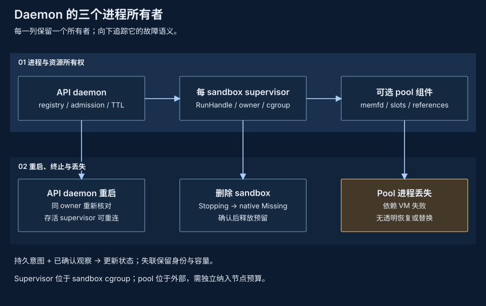

# 单节点 Daemon 架构

通过 `pvisor-daemon` 管理本机 sandbox：一个进程接受有资源边界的创建请求，持久化归属与意图，控制原生运行时，清理过期 sandbox，并转发对预制服务的访问。外部编排选择主机并协调业务工作，不是 pVisor 产品控制面。

## 职责划分 {#architecture}



| 所有者 | 职责 | 不负责 |
| --- | --- | --- |
| 调用方 | 工作负载、预制镜像、输入版本、重试与业务副作用 | 从超时推断执行没有发生 |
| Daemon | 本机准入、归属、意图、运行时对账、TTL、鉴权端点 | 跨主机调度或训练事务 |
| 原生 supervisor | 嵌入 pVisor/VM、RunHandle、已确认 vCPU 控制、cgroup 身份、vsock bridge | Stage/apply/checkpoint API 或自动 node 共享 |
| 预制镜像 | 监督 argv，初始化并鉴权 execd/egress | 替代生命周期 API 授权 |
| 原生 pVisor | Supervisor 嵌入 VM 执行；公开 Job 工作流仍独立 | 自动暴露 stage/checkpoint API |
| 原生 node 运行时 | 独立不可变 backing 协议 | 自动 daemon 获取／共享 |
| Daemon 池组件 | `serve --memory-pool` 启用的可选独立池 | 池进程／宿主重启恢复；node acquire/release |
| 独立 `pvisor-cache` | OCI prepare/publish/serve/list/stat/read | Daemon 生命周期所有权 |

Runtime trait 只有一个实现：VM-only NativeRuntime。独立 supervisor 嵌入 `pvisor::PVisor`，只配置 VmExecutor，跨 daemon 重启保留 RunHandle。没有 host/OCI/pull 降级。可执行程序的 `serve` 命令使用必需的 `--images-dir`/`--cgroup-root` 构造 NativeRuntime；同步内部 VM 派发先于 Tokio，隐藏 supervisor 命令负责 supervisor 派发。见[运维](operations.md#deployment)。

职责收敛的原则是为每种本机资源明确所有者，而不是把所有服务合并进 daemon 进程：sandbox 生命周期、原生不可变 backing 和不可丢失的活动 RAM 有不同权威与故障边界。同包发布、统一启动入口或更少端口不能补齐缺失的 runtime 适配器，也不建立更快启动、更低内存或更高密度。接入新路径前先定义获取、取消、终止与 pin 释放合同，并通过固定预算测量评估；职责收敛不建立 live-VM 接管、共享 cold-pool 仲裁、自动 node 获取或密度优势。

## 准入与容量记账 {#admission}

创建原生 VM 前，限制单机已接受 sandbox 的资源总量。Daemon 按硬限制之和准入，不排队、不选择主机，也不从低 RSS 样本推断可用容量。

创建必须在 `image.uri` 提供本机 prepared-image key、非空 argv，以及只含 `cpu` 和 `memory` 的 `resourceLimits`。CPU 接受整数／小数核或 millicore；内存接受字节及支持的十进制／二进制后缀。资源量必须为正、可精确表示，并检查溢出。可选 platform 必须与本机 Linux 架构一致。不支持的 snapshot/template、resource requests、network policy、credential proxy、secure access、volumes、镜像认证、lifecycle hooks 和非空 extensions 在原生创建前失败。环境与 metadata map 有界且经过校验。

```json
{
  "image": {"uri": "prepared-agent-1.1.0"},
  "entrypoint": ["sleep", "600"],
  "resourceLimits": {"cpu": "500m", "memory": "256Mi"},
  "timeout": 600,
  "metadata": {"purpose": "local-example"}
}
```

这是请求格式示例，不是已验证镜像配方；创建期间不拉取镜像。

| 边界 | 准入规则 |
| --- | --- |
| Sandbox 数 | Registry 记录数不得超过 `max_sandboxes` |
| CPU | 全部记录的 `cpu_millis` 与新请求之和不超过配置容量 |
| 内存 | 全部记录的 `memory_bytes` 与新请求之和不超过配置容量 |

串行的持久插入构成预留屏障，并发创建不能重复消费容量。拒绝返回 `429 CAPACITY_EXCEEDED`，不会生成等待执行的分配。没有租户配额或经鉴权的逐租户资源账户。Paused、Terminated、Failed 和不确定记录保留完整 CPU/内存/数量记账，直到显式删除，或失败创建已确认清理。Pause **不释放**逻辑 CPU。

逻辑准入总量、逐 supervisor/VM 树已安装限制和全节点物理占用是不同量。Daemon、helper、缓存及宿主需要 sandbox 限制之外的余量。没有隐式 CPU/RAM 超卖、基于压力的准入或已测量的全节点物理预算。原生[共享工作集](shared-working-set.md)不授权降低 daemon 预留。

## 实际控制与物理内存 {#reservations}

平台前提（Linux x86_64、`/dev/kvm`、委派的 cgroup v2 层级）与检查方式见[运维指南的前提条件](../../guides/daemon/index.md#prerequisites)。

原生 supervisor 在独立、脱离 daemon 生命周期的子进程中嵌入 `pvisor::PVisor`，只配置 `VmExecutor` 并持有 RunHandle。Sandbox cgroup 限制整个 supervisor/VMM/helper 树：总 CPU 速率 **10–8000 millicores**、硬内存、零 swap、`pids.max=512` 与 group OOM。vCPU 数按 quota 向上取整（最多 8），guest RAM 向下取整到 MiB；硬内存上限还包含宿主侧开销。完整限制／就绪检查保留在 create、Inspect 和 resume；端点解析认证 live Running 状态并检查删除屏障，不为每次数据请求重复完整 health/cgroup 检查。

启动 callback 在 owner 锁内检查 started／删除／tombstone marker，通过预先打开的 `cgroup.procs` FD 在 **exec 之前**加入身份绑定的 cgroup。Supervisor 启动时核验成员关系，不迁移已运行的 Tokio 进程；supervisor/Tokio 分配与后续 VM/helper 子进程均计入 sandbox 预算。直接在该 cgroup 外调用隐藏命令会失败关闭。

## 生命周期控制 {#control}

报告控制完成或释放资源前，确认本机原生状态。Daemon 按 sandbox 串行执行操作，不同 sandbox 的操作可以独立推进。

| 操作 | 持久／原生顺序 | 响应 |
| --- | --- | --- |
| Create | 持久化 `Pending` 与预留 → 创建／启动 → 核对配置及服务就绪 → 持久化 `Running` | 202 JSON |
| Pause | 查询 → 持久化 `Pausing` → 已确认的 vCPU pause → 确认 Paused → 持久化 `Paused` | 202 空体 |
| Resume | 查询 → 持久化 `Resuming` → 已确认的 vCPU resume 与就绪 → 确认 Running → 持久化 `Running` | 202 空体 |
| Delete | 持久化 `Stopping` → 确认原生对象不存在并独占 owner 锁 → 发布 tombstone → 回收 cgroup／私有 run 存储 → 确认 Missing → 持久移除 registry 记录 | 204 |

Pause/resume 在已认证的原生确认回复中返回 live 状态；daemon 消费该结果，不再发起第二次控制后 Inspect。已观察到目标状态时，可以不重复原生控制而返回成功；原生错误不能视为控制成功。已接受生命周期操作运行于自持有的异步任务，HTTP 断开不会取消它。丢失 create 响应不构成幂等重试合同；盲目重提可能创建另一个 sandbox。

私有 IPC 校验同 UID peer、owner、sandbox ID、generation 与秘密 token；持久身份绑定 boot ID 和 cgroup device/inode。ID 不复用、不重新启动。IPC 丢失表示不确定，不是 Missing 或清理证据。持久删除意图与 supervisor 独占锁阻止迟到启动；清理使用身份绑定的 `cgroup.kill`，不保存 PID 或按 PID kill，确认 cgroup 为空且 owner 锁释放后才释放容量。同一 boot 下没有持久 tombstone 证据的 cgroup 被替换或丢失不证明对象不存在。

清理使用所有权绑定，不依赖镜像／启动校验；rootfs/firmware 已移除不妨碍清理。持久 tombstone 支持重试中断的回收，最终只保留最小 ID 屏障。清理错误保留预留。见[存储](storage.md#gc)。

## 过期 {#expiration}

省略／null timeout 表示手动清理。TTL 至少 60 秒，并受配置上限约束（默认一天，配置最大一年）。续期提供上限以内、未来的 RFC3339 时间；已有截止时间必须延长，已过期或不可续期状态会被拒绝。

维护每秒扫描一次，最多并发八个清理任务。清理在与续期相同的锁内重新检查过期，陈旧扫描不能删除已经续期的 sandbox。待删除意图在清理失败后保留并重试。

TTL 是尽力清理，不是硬执行截止时间。慢原生命令、上传／等待响应头及同 sandbox 控制会延迟删除。过期后拒绝新代理请求；已建立响应流没有总超时。Daemon 停机期间维护停止，更强截止要求需独立宿主监督。

## 服务访问与并发 {#endpoints}

只发布 execd 44772 和 egress 18080 端口。端点发现与每次数据请求的端点解析都会认证 live supervisor，要求当前 RunHandle 为 Running，检查删除屏障并解析当前发布，不信任持久 observation 缓存。发现返回 daemon 路由的 authority，不公开 supervisor loopback 地址。解析不会为每次数据请求重复服务健康探测或完整 cgroup 额度对账。Create、Inspect 和 resume 保留完整配置／就绪检查；上游连接失败由 API adapter 处理，不作为就绪证据。代理建立连接与控制／删除共用生命周期锁，避免连接期间由 daemon 管理的删除／端口复用。

代理流式转发真实上游 command/file/health/metrics 流量，包括 multipart 和 SSE。上传加等待响应头限制为 120 秒，已建立响应没有总超时。不支持 WebSocket、CONNECT 和任意应用端口。流量／输出配额属于上游服务。

## 并发与故障边界 {#documents}

[Registry commit 锁](storage.md#commit)串行化容量检查与持久修改；每个 sandbox 的生命周期锁排序控制操作和代理建连。慢 VM 操作不持有全局运行时 mutex，让无关 sandbox 继续推进，同时防止两个创建请求重复消费预留，或建连与 daemon 管理的删除发生竞争。

持久意图和 live 观察具有不同权威。原生删除前先持久化 `Stopping`，确认对象不存在后才释放容量。IPC 或确认回复丢失时保留待对账工作，不能据此启动替代 VM 或复用容量。[只重启 daemon](storage.md#reconcile)会使用相同归属状态重连仍存活的 supervisor；宿主重启则丢失 live VM。

保守预留用利用率换取明确的清理记账：Paused、Failed 和不确定记录在确认移除前持续计费。低 RSS 与原生缓存共享不会减少预留；准入和物理工作集记账仍然独立。

## 独立执行语义 {#integration}

原生 pause/resume 通过 RunHandle 控制同一 Attempt 的 live vCPU，不是 cgroup freeze、内存 offload、checkpoint/restore 或重建 VM。准入记账保留。Execd 转发不是 Gateway 路由、捕获或推理空闲 CPU 释放。

普通 Job 保持独立的[checkpoint/fork 语义](../execution-model.md)。Daemon 不能 stage/apply 文件、恢复原生 VM 状态、获取 node backing 或协调模型响应。接入这些路径需要显式适配器及生命周期／证据合同，不能靠重命名已退役的分布式控制完成。

## 兼容性与证据 {#invariants}

部分 API profile 固定为 **OpenSandbox 1.1.0**、`release-1.1.0`、commit `b1a29cf93a823a95913f7943010febb3f29de05c`。这不代表完整 API 或未修改 SDK 的端到端兼容。预制 execd/egress 镜像合同尚无已验证的端到端配方，见[运维](operations.md#image-contract)。

运行时已接入原生 VM 执行。Stage/apply、checkpoint/fork 和 offload API、Gateway 推理等待协调与自动 node 资源获取未实现。旧 Cluster 结果不验证 daemon SDK 兼容、性能或密度，也没有全节点物理内存收益证据。

实现归属：`crates/pvisor-daemon/src/daemon/{models,store,mod,api}.rs`、`crates/pvisor-daemon/src/runtime.rs` 和 `crates/pvisor-daemon/src/main.rs`。校验与资源算术属于 `daemon/models.rs`，串行预留插入与生命周期编排属于 `daemon/mod.rs`，原生 KVM/cgroup 前置检查与控制属于 `runtime.rs`，流式转发属于 `daemon/api.rs`。已退役 Cluster 实现不属于该架构。
