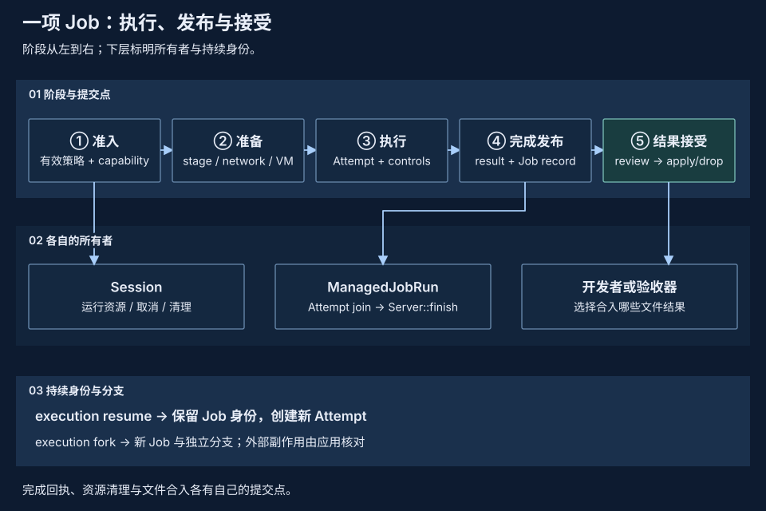

# Job、Operation、Attempt 与 Event

Job 关联一项持续的工作，Operation 描述请求系统处理的操作，Attempt 标识一次实际执行，Event 记录处理过程中发生的事实。它们分别连接工作身份、执行请求、运行过程与观察记录；执行结束后，候选文件和可恢复状态仍可继续保留。

| 概念 | 职责 |
| --- | --- |
| **Job** | 提供持续身份，关联执行、状态和候选结果。 |
| **Operation** | 描述请求处理的操作及其策略、放置决定。 |
| **Attempt** | 标识一次实际运行，关联该次执行的资源与结果。 |
| **Event** | 记录请求处理、策略决定和执行结果等事实。 |

## Job：工作身份与持久记录 {#job-identity}

<a id="runjob"></a>

Job 的身份不随工具进程退出而消失：调用方仍需查看结果、审查候选文件或继续后续工作。当前每个 Job 对应一条内部 Run 记录，其 ID 与操作系统 PID 无关；磁盘上的 `run-*`、`run.json` 和 Run Bundle 保留既有名称。创建、寻址和审查命令见[Job 用法与存储](../reference/jobs.md)。

Daemon 的 `sb-*` sandbox ID 与原生 Job ID 不同，复用原生执行也不自动开放完整 Job 工作流。接口边界见[单节点 Daemon](daemon/index.md)。

??? info "Daemon 身份与接口范围"

    [单节点 daemon](daemon/index.md) 通过 VM-only NativeRuntime 管理 OpenSandbox profile 的 `sb-*` sandbox。私有 supervisor 记录把 generation 绑定到原生 Run/Attempt ID；sandbox ID 不是公开 Job ID。API 不实现 stage/apply、checkpoint 或 Run Bundle 导出。它嵌入原生执行，但不自动暴露下列 Job 工作流；跨主机身份属于外部编排。

## Operation：请求与准入 {#operation-admission}

<a id="operation"></a>

Job 描述用户的一项工作，Operation 描述 pVisor 要处理的操作。当前生产操作是 `run.execute`，包含程序、参数和工作目录，以及有效策略决定和 Placement。pvisor 负责准入、实际改写、调度和执行；core 提供这些定义。

请求形成或准入通过，不等于实际执行已经发生，也不证明控制已经安装。文件与网络访问在各自驱动边界处理，当前不逐项提升为独立的公共 Operation。

??? info "准入配置与能力判断"

    准入只解析一次驱动网络配置，应用分层策略后，将最终配置传入 Attempt 准备。Gateway、显式代理和 VM 网络消费这份配置，不重新读取原始配置。Guest workspace overlay 要求执行器显式声明支持；执行器名称是描述性记录，不是能力判断。网络不可绕过标记由实际 VM 网络 attachment 路径决定，后端名称不作为判断依据。

## Attempt：执行身份与生命周期 {#attempt-lifecycle}

<a id="attempt"></a>

Attempt 标识由某个执行器完成的一次执行。当前 `PVisor::run` 每次调用创建一个 Attempt。pvisor 中的 Session 负责它的资源准备、取消、清理和终态公布；Session 是生命周期所有者。

取消请求、工具进程退出和完成发布是不同阶段。Session 还需完成清理与结果保存，持久 Job 服务随后发布 Job 状态，才能向调用方提供可核对的完成结果。

## Event：执行过程的事实记录 {#execution-events}

Event 是外部观察到的事实，Trace 是这些事实的记录。它们描述请求、实际改写、放置及结果，不等于操作本身，也不保证仅凭日志就能重放外部副作用。字段及因果关系见[Operation 与 Event](operations-events.md)。

Event 提供观察接口，不替代完成凭据；缺少终态 Event 时，仍可能已有有效的 Attempt 完成回执。

## Attempt 如何确认完成 {#attempt-completion}

进程退出、Bundle 保存和终态事件发布可能发生在不同时间。保留存储的 Attempt 通过 `completion.json` 将执行结果与已保存的 Bundle 绑定，避免故障后仅凭一个状态字段或文件判断任务是否完成。

正常收尾由 Session 串行推进：

1. 停止受管理的写入者，清理附件并核对观察；暂存文件按 stage 合同同步和 seal。
2. 保存 Bundle，将收尾阶段已知的结果、观察和警告固定下来。
3. 保存 Run 状态投影，提交绑定该结果与 Bundle 的完成回执。
4. 发布 `Completed` 和 `run.completed`、`run.failed`、`run.cancelled` 或 `run.hibernated` 终态事件；持久 Job 服务在 Attempt join 后完成 Job 状态发布。

回执提交后，终态事件写入失败作为审计缺口通过运行返回和日志报告。该失败不改写已绑定的 Bundle，也不补发一个相反终态。执行结果与事件是否完整分别核对；没有终态事件，仍可能已有有效完成回执。

完成回执有效时，以其绑定的结果核对状态；回执缺失时保留候选文件并显示 Unknown，依赖已停止状态的修改操作拒绝执行。回执损坏、摘要不符或身份不匹配必须报错，不能改写记录来制造成功。

回执把 Attempt 的结果与 Bundle 绑定，不覆盖 Journal、apply ledger、快照发布及外部服务的一笔总事务。内存运行没有这份磁盘回执。旧记录的读取规则见[记录与版本矩阵](records-and-versions.md#execution-records)，响应丢失后的处理见[失败语义](failure-semantics.md#reconciliation)。

??? info "完成校验与恢复细节"

    保留存储的 Attempt 使用 `completion.json` 确认执行结果。回执包含 `RunResult` 和已保存 Bundle 字节的 BLAKE3 摘要，并校验 Run／Attempt 身份、终态、退出码及起止时间。Run 和 execution Job 的状态是这份结果的投影；单独看到终态字段、Bundle 文件或进程退出，都不足以确认完成。

    持久 Job 服务还负责完成结果的发布。`ManagedJobRun` 将实际 Attempt join 与 `Server::finish` 交给 runtime task，前端只持有等待适配。前端等待失败或被丢弃会请求取消，已接受的完成任务在 Tokio runtime 仍存活时继续核对和发布；runtime 关闭与宿主进程退出仍有自己的恢复边界。

    owner 退出且 Attempt 不再被持有时，读取与恢复检查回执。回执有效则按其结果核对 Run 和仍指向该 Attempt 的 execution Job；已经推进到后续 Attempt 或撤销恢复权的 Job 不被旧结果覆盖。缺少回执时保留 stage 并显示 Unknown；`review` 不提供未确认的执行结果，`apply`、`drop` 和需要已停止状态的捕获拒绝执行。损坏、摘要不符或身份不匹配返回错误，不能改写记录来制造成功。

    源码入口：`pvisor/src/session/lifecycle.rs`、`runtime/attempt.rs`、`runtime/completion.rs`、`runtime/registry.rs` 和 `runtime/job_service/views.rs`。`completion.rs` 的测试覆盖重复提交、身份与摘要校验、缺失回执和状态投影；平台与进程故障覆盖须单独验收。

## 结果接受与外部副作用 {#result-acceptance}

<a id="effect"></a>



对暂存文件，当前支持的处理流程是：

```text
运行 → 停止 → 审查 → 应用选中文件 → 审查剩余改动 → 应用或丢弃
```

进程成功退出和文件成功应用是两个不同结果。失败命令产生的文件仍可审查；已经应用的文件不会被后续 drop 撤销。

网络请求和外部服务修改也是执行后果，但文件暂存不会把它们延迟到审批后，也不会回滚它们。

## 恢复与分支中的身份变化 {#checkpoint-lineage}

<a id="checkpoint"></a>

检查点保存可复用的状态，恢复与分支决定这些状态如何关联到后续工作：

| 操作 | 状态与身份关系 |
| --- | --- |
| 工作区分支 | 从逻辑检查点复用文件进展和冲突基线，保留来源关系；不续接进程执行位置。 |
| VM 执行恢复 | 从支持的执行检查点恢复，保留 Job ID，生成新 Attempt。 |
| VM 执行分支 | 从执行检查点创建新 Job 和独立写入层，并保留来源关系。 |

这里的检查点恢复不同于运行中 VM 的 Pause／Resume：前者恢复已保存的执行点，后者继续原 VM 的执行。工作区与 VM 检查点的作用和范围见[状态保存与分支复用](../concepts/resource-reuse.md)，捕获与持久化机制见[环境快照](environment-snapshot.md)。

??? info "检查点操作与支持边界"

    默认 `fork --state workspace` 对已停止的暂存 Run 的 upper 层创建快照。嵌入式 API 还支持 AgentCtl 协作静默点。检查点保留暂存文件、首次修改时的冲突基线和来源关系，不保存进程内存、外部服务状态，也不冻结所有 lower 层。快照内容同步落盘后才发布 manifest。嵌入式调用方通过 `restore_logical_checkpoint(checkpoint, destination_upper, destination_preimages)` 同时恢复文件和冲突基线。

    原生 VM 的 `checkpoint --kind execution` 则封存 CPU、RAM、设备和文件系统的一致执行点。`suspend` 以原 VM 的终止回执确认暂停，`resume` 保留 Job ID、生成新 Attempt；execution fork 创建新 Job 和独立写入层。暂停状态下 apply/drop 不可用，须先 kill 撤销恢复权。支持的 profile 与兼容性限制见 [CLI 参考](../reference/cli.md#full-vm-execution-checkpoints)。

    操作步骤见[审查与应用](../guides/review-apply.md)，执行保证见[能力与证据](../concepts/capabilities-and-evidence.md)。
