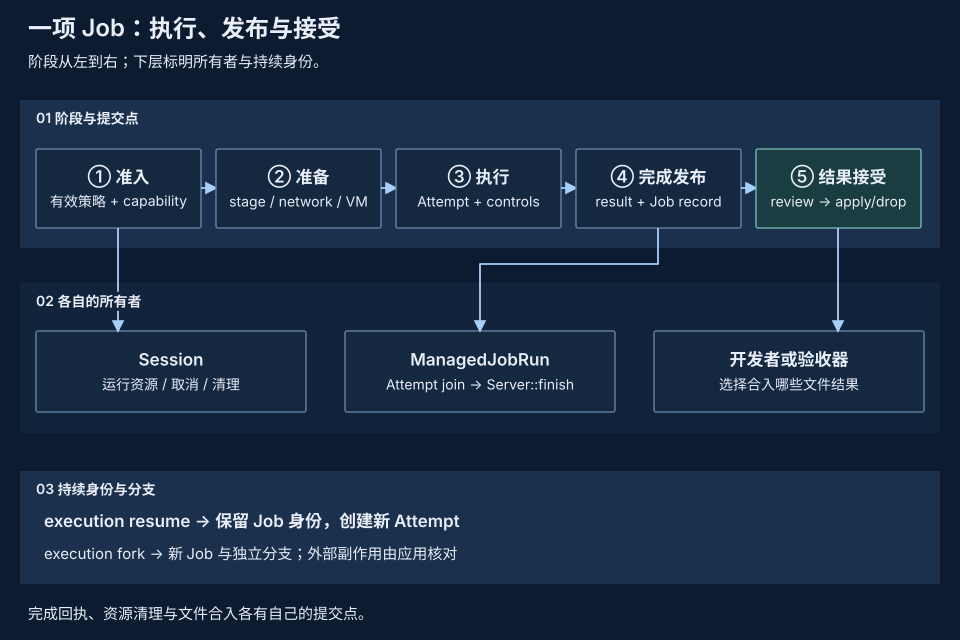

# Job、Operation、Attempt 与 Event

Job 表示用户的一项持久工作，Run 保存它的内部记录，Attempt 标识一次实际执行，Event 记录处理过程中发生的事实。一次执行结束后，记录和待接受的文件仍有自己的生命周期。

命令如何创建和查找 Job，见[Job 与存储](../concepts/jobs.md)。当前每个 Job 对应一条内部 Run 记录；为保持兼容，磁盘上的 `run-*` ID、`run.json` 和 Run Bundle 名称保持不变。

[单节点 daemon](daemon/index.md) 通过 VM-only NativeRuntime 管理 OpenSandbox profile 的 `sb-*` sandbox。私有 supervisor 记录把 generation 绑定到原生 Run/Attempt ID；sandbox ID 不是公开 Job ID。API 不实现 stage/apply、checkpoint 或 Run Bundle 导出。它嵌入原生执行，但不自动暴露下列 Job 工作流；跨主机身份属于外部编排。



## Operation：核心处理对象

Job 描述用户的一项工作，Operation 描述 pVisor 要处理的操作。当前生产操作是 `run.execute`，包含程序、参数和工作目录，以及有效策略决定和 Placement。pvisor 负责准入、实际改写、调度和执行；core 提供这些定义。

Event 是外部观察到的事实，Trace 是这些事实的记录。它们描述请求、实际改写、放置及结果，不等于操作本身，也不保证仅凭日志就能重放外部副作用。字段及因果关系见[Operation 与 Event](operations-events.md)。

## Run：Job 的内部记录

Run 标识命令、配置与执行结果，其 ID 与操作系统 PID 无关。进程退出后，本地记录仍让 `status`、`apply` 和 `drop` 指向同一段工作。使用 `status --review` 查看 Run Bundle 与暂存改动。

## Attempt：一次执行

Attempt 标识由某个执行器完成的一次执行。当前 `PVisor::run` 每次调用创建一个 Attempt。pvisor 中的 Session 负责它的资源准备、取消、清理和终态公布；Session 是生命周期所有者。

准入只解析一次驱动网络配置，应用分层策略后，将最终配置传入 Attempt 准备。Gateway、显式代理和 VM 网络消费这份配置，不重新读取原始配置。Guest workspace overlay 要求执行器显式声明支持；执行器名称是描述性记录，不是能力判断。网络不可绕过标记由实际 VM 网络 attachment 路径决定，后端名称不作为判断依据。

Workspace fork 从逻辑检查点创建文件分支；execution fork 从支持的机器检查点恢复新 Job。两者保存来源关系，具体恢复范围由检查点种类决定。

持久 Job 服务还负责完成结果的发布。`ManagedJobRun` 将实际 Attempt join 与 `Server::finish` 交给 runtime task，前端只持有等待适配。前端等待失败或被丢弃会请求取消，已接受的完成任务在 Tokio runtime 仍存活时继续核对和发布；runtime 关闭与宿主进程退出仍有自己的恢复边界。

## Attempt 执行时间线

Session 生命周期与在线 VM 控制共享一个 `Execution` owner，通过 `Session::execution()` 或 `RunHandle::execution()` 获取。状态、订阅、取消、SDK 控制和 Host 命令派发均由它负责，RunHandle 负责等待完成。RunControlHandle、RunCancellation、AttemptService 及控制转发别名已删除；执行器直接向 Execution 报告启动与就绪。准入、派发、成功、失败与完成事实通过唯一的状态转移函数；status 与待处理操作是这些事实的投影。原生副作用在状态锁之外执行，继续使用已有的转移锁、模型等待仲裁与 guest idle epoch 排序。最多保留 32 个待处理控制；等待原生结果期间仍可取消。迟到的启动通知与控制响应不能撤销暂停、取消或终态发布。

保留存储的 Attempt 通过 `pvisor-journal` 向 `execution-ATTEMPT_ID.jsonl` 追加事实；无存储运行使用内存日志。调用方停止等待后，已接受的日志追加与状态更新仍会继续。runner 明确拒绝并确认健康在线状态时，记录该状态并允许后续控制；原生结果不明则阻止进一步控制。历史写入失败会标记缺口，同时保留已确认结果并继续清理。重放测试可在不调用后端的情况下重建投影；owner 丢失后不会自动重试未完成操作。完成与检查点回执继续拥有结果确认权。

`status --json` 展示已应用日志位置、有界执行进度、计数与少量观察样本，不包含完整请求历史与启动计划。schema 2 详见[机器可读输出](../reference/json-output.md#envelopes)。

`Execution::snapshot()` 同步读取最近的一致状态／进度投影，`subscribe()` 发布同一个 `ExecutionSnapshot`。日志写入在转移锁下发布投影，因此本地查询无需等待自己的运行时任务或建立 socket 连接。等待协调器复用 Execution 的取消 token，不再把所有控制拒绝都解释为结果不明。明确的人工控制拒绝保留健康执行；无法释放的自动暂停与不明结果仍会触发取消。

`JobExecution` 负责跨 Attempt 的持久阶段，状态字段私有，捕获、恢复、完成与终结均应用带类型的转移。存储模块负责获取 lease 并持久化结果。普通记录读取与持锁恢复共用唯一的完成投影；迟到回执不能覆盖恢复后的后继，也不能恢复已撤销的继续执行权。查询模型统一生成有效 `state`，CLI 文本与 JSON 只负责渲染，不再从存活推断运行。`paused` 表示在线 VM 暂停，`hibernated` 表示原生终止已确认。

每个 Attempt 只保留一个宿主实例控制 socket。同进程的查询、工作区 inspect 与执行捕获直接调用已注册的 owner；Overlay 与捕获监听及其 stage 发现链接已删除。owner 使用唯一的有界 inspect 挂载表，并在清理可写工作区之前关闭挂载。已接受的捕获任务在前端超时后继续运行，请求回执、Job 锁与 suspended head 的终止确认保持有效。Guest AgentCtl 继续使用独立的 guest 协议。

## Attempt 完成协议 {#attempt-completion}

保留存储的 Attempt 使用 `completion.json` 确认执行结果。回执包含 `RunResult` 和已保存 Bundle 字节的 BLAKE3 摘要，并校验 Run／Attempt 身份、终态、退出码及起止时间。Run 和 execution Job 的状态是这份结果的投影；单独看到终态字段、Bundle 文件或进程退出，都不足以确认完成。

正常收尾由 Session 串行推进：

1. 停止受管理的写入者，清理附件并核对观察；暂存文件按 stage 合同同步和 seal。
2. 保存 Bundle，将收尾阶段已知的结果、观察和警告固定下来。
3. 保存 Run 状态投影，提交绑定该结果与 Bundle 的完成回执。
4. 发布 `Completed` 和 `run.completed`、`run.failed`、`run.cancelled` 或 `run.hibernated` 终态事件；持久 Job 服务在 Attempt join 后完成 Job 状态发布。

回执提交后，终态事件写入失败作为审计缺口通过运行返回和日志报告。该失败不改写已绑定的 Bundle，也不补发一个相反终态。执行结果与事件是否完整分别核对；没有终态事件，仍可能已有有效完成回执。

owner 退出且 Attempt 不再被持有时，读取与恢复检查回执。回执有效则按其结果核对 Run 和仍指向该 Attempt 的 execution Job；已经推进到后续 Attempt 或撤销恢复权的 Job 不被旧结果覆盖。缺少回执时保留 stage 并显示 Unknown；`review` 不提供未确认的执行结果，`apply`、`drop` 和需要已停止状态的捕获拒绝执行。损坏、摘要不符或身份不匹配返回错误，不能改写记录来制造成功。

回执把 Attempt 的结果与 Bundle 绑定，不覆盖 Journal、apply ledger、快照发布及外部服务的一笔总事务。内存运行没有这份磁盘回执。旧记录的读取规则见[记录与版本矩阵](records-and-versions.md#execution-records)，响应丢失后的处理见[失败语义](failure-semantics.md#reconciliation)。

源码入口：`pvisor/src/session/lifecycle.rs`、`runtime/attempt.rs`、`runtime/completion.rs`、`runtime/registry.rs` 和 `runtime/job_service/views.rs`。`completion.rs` 的测试覆盖重复提交、身份与摘要校验、缺失回执和状态投影；平台与进程故障覆盖须单独验收。

## Effect：执行带来的后果

对暂存文件，当前支持的处理流程是：

```text
运行 → 停止 → 审查 → 应用选中文件 → 审查剩余改动 → 应用或丢弃
```

进程成功退出和文件成功应用是两个不同结果。失败命令产生的文件仍可审查；已经应用的文件不会被后续 drop 撤销。

网络请求和外部服务修改也是执行后果，但文件暂存不会把它们延迟到审批后，也不会回滚它们。

## Checkpoint：文件系统快照

默认 `fork --state workspace` 对已停止的暂存 Run 的 upper 层创建快照。嵌入式 API 还支持 AgentCtl 协作静默点。检查点保留暂存文件、首次修改时的冲突基线和来源关系，不保存进程内存、外部服务状态，也不冻结所有 lower 层。快照内容同步落盘后才发布 manifest。嵌入式调用方通过 `restore_logical_checkpoint(checkpoint, destination_upper, destination_preimages)` 同时恢复文件和冲突基线。

原生 VM 的 `checkpoint --kind execution` 则封存 CPU、RAM、设备和文件系统的一致执行点。`suspend` 以原 VM 的终止回执确认暂停，`resume` 保留 Job ID、生成新 Attempt；execution fork 创建新 Job 和独立写入层。暂停状态下 apply/drop 不可用，须先 kill 撤销恢复权。支持的 profile 与兼容性限制见 [CLI 参考](../reference/cli.md#full-vm-execution-checkpoints)。

操作步骤见[审查与应用](../guides/review-apply.md)，执行保证见[能力与证据](../concepts/capabilities-and-evidence.md)。
