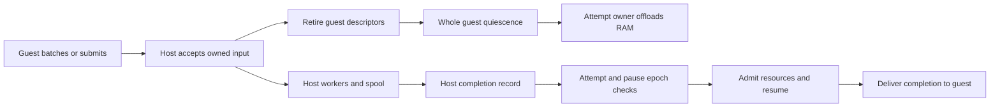

# Agent 异步 I/O 与完成队列（EXP-003）

让 pVisor 接管下载、模型请求和批量写入的输入、执行与结果。guest 提交工作后可以继续计算，或者在整个 guest 进入等待时卸载内存；host 继续推进 I/O，保存完成结果，再由现有 Attempt 控制者恢复 guest 并交付。

| 项目 | 当前状态 |
|---|---|
| 阶段 | **受限 PoC，2026-10-18；M0 原生等待闭环与 host 写缓存基础已实现，完整 Agent IOCP 待实现与验收** |
| 第一阶段 | Linux x86_64/KVM、共享文件 RAM、单一 Attempt 独占 stage；默认关闭 |
| 文件系统路径 | 首版 Linux host 写缓存：WB=0、DAX=0；guest 批量 transfer 和更大缓存后续接入 |
| Agent 路径 | 拟议的受限 submit / wait / cancel / ack；首版假设允许薄适配，兼容性选择尚待确认 |
| 资源目标 | 降低 host 交互次数和 guest 驻留时间，提高固定 CPU/内存预算下的有效吞吐 |
| 接口状态 | 以下任务和完成协议仍为拟议合同；host 缓存使用私有实验环境变量，M0 提供默认关闭的嵌入式 Gateway 配置；无公开 Agent 任务 API 或 CLI 特性开关 |

## 1. 问题提出 {#problem}

### 1.1 异步写入需要可以转移的输入

guest 页缓存可以合并小写入、提前返回普通 write。Linux FUSE 的 writeback-cache 已提供这种能力；部分页写入还可能触发回读，即使文件以 O_WRONLY 打开。[FUSE I/O 模式](https://docs.kernel.org/filesystems/fuse/fuse-io.html)

早期 `0042-fuse-batched-writeback.patch` 使用 1 MiB/10 ms 提交条件、16 MiB 高水位和 256 句柄上限。当前 0048/0049 改为按实际脏页与临时 WRITE 页计账，软目标为 guest 可用 RAM 的 1/8、限制在 16–256 MiB，仍保留 256 个句柄 lease；具体提交条件见 [VM 缓存合同](https://github.com/DeepLink-org/pvisor/blob/main/crates/pvisor-vm/README.md)。数据仍在 guest pagecache。host 文件请求执行期间持有 guest RAM lease，直到 used-ring 发布才释放。扩大 guest 缓冲会增加可合并的数据，也会增加未转移的脏数据和可能需要 offload 的 RAM。

目标流水线需要一个明确的所有权交接点：host 已经拥有输入字节、目标对象和预算之后，后台 I/O 才能脱离 guest RAM 继续执行。仅把同步 pwrite 放在线程里，或把 guest 地址传给 io_uring，仍然依赖 guest 内存。io_uring 的读写数据缓冲必须保持有效直到完成。[liburing 缓冲生命周期](https://github.com/axboe/liburing/blob/master/man/io_uring.7)

### 1.2 当前可复用的机制与缺口

| 现有机制 | 可以复用 | 尚缺的连接 |
|---|---|---|
| guest writeback、host 缓存与文件操作屏障 | 小写入合并、host 字节接管、对象操作排序、freeze | guest transfer fence、按对象并行、脱离 RAM 的阻塞回复 |
| Gateway `ModelWaitLifecycle` | upstream 前 enter、回复前 delivery barrier、取消清理 | M0 已绑定 native offload/resume；完整结果 spool 与资源再准入仍待接入 |
| OverlayNet host TCP | egress 授权、host socket、反压 | 独立 HTTP/TLS 下载、结果 spool、完成唤醒 |
| VM pause/offload/resume | CPU 停止、设备 RAM gate、回收与恢复 | M0 已实现暂停归属与陈旧等待隔离；尚未释放或重新申请资源配额 |
| AgentCtl 协作静默 | 固定参与者、generation、匹配 ACK | VM 内受限 transport 与 I/O 任务协议 |

这些状态来自当前 `feature/emb_meta`：`fw/patches/0042-fuse-batched-writeback.patch`、`crates/pvisor-vm/src/devices/virtio/fs/worker/scheduler.rs`、`crates/pvisor-gateway/src/model_wait.rs`、`crates/pvisor-overlaynet/src/vm.rs` 与 `crates/pvisor/src/runtime/agentctl.rs`。Gateway 的嵌入式配置已可显式安装 Attempt 绑定的 native model-wait 原型，默认关闭；AgentCtl 当前是 host Unix socket，VM executor 主动删除对应环境变量，不能直接把 Host 凭据转给 guest。

普通 HTTPS 的 TLS 状态在 guest 内。当前 TCP bridge 的每流 host 接收额度为 64 KiB，smoltcp 另有 64 KiB 缓冲；guest 停读后最终反压。完整下载需要 host 拥有应用层请求及结果落点，才能在 guest 卸载后持续推进。

### 1.3 与既有实验的关系

[EXP-001](../vcpu-idle-offload/index.md) 保留“不修改 Agent 或 guest 内核”的自动等待观测路线，当前仍为 M0 观测原型。[EXP-002](../guest-stage-cache/index.md) 负责文件系统元数据与延迟绑定设计。EXP-003 引入显式协作等待和 host 任务所有权，复用它们的控制与对象机制；各自阶段和已有证据保持独立。

## 2. 核心设计 {#core-design}

### 2.1 提交、执行和完成形成流水线



guest 在 host 接收批次 N 时生成 N+1，host 并行执行不同对象的工作；存在顺序依赖的操作按对象串行。只有整个 guest 的可运行工作都进入受认可的等待，才考虑 offload。单个 LLM 请求等待或低 CPU 利用率不足以证明这一条件。

完成队列的权威副本保存在 host。guest 共享 ring 可以承载运行时的批量传输，但 guest 不驻留时，后台任务不能写 guest buffer、发布 used-ring 或触发 RAM refault。输入复制到 host 后，原 virtqueue 请求应及时完成交接，最终任务结果通过独立完成记录交付。

### 2.2 文件写入的三个水位

| 水位 | 语义 | 是否还依赖 guest RAM |
|---|---|---|
| accepted | 已完成相应授权、对象绑定及必要 copy-up，host 拥有字节和资源额度 | 否；guest descriptor 发布完成后可释放对应 RAM lease |
| completed | backing 执行已终结，可能部分生效；实际长度或错误已记录 | 否 |
| durable | 约定范围已执行实际文件同步；命名空间持久化还包括必要的目录/日志同步 | 否 |

普通缓存 WRITE 可以在 accepted 后回复；O_SYNC/O_DSYNC、direct I/O、显式 fsync/fdatasync、锁获取及尚未完成的 namespace mutation 保留各自完成要求。close 不代表磁盘耐久，已知异步错误仍需按合同交付。accepted 是当前进程生命周期内的接管承诺；需要进程崩溃后恢复的任务，必须额外提供可恢复 spool/日志及相应耐久屏障。

每个逻辑对象和 backing 绑定世代维护序号，多 FD/硬链接对同一可变对象统一排序，旧 lower FD 跨 copy-up 保持原绑定。不同对象可以乱序完成；同步屏障等待对应 cut 之前的全部操作，不能把最大的完成序号当作连续完成水位。

完成水位可以跨过已经记录的失败项；成功的 durable 屏障必须报告 cut 内的失败，内存中的错误记录本身没有耐久保证。

首版后台项只持有 host 字节、稳定对象 FD/引用、offset、flags、sequence 和错误状态。后台工作继续参与现有文件系统 admission 和 dirty tracking。RAM offload 只排空 guest-memory 引用；机器 snapshot/capture 的文件系统屏障等待相关队列 completed 或拒绝捕获，存储耐久另由同步和发布事务保证。READ、GETATTR、TRUNCATE、copy-up、rename/unlink、FLUSH、RELEASE 对相关对象先排空，以减少首版需要维护的可见状态；后续再增加待写范围的读取覆盖及元数据合并。

### 2.3 暂停前转移 guest 脏数据

guest pagecache 中尚未生成 FUSE WRITE 的字节不会因 host 队列排空而自动转移。vCPU 暂停后，guest writeback timer 也停止运行。

因此增加拟议的 transfer fence：guest 停止产生该批次的新写入，提交目标 cut 内的脏数据，等待这些数据达到 host accepted；随后进入协作静默，Attempt owner 暂停 CPU 并排空短期设备 RAM 引用。该屏障允许后端写入继续执行，不等待 completed/durable。缺少 guest 协作时，只能让已交接的请求继续；未交接的脏页仍属于保存的 guest RAM。

WRITE 提前回复还不足以完成这个交接：现有 guest worker 随后可能提交时间 SETATTR，READ/FLUSH 等也可能等待 completed 并持有 RAM lease。后续必须接管延迟 metadata，并证明 park 前没有这类请求；或者新增 host 拥有的请求与 deferred reply ticket，卸载期间只保存结果，恢复后重新取得 RAM access 并发布回复。后者需要修改现有 descriptor/freeze 合同，当前 host 缓存未提供该能力。

guest 缓冲承担短期合并；较长积压进入 host 有界内存池或私有 spool。offload 只有在预计等待足以覆盖转移、回收和恢复成本时才执行，短暂队列等待可仅保持普通异步执行。

### 2.4 批量写入与对象生命周期

异步接收前必须固定文件对象，后台不能按旧路径重新打开。对象保留需要覆盖待写数据、延迟 inode metadata、LOOKUP/FORGET、打开句柄及队列引用，正确处理 unlink、同名替换、hardlink 和 copy-up。

历史 close → unlink → 首次 syncfs 的 ENOENT 已由宿主对象退休机制修复：guest WB 会话在 unlink/覆盖 rename 后保留原 nodeid，upper 保留 native O_PATH 引用，lower 仅保留逻辑属性；最终 FORGET 才释放。最后一个 handle 关闭后，延迟 MTIME/CTIME 仍绑定原对象，不忽略未知 ENOENT，不写入同名新文件或 immutable lower。该修复及其独立 SDK 证据已在 VM crate 中；M1 仍需验证阻塞写入、RAM 卸载与 Attempt 收尾的联合行为。

旧 VM virtio-fs host server 路径对 FUSE_SYNCFS 返回 ENOSYS，guest 可把它当作成功并关闭后续调用。新 host 缓存会话增加真实同步与错误屏障；未启用时保留旧行为，因此旧会话的 guest syncfs 成功不能单独证明 host 存储耐久。单文件 fsync/fdatasync 继续使用现有路径。

首版仅覆盖明确支持的普通缓存写入；append、重叠写、mmap、truncate 与 namespace 并发分别验证。修复退出错误、明确同步语义之后，才扩展 guest 写缓冲和默认启用范围。

### 2.5 Agent 任务与受限 guest 通道

首批任务表达完整工作：下载到私有 blob/stage、模型请求到结果、从已接管 blob 批量写文件。submit 必须先复制或 seal 输入，任务引用绑定 Job、Attempt、generation、operation ID、参数摘要及权限范围。wait/poll 读取完成状态，cancel 返回取消结果，ack 释放允许回收的结果引用。

ack 可以释放 blob/spool，operation ID、参数摘要、dispatch/结果状态的轻量记录保留到 Attempt 结束；结果已回收或未知时不重新 dispatch，以保留去重事实。

新增 guest 通道只授予本 Attempt 的任务能力，可研究已有显式 vsock 能力；不转发 Host 控制凭据。重试相同 operation ID 和参数在本 Attempt 去重，参数冲突拒绝。等待连接断开只说明 waiter 离开，不能推断任务没有执行。远程 POST/LLM 等副作用的跨 Attempt 重试需要供应方幂等键或结果核对；取消未决与结果未知分别记录。

下载复用 OverlayNet 的出口授权，每次重定向重新授权；LLM 复用 Gateway 的凭据、协议转换和 capture。结果先进入有界内存/spool。批量文件任务经过现有文件系统 owner、Core 操作锁、原像/Journal、dirty tracking 和缓存失效；supervisor 不能直接修改正在使用的 upper。

LLM 可先复用 `enter` / `before_delivery` 实现单次等待闭环。现有 SSE 恢复边界是首个非空网络 chunk，可能只是 heartbeat。整段推理睡眠需要独立结果 spool、最大字节/期限、可交付数据条件和断连语义；避免每个 heartbeat 或 token 都恢复 VM。

### 2.6 Attempt 控制与恢复归属

任务表和 spool 属于现有 Attempt，Run 终态仍由既有 runtime 决定。自动等待持有可失效的 pause epoch；人工 pause、取消、终止和 lease 失效由同一控制 owner 仲裁。当前 stage `RunLease` 是存储所有权锁，不能当作已有 CPU admission。

完成先落入 host 状态，再检查 Attempt/generation、等待 epoch、有效所有权和人工暂停原因；需要运行资源时重新准入，通过现有 native control 恢复并收到 ACK，才交付 guest。旧完成不能恢复新 Attempt，自动恢复不能解除人工暂停。completion 与 offload 并发时先锁存事件，再由同一 owner 决定跳过回收或完成回收后恢复，避免丢失唤醒。

VM offload 会关闭并排空 RAM gate，当前超时会导致控制失败，不能用它探测“现在是否空闲”。运行时先建立静默与输入接管证据，再进入回收。有意 parked 的参与者由等待 epoch 表达，不能按普通心跳超时直接判死。

RAM offload 保留同一 host 进程和独立队列，可让后台工作继续。机器 checkpoint/fork/migration 要么排空队列，要么完整保存可恢复任务状态；首版选择排空或明确拒绝，避免把仅有 RAM 的快照当作任务完整快照。

Attempt 退出按停止提交、取消可取消任务、排空已接管 stage 写入、固定结果及未知远端效果、seal stage、生成 Bundle、释放 lease 的顺序执行。后台任务不得在 stage 封存或 Run 终态发布后继续写入。

### 2.7 内存预算与异步错误

预算同时限制 guest dirty bytes、host pending bytes、spool bytes、FD/对象数、任务数、completion 大小以及单 Attempt/runner/节点总量。数据准入满时反压，fsync、取消、退出和控制消息保留容量，避免队列满后无法排空。大型任务分块接管；短写、ENOSPC/EIO、worker 异常保存到对象和序号，后续同步和最终 Job 完成必须观察到。

“内存换性能”应比较实际回收的 guest 内存与新增 host pool、spool pagecache、guest/host 双份数据峰值和 offload backing 的总开销。有限队列只能吸收突发；长期输入速率超过后端吞吐时必须反压。待写字节规模可用输入速率乘允许积压时间估算，再受总预算约束。

### 2.8 实施计划与快速验证 {#implementation-plan}

| 阶段 | 可评审的增量 | 验证重点 |
|---|---|---|
| M0 | Attempt 内等待归属与真实 Gateway/native adapter | 单一受控负载用 x-pvisor-inference-idle 声明全 guest 等待；延迟 LLM 的运行/pause/offload、交付与控制竞争 |
| M1 | 修复 unlink 后对象存活，定义 host 同步屏障；增加 host 拥有的 WRITE 队列 | 阻塞 backing 时 guest 可 offload，host 可继续写；读后写、跨 FD/hardlink 顺序、错误和退出完整性 |
| M2 | guest transfer fence、较大合并预算、批量提交与完成 | 16/64/256 MiB 候选预算及多个并发窗口，观察请求数、吞吐、峰值和尾延迟；数值是实验点 |
| M3 | 受限 guest 任务通道、完整下载/LLM spool、blob 批量写 | 下载与保存避开 guest 数据往返；LLM 全等待窗口回收；结果、授权和 stage 一致 |
| M4 | 独占 stage 的 guest 元数据更新与异步 mutation log | 在明确授权、对象/版本、配额和失败语义下扩展 create/rename/unlink 流水线 |

M0 验证整个控制闭环，M1 同时推进大规模异步写入的数据所有权；M2 再调整内存和并发，避免容量变化掩盖串行等待。M4 需要维护可信的 guest 执行视图、host 复制日志及读取一致性，复用 EXP-002 的对象/版本设计；不能只延迟 namespace RPC 就宣称透明异步完成。

M0 不能假设已有 VM AgentCtl 全参与者通道。未来安全等待确认输入已接管和参与者静默，不要求所有 host 任务 completed，否则会消除 I/O 与内存卸载的重叠窗口。

#### M0：已实现的原生等待适配器 {#native-model-wait}

启用 `gateway` Cargo feature 的嵌入式调用方可选择：

```rust
let gateway = pvisor::GatewayDriverConfig::new(proxy)
    .native_model_wait(pvisor::NativeModelWait::Offload);
```

`Pause` 仅停 vCPU，`Offload` 还使用现有共享文件 RAM 卸载屏障。默认关闭；仅接入 Linux x86_64 VM，要求 Gateway 启用，与自定义 `model_wait` 冲突。Session 在每次 Attempt 启动时绑定独立身份与等待状态。没有 CLI 或配置文件开关。

首版要求可信的单一工作负载用 `x-pvisor-inference-idle: true` 声明整个 guest 静默，且没有尚未完成的文件系统或设备操作。声明不自动发现其他 runnable 进程，也不提交尚在 guest 中的脏页。普通请求保留原路径；私有 COW/pager RAM 不支持卸载，设备排空超时仍导致 Attempt 失败。

每个 Attempt 最多保留一个等待，包括已接受的原生操作和取消清理。缺失或不同的 Run/Attempt 身份、并发等待在 upstream dispatch 前拒绝。进入和交付分别等待原生 pause/offload 与 resume ACK。人工 pause/resume/offload 与自动操作共享控制锁，准入后撤销自动暂停 epoch，即使后续原生操作失败也不归还自动所有权。人工暂停后的交付等待显式 resume 或取消；丢弃 handler 只清理自身暂停，未知 ACK 或清理失败会取消 Attempt。等待存在时拒绝执行 checkpoint/suspend。

该原型始终保留现有资源准入和存储 lease，没有释放或重新申请 CPU 配额。控制观察增加 `model_wait_epoch`，人工操作为 null。SSE 仍在第一个非空网络 chunk 恢复，heartbeat 也可触发；完整推理 spool、通用 guest 任务协议与 guest transfer fence 尚未实现。

### 2.9 已实现的 host 写缓存基础 {#host-write-buffer}

私有实验变量 `PVISOR_VM_FS_HOST_WRITEBACK=1` 开启 Linux staged virtio-fs 的 host 写缓存，未设置或 `0` 关闭，非法值拒绝；当前要求 guest writeback=0、DAX=0。每连接最多 64 MiB payload 和 1024 个预留/排队/执行项。先预留再复制，完整接管之后回复 WRITE；相邻同句柄、连续 offset、相同 killpriv 的写按 1 MiB / 64 chunks / 10 ms 聚合，用一次 pwritev 执行。单 FIFO 先保证跨 FD/硬链接顺序。

缓存只接收符合条件的 upper 普通文件写；同步、direct、append、导出或 DAX 路径保留原行为。metadata、读、namespace、关闭和同步等待已接收写；错误保留到会话结束，RELEASE 完成清理后报告错误，capture 拒绝隐藏失败。DESTROY/drop 排空并 join。新缓存会话的 FUSE_SYNCFS 排空、同步 preimage，再同步 upper 所在宿主文件系统；PID 1 的最终同步可以观察异步错误。队列不保存 guest Reader 或 RAM lease，但满队列背压和后续依赖请求仍可能持有当前 virtqueue 的 RAM 引用。

WB=0 的 close 仍通过 FLUSH 排空，因此收益重点是保持打开文件的连续写，不能据此宣称大量 write-close 小文件已跨文件合并。该基础没有实现完整 offload、Agent 任务协议、guest transfer fence 或对象级并行；guest WB=1 的 unlink 错误已由独立的对象退休机制修复，新 host 模式仍与 guest WB=1 互斥。

快速实验沿用五个新环境、每任务内部三轮，保留 Ready 排除退出的独立指标，不加入主机干扰门禁。另记录 accepted、completed、durable、Job 完成各自耗时，统计总 CPU、整个受控进程/cgroup 及内核缓存内存、驻留内存时间积分、offload/load 耗时、唤醒次数和 backing 请求；避免把延后到退出的工作算成收益。测量前按 `benchmark/README.md` 登记或复用协议，原始数据留在 benchmark `.data/`，不混入用户排名。

### 2.10 当前验证记录 {#validation}

2026-10-17：完成现有 writeback、Gateway、OverlayNet、VM RAM gate 和 Attempt 控制的静态核对，并实现 host 写缓存基础。当时 guest 通道、自动恢复与新性能实验尚未实现；M0 的后续进展见下文。完整 IOCP 的待执行语义检查至少包括阻塞写期间 offload 无 RAM 访问、最后句柄关闭后 unlink/syncfs、完成空洞、短写/ENOSPC、满队列同步退出，以及完成与人工暂停/取消竞争。

host 缓存基础的 Linux 验证：`just test pvisor-vm -- --test-threads=8` 通过 486 项、跳过 8 项（含 25 项新增缓存/协议检查）；文件系统/API/快照子集 192 项通过。沙箱内未暴露 `/dev/kvm` 的硬件检查失败，访问实际 KVM 后完整套件通过。CLI 与 VM shim 消费者编译检查通过。真实 KVM 的既有 `guest_writeback_case` 在 host 缓存开启、guest WB=0 时通过正常全流程及故障流程：256 个文件与 32 MiB 连续写、关闭/读取/重命名/删除/卸载验证通过，文件大小限制造成实际 64 KiB 短写后，最终 guest 状态为 125。以上是正确性记录，不是吞吐或延迟提升的测量。

2026-10-18：M0 原生适配器通过 Linux 验证。`just test pvisor pvisor-gateway -- --features gateway --test-threads=8` 通过 980 项、跳过 8 项；随后补充的定向原生等待套件 12 项通过，覆盖 ACK 屏障、进入/恢复中丢弃请求、并发和陈旧身份拒绝、人工接管、取消、清理失败及配置冲突。CLI 和 shim 消费者编译通过；关闭 `gateway` 的 runtime 编译通过。

`native_model_wait_case` 在真实 KVM 上通过 `running`、`pause`、`offload`、`manual`、`cancel` 五个用例：guest 经 Gateway 访问本机延迟供应方，普通路径保持运行；自动路径在 upstream dispatch 前收到暂停/卸载 ACK；人工暂停不被完成事件解除；取消后没有自动恢复。成功交付后校验 guest 的 8 MiB 内容摘要。完整 `result.json` 与控制观察保留在本地 `/tmp/pvisor-iocp-m0-*-20261018*/`；固件使用仓库构建缓存 `581b3346…`，对应来源记录保存在 `/tmp/pvisor-iocp-firmware/libkrunfw.SOURCE`。这些用例证明控制和内容完整性，不证明驻留内存减少、密度或性能收益；macOS/HVF 未验收。M1–M4 的剩余门槛仍保留。当前既有对象退休与 host 输入脱离 RAM 的 8 项定向测试也通过；这不是阻塞 backing 下的真实 VM 联合验证。选定 crate 的 `cargo clippy --locked -p pvisor --features gateway --lib --no-deps -- -D warnings` 通过。包含依赖的严格 Clippy 检查在未改动的 `pvisor-vm/src/devices/virtio/fs/guest_index.rs` 遇到 5 项 `unnecessary_cast`，不能记为通过。

## 3. 方案讨论和对比 {#alternatives}

| 路线 | 可获得的收益 | 成本与适用范围 |
|---|---|---|
| 仅扩大 guest pagecache | 合并小写、降低突发阻塞 | 脏数据仍依赖 guest；卸载前提交及全局内存压力仍需处理 |
| host 拥有字节的异步 WRITE 队列 | 普通工具透明受益，存储等待可与 guest 卸载重叠 | 需要对象存活、可见性、错误、同步及预算合同 |
| 完整 Agent I/O 任务 | 下载/模型/批量保存可长期脱离 guest，减少数据穿越 VM | 薄适配与受限任务通道；任意现有 TLS 程序不能自动转为完整任务 |
| io_uring 或工作线程后端 | 减少线程/系统调用成本、提高后端并发 | 在 host 接管输入之后比较；仍需顺序、数据生命周期与完成处理 |
| guest 独占可写执行视图 | 更多元数据操作可在 guest 本地执行并批量复制 | 对权限、Journal、copy-up、恢复和失败语义要求最高，放在 M4 |

优先建立 host 输入接管和 Attempt 完成闭环，再用测量选择缓冲容量及后端执行器。完整任务把下载到 blob、后续写 stage 串在 host 内，具备省去 guest 协议处理和数据往返的空间；通用文件路径则保留透明性，按依赖逐步扩大异步范围。
