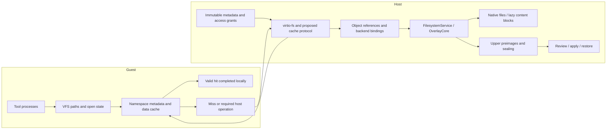
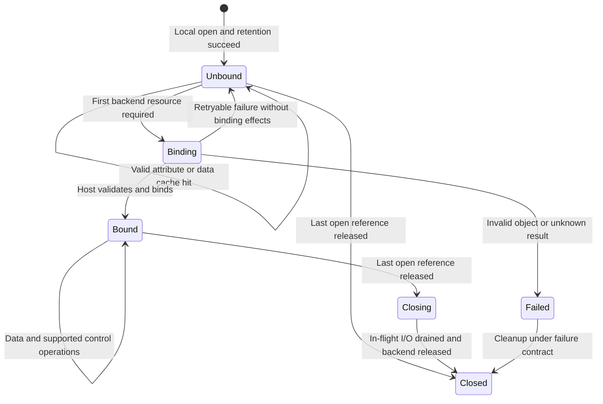

# Guest 内核文件系统缓存与延迟后端绑定（EXP-002）

让 guest 内核使用版本明确的文件系统视图，直接完成缓存命中的路径查询、属性查询和普通只读 open；在数据缺失、stage 修改或持久化时调用 VMM。宿主继续持有 stage、基线观察、访问策略、review/apply 与恢复的权威状态。

首版研究复用 FUSE 缓存与只读 zero-message open，后续增加分页元数据导入和 stage 缓存一致性协议。

| 项目 | 当前状态 |
|---|---|
| 阶段 | **设计阶段（RFC），2026-10-11；尚未实现或验收** |
| 实现读者 | guest 内核、VMM、文件系统与性能方向的研究实现团队 |
| 第一阶段 | Linux x86_64/KVM；独占、物理不可变的只读导出；普通文件与静态访问范围 |
| 核心机制 | 元数据导入、对象引用、guest 本地打开状态、首次回源时建立数据绑定 |
| stage 扩展 | 宿主提交修改，guest 按协议更新缓存；现有可写 open/copy-up 合同先保留 |
| 开关 | 尚无运行时开关或 CLI 接口；原型接入后默认关闭 |
| 实现语言 | 新增宿主与 guest 用户态代码优先 Rust；必要的 guest 内核扩展优先小范围 C 补丁 |
| EROFS | 可选的不可变 lower 表示，不是首版依赖；不承接 stage 写入 |
| 性能状态 | 尚无该方案的真实 VM 性能数据；请求减少与端到端收益分别验收 |
| 后续 profile | frozen 执行基线、独占 stage、受协议管理的缓存更新 |
| 接口状态 | 下列类型、字段和消息名表达拟议语义，尚未形成 wire ABI 或公开 Rust API |
| 实施入口 | [里程碑、分工和验收矩阵](#implementation-plan) |

先验证现有 FUSE 缓存与 zero-message open 的适用范围，再研究分页元数据导入和混合 stage 视图。第一阶段的结果只适用于列明的只读 profile；扩展到可写 stage、live baseline 或其他平台需分别验收。

## 1. 问题提出 {#problem}

### 1.1 文件系统请求为什么值得下沉

文件扫描和工具初始化会反复执行路径查找、属性查询和 open。有些文件只被打开以检查属性，根本没有读取内容。现有 guest FUSE 能缓存部分目录项、属性和数据，但未命中的元数据请求及当前普通 OPEN 仍经过 guest 内核、virtqueue、VMM 和宿主文件服务；后者还会创建后端 handle。lazy image 的索引已经在宿主准备好，并不意味着 guest 能直接使用这些知识。

因此，需要判断哪些请求可以在 guest 内核依据稳定视图完成，把不可变 lower 的元数据和受协议管理的 stage 状态交给 guest，同时保留宿主的修改、授权和持久化职责。目录扫描、open/fstat/close 和混合 stage 视图分别对应元数据供给、打开生命周期和缓存一致性三个问题。

现有[写合并对照](../../../lab-notes/filesystem-performance-analysis.md#writeback-ab)支持关闭写合并后该写入负载改善，完整任务仍未检出加速。缓存方案针对元数据与打开路径的结构性成本，其端到端收益需要独立实验；写回、copy-up 和持久化成本仍需各自定位。

### 1.2 当前基础与设计缺口

VM 文件系统通过 guest virtio-fs 和 virtqueue 直接调用宿主 runner 中的 `FilesystemService`，与 host FUSE 复用 OverlayCore。VM lazy image 没有中间宿主 FUSE 挂载，元数据和按块读取仍由宿主 image backend 提供。[现有架构](https://github.com/DeepLink-org/pvisor/blob/main/crates/pvisor-vm/README.md)、[共享服务](../../overlayfs.md)

| 当前基础 | 能复用的内容 | 需要增加或核验的内容 |
|---|---|---|
| guest FUSE 缓存 | 路径、属性和文件页缓存 | 准入、版本有效性、元数据导入与本地 open 条件 |
| FUSE zero-message open | 只读连接的无 OPEN 原型 | 无 handle 的数据服务、FLUSH/RELEASE、连接级限制 |
| VM OverlayFs | inode/handle、对象 I/O lease、修改和 freeze | 未绑定打开状态、对象保留、缓存更新协议 |
| OverlayCore | lower/upper 合成、copy-up、原像、冲突检测 | 为缓存提供明确语义输入，保留原合同 |
| lazy image 分页索引 | 版本化属性、目录索引、内容描述与校验 | guest 消费接口、稳定对象映射、权限完整性 |
| 现有 snapshot | CPU/device/RAM 静默与文件系统重绑定 | 缓存模式、对象引用和未绑定 FD 的保存与恢复 |

当前只读 open 在 live baseline 下会进入基线观察；可写 open 会进行 copy-up。[open 分类与准备](https://github.com/DeepLink-org/pvisor/blob/main/crates/pvisor-overlay-core/src/service.rs)、[原像观察](https://github.com/DeepLink-org/pvisor/blob/main/crates/pvisor-overlay-core/src/core.rs) 因此，本地完成 open 的准入必须同时考虑观察合同，不能仅按是否写入数据分类。

当前普通 OverlayFs open 要求创建后端 handle。[VM open 实现](https://github.com/DeepLink-org/pvisor/blob/main/crates/pvisor-vm/src/devices/virtio/fs/overlay.rs) 已有 FUSE 标志定义并不代表可以直接开启这个方案。

host OverlayFs 已有 owned-view 缓存、修改效果收集和通知失败处理，可复用其语义经验与测试场景。[host 缓存合同](https://github.com/DeepLink-org/pvisor/blob/main/crates/pvisor-overlayfs/README.md) 该实现属于 host 挂载适配器，不能直接当作 guest 更新传输，也不能为复用而暴露其私有状态。

### 1.3 优化目标与衡量边界

目标是在元数据、权限、对象存活和版本条件完整时，让路径查询、属性查询及普通只读 open 不产生文件系统 VMM 请求。数据缓存命中也在 guest 完成；数据缺失、stage 修改以及必须保留的宿主观察或副作用继续回源。性能评价同时覆盖冷启动、稳态和完整 Attempt。

“零请求”指指定操作窗口内没有文件系统 VMM 请求。元数据导入、首次协议探测、引用回收和 teardown 分别记录。该目标不表示整个 VM 没有硬件退出、调度或其他设备活动。

## 2. 核心设计 {#core-design}

### 2.1 总体架构与职责

1. guest 使用自身 VFS 的 dentry、inode、页缓存及文件打开状态，缓存导出的命名空间和元数据。
2. VMM 保留 stage 修改、copy-up、数据供给、基线观察和持久化；guest 缓存是执行视图的副本。
3. 普通只读 open 可以创建 guest 打开状态，在首次需要回源的数据操作时建立后端绑定。数据已在 guest 缓存中时，不因执行 read 就强制回源。
4. 可写 open、创建、截断、删除、重命名和其他当前具有副作用的操作，第一版保留现有宿主路径。
5. 先证明少量操作在同一合同下减少请求，再扩展 stage 视图和恢复；每个阶段单独验收。



guest 内核持有缓存、本地文件打开状态和按协议取得的对象引用。VMM 持有会话、可信对象映射、native handle、权限验证和请求生命周期。OverlayCore 继续执行合成、copy-up、原像及 stage 语义。runtime/supervisor 继续仲裁 Attempt、冻结、封存、保存和恢复。

元数据构建与导入负责固定源 revision、校验索引、保留 Unix 原始路径字节及硬链接身份。缓存不能绕过 image/backend 的内容校验，不能从 lazy 稀疏占位文件的空洞读取真实内容。

### 2.2 本地执行与 VMM 操作边界

本地执行需要同时满足：缓存条目有效、相关元数据完整、对象存活已有保障、访问可本地判定，以及操作没有必须在宿主完成的观察或副作用。

| 操作 | 有条件的 guest 本地路径 | 必须回源的情况 |
|---|---|---|
| LOOKUP、GETATTR、stat/lstat | 版本有效的目录项和属性 | 页缺失、属性缺失、策略或观察要求回源 |
| 负查找 | 完整目录索引及 stage 覆盖状态证明不存在 | 不完整索引、版本缺口；错误不当作不存在 |
| READDIR | 已验证的目录视图和版本绑定的 cookie | 索引缺页、stage 版本变化、尚未支持的游标语义 |
| O_PATH | 使用有效路径缓存及对象引用 | 路径查询、权限或引用条件不满足 |
| 普通文件 O_RDONLY open | 静态权限完整、对象已保留、观察合同允许 | live 观察、动态策略、特殊文件、未知能力 |
| O_WRONLY/O_RDWR open | 首版保留现有 VMM 行为 | 当前 copy-up、权限和错误时机需保留 |
| O_CREAT/O_TRUNC/O_TMPFILE 等 | 可使用缓存准备输入 | 创建、截断、临时对象等副作用经过 VMM |
| read、pread、mmap 缺页 | 内容版本有效的页缓存 | 数据缺失、缓存失效、所需后端绑定尚未建立 |
| write、truncate、共享可写 mmap | 首版保持现有路径或明确拒绝未覆盖形态 | stage 修改、copy-up、原像和数据写入 |
| unlink、rename、link、mkdir、属性修改 | 原子应用宿主返回的缓存更新 | 修改授权、原像和 stage 提交经过 VMM |
| fsync、seal、checkpoint | 按已有合同刷新和静默 | 宿主负责的同步、封存和保存 |

O_PATH 通常已由 Linux 在 VFS 层处理，不应把原本就没有 FUSE OPEN 的操作当成新增收益。普通 open 带 O_TRUNC 等标志时，副作用可能在任何 read/write 之前发生。[Linux open 语义](https://man7.org/linux/man-pages/man2/open.2.html)

首版排除 live/mutable lower、外部写入 upper、多个 VM 共同修改同一 stage、动态宿主策略、特殊文件及未明确支持的锁和 I/O 形态。范围扩展需增加独立 profile 和对应验收项。完整 guest upper、全量迁移 overlay 到内核和改变 apply 合同，分别属于后续架构评估。

目标操作示例：

```text
open("a", O_RDONLY) → guest 检查视图和权限，保留对象 A，创建本地打开状态
fstat(fd)           → 返回对象 A 的有效缓存属性
read(fd)            → 缓存命中则返回；缺失则按对象 A 回源
close(fd)           → 释放打开状态；对象缓存引用按协议回收
```

### 2.3 对象、版本与引用

以下是评审用语义模型，不是最终序列化结构：

| 概念 | 必须表达的内容 | 生命周期与用途 |
|---|---|---|
| 会话身份 | Attempt、stage、base revision、协议版本、权限语义、策略版本 | 挂载/恢复前由宿主验证；不同会话不复用 token |
| 对象身份 | 宿主分配或认可的 object ID、存活世代、类型、硬链接组 | 在引用存续期间不可因路径或 inode 数字重用而改变 |
| 后端身份 | 物理或远程 backing 的身份及世代 | copy-up/替换可改变后端；已有打开绑定遵循当前 VM 合同 |
| 目录版本 | 目录及相关覆盖状态的版本 | 创建、删除、重命名、whiteout/opaque 等更新 |
| 属性版本 | 所有权、权限、大小、时间、链接数等版本 | 与目录和内容版本分别校验 |
| 内容版本 | 对象数据及范围有效性的版本 | 写入和截断更新；数据页不能只检查目录版本 |
| 对象引用 | 已授予的保留范围、权限、owner、预算与回收状态 | 可以早于数据 FD；淘汰缓存不释放仍被打开状态持有的引用 |
| 打开状态 | 对象/后端绑定、flags、凭据上下文、偏移、绑定状态 | dup/fork 共享同一打开状态；独立 open 独立持有 |

目录缓存以会话、父对象、原始 basename、相关目录版本和策略版本隔离。属性缓存以对象身份及属性版本隔离。数据页以对象/后端身份和内容版本隔离。实现可以组合字段或压缩存储，但必须保留上述区别。

#### 2.3.1 延迟绑定必须保留旧对象

```text
fd = open("a", O_RDONLY)   # 本地打开对象 A
unlink("a")               # VMM 修改 stage
create("a")               # 同名对象 B
read(fd)                  # 必须仍访问 A
```

被 unlink 的已打开文件在相关引用释放前继续存在。[Linux unlink 语义](https://man7.org/linux/man-pages/man2/unlink.2.html) 第一次 read 必须携带 A 的对象引用，不能重新查找路径 a。

不可变 lower 可以保留整个 revision；无需为每次 guest open 创建宿主数据 FD。stage 对象可使用已经固定的 native 对象、描述符或私有对象保留机制，具体实现必须证明 unlink 后存活及资源上界。数据 FD 可以延迟，对象保留不能延迟。缺少这项保障时，open 回到原宿主路径。

stage 元数据交付时就必须附带已生效的宿主保留引用，guest 才能在该引用范围内增加本地打开引用。宿主可保守地保持缓存引用对应的对象，直到 guest 明确释放缓存和打开引用；代价是对象/FD 预算。仅交付路径、随后在首次 read 时 pin 对象，不满足这个条件。

对象存活世代与内容版本不同：同一可变文件被写入后，其他已打开 FD 应按现有语义看到更新；不能把每次写入都解释为新对象。copy-up 后已有 lower handle 保持原 backing 的现有 VM 行为也要保留。

#### 2.3.2 引用回收

缓存和打开状态分别持有引用。缓存淘汰只释放缓存部分；在途 I/O 继续持有其对象和 RAM lease。guest 通过有界批量回收或已有 FORGET 类机制释放缓存引用；整个会话 teardown 提供最终回收边界。

stage 删除的对象进入待回收状态，最后一个受认可引用释放后才回收 backing。达到引用/FD 预算时拒绝新准入或回到原路径，不能强制回收仍被 FD 使用的对象。guest 不回应回收时，由现有 supervisor 管理会话终止。

### 2.4 元数据包与 merged 缓存

#### 2.4.1 物理稳定性与视图稳定性

物理不可变要求内容、元数据、命名空间、父目录、mount 身份及硬链接别名在约定生命周期内稳定。只读挂载、摘要路径和 frozen baseline 分别表达其他属性，不能单独证明物理稳定性。[现有 lower 合同](https://github.com/DeepLink-org/pvisor/blob/main/crates/pvisor-overlay-core/README.md)

只读导出可整体缓存。混合 stage 视图还必须保证：upper/work 由单一会话控制，所有修改经 VMM，higher-priority lower 的变化可被证明或处理，策略固定或具备可靠更新协议。准入失败时在启用前拒绝，不能仅增加 TTL 来承担未知外部变化。

#### 2.4.2 分页导入

启动交付有界的版本、校验目录、root/必要页及操作能力；后续可以按需取元数据页。目录索引、inode 属性、symlink 目标、硬链接组和内容位置分别表达。包已生成、页已交付和 inode/dentry 已建立是三个成本。

现有 [pvisor-paged-v1](../../shared-image-cache-storage.md) 可以提供字段与构建基础；guest 导入格式需单独评审。当前格式不保存 xattr，不能据此声明已具备 ACL 或完整安全属性。缺少权限输入时，不准入本地 open；属性查询也按所需字段回源。

内核消费前限制总字节、记录数、页引用、深度、名称/目标长度及 offset 运算；拒绝循环、重复、越界和未知必要特性。宿主校验和内核边界检查都保留。编码固定版本和字节序，不映射 Rust/C struct 的本机内存布局。

#### 2.4.3 merged 查找与负缓存

缓存先检查有效 stage 覆盖，再按明确 lower 顺序查询。whiteout、opaque 和非目录祖先会遮盖 lower；目录 rename 需要更新相关子树与路径缓存。合成配置文件和挂载点按现有入口的职责处理，元数据包不能覆盖它们。

只有完整、已校验的索引和有效 stage 状态才能证明不存在；未加载页不表示不存在。readdir cookie 绑定目录视图和版本，恢复/seek/并发修改按明确合同处理。网络、校验或版本错误不写入负缓存。

### 2.5 本地 open 与延迟绑定

#### 2.5.1 本地打开步骤

1. 取得一致的缓存视图，完成逐组件路径和 symlink 解析。
2. 核对文件类型、flags、权限输入、路径授权和观察要求。
3. 从已有对象引用中取得打开引用；保证对象不会在下一次 I/O 前消失。
4. 创建 guest 打开状态并返回 FD；当前无需读取文件内容。

缺少任何条件时使用原 open 路径。O_CREAT、O_TRUNC、O_TMPFILE、权限清除和当前可写 copy-up 都是单独的宿主操作。延迟 copy-up 或改变原像观察时点属于独立合同迁移。

#### 2.5.2 打开状态机



Binding 状态下的并发首次请求共享同一次绑定结果；不持有 inode 表或全视图锁等待 I/O。关闭、取消和 freeze 不能遗留未知的后端 handle。异步请求保留打开状态，现有 INTERRUPT 不提供实际取消保证，清理仍须等待结果或进入会话失败路径。

#### 2.5.3 数据请求

拟议请求携带受宿主认可的对象引用、后端/内容版本条件、打开上下文、offset 和 length。VMM 核对会话、授权、对象存活和边界后，通过已固定的 native backing 或 lazy backend 提供数据。

新协议可合并 BIND 与第一次 READ，避免额外往返。首版纯只读 FUSE 原型也可以通过 inode 加 fh=0 服务数据，并在宿主按对象缓存只读 backing；这条路径不等同于新增 BIND RPC，需分别验证。

read、mmap 缺页和执行文件加载都可能产生数据请求；数据已在有效 guest 页缓存中时可以本地完成。[FUSE I/O 缓存](https://docs.kernel.org/filesystems/fuse/fuse-io.html) write 第一版保留现有路径，正确处理部分成功、大小与时间变化、错误及原像顺序。

混合 stage 的内容缓存另设准入：现有 lower 打开绑定与 copy-up 后的新绑定可能属于不同 backing，而普通 FUSE inode 通常共用一个页缓存地址空间。实现必须证明页不会跨 backing 错误复用；必要时先限制内容缓存，再研究内核页缓存归属或单独迁移该语义。只维护概念上的内容版本字段，并不足以解决这个问题。

#### 2.5.4 open 的错误与 close

本地 open 必须保留存在性、权限、类型、flags 和已承诺的观察/副作用错误。延迟宿主 FD 会影响宿主资源不足等错误的出现时点；profile 需明确并经语义评审，不能只比较最终数据正确性。

不申请后端绑定的只读 FD 可以本地释放打开状态，但需单独核验 FLUSH、RELEASE、FORGET、访问时间及引用回收。zero-message open 不自动保证整个 open/fstat/close 窗口没有请求。首次连接探测计入启动成本，稳态请求计数单独报告。

### 2.6 stage 修改与缓存一致性

#### 2.6.1 更新内容

VMM 返回有版本的修改结果，至少表达受影响的目录项、对象属性、后端绑定、硬链接别名、内容范围及 whiteout/opaque 或子树变化。guest 依据结果更新缓存，不能用猜测的本地结果代替宿主提交。

namespace 修改、普通数据写入和策略变化分别更新相关版本。旧 metadata/read 响应只有在对象及版本条件仍有效时才能填充缓存。失败也可能已产生部分数据或可见状态，需要返回或恢复实际效果。

#### 2.6.2 可见性顺序

复杂修改采用可验证的准备、屏障和发布协议：

1. 确定影响范围和预期版本；别名或子树不明确时扩大屏障范围。
2. guest 阻止范围内新缓存读取/打开，并协调已进入的操作；VMM 协调其原生 I/O。
3. VMM 按现有合同记录原像、执行 copy-up/修改，生成新的版本和效果。
4. guest 原子应用效果，丢弃旧响应，完成约定的可见性确认。
5. 解除屏障后返回修改结果；相应宿主请求在发布窗口内遵循相同顺序。

真实线性化点、跨队列顺序和 ACK 必须在实现前写成可执行交错测试。首个 stage PoC 可以使用保守的全视图屏障，再测量影响并缩小范围。禁止持有会被响应线程需要的锁等待 guest ACK。

本地 open 的对象保留必须与修改屏障协调：新 FD 不能在对象删除已提交但缓存仍旧时取得失效引用；已打开 FD 继续保留原对象。元数据命中和后端 I/O 不能在同一因果链上组合不兼容的版本。

#### 2.6.3 传输与提交不明

混合 stage 原型需要可靠的更新传输、序列检测、缺口恢复和背压。可评估操作回复扩展或独立控制通道；host `/dev/fuse` 通知机制不能直接当作当前 virtio-fs 已完成的能力。

漏更新、序列跳跃或 token/版本不匹配时先禁止对应缓存路径，进入验证后的重同步。已打开 FD 的对象绑定保留；不能通过丢掉全部 FD 来假装缓存已重建。无法建立一致状态时停止会话。

请求 ID 用于关联，首版不据此承诺持久 exactly-once。READ 在明确对象条件下可重试；修改超时或取消后不盲目重发，核对可信 stage/日志或沿现有失败恢复路径处理。

#### 2.6.4 协议评审的最小消息集合

以下仅规定信息和因果关系；具体编码、错误码、限额、兼容性及是否复用现有 opcode，在对应里程碑评审后确定。

| 消息类别 | 必需信息 | 成功与失败边界 |
|---|---|---|
| 视图初始化 | 会话、协议/profile、base/stage 身份、策略版本、预算、索引根、起始更新序列 | 完整准入成功后才允许本地操作；失败不产生半可用视图 |
| 元数据页请求 | 视图、页/对象、预期版本；回复含校验和、完整性与引用授权 | 旧页不得覆盖新状态；缺页与不存在区分 |
| 数据回源/绑定 | 对象保留引用、backing/内容条件、已授权打开上下文、offset/length | 可合并首个 READ；失败区分无副作用、已产生资源及结果不明 |
| stage 修改及效果 | 现有操作输入、预期版本、请求关联；回复含实际效果与更新序列 | 宿主保留原像与授权；部分成功也发布真实效果 |
| 更新确认/重同步 | 已应用序列、缺口、屏障范围和恢复视图 | 缺口期间停用受影响缓存；确认不等于持久化 |
| 引用释放 | 会话、对象/绑定引用、批次与 owner | 重复或迟到释放按明确合同处理；不释放仍在使用的对象 |

会话静默、seal 和 snapshot 继续由既有控制 owner 调度。上述消息不能另建一套终态或 Host 权限控制通道。

### 2.7 语义与权限不变量 {#invariants}

1. **宿主权限不变。** guest 不能自行授予文件读取、stage 修改、apply、seal 或 Host 控制权限。
2. **执行视图与冲突基线独立。** 可见 compose 文件 B、apply baseline A、upper C 分别保存；修改 B 后 apply 仍对照 A，不能把 B 的摘要代替 A。
3. **对象身份稳定。** open 绑定对象及其存活身份；rename、unlink、同名重建和缓存淘汰不会把旧 FD 转到新对象。
4. **内容相同不等于同一 inode。** 内容去重、硬链接组、目录项和打开状态分别建模。
5. **merged 缓存尊重覆盖。** upper、whiteout、opaque、目录重命名和策略共同决定可见结果；lower 不变不能证明 merged 结果不变。
6. **观察合同保留。** 现有 live 内容打开和负查找的观察不能因缓存命中静默消失；首版选择允许跳过这些观察的 profile。
7. **错误不表示不存在。** 超时、校验失败、权限拒绝、版本不匹配和后端故障分别传播。
8. **提交与可见性有明确顺序。** stage 修改及缓存更新有共同的线性化规则；旧响应不能覆盖新状态。
9. **生命周期受控。** 对象引用、后端 handle、在途请求与缓存都有 owner、预算和释放协议。
10. **快照保持原有打开语义。** 冻结和重绑定不能通过按当前路径重开文件来替代原对象。

#### 2.7.1 权限、基线观察与信任边界

宿主在交付元数据时裁剪不可见路径、受保护别名和对象访问范围；必要的访问模式、ownership、ACL/xattr 输入要完整。原始路径字节保留，symlink 不能使 guest 请求任意宿主路径。对象摘要仅表达内容身份，不能作为跨租户读取权限。

guest 做本地 Linux 权限检查；VMM 对数据和修改请求继续验证宿主认可的授权。会话 token、guest uid 或修改清单不能替代 Host 控制凭据，不能修改宿主权限账本（Host/Guest 权限分离）。

需要每次宿主回调的动态策略或审计 profile 不进入本地 open 快速路径。策略变化先撤销新缓存准入并协调现存引用；恢复只在权限与引用合同重建后继续。

live baseline 的首次内容打开会观察 apply baseline，缺失查找也可能记录 Absent。把这些事件延迟到首次 read/write 会改变当前合同。首版使用无需这些读观察的稳定只读 profile；frozen stage 修改仍由宿主按真实 baseline 记录原像。guest 提供的摘要或事件不能成为冲突检测的唯一依据。

缓存读取涉及的 atime、force-sync 属性查询及权限检查也需按当前 profile 验证；缺乏完整语义的操作回源。通过只读挂载或改变文件时间来掩盖不稳定性，不构成准入证据。

### 2.8 生命周期与恢复

#### 2.8.1 失败处理与模式切换

| 事件 | 处理要求 |
|---|---|
| 导入失败或能力不支持 | 在启用缓存前拒绝；配置失败保持原配置可用，不留下半初始化视图 |
| 元数据不完整 | 允许已验证能力按范围使用，缺失部分回源；不能推导不存在或权限成功 |
| 校验/协议错误 | 返回明确错误；拒绝污染缓存，不写成 ENOENT |
| 对象或世代不匹配 | 重同步缓存或按对象错误处理；旧 FD 不按当前路径重新绑定 |
| 资源耗尽 | 按预算拒绝准入或释放无引用项；保留有效 FD 和在途请求 |
| 修改结果不明 | 停止相关推进并核对真实效果；不能报成功或安全回滚 |
| guest/VMM 退出 | 由已有 supervisor 终结会话，排空/释放对象和后端资源 |
| seal/apply/drop | 使用现有 Host 生命周期边界，禁止与运行中的 stage writer 竞争 |

连接级 no-open 行为启用后，不能靠返回值逐 inode 恢复原 open 路径。准入和回退边界在挂载前明确；运行中的协议模式改变需排空、保存绑定并经过专门设计。

#### 2.8.2 snapshot、fork 与重绑定

快照需要绑定 base revision、stage 身份/状态、协议与缓存模式、权限语义/策略版本、对象引用及打开绑定。guest RAM 中的 inode/dentry、FD、页缓存与 VMM 设备状态必须对应同一静默边界。

复用现有控制 owner：停止新准入，停驻 CPU，排空已执行设备访问并发布完成，保存一致的 RAM/device/Host 文件系统状态，完成现有 backing 提交与封存。未执行 ring 请求遵循已有保存和恢复合同。排空 virtqueue 不意味着 guest 脏页已持久化；seal 仍需满足原有 writer 停止及数据/目录同步条件。

若该流程要求 guest 执行刷新或确认，必须在 CPU 仍可执行的阶段完成，并保留其所需设备请求通路；不能停驻 CPU 或关闭通路后等待 guest 响应。保存含脏页的整机状态与导出已持久化 stage 是不同验收目标。

恢复在 guest 继续执行前验证 revision、模式和权限，并重建可信对象映射。Unbound FD 要保留可供未来绑定的原对象；Bound FD 保留对应 backing、flags 和偏移。被删除的 stage 对象若仍有 FD 引用，需要独立保存其 backing，不能只保存当前 namespace。

native FD 数字不能序列化为恢复依据。可淘汰缓存与不可丢弃的打开引用分别处理；fork 后 upper/对象引用 owner 独立，immutable base 可以共享。当前 snapshot 不支持的形态应明确拒绝，不能用某个只读 PoC 的恢复成功扩大能力范围。


### 2.9 实施计划与验收 {#implementation-plan}

本计划面向 guest 内核、VMM、文件系统和性能方向的研究实现团队。先在真实 VM 中验证只读缓存与本地 open，再导入元数据，最后接入 stage 更新和恢复。所有里程碑目前均未完成；命令是后续实现的验证入口，不是本次已执行的测试记录。

实现须保持 [设计中的不变量](#invariants)。阶段范围、协议模式和已通过的 profile 分别记录，不能用只读结果代替可写 workspace 的验收。

#### 2.9.1 里程碑与决策门

| 阶段 | 产出 | 进入下一阶段的条件 |
|---|---|---|
| M0：合同与基线 | 当前行为、支持范围、请求诊断、冻结输入和制品 | 明确可本地执行的操作与不可省略的宿主工作 |
| M1：只读机制原型 | FUSE 缓存、连接级 no-open、无 handle 数据服务 | 真实 KVM 语义通过，完整请求计数可解释，资源可回收 |
| M2：元数据导入 | 版本化包、内核导入、权限完整性、有界分页 | 冷启动和稳态均正确；错误、缺页、负缓存有明确处理 |
| M3：stage 感知 | 对象保留、混合 open、修改效果、更新传输与屏障 | 身份、别名、部分失败和交错测试通过 |
| M4：生命周期 | seal、snapshot、恢复、fork、退出与兼容性 | RAM/device/Host 状态一致，打开引用可恢复，失败可收敛 |
| M5：性能与接入 | 注册工程 A/B、资源结果、维护决策、实验开关 | 目标负载有净收益，非目标负载及资源开销满足预登记预算 |

M1 可不修改 guest 内核；它验证预热后的机制，不能证明已实现元数据打包或优化冷启动。M2 之后才验收打包导入。M3、M4 在共同语义模型稳定后可分工研究，但两者的合同需共同评审，不能分别假定对方负责对象存活或更新排空。

##### M0：先固定合同和基线

1. 固定 Linux x86_64/KVM、guest 内核/配置、VMM、rootfs、lower、upper/work 和工具输入；记录源码和制品身份。
2. 对照现有 open、copy-up、live/frozen baseline、负查找、目录 cookie、权限和错误时机。分别记录当前保证、原型范围和拟议合同变化。
3. 定义只读准入证据：物理不可变来源、稳定 revision、静态授权、对象保留、权限字段完整、独占会话生命周期。不能仅用只读挂载或内容摘要代替。
4. 在独立诊断批次记录 INIT、LOOKUP、GETATTR、READDIR、OPEN、READ、FLUSH、RELEASE、FORGET 和失败请求；区分初始化、priming、指定操作窗口及 teardown。
5. 核对原本已命中的 FUSE 缓存和 O_PATH 行为。只对原先实际发生的请求讨论减少量。

产出：合同清单、准入/能力矩阵、诊断 harness、完整计数记录和待评审事项。无法证明来源稳定的输入不进入 M1；失败记录不能转述为性能基线。

##### M1：独立只读连接上的最小原型

1. 使用受限只读 share，保持当前可写 workspace 路径。按连接协商和验证 no-open 行为，不直接对混合可写挂载返回 ENOSYS。
2. 实现按可信 inode/对象服务 fh=0 的 READ 等已支持数据请求；保留整个不可变 revision，以保证本地 open 到首次 read 之间对象仍存活。
3. 宿主按对象复用有界的只读 backing；规定并发首次打开、失败、淘汰、FORGET 和 teardown 的 owner。宿主数据 FD 数量不得随重复 open 无界增长。
4. 检验 open/fstat/close 的完整窗口。单独记录首次 OPEN/FLUSH 探测；必要的 FLUSH/控制操作只有在 profile 合同允许时才能省略。
5. 验证普通 read、并发 pread、mmap 缺页和 exec；有效 guest 数据缓存命中不建立后端数据绑定。每个数据实验保留完整字节校验。
6. 保留资源不足和错误时机记录；需要改变合同的行为单独评审。未支持的锁、特殊文件和 I/O 形态明确拒绝或不准入。

退出条件：真实 KVM 中只读语义通过；稳态 metadata/open 请求计数达到所声明目标；没有隐藏 FLUSH、错误回源或 FD 泄漏；首次探测、预热和资源成本已记录。出现机制收益后再投入导入和 stage 协议；性能未改善时先解释成本，不扩大功能范围。

##### M2：把元数据包接入 guest 内核

1. 明确采用全量导入还是有界分页；复用 lazy 索引构建经验，但单独定义 guest 格式、版本、校验、完整性与能力字段。
2. 从 root/必要页开始导入 inode、目录项、原始 Unix 名称、symlink、硬链接组和内容描述；区分未加载、完整不存在和错误。
3. 内核导入器做长度、offset、数量、深度、引用和循环检查。现有格式没有 xattr 时，不能声称已支持 ACL/安全属性；首版输入必须满足明确的权限 profile。
4. 在当前固定内核上维护小范围 C 补丁，复用 VFS/FUSE 对象。协议和宿主解析优先 Rust；不为首版重写完整文件系统。
5. 内核导入与页回源使用明确的锁和预算。并发页 miss 合并，不在全视图锁内等待 VMM；淘汰不回收仍被 FD 或 I/O 使用的对象。
6. 分别测包构建、交付、内核解析、inode/dentry 实例化、首个 lookup 和稳态查询。预热扫描不能记成元数据包导入完成。

退出条件：新 guest 的冷查询正确；完整索引可证明负查找；缺页和旧版本处理正确；恶意或损坏包不导致内核越界；峰值内存和导入成本在预登记预算内。包可分页时，应明确哪些第一次查询仍需要 VMM。

##### M3：stage 感知的混合视图

1. 从 frozen baseline、独占 upper/work、所有修改经 VMM 的 profile 开始。外部 stage writer、live mutable lower 和多 VM 共写明确排除。
2. stage 元数据交付时授予已生效的对象保留引用；验证本地 open 后 unlink、rename、同名重建和缓存淘汰。首次 read 按旧对象绑定，不能按路径重开。
3. 评审 per-object 本地 open 能力或内核扩展。连接级 no-open 无法仅对合格只读文件启用；O_WRONLY/O_RDWR、创建和截断先保留当前 VMM/copy-up 路径。
4. 收集修改前后真实效果：目录项、属性、内容、backing、硬链接别名、whiteout/opaque 与子树。失败已产生部分效果时也发布实际状态。
5. 实现更新序列、屏障、可靠传输、确认、缺口恢复和有界背压。首个原型可用全视图屏障，再根据诊断缩小范围。
6. 复用 host owned-view 缓存的语义和测试经验；通过明确输入/结果共享合同，不搬出私有 cache 状态，不假定 host FUSE 通知已能到 guest。
7. 内容缓存单独验收。保持 lower 旧打开绑定与 copy-up 新绑定的现有语义，证明同一 FUSE inode 的共享页缓存不会混淆 backing；未证明前限制该内容缓存能力。
8. 增加可执行交错测试：旧页晚到、修改与本地 open 竞争、跨队列发布、ACK 等待、丢更新、重复释放、未知提交和部分失败。

退出条件：单线程语义、并发线性化、对象生命周期和失效覆盖均通过；缓存故障不会留下可继续使用的旧视图。若局部协议复杂度或屏障成本过高，记录限制并保留 M2 的只读能力。

##### M4：恢复与运行生命周期

1. 接入既有 Attempt/supervisor、CPU/device 静默和文件系统 freeze owner。需要 guest 刷新/确认时，在 CPU 和相应设备通路仍可工作时完成。
2. 保存协议模式、base/stage、策略、对象引用和打开绑定；把缓存与不可丢弃引用分别处理。native FD 数字不进入持久恢复合同。
3. 覆盖 Unbound、Bound、正在绑定、在途 I/O 和缓存更新未排空的边界。冻结后状态须明确，不留下等待被冻结 guest 的工作线程。
4. 被删除但仍被打开的 stage 对象要有可恢复 backing；无法保存时明确拒绝该 profile 的 checkpoint，不能重开当前同名文件。
5. fork 后 upper 和对象 owner 独立，immutable base 按有效 revision 共享。验证父子写入、淘汰、释放与退出互不污染。
6. 分别验收完整 VM 保存/恢复与 stage seal/export；virtqueue 排空不能代替 guest 脏页处理，缓存更新 ACK 不能代替持久化。
7. 拒绝未知必要协议特性和不兼容快照模式。协议升级与运行中切换需要单独设计，不通过逐 inode 回退绕开连接级 no-open。

退出条件：缓存启用的 profile 不削弱已有 seal/snapshot/fork 合同；故障释放和恢复可复核。KVM、HVF、其他架构和不同挂载形态分别记状态。

##### M5：性能验收与产品接入

先登记实验协议和预算，再构建冻结候选制品。正式性能批次通过后，决定是否接入真实实验开关；开关默认关闭，有实际能力检查，CLI、Host 请求、runner spec 和恢复模式一致。

只有在适用范围内有净收益、非目标负载未超过允许退化、资源成本可接受时才扩展。没有收益或维护成本高于收益时，可退役具体路线并保留实验结论。用户性能页面仅在用户结论确实变化后更新。

#### 2.9.2 工作包与代码接点

| 工作包 | 主要接点 | 负责的交付 |
|---|---|---|
| guest 内核缓存 | [fw](https://github.com/DeepLink-org/pvisor/blob/main/fw/README.md)、FUSE/VFS 补丁与内核配置 | 元数据导入、本地 open、页缓存归属、版本检查、内核预算 |
| VMM 文件服务 | [virtio-fs](https://github.com/DeepLink-org/pvisor/tree/main/crates/pvisor-vm/src/devices/virtio/fs)、[VM API](https://github.com/DeepLink-org/pvisor/blob/main/crates/pvisor-vm/README.md) | 可信对象引用、无 handle 数据服务、绑定、队列与更新协议、设备保存 |
| stage 与观察语义 | [OverlayCore](https://github.com/DeepLink-org/pvisor/blob/main/crates/pvisor-overlay-core/README.md)、[FilesystemService](https://github.com/DeepLink-org/pvisor/blob/main/crates/pvisor-overlay-core/src/service.rs) | 合成/copy-up、baseline、实际修改效果、部分失败和 seal |
| host 缓存经验 | [OverlayFs](https://github.com/DeepLink-org/pvisor/blob/main/crates/pvisor-overlayfs/README.md) | 对照已有 owned-view 合同、失效覆盖和失败测试，保留适配器边界 |
| image 与导入格式 | [共享镜像设计](../../shared-image-cache-storage.md) | revision、索引、内容校验、权限数据完整性、格式与构建证据 |
| guest 用户态控制 | [pvisor-guest](https://github.com/DeepLink-org/pvisor/blob/main/crates/pvisor-guest/README.md) | 必要的初始化/确认；不把常规 stat/open 转到 guest 用户态服务 |
| 生命周期与接入 | [runtime](https://github.com/DeepLink-org/pvisor/tree/main/crates/pvisor/src/runtime)、[environment snapshot](https://github.com/DeepLink-org/pvisor/tree/main/crates/pvisor/src/environment_snapshot) | 准入、freeze、恢复、fork、实验配置与 Host 权限边界 |
| 验证与性能 | [semspec](https://github.com/DeepLink-org/pvisor/blob/main/tools/semspec/DESIGN.md)、[benchmark](https://github.com/DeepLink-org/pvisor/blob/main/benchmark/README.md) | 候选规格、故障与交错测试、真实 VM harness、原始证据和统计 |

先共同评审对象模型、profile 和失败合同，再拆分工作包。共享接口由拥有者定义，不复制 DTO；`pvisor-vm`、`pvisor-overlayfs`、`pvisor-journal` 保持现有 API 边界。尚未迁移的 crate 只做必要的局部修改，不借实验改成全工作区重构。改文件前逐级阅读目录 README。

#### 2.9.3 正确性验收矩阵

以下是候选用例，不是已人工批准的 semspec。每例记录 profile、前置状态、并发顺序、结果、错误和资源释放；单元测试与真实 VM 测试分别标识。

| 用例组 | 操作与干扰 | 必须验证 |
|---|---|---|
| 元数据命中 | lookup/stat/lstat/readdir，完整与缺页目录 | 正确字段、顺序、cookie；缺页不变成不存在 |
| 本地只读 open | O_RDONLY → fstat → close，无数据操作 | 对象引用与权限正确；完整请求窗口符合声明 |
| 原有本地路径 | O_PATH、已有 dentry/attr 命中 | 与旧实现对照，不把原本零请求计作新增收益 |
| 副作用 open | O_CREAT/O_EXCL/O_TRUNC/O_TMPFILE、可写 open | 现有错误、copy-up、原像和副作用时机保留 |
| 权限与策略 | 拒绝路径、别名、mode/uid/gid、缺失 ACL/xattr | 不越权、不伪造成功；动态策略不静默绕过 |
| 首次回源 | 同一 FD 并发首次 read，失败和关闭竞争 | 一次受控绑定、完整字节、无泄漏和死锁 |
| 有效内容命中 | read/pread/mmap/exec，跨 EOF 与短读 | 页版本及 backing 正确；命中不强制建立数据 FD |
| 旧 FD 存活 | 本地 open 后 unlink/rename/同名重建/淘汰 | 旧 FD 始终访问原对象，新 open 访问新对象 |
| 对象与内容身份 | 两个同内容文件、硬链接、inode 数字重用 | 去重不制造别名；真实硬链接保持一致 |
| copy-up 与缓存 | lower FD、upper 新 FD、write/truncate、旧页晚到 | 原绑定语义不变；页不跨 backing 错误复用 |
| 合成覆盖 | whiteout、opaque、目录 rename、非目录祖先 | lower 遮盖正确，子树与别名完整更新 |
| B/A/C 与观察 | compose B、baseline A、upper C；live/负查找 | apply 仍对照 A；不准入或完整保留必要宿主观察 |
| 更新交错 | lookup/open 与修改竞争，跨队列乱序 | 线性化规则成立，旧响应不能填充新视图 |
| 更新故障 | 丢更新、序列缺口、ACK 延迟、队列满 | 停用相关缓存并重同步/失败；不能继续读旧视图 |
| 部分修改与未知提交 | 短写、后续错误、超时、INTERRUPT | 报告真实效果；不盲目重放或宣称已回滚 |
| 格式与路径 | 非 UTF-8 名称、symlink、越界/循环/损坏页 | 原始字节与权限边界正确，内核拒绝非法输入 |
| 预算与回收 | 大目录、FD/引用压力、FORGET、重复关闭、退出 | 有界内存/队列，无误回收；最终资源回到 owner 基线 |
| snapshot 与 fork | Unbound/Bound FD、unlink 后 FD、在途状态 | 原对象可恢复，模式/权限匹配，父子 stage 隔离 |
| seal 与退出 | guest 脏页、未排空更新、VMM/guest 崩溃 | 持久化合同保持；失败收敛，不能仅以 drain 判成功 |
| 准入拒绝 | mutable lower、外部 upper writer、特殊文件 | 启用前拒绝或按明确范围回源，不遗留半可用模式 |

先用可控交错 runner 测试协议和对象生命周期，再用真实 KVM guest 验证 syscall/VFS 行为。宿主 mock 的 PASS 不等同于真实内核行为通过。

#### 2.9.4 实现后的验证入口

按实际修改选择命令，完成目标 crate 测试、受影响消费者编译和必要的真实平台验证：

```bash
just test pvisor-vm
just test pvisor-overlay-core
just test pvisor-overlayfs
just test pvisor-guest
just test pvisor
```

涉及固件补丁或配置时：

```bash
just fw build
just fw test
```

固件测试验证构建/打包合同，不能替代真实 guest 文件系统测试。记录固定内核、patch 集、配置、VMM/固件哈希与 `libkrunfw.SOURCE`。测试所需 `/dev/kvm`、`/dev/fuse`、权限或平台不具备时，报告失败/跳过及未覆盖能力。

修改公开 API 时，从 crate 外部经 `api` 测试合同，执行已有边界 guards，并以 warnings denied 检查 rustdoc；不为测试暴露内部状态。修改 semspec 用例时遵守 [semspec 设计](https://github.com/DeepLink-org/pvisor/blob/main/tools/semspec/DESIGN.md)，执行 `just semspec lint docs/src/zh/cases`；修改 runner 时用 `just test-semspec`。AI 不执行 approve/revoke，不改真实 `REVIEWED.toml` 或 `.approved/`，不弱化已有 claims/checks/xfail。

#### 2.9.5 性能实验协议

##### 2.9.5.1 注册与可复现入口

正式工程对照归属 [B-FS-ENG](https://github.com/DeepLink-org/pvisor/blob/main/benchmark/README.md#b-fs-eng)，请求成本诊断归属 [B-FS-DIAG](https://github.com/DeepLink-org/pvisor/blob/main/benchmark/README.md#b-fs-diag)。实现与测量前复核 [注册表](https://github.com/DeepLink-org/pvisor/blob/main/benchmark.new/registry.csv)及 [filesystem 入口](https://github.com/DeepLink-org/pvisor/blob/main/benchmark.new/filesystem/README.md)。当前 `filesystem/ab.json` 和 `diagnostic.json` 仍要求具体单条件命令；先准备可重复执行的 harness，再开始测量。

现有 DAX 配对实验属于独立机制，不作为本方案的证据。单独执行各条件的采样器也不会自动形成随机配对；本方案需要显式生成配对顺序、执行记录和同轮统计。

原始输入清单、harness、冻结源码、制品、日志、逐次样本与校验保存在实验所属 `.data/`；加工 CSV 和结论在工程报告中引用。不将研究 A/B 写入用户性能表。

##### 2.9.5.2 对照与资源预算

优先使用相同二进制、固件、输入和配置，仅切换真实缓存机制；必须更换内核/制品时，冻结同一源码基线，只应用所测改动，分别记录身份和差异。

固定完整 VM 进程组的 CPU affinity/quota、guest vCPU/RAM、宿主内存/swap 限额、临时存储、工具缓存目录、IO 并发、写回、同步、baseline、权限和 seal 策略。不要把 guest 多用的内存或额外宿主线程预算解释为缓存收益。

测量前登记目标负载、最小有用改善、允许退化、导入/更新成本和内存/FD 上限。共同预算至少覆盖 guest 元数据/inode/dentry/页缓存、宿主对象引用/FD、在途请求/更新队列以及 helper/node 的真实成本；共享文件的实际内存归属单独解释，不重复相加或省略。

##### 2.9.5.3 负载与冷/热条件

| 负载 | 主要问题 | 必要分列 |
|---|---|---|
| lookup/stat、负查找、目录遍历 | 元数据导入是否减少请求 | 新 guest、已导入未实例化、稳态、版本更新后 |
| open/fstat/close | 本地 open 是否兑现 | 首次探测、预热、稳态；包含 FLUSH 等全部请求 |
| 小文件 open/read/close | 延迟绑定与复用是否有效 | 首次数据访问、guest 热缓存、对象/FD 回收 |
| 顺序读、并发 pread、mmap、exec | 数据供给与页缓存成本 | 缺页与命中、同 FD 与重开、完整字节校验 |
| create/write/truncate/rename | stage 维护是否造成退化 | legacy 路径、屏障/效果开销、部分失败与 seal |
| git/rg/Cargo/npm 等真实工具 | 请求减少是否变成工具收益 | 每项工具、完整任务、输入与工具缓存条件 |
| 大目录与多 VM | 导入/引用压力是否降低密度 | 峰值内存、淘汰、资源配额、吞吐与尾部 |
| checkpoint/恢复/fork | 新状态是否增加生命周期成本 | 保存/恢复、未绑定与已绑定 FD、私有 stage |

宿主缓存温度和 guest 缓存温度分别定义。新 guest 不代表宿主冷磁盘；预热数据或解释器会影响首次访问。冷缓存实验采用隔离可复现输入/环境，不在共享开发机上随意 drop_caches。

##### 2.9.5.4 采样与有效性

每条件至少 30 个正式样本，按预登记 seed 随机平衡配对；每组先做 3 次预热并保留记录。诊断、试验性调参和失败重跑分别成批，不与冻结后的正式样本混合。

每次验证输出、完整内容、宿主原文件未被修改、upper 合成结果与持久化边界。记录所有失败及其处理：校验错误、非零退出、制品/输入变化、预算不符、OOM 或外部构建/测试干扰按预定协议处理，不能将失败过滤后称为零失败。有效的慢样本不因耗时被删除。

预检确认仪器和负载可用，再冻结正式批次。发现新问题需停批、修复、重新冻结，并保留原失败批次；不持续追加样本直至区间看起来显著。

##### 2.9.5.5 计时边界与统计

分别报告工具内部时间和完整 Attempt 时间。后者至少覆盖每次元数据准备/交付、VM 启动/导入、工具、seal、请求的 checkpoint/export 和 teardown。离线镜像构建另列；给出首次使用和复用的成本，不能把新增导入移到计时区间外。

报告逐次数据、两组中位数、同轮配对变化及 95% bootstrap 置信区间。先检查分布；出现分离簇时报告簇比例和条件，不作整体工具排名。区间跨零表示未检出差异，不等于已证明性能相同；30 个样本不报告可靠 P99。

同时报告 CPU、IO、峰值/稳态内存、对象引用/FD 数、缓存命中和回收成本。并发吞吐与密度使用独立负载和预算验收，不由单 VM 时间外推。

##### 2.9.5.6 独立诊断与机制证明

正式计时关闭会影响性能的 profile/tracing，另跑诊断批次。记录全部 PID/component/instance 的最终计数、协议序列和资源状态；缺记录、额外实例或失败均要解释，不能固定忽略线程实例。inclusive spans 不相加为精确时间归因。

“metadata/open 零请求”验收只适用于声明的稳态窗口，完整计数包括 FLUSH/RELEASE/FORGET 等操作。初始化、priming、导入、引用回收和 teardown 各有独立记录；不能把它们隐藏为免费操作。内容命中也要确认没有隐式数据 FD 创建。

阶段成果依次表达为：语义正确、机制减少请求、目标负载改善、端到端和资源净收益。前一项不能代替后一项；该方案也不能仅凭 metadata/open 改善就声称解决了写回退化。

#### 2.9.6 评审和交接材料

每个阶段提交可独立评审的小改动和下列材料：

1. 支持 profile、准入证据、操作/错误合同与未支持范围。
2. 对象/版本模型、线性化点、消息限额、owner 与失败恢复说明。
3. 目标 crate/API、内核 patch、配置、格式版本及兼容性变化。
4. 正确性矩阵的通过/失败/跳过、真实平台范围和未覆盖项。
5. 冻结源码、制品/输入身份、可复现命令、原始证据和统计方法。
6. 冷/热与全生命周期性能、资源预算、维护成本和晋级/停止建议。

第一份交接成果应是 M0 合同和 M1 的受限只读闭环。之后依据对象保留、导入成本和 stage 更新的实验证据选择路线；EROFS 保留为独立 lower 对照，不自动扩大为重写完整可写文件系统。

### 2.10 实施与维护规则 {#maintenance}

1. 区分当前实现、拟议协议、受限原型和已验收能力；协议字段与消息名在评审前均为语义草案。
2. 每项本地操作都写清对象存活、权限、基线观察和版本条件；对象引用不能只依赖路径。
3. 将目录版本、属性版本、内容版本和后端身份分别建模；丢失更新或提交结果不明时进入明确的恢复或失败路径。
4. 性能实验遵守 [benchmark 规则](https://github.com/DeepLink-org/pvisor/blob/main/benchmark/README.md)，找到对应注册条目后再测量；原始数据保存到所属实验目录的 `.data/`。
5. 实现归属现有 crate 与 `fw/`，遵守各目录 README 和 API 边界；设计登记不创建空 CLI 开关。
6. 新语义规格遵守 [semspec 设计](https://github.com/DeepLink-org/pvisor/blob/main/tools/semspec/DESIGN.md)。候选验收项、测试 PASS 和人工批准分别记录，AI 不操作真实审批账本或批准快照。

## 3. 方案讨论和对比 {#alternatives}

### 3.1 文件系统路线比较

| 路线 | 主要收益假设 | 关键代价与边界 | 选择 |
|---|---|---|---|
| 仅延长现有 FUSE TTL | 减少已缓存元数据的重复请求 | 不交付冷元数据，也不直接省去普通 OPEN；仍需证明视图稳定和失效正确 | 保留为低成本对照 |
| FUSE 缓存 + 元数据导入 + 延迟后端绑定 | 让更多元数据查询与普通只读 open 在 guest 完成 | 需要对象保留、权限完整性、stage 更新和页缓存归属协议 | 推荐主线，先做独立只读原型 |
| EROFS 不可变 lower + 宿主 stage | 复用原生只读目录、inode 和 open 路径 | 需要镜像/数据块供给、混合视图和设备快照适配；stage 一致性仍需解决 | 作为独立 lower 对照 |
| 完整 guest upper/原生可写文件系统 + stage 导出 | 有机会将更多写入和 namespace 操作留在 guest | 改变原像观察、stage 权威状态、seal/apply 与恢复合同，工程范围大 | 当前方案之外，单独立项评估 |

上述收益是待验证的机制假设。对比使用相同输入、权限、资源预算和生命周期边界，不以只读 lower 的结果替代可写 workspace 的结论。

#### 3.1.1 首选：渐进扩展现有 FUSE 路径

Linux FUSE 已有连接级 no-open 机制，后续 open 和 release 可以在内核处理。[Linux 6.12 实现](https://github.com/torvalds/linux/blob/v6.12/fs/fuse/file.c) 它适合独立只读导出的原型。混合可写挂载若要只跳过符合条件的 open，需要 per-object/操作能力或 guest 内核扩展，不能直接全局停掉当前 open。

先用已知输入和预热验证本地操作及无 handle 数据服务，完整计算预热成本；随后接分页元数据导入。预热原型不代表已实现打包索引或解决冷启动。

#### 3.1.2 EROFS 作为可选 lower

EROFS 提供 guest 原生的只读 inode、目录和内容布局，可作为不可变 lower 的另一条实现路线。[EROFS 文档](https://docs.kernel.org/filesystems/erofs.html) stage 仍由现有宿主机制管理。EROFS 格式、内容块供给及混合视图接入需要适配；采用它不自动完成远端 lazy 或 stage 协议。

当前 x86 固件配置已有 OverlayFS/tmpfs/virtio-blk，但未启用 EROFS/ext4；VMM blk 也不在默认 feature 中。[固件配置](https://github.com/DeepLink-org/pvisor/blob/main/fw/config-libkrunfw_x86_64)、[VMM features](https://github.com/DeepLink-org/pvisor/blob/main/crates/pvisor-vm/Cargo.toml) 使用这条路线需分别评审设备与快照生命周期。

### 3.2 全量导入与分页导入

| 策略 | 优点 | 代价与适用条件 |
|---|---|---|
| 全量导入 | 导入完成后，范围内首次元数据查询可以直接命中；便于建立完整负查找证明 | 将准备、传输和内核对象建立成本集中到启动；未访问的目录也占预算 |
| 按需分页 | 小工作集可少导入元数据，有界按需分配 | 首次缺页仍需 VMM；目录完整性、请求合并和旧页拒绝更复杂 |
| root/必要页先交付，其余分页并有界预取 | 保留快速启动入口，根据访问范围扩展缓存 | 需要清楚区分已交付、已校验和已实例化，控制预取与淘汰 |

首版从有界 root/必要页开始，并保留全量导入作为对照。最终选择依据冷启动、首个 lookup、目录遍历、峰值内存和多 VM 密度，不能只比较预热后的查询时间。

### 3.3 C、Rust 与 API 归属

| 实现位置 | 优先选择 | 原因与代价 |
|---|---|---|
| guest FUSE/VFS 扩展 | 小范围 C 补丁 | 复用现有内核接口与缓存；生命周期和输入边界由实现明确维护 |
| 宿主协议、对象管理与 guest 用户态控制 | Rust | 沿用现有 crate、所有权与 API 模型；协议和对象预算仍需显式设计 |
| 自研 Rust 内核文件系统 | 单独的研究工作包 | 需要文件系统安全抽象、no_std 工具链及固定内核适配；首版维护成本较高 |

新增宿主对象管理、内容供给、stage 更新和恢复代码优先 Rust；guest 用户态控制继续使用 `pvisor-guest`。必要的 guest FUSE/VFS 扩展优先维护小范围 C 补丁，复用内核已有缓存。

当前固件固定 [Linux 6.12.109](https://github.com/DeepLink-org/pvisor/blob/main/fw/Makefile)，该系列 Rust kernel crate 未提供完整文件系统接口；内核 Rust 需要安全抽象和 no_std 工具链。[该系列源码](https://github.com/torvalds/linux/blob/v6.12/rust/kernel/lib.rs)、[Rust 内核接口说明](https://www.kernel.org/doc/html/v6.12/rust/general-information.html) 若选自研 Rust 内核模块，接口建设、回移和跨架构验证单独列项。

跨 crate 合同集中于拥有者的 API，不复制等价 DTO，不暴露私有 VMM 或 Core 状态。一次只迁移一个边界，支持平台使用统一声明和明确 Unsupported。固件补丁遵循 Linux 许可证及对应源码交付流程。

### 3.4 资源预算与收益判断

缓存预算覆盖元数据页、guest inode/dentry、本地打开状态、对象保留、宿主 FD、内容页、在途 I/O 和更新队列。既有 node/cache/helper 也计入整机预算。共享元数据或内容不代表各 VM 的 inode/dentry 和页缓存免费。

等待 metadata/data miss 不持有全视图锁。按对象或数据块合并重复请求，有界预取；更新队列过载时暂停准入或进入重同步，不能无界积压。缓存淘汰和引用回收的开销单独统计。

预期最先改善 metadata 密集、目录扫描以及 open 后只检查属性的负载。创建大量新文件的 WRITE/CREATE 仍经过 VMM；该设计不直接证明已解决现有小文件写入退化。首次冷读取仍受数据供给、copy-up、哈希和持久化影响。

```text
完整成本 = 元数据准备/交付 + VM 启动/导入 + 工具执行
         + seal + 请求的 checkpoint/export + teardown
候选净收益 = 实际减少的后端工作 - 导入/维护/回收/恢复新增成本
```

共享镜像的离线构建和每次 Attempt 的导入分别记录；给出首次使用及复用成本。正式 A/B 比较总耗时、CPU、内存、IO 和吞吐，诊断批次解释请求减少。性能门槛和容忍预算在测量前登记，按置信区间和完整正确性判断。

### 3.5 研究问题与决策门

| 问题 | 决策所需证据 |
|---|---|
| 元数据全量导入还是分页按需？ | 冷启动、首个 lookup、目录扫描、峰值内存和多 VM 密度 |
| 独立只读连接能减少哪些 open/close 请求？ | INIT/LOOKUP/GETATTR/OPEN/FLUSH/RELEASE/FORGET 完整计数与语义验证 |
| 如何保留未绑定的 stage 对象？ | unlink/rename/同名重建/淘汰的交错测试，FD 和引用预算 |
| 混合视图如何做到精确更新？ | alias/subtree 覆盖、乱序响应、部分失败、线性化和背压测试 |
| 需要哪些 guest 内核扩展？ | 固定内核上的最小补丁、构建/恢复兼容性和维护成本 |
| FUSE 缓存或 EROFS 哪条更合适？ | 相同输入、权限、预算与冷/热条件下的受控工程 A/B |
| 净收益能否保留到产品流程？ | 含启动、seal、保存/恢复及资源成本的端到端结果 |

每个问题由 [实施计划](#implementation-plan)中的独立工作包产出可复核的代码、测试和原始证据。只读机制成功后，再决定 stage 扩展和产品接入范围。
