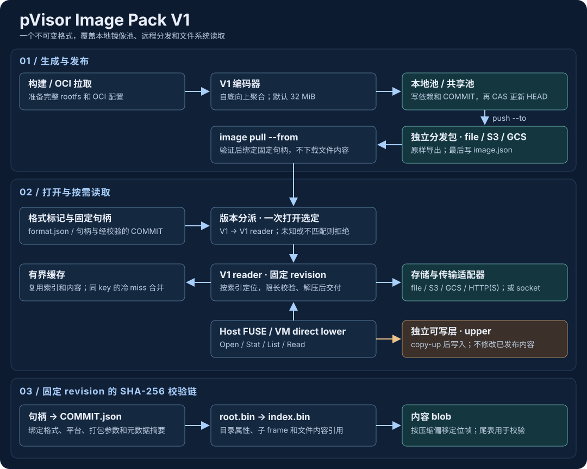

# pVisor Image Pack V1 设计

pVisor 镜像包（Image Pack）为本地镜像池和远程分发使用同一种不可变存储格式。读取端根据数据选择版本，只加载目录查询和文件读取所需的索引与内容。

> **EXP-004 · 初版实现。** 新镜像写入 Image Pack V1；[预发布 Lazy Image V2](../../lazy-image-v2.md) 仅保留读取和原样导出。socket 协议仍为 2。

## 问题提出 {#problem}

现有布局已经支持目录级索引、小文件聚合和按需解压，但单一格式同时写死在对象存储、socket 元数据读取、目录排序和 VM lower 准入中。另一个限制是打包参数和读端上限共用常量：调整打包粒度可能意外改变旧镜像的可读性。

V1 固定可辨认的格式家族、reader 边界和打包顺序。一个 pVisor 进程可以读取不同格式的镜像，CLI 和文件系统调用模型不变。普通 OCI 拉取仍需完整下载和应用层；V1 不扩展 xattr、ACL、DAX 或在线 GC。

## 核心设计 {#design}

### 架构与所有权 {#architecture}



| 组件 | 拥有什么 | 不负责什么 |
| --- | --- | --- |
| 镜像目录与 CLI | 标签、平台、OCI 摘要和固定句柄；`build` / `pull` / `push` 的用户语义 | 二进制编码、版本探测、存储访问 |
| Image Pack 服务 | 格式分派、固定 revision、准备与发布的提交边界 | OCI 拉取算法、VM 投影和可写层 |
| `v1` 格式实现 | 控制记录、目录与内容布局、打包和验证、该版本的读取行为 | filesystem、S3、HTTP 或 socket 连接管理 |
| 存储与传输适配器 | 有界 GET / Range、不可变写入、CAS、镜像站与连接 | 选择解码规则、解释 inode 或改变引用 |
| Host FUSE / VM direct lower | 消费 `Open / Stat / List / Read`，维护挂载和投影生命周期 | 重解析标签、修改镜像包内容；写入由独立 upper 承接 |

实现归属是 `pvisor` 的镜像缓存模块。先用一个私有分派入口和具体的 `v1` 实现；有第二个实际格式时再扩展分派。沿用现有 [`PortableCache`](https://github.com/DeepLink-org/pvisor/blob/main/crates/pvisor/src/image/cache/portable.rs#L250-L340)、[对象存储适配](https://github.com/DeepLink-org/pvisor/blob/main/crates/pvisor/src/image/cache/client.rs#L263-L342)和 [direct lower](https://github.com/DeepLink-org/pvisor/blob/main/crates/pvisor/src/image/cache/direct.rs#L529-L573) 的职责边界，不把版本化 DTO 暴露给 CLI、daemon 或 OverlayFS。

### 格式身份与版本分派 {#versions}

- `format.json` 是存储根标记：`{"format":"pvisor-image-pack","format_version":1,"packing":{"blob_target_bytes":33554432}}`。每个根只承载一个格式和一种写入策略；同一进程可连接不同格式的根。新本地池用 `<image-store>/image-pack-v1`，不复用 `pool-v2`，也不写 `pool-format.json`。
- 句柄为 `pvisor-image-pack:v1:<image-key>:<platform>:<revision>`。`image-key` 是规范化源引用字节的 SHA-256，`revision` 是 `COMMIT.json` **原始字节**的 SHA-256，两者都是 64 位小写十六进制。对象路径平台为 `linux-amd64` 或 `linux-arm64-v8`；对外 OCI 平台仍为 `linux/amd64` 或 `linux/arm64`。OCI manifest digest 跟随镜像内容来源，和打包 revision 分开。
- 按名称准备或读取时先解析存储根标记，再按该版本读 HEAD；没有标记时，只有显式写入者可在未初始化的空根创建它。固定句柄打开时，解析家族和版本，校验可见的根标记、`COMMIT` 摘要、格式与平台一致，再进入该版本的解码器。socket 只暴露准许的 revision 对象时，用句柄和经摘要验证的 `COMMIT` 做同样的绑定；不要求能读全局标记。
- 未知家族、未知版本、缺失的必需标记或交叉版本记录均明确报错；不探测多个解码器、不回退到 OCI 或别的名字。解码规则不从扩展名或环境变量推断。目录排序由选定格式定义；快照保留和稳定命名空间由已验证的镜像能力准入，不用字符串前缀当作认证。
- Image Pack 版本独立于 socket envelope 版本（保持 2）、目录记录 schema、OCI 版本和 pVisor 发布版本。凡改变旧 reader 如何解释字节、路由、地址或硬上限的改动，发布为新格式版本。每个已发布的版本有独立 reader 和固定制品；writer 只写明确选择且支持的版本，V1 阶段只写 V1。

### V1 对象与校验链 {#layout}

```text
format.json
meta/<image-key>/identity.json
meta/<image-key>/platforms/<platform>/HEAD.json
meta/<image-key>/platforms/<platform>/revisions/<revision>/
  COMMIT.json  manifest.json  config.json  root.bin  index.bin  objects.bin
meta/<image-key>/platforms/<platform>/uploads/<upload-id>/
  plan.json  progress.json
data/blobs/<aa>/<bb>/<encoded-object-sha256>
```

`aa`、`bb` 分别是摘要的前两个和接下来的两个十六进制字符。上述对象路径相对于一个存储根。独立分发包只携带一个固定 revision 和它的依赖，不携带 HEAD、上传日志或其他 revision；另含 `image.json` 和可按 OCI config ID 验证的 `configs/<sha256>.json`。普通镜像和预制模板沿用各自的 `image.json` 记录，底层对象格式相同。

| 记录 | 字段与约束 |
| --- | --- |
| `identity.json` | `format_version`、`image_key`、规范化 `reference`；引用摘要等于 key。 |
| `HEAD.json` | `format_version`、`image_key`、`platform`、带 `sha256:` 的 `revision`、`manifest_digest`、`generation`、`published_at`（Unix 秒）、`publication_id`；只指向完整提交。 |
| `COMMIT.json` | `format`、`format_version`、`image_key`、`platform`、`manifest_digest`、`packing` 和 `metadata`。`metadata` 恰含 `manifest.json`、`config.json`、`root.bin`、`index.bin`、`objects.bin`，值是 `{sha256, bytes}`；`packing.blob_target_bytes` 记录生效的原始 payload 目标。 |
| `manifest.json` / `config.json` | 前者记录 `format_version`、`reference`、`platform`、`manifest_digest` 及可空的 `config_digest`、`layer_digests`；后者记录 `format_version`、`architecture`、`env`、`entrypoint`、`cmd`、`totals`（文件数、字节数）。启动配置与分发包中的原始 OCI 配置是两份用途不同的记录。 |
| `root.bin` / `index.bin` | `root.bin` 是未压缩的根 `Record`，`index.bin` 包含独立压缩的目录和分块引用 frame。根记录和每层父引用认证所指向数据的摘要、位置、编码/解码长度和条目数。 |
| `objects.bin` | 按 key 排序、无重复的 `(object_key, encoded_bytes)` 列表。离线校验或导出时，必须与从根遍历得到的可达对象集合核对；普通打开不读取它。 |

JSON 控制对象使用 UTF-8，V1 schema 拒绝未知或重复字段。摘要校验针对实际字节，读端不重新序列化来计算摘要。writer 用固定字段顺序和排序 map 输出紧凑 JSON，且不会把发布时间、upload ID 或宿主路径放入 `COMMIT`。对象键、平台、全长和偏移先校验，再访问对象。

### 二进制记录与读取规则 {#binary}

`root.bin`、`objects.bin` 和 frame payload 使用 bincode 2.0.1 `standard`（little-endian、变长整数）。下列字段按列出顺序编码，枚举编号从 0 开始；`Digest` 是 32 原始字节，`Bytes` 是 `Vec<u8>`。`Box` 不引入字节，解码须正好消耗 payload。

| 类型 | 有序字段或编号 |
| --- | --- |
| `FrameRef` | `offset:u64, encoded:u32, decoded:u32, digest:Digest, count:u64`；digest 覆盖被引用的压缩 frame。 |
| `Record` | `name:Bytes, attrs:Attributes, directory:Option<FrameRef>, content:Option<Content>, digest:Option<Digest>`；文件 digest 覆盖原始完整内容。 |
| `Attributes` | `kind:u8, size:u64, mode:u32, uid:u32, gid:u32, inode:u64, nlink:u64, mtime:i64, mtime_nsec:i64, target:Option<Bytes>`。kind：目录 0、普通文件 1、symlink 2、special 3；special 不提供普通文件读。 |
| `Content` | 0 `Empty`；2 `Chunks(FrameRef)`；3 `PackedFrame(blob:Blob, frame:FrameRef, slot:u32)`。编号 1 仅用于预发布 V2，V1 拒绝。 |
| `IndexFrame` | 0 `Leaf(directory:u64, depth:u8, prefix:u64, entries:Vec<Record>)`；1 `Branch(directory, depth, prefix, children:[Option<FrameRef>;16])`；2 `Range(directory, depth, prefix, children:Vec<(first:Bytes, ref:FrameRef)>)`；4 `ChunkBranch(first:u64, children:Vec<FrameRef>)`；5 `BlobChunks(first:u64, chunks:Vec<ChunkRef>)`。编号 3 仅用于预发布 V2。 |
| `Blob` / `ChunkRef` | `Blob` 为 `digest:Digest, bytes:u64`，覆盖完整编码对象（含尾表）。`ChunkRef` 为 `blob:Blob, frame:FrameRef, digest:Digest, bytes:u32`，最后两项校验原始块。 |
| `DataFrame` | 0 `Slots(offsets:Vec<u32>, bytes:Bytes)`。slot 从 0 开始；偏移严格递增，从 0 到 payload 长度。一个大文件块占用独立帧中的唯一 slot。 |

- **目录。** basename 为原始字节，长度 1–255，不含 NUL、`/`，且不为 `.` / `..`；根名称为空且 inode 为 1。symlink 目标是原始字节，最多 16 KiB，不含 NUL。目录仅索引直接子项；空目录无子 frame。hard link 共享 inode 和属性，相同内容的独立文件仍使用不同 inode。
- **路由与分页。** 固定 seed `0x707669736f727632` 的 XXH3-64 从高位起每层用 4 bits，超过 64 KiB 的叶继续分裂；完整 hash 冲突使用有界的原始名称范围节点。枚举按 `(hash, name_bytes)`，每页至多 256 项；cookie 绑定 revision 和目录，对调用方不透明。只有经过验证的索引明确缺项才返回不存在。
- **分帧。** 空文件没有内容对象。≤64 KiB 的普通文件不跨帧，帧的 payload 目标为 16 KiB、最多 1,024 个 slot。大文件按 1 MiB 分帧，末帧可短。块树按从 0 开始的连续序号寻址，分支最多 16 个子节点，叶最多 256 个引用。
- **压缩与完整性。** 独立 Zstd frame（writer level 3）后追加标准 seekable 尾表：每帧记录编码和解码长度，结尾记录帧数与 magic，不写 seek-table checksum。文件路径、目录归属和属性只写入索引。读端根据经验证的 `FrameRef` 做 Range GET，不读取尾表来定位。完整 blob 使用编码 SHA-256 寻址；导出校验整个对象、尾表、frame 和可达 slot。

### 生成、发布与导入 {#publication}

1. `build` / 普通 OCI `pull` 准备 rootfs 和 OCI 配置，再按池策略编码。写入者先观察 HEAD 和 CAS token，写并核验不可变依赖，再写 `COMMIT.json`，最后 CAS 更新 HEAD。旧 HEAD 不参与布局；只复用字节一致的完整对象。
2. `image push --to` 一次固定本地标签指向的镜像，原样导出已验证的编码依赖和 OCI 配置，保留句柄。独立分发包用 `image.json` 原始字节的 SHA-256 作为根路径；先上传依赖，再写 `image.json`，预制模板的 `refs/<name>.json` 随后 CAS 更新。[仓库 URL](../../../reference/shared-image-cache.md) 选择可写的本地目录、S3 或 GCS，或只读 HTTP(S)。
3. `image pull --from` 验证分发根描述符、版本、OCI 配置（普通镜像必需）和已固定的根元数据，再原子更新本地目录。现有名字需显式 `--refresh`；失败保留旧引用。运行中只按固定句柄读取，不跟随 HEAD 或标签变化。

上传失败可留下未引用对象；CAS 冲突不能覆盖赢家。丢失提交 ACK 时，用确切的提交字节及 publication ID 对账，无法确认就返回结果未知。V1 导出比对清单与可达引用，拒绝携带任何不可达帧或 slot 的 blob。旧版本中已删除的文件不会进入新 revision 的规范布局。

### 规范聚合与池策略 {#packing}

1. 目录的直接小文件按 basename 原始字节排序；相同内容在该目录内使用首次出现的 slot。先把直接小文件组成独立帧，再按子目录名称字节序追加子目录未封包的尾帧。子目录已经封好的 blob 不重新打开。
2. 大文件按文件偏移顺序独立聚合，不和目录尾帧混装；文件末尾和根目录各自封掉最后的尾包。
3. 加入下一帧前，若原始 payload 将超过池目标、编码对象（含尾表）将超过 64 MiB，或已有 4,096 帧，先封当前 blob。达到 payload 目标或帧数上限也立即封包。对象字节只由有序编码帧和尾表组成。

新池默认目标为 **32 MiB 原始 payload**；宿主可用 `PVISOR_IMAGE_BLOB_TARGET_MIB=64` 初始化 64 MiB 池。首次写入将策略固定在 `format.json`；之后省略设置沿用池策略，显式值若不匹配则拒写。值只允许 `32` 或 `64`，没有每次 push 的打包选项。`COMMIT` 记录生效策略，reader 用索引中的压缩偏移与长度读取，不用目标值推算偏移。

同一写入策略下，池中已有的对象不会改变新布局。完整 blob 字节一致即可共享；改变文件顺序、切分边界或压缩输出可能改变 blob 摘要，不承诺任意跨目录或跨策略的逐文件去重。

### 按需读、错误与资源边界 {#reading}

以 VM 中一次冷 `read` 为例：virtio-fs 将请求交给 direct lower，reader 通过固定 revision 找到目录记录或大文件块树。按索引的压缩范围获取覆盖请求的 frame，校验长度与 SHA-256，在窗口和输出限制内解压，再核对 slot 或块。Host FUSE 共享同一语义；socket 服务可替客户端解码内容。guest `mmap` 经 virtio-fs 和 guest page cache；copy-up、完整导出和全量校验可能读遍内容。

| 约束 | V1 边界 |
| --- | --- |
| 格式硬上限 | 控制对象与 `root.bin` 1 MiB；`index.bin`、`objects.bin` 与内容包对象 64 MiB；索引 frame 解压后 64 KiB；pack slot frame 解压后最多 72 KiB；全局 frame 解压后最多 1 MiB + 128 B，Zstd window 最多 2 MiB。 |
| 清单与读取 | 每镜像 1,000,000 个条目（含根）、2,000,000 个内容跨度；达到对象上限也可拒绝镜像。socket 单次 Read/Metadata 最大 1 MiB，独立于磁盘块大小。 |
| 宿主缓存 | 沿用有界 LRU 和同 key 冷 miss 合并。起始预算为每镜像索引 16 MiB、服务内容 64 MiB，各 4,096 项；每 reader service 缓存 4 个已打开镜像。预算不等于进程 RSS 或磁盘配额。 |
| 错误 | 校验失败、范围溢出、缺失依赖、解压超限、网络和鉴权失败均为错误，不合成字节、不当作 `ENOENT`。本地编码缓存损坏时可丢弃并重新获取。镜像站只能为同一已固定发布提供对象，不能换用另一个 revision。 |

摘要链验证来自固定句柄的字节一致性，不证明发布者身份。客户端必须信任配置的发布者和初始引用；AWS 凭据、endpoint 配置和宿主投影路径不进入分发记录。V1 不把动态更新目录视为不可变镜像。

### 迁移与验证门槛 {#validation}

1. **格式与分派。** 冻结一个最小完整制品及字节向量，覆盖 `COMMIT`、raw basename、目录分裂与冲突、slot 和块边界；独立断言句柄与每级摘要。
2. **端到端保持。** 用已有的 [Lazy Image Scrut 场景](https://github.com/DeepLink-org/pvisor/tree/main/tests/spec/lazy-image) 扩展覆盖新的身份与显式迁移。保留幂等、精确读取、原子刷新、只读、CAS 冲突、丢失 ACK 和未引用 slot 不泄漏的断言。验证文件系统、loopback HTTP、签名 S3 fixture 和 socket；真实 S3、KVM / HVF 另行记录。
3. **聚合。** 核对 32/64 MiB 制品的对象数、尾表帧数、跨帧与跨对象读取，以及空池与已有 HEAD 时句柄一致。真实 S3 上的读放大、延迟和相邻镜像新增上传量需单独测量。

旧 raw/paged V1 仍拒绝。已固定的 radix V2 镜像和分发引用仍可读取；更新或重发为新格式时，从 OCI 准备到新池，再发布和重绑引用。不原地改名、不删除旧池或改写已存在的实例。

## 方案讨论和对比 {#alternatives}

| 决策 | 选择与代价 |
| --- | --- |
| 重用 `pvisor-v1:`，或采用独立家族 | 采用独立家族。旧 V1 和新 V1 的数字相同但字节不兼容；新命名空间能安全拒绝旧数据。 |
| 每个对象动态探测，或每个根单版本 | 每个根单版本，打开时分派一次。升级需要新根，但无需为共享对象池、CAS 或 GC 定义混合版本语义。 |
| 一帧一对象，或多帧一个 blob | 聚合多个独立帧减少对象数量；变更可能需要重上传整个 blob，随机读取仍只取目标帧。 |
| 每次打包调参，或保持池级策略 | 固定帧规则和遍历顺序，只允许池初始化时选择 blob 目标。同一池的发布不会因打包选项分裂去重。 |
