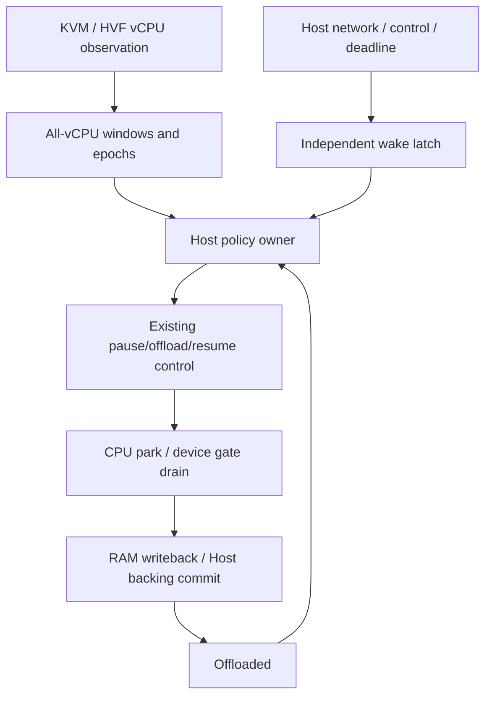
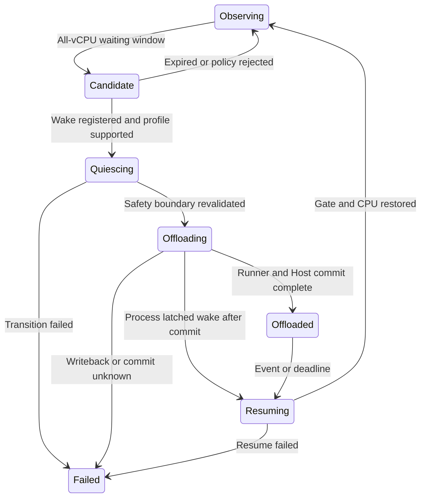

# vCPU 空闲观测与自动内存卸载（EXP-001）

| 项目 | 当前状态 |
|---|---|
| 阶段 | **观测原型阶段（M0）；尚未通过全部退出门槛** |
| 核心目标 | 利用 VM 等待窗口降低驻留内存，宿主事件到来时自动恢复 |
| 默认行为 | 保持现有行为；尚无自动 offload 开关 |
| 首选路径 | pVisor vCPU/宿主观测，不修改 Agent 或 guest 内核 |
| HVF | 已接入 wait/timeout 观测与全 vCPU 聚合；未实际编译/运行验收 |
| KVM | 真实 VM API 与实验通过；KVM_RUN 内 Unknown，尚无可靠 idle 信号 |
| 现有基础 | pause/resume、RAM offload、device memory gate、Host backing commit |
| 主要新增 | 等待窗口观测、全 vCPU 聚合、策略 owner、wake/deadline 与 lost-wakeup 防护 |
| 尚未完成 | 完整 idle 来源、wake/deadline、自动 offload、HVF 验收与卸载收益实验 |

Agent 等待模型响应、输入或外部工具时，VM可能不需要执行，但仍保留大量驻留RAM。短等待让CPU自然休眠；有足够长的等待窗口时，评估自动offload，减少内存时间成本。唤醒后继续同一个live Attempt，不将其冒充持久checkpoint或重新启动。

选择是否卸载由宿主决定，依据窗口长度、内存压力、设备安全、恢复预算和支持范围；不对每次线程阻塞立即卸载。

## 1. 问题提出 {#problem}

### 1.1 等待窗口与驻留内存

Agent 等待模型响应、网络或外部工具时，VM 可能长时间没有有效计算，却仍持有驻留 RAM。普通 CPU 休眠降低计算开销；内存回收还需要知道等待窗口是否足够长、如何停驻安全，以及何时恢复同一个 Attempt。

设计需要回答三个问题：如何识别全部相关 vCPU 的可利用等待窗口；如何在网络、控制或 timer 到来时可靠恢复；节省的内存时间是否足以覆盖观察、提交和恢复成本。

### 1.2 后端基础与观测缺口

| 后端 | 现有接点 | 拟议方案 | 限制 |
|---|---|---|---|
| HVF | `vmm/macos/vstate.rs`的WaitForEvent/Timeout及等待channel；`hvf/mod.rs`读取虚拟timer | 等待进入/离开序列、可用deadline，独立owner聚合全部vCPU | WFE可能是同步等待；需验证其它timer/IRQ来源，不能只凭一个寄存器声称完整 |
| KVM | vCPU线程与`vmm/linux/vstate.rs`运行循环 | 先观察CPU时间/调度等候选窗口；核验可选KVM宿主事件来源 | KVM_RUN未返回可能正在执行；低CPU也可能宿主抢占；当前Hlt分支是Stopped，禁止直接改语义 |

KVM tracepoint/eBPF或用户态halt处理只是候选路线，具体内核接口、权限、开销与兼容性未核验。第一阶段不改irqchip、不要求全局sysctl或特权追踪。无法可靠区分时标Unknown并拒绝自动操作。

当前 M0 的真实 KVM 实验尚未发现可靠等待信号，HVF wait 接点尚未实机验收。[验证记录](#validation)分别保存现有结果与未覆盖范围；自动策略依赖的 wake/deadline 闭环仍需实现。

### 1.3 目标与范围

不修改Agent与guest内核，从pVisor vCPU和宿主事件侧发现等待窗口，自动卸载RAM并在需要执行时恢复。观测回答“何时值得卸载”；现有CPU/device quiescence和backing commit回答“如何安全卸载”。

不证明所有Linux进程阻塞，不做通用checkpoint/migration，不冻结guest时间，不支持任意设备或所有内存机制叠加，不承诺生产密度倍率。

## 2. 核心设计 {#core-design}

### 2.1 架构、职责与接入



- `pvisor-vm`归属后端观测及CPU/device控制，新增公共契约必须集中于`api.rs`，不为实验暴露私有VMM模块。
- `pvisor`归属策略、Host backing commit、Attempt生命周期、配置和可解释事件。
- OverlayNet等事件源在guest RAM访问或可能阻塞的channel之前通知wake。
- 单一control owner串行仲裁自动策略与手动pause/resume/checkpoint/cancel，不另造completion owner。

观测状态、快照与 `VcpuObservationControl` 已在 `api.rs` 实现，详见 [验证记录](#validation)。Host 自动策略 owner、wake/deadline 与自动 offload 状态机仍为设计，尚未实现。

### 2.2 观测聚合与候选窗口

M0 已定义观测状态：Executing、HandlingExit、WaitingForEvent、HostDescheduled、ManualPaused、Stopped、Unknown。只有全online vCPU等待且满足策略时产生候选。禁止把HostDescheduled归为guest idle；等待状态是机会，不是Linux runqueue真值。

### 2.3 wake、deadline 与提交顺序

至少需要Attempt身份、CPU topology generation、观测sequence、idle epoch、pending wake sequence、停驻原因、可用deadline和clock domain。

wake在Candidate/Quiescing/Offloading/Offloaded阶段均latch；已有pending事件不得忽略。进入停止边界后重验观测和事件sequence。Host backing提交期间收到wake先排队，提交完成后立即恢复，不能提前打开writers。

网络数据、EOF、错误、连接完成优先作为语义wake，不用socket writable/普通ACK无条件触发。wake先于virtqueue/memory gate访问，由独立owner处理，设备线程不得持queue/proxy锁同步resume。恢复后重查挂起事件/ring，不仅依赖新EPOLLET边沿。

最早有效timer deadline需要覆盖目标profile，明确guest/host时间转换与提前恢复margin；未知或太短就跳过。watchdog只能作为PoC容错，不能代替精确timer支持。当前pause保留wall-time，不通过冻结时间隐藏过期timer。

### 2.4 状态机与失败处理



busy/unsupported/short-window是破坏性transition之前的正常拒绝。现有drain超时会fail_control，不能把poisoned runner当普通拒绝后继续执行。正常取消一个已开始的transition必须证明状态恢复，不能直接跳回Observing。

自动wake只解除该owner/epoch的自动停驻；人工pause、snapshot freeze、failed状态保持原语义。guest不能伪造Host权限或绕过资源限额。观察误判主要影响性能，但丢wake、timer缺失或绕过commit会破坏执行正确性。

### 2.5 初期 profile

- 普通writable shared file-backed RAM、raw offload、同live Attempt。
- 先单vCPU，SMP聚合/epoch验收后扩展。
- 网络wake优先现有OverlayNet IPv4 TCP；明确timer与控制wake支持。
- 无在途virtio-fs请求；慢I/O跳过，不对已有RAM lease强行discard。
- 排除cold pager/pool、restored private COW、未守护设备、未知wake来源。
- 后端deadline/wake未验收时，保持observe-only；不因HVF接点更明确就宣传macOS全平台已支持。


### 2.6 当前约束 {#constraints}

- 第一版不要求guest内核通知；仅保留PV通知作为将来精度增强。
- 自动策略的观察是机会信号，不是“所有Linux进程都阻塞”的证明；安全卸载仍依赖CPU/设备quiescence与backing提交。
- 初期只支持明确的普通file-backed RAM；现有cold pager/pool与whole-VM offload互斥，private restored COW不支持该discard路径。
- deadline/wake支持不完整的平台或设备，只观察，不自动卸载。
- 不解除人工pause、snapshot freeze或失败停驻，不授予guest Host控制权限。

现有手动offload数据只支持基础成本分析，不能宣称自动策略已经提升生产密度。当前观测结果不能授权自动卸载，设计不是验收结果。

### 2.7 实施计划与验收 {#implementation-plan}

> 已实现 M0 观测 API、后端接点和实验；自动 idle/offload 尚未实现。已完成项与未验收项分开，详见 [验证记录](#validation)，不承诺固定排期。

#### M0：基线与Observe-only

- [ ] 核对当前后端idle、IRQ、timer、offload、device gate和Host commit链。
- [x] 定义跨后端观测契约与Unknown语义，遵守VM公共API边界。
- [x] 注册vCPU身份/topology generation、enter/exit sequence、等待窗口与拒绝原因。
- [ ] HVF从现有wait/timeout路径采集；KVM先验证低成本候选观测，区分guest等待与宿主抢占。
- [x] 接入单一 VM-local collector，只记录、不调用pause/offload；Host策略owner尚未实现。
- [ ] 完成跨平台采集开销、退出清理与容量验收；KVM已完成有界采样与工程A/B，HVF尚未验收。

退出条件：能解释真实任务的等待窗口，不因无KVM exit、低CPU或人工pause误报精确idle；平台未提供可靠信息时Unknown。

#### M1：可控wake闭环

- [ ] 增加独立wake latch，覆盖候选/排空/卸载/停驻全部窗口。
- [ ] 网络数据/EOF/错误/连接完成在RAM访问与有界发送等待前登记。
- [ ] 建立deadline clock domain、提前恢复margin与timer取消/重编程规则。
- [ ] 将wake交现有Host控制owner，保证runner ACK后的backing commit顺序。
- [ ] 仲裁自动、人工、snapshot、cancel与失败状态。
- [ ] 验证resume后重查queue/backend，不丢已消费边沿。

退出条件：故障注入和可控交错证明lost wake不出现；deadline未知profile拒绝自动深停驻。mock通过后仍需真实VM验证。

#### M2：单vCPU受限raw offload PoC

- [ ] 默认关闭；拟议enable配置经实现评审后才命名、接CLI。
- [ ] 普通file-backed RAM支持检查，排除pager/pool/private COW等。
- [ ] 在途FS/未守护设备提前拒绝，不以真实drain失败作为常规策略。
- [ ] 初期grace、deadline guard、重入冷却、wake频率抑制。
- [ ] 真实delayed network、timer、控制wake下恢复同Attempt并校验全部内容。
- [ ] offload/store/恢复失败沿用fail-stop与unknown，终态不伪造。

退出条件：正确性、权限与生命周期负对照通过；仅对验收的平台/profile标记受限PoC。

#### M3：SMP与更多事件

- [ ] 全online vCPU聚合、跨CPUwake/IPI、迁移/topology变化竞态。
- [ ] 一个CPU运行时不卸载；退出/恢复旧epoch不复用。
- [ ] 扩展vsock、终端、signal等事件，不在proxy/queue锁内同步切换。
- [ ] 多连接、streaming、backpressure、恢复风暴与deadline竞争。

退出条件：平台支持矩阵逐格记录，不以SMP mock替真实guest验收。

#### M4：收益实验与是否继续

- [ ] 按`benchmark/README.md`先登记自动策略的问题、角色、runner与统计协议。
- [ ] 同任务/硬件/预算/制品，自动策略on/off随机配对，多轮；手动策略可独立对照。
- [ ] waiting/compute/短阻塞/streaming/timer-heavy/恢复风暴分开。
- [ ] memory-time integral、cgroup/PSS/cache、全组peak、CPU/IO、恢复及完整任务延迟、失败和有效吞吐。
- [ ] 计入观察者/全局扫描器等组外成本的说明，不用低PSS或配置容量估生产密度。
- [ ] 正确性失败不算收益；保留失败、干扰与完整来源，不挑样本。

晋级条件：在明确用户负载上有净资源收益且满足QoS，测试可复现、操作可解释。若thrash、CPU/IO或恢复代价抵消收益，就调整策略或退役，不为保留功能强行上线。

#### 代码归属建议

| 归属 | 职责 | 验证 |
|---|---|---|
| `crates/pvisor-vm/src/api.rs`与私有后端 | 观测契约、wait/deadline、CPU控制与device gate | API boundary、状态/epoch、timer与RAM正确性 |
| `crates/pvisor/src/executor/vm/` | 观测/控制通道、backing提交、支持profile | 排空/提交/wake并发、错误fail-stop |
| `crates/pvisor/src/runtime/` | Attempt仲裁、自动策略与事件 | manual/auto/snapshot/cancel不越权 |
| `crates/pvisor-overlaynet/src/vm.rs`及后续设备事件源 | wake-before-RAM与外部socket生命周期 | 数据/EOF/错误/背压/已pending事件 |
| 原crate测试与产品集成测试 | mock交错与真实VM验证 | 分平台记录通过/失败/跳过 |
| `benchmark/` | 已登记策略实验 | 独立数据/收据/样本，不放本目录 |

这张表规定职责，不预先规定新文件名或引入依赖；实施时按已有代码结构收敛。

#### 必测负对照

| 场景 | 预期 |
|---|---|
| compute busy、宿主CPU拥塞 | 不将低CPU误判为确定guest等待；策略误判也不能破坏安全边界 |
| sleep/futex deadline、timer取消 | 不丢timer，不冻结时间；未知deadline拒绝 |
| 任意卸载窗口到来的wake | 锁存并最终交付，不需guest自己重新发事件 |
| 慢FS持RAM lease | 正常提前跳过；真实transition失败必须fail-stop |
| 手动pause或snapshot freeze | 网络/自动deadline不能擅自解除 |
| backing commit中网络到达 | 等提交完成后恢复，RAM writer不早开 |
| KVM Hlt/guest shutdown | 保留shutdown语义，不变成自动idle |
| 已offloaded时cancel/exit | 清理与终态正确，不保留永远无法唤醒的owner |
| 不支持的pager/pool/COW | 明确拒绝且不改变运行状态 |

#### 验证记录模板

每次推进填写：日期、平台、stage/profile、源码SHA+dirty manifest、binary/firmware/rootfs身份、命令、结果、失败/跳过、未覆盖项、证据路径、结论。实际记录见 [第一版实现与验证](#validation) 和 [KVM 工程实验报告](https://github.com/DeepLink-org/pvisor/blob/main/benchmark/pvisor/vcpu_idle_report.md)。

默认使用目标包的`just test PACKAGE`；真实VM/特殊runner按已有契约运行。语义审批与PASS分开，不由AI操作真实ledger。实验实现成功后再同步用户文档和正式支持矩阵。

### 2.8 第一版实现与验证 {#validation}

#### 当前结论

**已交付 M0 observe-only 观测原型和真实 VM 实验，不是自动 offload 第一版闭环。** KVM 实测证明当前用户态接点不足以识别等待：sleep/busy/短 timer/SMP 条件几乎都为 Unknown。不能为了完成自动策略而把低 CPU、未返回的 KVM_RUN 或 shutdown HLT 改作 idle。

HVF 等待路径已接入，但本 Linux 工作区没有实际 macOS 编译或运行验收。M0 未完成全部退出门槛；M1/M2 未实施，不新增自动 offload CLI 开关。

#### 实际代码与 API

- `crates/pvisor-vm/src/api.rs`：`VcpuObservationControl`、状态/拒绝原因、逐 CPU 记录与聚合快照，公共契约集中于该文件。
- `crates/pvisor-vm/src/vcpu_observation.rs`：默认关闭的单 VM collector，无后台线程和事件队列，内存 O(vCPU 数)，session/sequence/topology generation/idle epoch、等待累计与拒绝原因。
- `crates/pvisor-vm/src/vmm/{builder,mod}.rs`：collector 生命周期与 CPU 注入。
- `crates/pvisor-vm/src/vmm/{linux,macos}/vstate.rs`：后端观测，人工停驻与停止保持原控制语义。
- `crates/pvisor/examples/vm_vcpu_observe.rs`：真实 SDK VM、有界采样和 guest 正确性负载。

```rust
use pvisor_vm::api::VcpuObservationControl;

handle.set_vcpu_observation(true)?;
let snapshot = handle.vcpu_observation()?;
handle.set_vcpu_observation(false)?;
```

此 API 不调用 pause/resume/offload。中途启用不 kick CPU，状态保守 Unknown，直到下一接点。KVM 的 Executing 是执行入口接点，KVM_RUN 内 Unknown，返回后 HandlingExit；HLT 仍为停止。HVF WaitingForEvent 表示 wait/select 接点窗口，可能立即消费已就绪事件，不等价于精确睡眠或 Linux runqueue 事实。

全配置 CPU 的 online 指后端生命周期，不证明 guest Linux CPU-online。停止/尚未启动的槽不冒充全 CPU idle。即使全等待成立，仍以 WakeDeadlineUnavailable 拒绝自动操作。

#### 实验与结果

注册 **B-VCPU-IDLE-ENG**，工程 A/B，不进入用户 benchmark 正文。完整[协议](https://github.com/DeepLink-org/pvisor/blob/main/benchmark/pvisor/vcpu_idle_plan.md)、[报告](https://github.com/DeepLink-org/pvisor/blob/main/benchmark/pvisor/vcpu_idle_report.md)及[复现入口](https://github.com/DeepLink-org/pvisor/blob/main/benchmark/pvisor/README.md#vcpu-observation-m0)。

矩阵：sleep、busy、2 ms 短 timer 分别使用 1/2 vCPU；另设 2 vCPU 仅 CPU 0 busy。每格 fresh 256 MiB VM、3 秒 workload、10 ms 采样，observer off/on seeded 随机配对，每 case 5 pairs，共 70 VMs。guest multiprocessing 独立进程与亲和性验证防止 GIL 串行化，逐 worker 校验 SHA-256、工作区间、退出与输出。

| 项目 | 实际结果 |
|---|---|
| 原始预检 | 0/14，通过失败均保留；Python 3.14 forkserver bootstrap 错误 |
| 显式 fork 修复后独立预检 | 14/14 有效，0 失败 |
| 正式批 | 70/70 有效，0 失败、0 timeout，35 完整 pairs |
| 周期采样 | 10,613 snapshots，16,666 条 CPU 状态 |
| Unknown | 16,657 条，99.946% |
| WaitingForEvent / 全等待 epoch | 0 / 0 |
| 配对任务 wall 差异 | 全部 case 的 95% CI 包含 0，未检出差异 |
| 配对 VM CPU 差异中位数 | +48.253～+88.676 ms；2-vCPU busy CI 包含 0，其余为正 |
| snapshot + JSON Value 构造时间 | 描述性中位数 24.566 µs，不包含 JSONL 写入 |

开销包含 collector、sampler 和证据 I/O，非纯接点成本。GNU debug、单宿主、每 case n=5，无 cgroup 限额或连续宿主干扰检测，不推导 release、P95/P99、生产 density 或整机节省。未调用 offload，没有内存回收效果或恢复延迟结果。

#### 验证与制品边界

- 最终 `just test pvisor-vm`：345 passed、8 skipped；含真实 KVM busy-loop/OUT/HLT 特殊测试、SMP/session/并发采样/退出/容量/统计一致性回归。
- Python runner：16 个单测通过，包含 Python 默认 forkserver 下的显式 fork 回归、超时、来源、拓扑和输出拒绝。
- example debug 构建、修改文件格式检查通过；Linux VM 库 Clippy 通过。tests Clippy 被依赖的现有 pvisor 告警阻断，未改无关代码。
- macOS/HVF 编译与真实运行未验收；无 lost-wakeup、完整 timer/deadline 或自动恢复测试。

正式测量绑定冻结 binary SHA-256 `af6830774dfd9fef042893c7491c38077377cf7032afeb1add3af433ca83f239`；report SHA-256 `036094ed87fcc5ffd7d7c73d28cd932350bbd16499fae6b8ae28f4655e5bf339`。来源与资产完整摘要在报告，原始证据在 `benchmark/pvisor/.data/vcpu-m0-fork-pairs5-20261007/`。

**实测后修复了快照时间戳锁内一致性，以及 disable 截断逐 CPU 等待记账两项问题。** 最终单测包含修复，但冻结 binary 未替换、真实 A/B 未重跑；上述实验只属于修复前冻结版本。工作区同时有外部开发，旧 receipt 会拒绝当前源码；下一次测量需 NEW build/cohort，不修改历史结果。

#### 下一版实施门槛与实验

1. **KVM 信号问题优先**：验证宿主 KVM halt/wake 观测接口是否能按 VM/vCPU 关联、区分抢占并控制权限/开销。不先修改 irqchip、HLT shutdown 或全局 sysctl；无可靠来源则保持 Unknown。
2. **HVF 实机验收**：同矩阵核实 wait 接点、短 timer、单 CPU busy SMP 与 pending event。补 host 拥塞负对照及更低开销的 aggregate-only 采样，不把接点窗口当未来 deadline。
3. **M1 正确性实验**：wake-before-RAM、候选/排空/提交/停驻四阶段注入事件；timer 重编程/取消、人工 pause、cancel、失败，证明不丢事件、不越权恢复。
4. **M2/M4 回收 A/B**：上述闭环通过后，在普通 file-backed raw、单 vCPU、明确网络/timer profile 对比 off/on。独立登记/补全协议，测等待 0.1/1/5/30/60 秒、计算/streaming/短 timer/恢复风暴，重复/随机工作集；固定组预算、完整 cgroup/PSS/cache/helper、memory-time integral、CPU/IO/peak、完整任务延迟和有效结果。当前均未测，不预设节约倍率。

这次实验的价值是及时暴露 Linux 路线的观测缺口，而非给尚不存在的自动卸载策略提供漂亮收益数字。

## 3. 方案讨论和对比 {#alternatives}

### 3.1 等待观测路线比较

| 路线 | 优点 | 代价与局限 | 选择 |
|---|---|---|---|
| 现有用户态 vCPU/宿主接点 | 复用 VMM，Agent 和 guest 内核无需改动 | HVF wait 窗口仍需 timer/IRQ 验证；KVM_RUN 内无法据此确定等待 | M0 主线，信息不足时保持 observe-only |
| KVM 宿主观测扩展 | 有机会补充 halt/wake 等等待来源 | 接口、权限、VM/vCPU 关联、抢占区分和开销均待验证 | Linux 后续研究重点 |
| guest PV 协作 | 有机会提供更明确的等待与 deadline 输入 | 需要 guest 协议/内核适配，仍由 Host 控制安全边界和权限 | 可选增强，独立验收 |
| 低 CPU/固定时间启发式 | 采集简单，适合寻找候选机会 | 无法证明 guest 等待，也不提供完整 wake/deadline | 不单独作为自动卸载依据 |

任何观测路线都必须经过现有 quiescence 和 backing commit 边界。路线选择影响机会识别的精度与成本，不能绕过安全停驻和唤醒协议。

### 3.2 策略与完整成本

先固定可解释的grace、deadline guard、最低再停驻间隔和thrash抑制，再探索pressure-aware策略。参数由实验决定，不从单次手动offload数据设置生产默认。

主要目标是内存时间积分下降，同时满足任务QoS；包括完整cgroup/PSS/cache/helper、CPU/IO、峰值、恢复延迟、吞吐、失败和有效结果。短阻塞只CPU休眠，长窗口才回收RAM，更长停驻再研究压缩backing。

### 3.3 实施选择与决策门

先证明host-only观测足够有用；guest PV可选增强留待后续，不因追求“精确全部进程状态”无限扩大首版范围。

先保留 host-driven、observe-only 主线，补齐可靠观测和 wake/deadline 后，再验证单 vCPU、普通 file-backed RAM 的 raw offload。压缩 backing、更多设备和 SMP 扩展按收益与正确性分别推进。

进入自动策略前，至少取得可靠信号或明确拒绝、无丢失 wake、完整 timer 支持以及真实 VM 恢复的证据。随后用相同任务与资源预算比较内存时间、CPU/IO、完整任务延迟和有效吞吐；成本抵消收益时调整路线或退役。阶段分工见[实施计划](#implementation-plan)，已有证据见[验证记录](#validation)。
