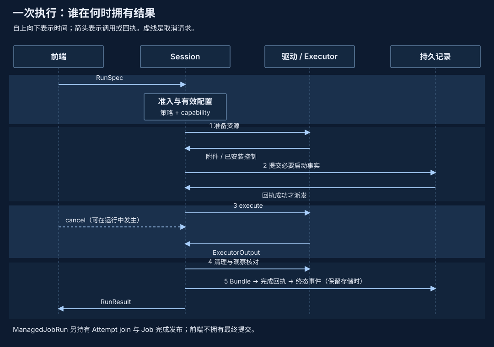
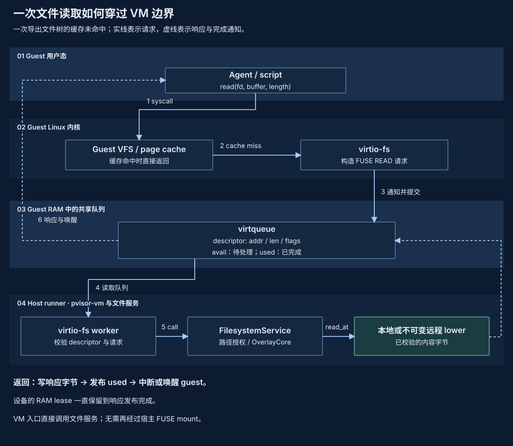
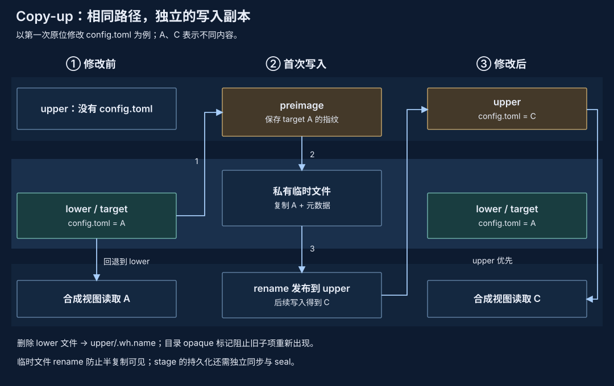
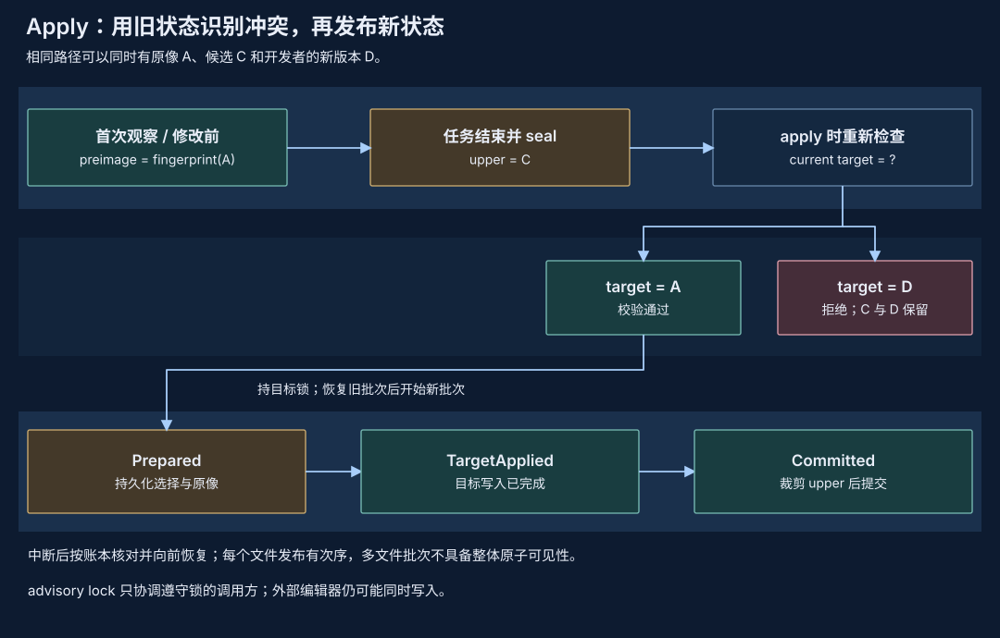
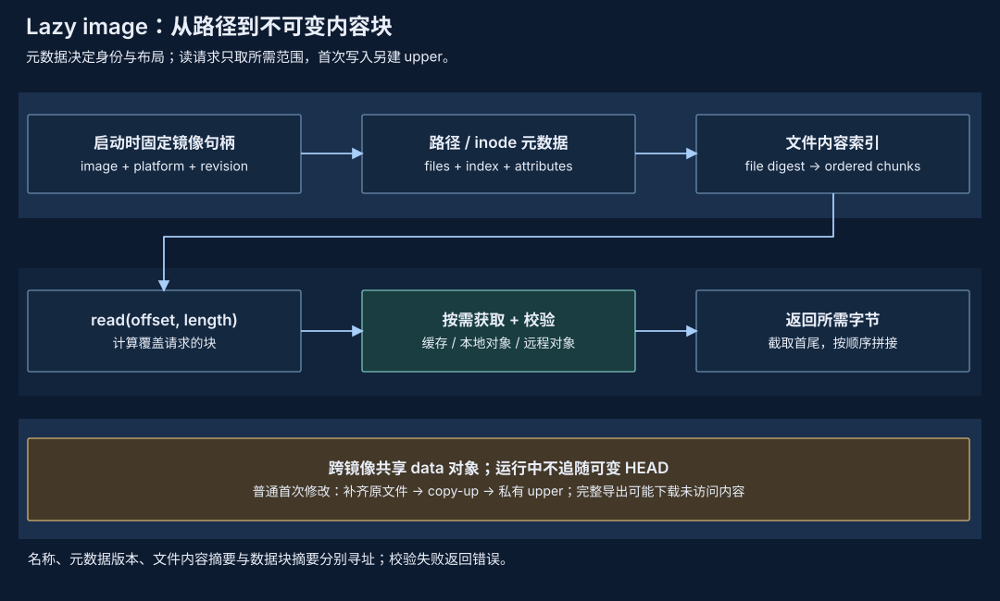
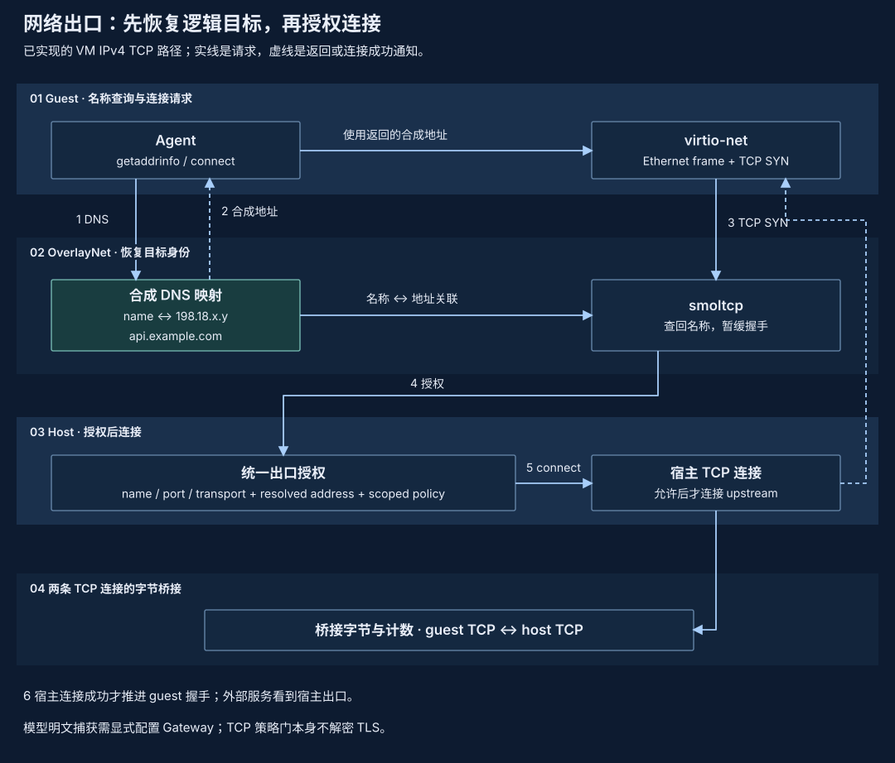
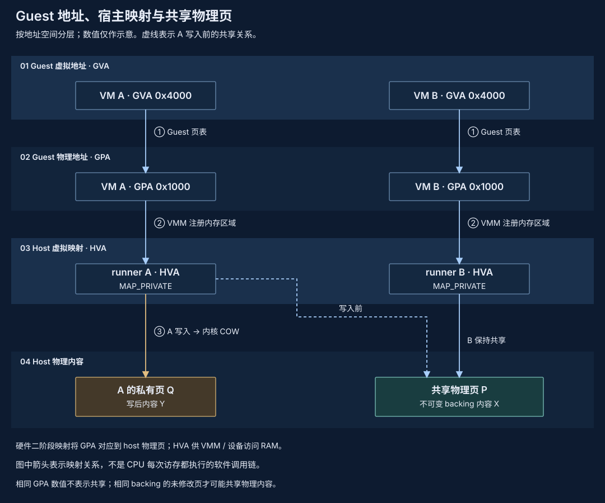
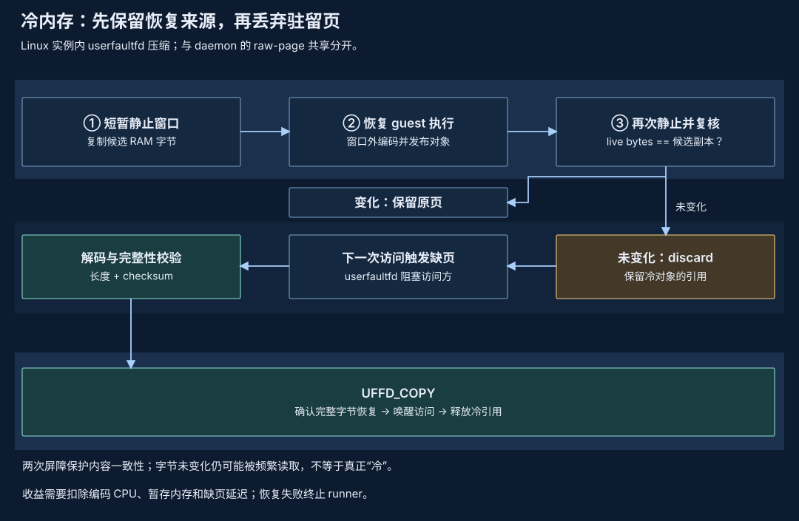
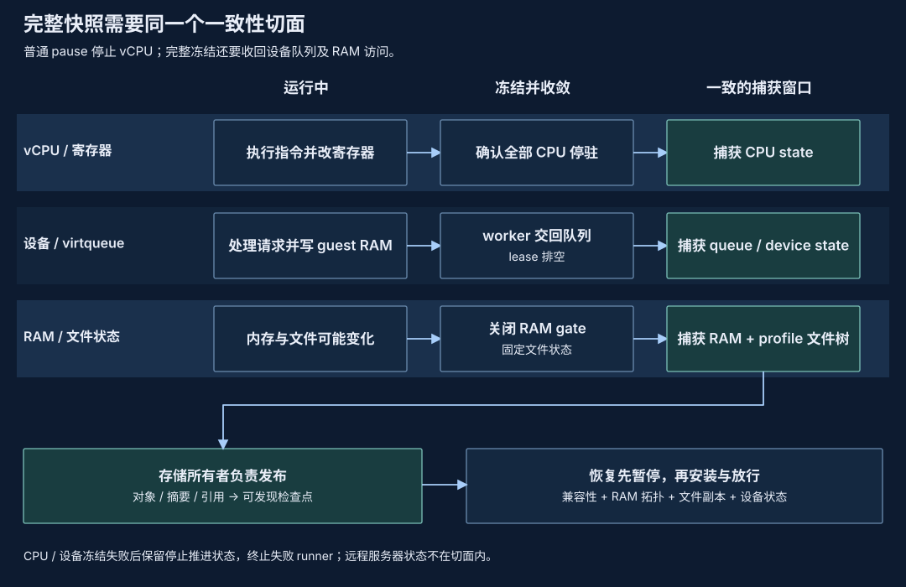
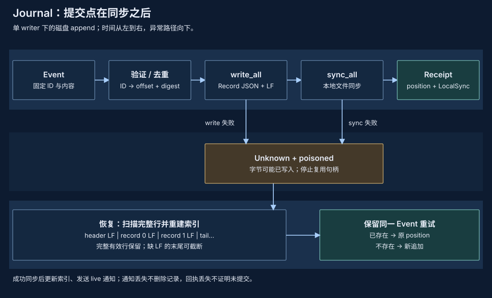

# 架构总览

Agent 执行需要持续管理工具进程、文件与网络访问，以及任务状态和资源。在本地工作流中，pVisor 限定访问范围、隔离文件修改，并支持结果审查；在集群的执行节点上，pVisor 为上层推理、评测与训练框架提供受管理的沙箱，通过生命周期管理、镜像与内存优化以及状态复用，支持多个任务和分支的并发执行。两类场景共用同一套底层机制，跨节点调度与任务编排由上层框架负责。

## 1. 整体架构与模块分工 {#architecture}

pVisor 在 Host 侧组织任务执行，并通过文件、网络和状态服务管理执行环境。各模块的职责与关系如下：

| 模块 | 职责与关系 |
| --- | --- |
| **Runtime 与 Executor** | Runtime 组织任务执行与资源管理，Executor 将请求落实到具体执行环境。 |
| **OverlayCore 与 OverlayNet** | 分别管理文件视图、候选修改和网络出口，将访问规则落实到文件与网络交互中。 |
| **Image Cache** | 提供可复用的镜像元数据与内容，支持按需读取。 |
| **VMM 与 guest** | Host 侧的 VMM 管理虚拟机资源与设备，guest 内核和工具进程执行任务。 |
| **状态存储与执行记录** | 保存可恢复状态与执行事实，支持任务恢复、结果审查和故障核对。 |

Runtime 通过 Executor 启动并管理执行环境。在 VM 路径中，VMM 驱动 guest 执行工具，guest 的文件与网络请求经虚拟设备交给 OverlayCore 和 OverlayNet 处理，Image Cache 为文件读取提供镜像内容。执行产生的候选修改由 OverlayCore 保留，状态存储与执行记录分别保存受支持的恢复状态和执行事实，供后续恢复与审查使用。

## 2. 一次任务的开始到结束 {#execution}

以一次 VM 工具执行为例：Agent 读取 `config.toml`，通过 HTTPS 查询外部服务，再修改配置。执行启用工作区暂存，文件修改保留为候选结果，等待后续审查。暂存的启用方式和默认写入行为见[本地工作流快速开始](../start/first-run.md)。

### Job、Attempt 与 Session

这次执行通过三个概念连接任务身份、实际运行和资源管理：

| 概念 | 在这次执行中的作用 |
| --- | --- |
| **Job** | 为受管理的任务提供持续身份，关联状态、记录和候选结果。 |
| **Attempt** | 标识一次实际执行；示例中的读取、查询和修改发生在该次执行中。 |
| **Session** | Runtime 内部管理该次执行资源的对象，组织准备、执行后的清理和结果保存。 |

一个 Agent 业务任务可以包含多轮模型交互与工具调用，如何将它们映射到 Job 由调用方决定。检查点恢复与分叉时的 Job／Attempt 身份变化见[执行模型](execution-model.md)。

执行按三个阶段推进：

1. **准备。** 解析请求和策略，确认执行器能力，准备文件、网络及运行资源。
2. **执行。** 提交必要启动记录后启动工具，将运行过程关联到当前 Attempt；工具读取配置、查询服务，并将文件修改保留在暂存层。
3. **收尾。** 工具退出后，完成资源清理与实际控制核对；保留存储时，先保存 Bundle，再提交绑定执行结果与 Bundle 摘要的 Attempt 完成回执，最后发布终态事件。文件候选仍等待调用方审查与接受，具体协议见[Attempt 完成协议](execution-model.md#attempt-completion)。

取消请求、工具退出和任务完成是不同事件；Runtime 及持久 Job 服务仍需完成清理和结果保存。准备失败的清理、取消与收尾规则见[执行模型](execution-model.md)，调用顺序见[核心架构](architecture.md)。

### 有效策略与实际控制 {#_2}

准入形成一致的有效配置，供驱动与执行器使用；策略解析成功并不证明控制已经生效，仍需核对实际安装的控制与观察结果。配置传递与策略收窄见[执行模型](execution-model.md)和[核心架构](architecture.md)。

## 3. VM 执行与 Host／guest 交互 {#os-foundations}

在 VM 路径中，工具进程使用 guest 内核提供的系统调用；访问 Host 提供的文件与网络资源时，请求通过虚拟设备交给 Host 侧服务处理。VMM 管理 vCPU、guest RAM 和设备执行，使工具运行与资源访问能够协同推进。

### 进程、内核与虚拟机 {#_3}

普通指令和大部分 guest 内核工作由硬件虚拟化直接执行，只有需要 Host 服务的设备请求进入相应的宿主实现。guest 内部的 tmpfs 操作或内核缓存命中，不会自动生成 OverlayCore 请求。不同执行环境的内核与控制点差异见[VM 子系统](vm-runtime.md)和[隔离机制](isolation.md)。

### Virtio：用共享队列传递 I/O

在 pVisor 的 VM 路径中，virtio-fs 将 guest 的文件访问接入 Host 侧文件服务。guest 工具通过普通文件接口读取和修改文件，属于受管理文件视图的请求由 Host 侧的 OverlayCore 按访问规则处理，结果再返回 guest。

以一次未命中 guest 页缓存的文件读取为例：

1. guest 工具读取文件，guest 内核将请求交给该文件所属挂载的 virtio-fs 驱动。
2. Host 侧设备实现校验请求，调用文件服务，由 OverlayCore 处理授权与文件视图，并访问所需内容。
3. Host 将结果写回 guest 缓冲区，通知 guest 继续执行。

请求与响应通过 guest RAM 中的共享队列和缓冲区传递，设备处理期间需保证相关内存访问有效。

Host 与 VM 文件访问入口复用同一套文件服务语义，但各自管理协议状态和请求生命周期，见[统一文件服务](overlayfs.md#filesystem-service)。

## 4. 文件暂存：从 copy-up 到冲突检测 {#file-mechanism}

文件暂存让 Agent 在独立的文件视图中持续修改内容，同时保留目标工作区，直到调用方审查并接受候选改动。

### 分层视图与私有修改 {#staging-layers}

lower 提供已有文件内容，upper 保存本次执行的候选修改，merged 是工具实际看到的合成视图：同一路径优先读取 upper，没有覆盖时再按优先级查找 lower。无需预先复制完整目录，也不代表 lower 已成为不可变快照或底层内容已经去重。

首次原位修改 lower 中的 `config.toml` 时，OverlayCore 将需要的内容复制到私有 upper，后续修改写入该层。工具继续读取自己的修改，目标工作区等待 Apply 后再更新。普通文件通常按整文件 copy-up，而非块级增量。

暂存还需要表达删除和目录变化；候选结果必须满足完成与持久化条件才能 Apply。删除标记、目录物化和同步策略见[OverlayCore 详细设计](overlayfs.md#detailed-design)。

### 原像指纹与冲突检测 {#staging-conflicts}

Agent 基于目标文件 A 生成候选 C 时，外部编辑可能已将目标改成 D。upper 保存 C，却不能单独说明 C 所依据的目标状态。preimage 保存目标内容与元数据的原像指纹，供 Apply 判断目标是否已发生冲突；它不是完整旧文件副本。

冲突检查针对最终要写入的目标工作区。存在额外 lower 时，工具读取的内容与目标基线可能不同，需要分别管理；观察时机、live lower 与冻结布局的规则见[原像与冲突基线](overlayfs.md#preimages)。

### 接受候选与恢复边界 {#staging-acceptance}

Apply 检查所选路径的冲突，将通过检查的候选改动写入目标工作区，并记录应用进度；未接受的候选继续保留。进度记录支持中断后核对和恢复，批次阶段与路径依赖见[OverlayCore 详细设计](overlayfs.md#detailed-design)。

多文件 Apply 是一组有序操作，外部读者可能看到中间状态，目标锁也只协调合作调用方，因此不能把它当成对任意编辑器的原子事务。Drop 丢弃剩余候选，不撤销已接受的修改，也不撤销已发出的 HTTPS 请求等外部影响。

## 5. 镜像：共享内容与按需读取 {#image-mechanism}

多个 Agent 执行环境往往使用相似的工具与依赖，而单次任务只访问其中一部分文件。pVisor 将镜像的目录结构与文件内容分开管理，使相同内容能够跨镜像复用，并在支持的按需加载路径上获取任务实际访问的内容。

**内容共享**减少重复保存：各镜像保留自己的路径、权限、目录和硬链接身份，V2 内容池在支持的布局下复用相同内容。大文件块可跨镜像共享，小文件按组打包，部分重叠的小文件集合不保证逐文件物理去重。这里共享的是镜像内容，不代表多个 VM 的 guest RAM 已经共享。

**按需读取**减少提前准备的数据：文件被访问时才获取所需内容。运行开始时固定镜像、平台及内容版本，后续读取不追随可变标签，避免一次任务混入新旧版本。内容共享决定哪些数据可以复用，按需读取决定何时获取它们。

文件服务根据固定版本的元数据定位所需内容；缓存命中时直接读取，未命中时从本地或远程内容后端获取并校验，再返回请求的数据范围。索引、内容块与版本发布规则见[共享镜像缓存](lazy-image-v2.md)。

Docker-style 本地存储同样使用 V2 压缩池，但 pull 后保留完整编码内容，不等同于远程客户端仅获取工作集。两条路径的磁盘、读取与内存成本见[镜像 V2 设计](lazy-image-v2.md)和[惰性镜像基准](../benchmarks/lazy-image-startup.md)。

按需加载的镜像为文件视图提供基础内容，任务修改仍进入私有写层。普通文件首次修改可能需要先获取原文件内容，再执行 copy-up；完整导出或快照也可能触发此前未访问内容的读取。VM 文件服务接入与元数据投影见[统一文件服务](overlayfs.md#filesystem-service)。

按需加载减少运行前的准备开销，也将部分成本转移到首次访问。实际收益取决于文件访问范围、缓存状态和写入行为；评估时需要分别观察冷缓存读取、热缓存复用、元数据访问与 copy-up 成本。

## 6. 网络访问控制与模型交互 {#network-mechanism}

在 VM 执行路径中，guest 的网络请求经虚拟网卡进入 Host 侧的 OverlayNet，由它检查访问策略并建立对外连接。guest 与 OverlayNet、Host 与外部服务分别维护 TCP 连接，OverlayNet 在两条连接之间转发数据，使对外访问经过统一的出口管理。

### 从域名到两条 TCP 连接

以 `api.example.com:443` 为例，应用请求的是域名，而建立连接时使用的是 IP 地址。pVisor 的合成 DNS 保留 Attempt 内稳定的名称与地址映射，使 OverlayNet 能在收到连接请求时找回逻辑目标。合成地址用于关联域名身份，并不是外部服务的真实地址。

OverlayNet 先检查域名、端口和传输方式，再检查 Host 解析得到的地址及对应策略。授权通过且 Host 对外连接成功后，才继续 guest 的握手并转发数据；策略拒绝或连接失败不会被当作已建立连接。地址可见性、协议支持范围和传输实现见[OverlayNet](overlaynet.md#vm-request-path)。

Host／容器的选择性网络策略主要依赖显式代理，其覆盖取决于应用是否使用代理，与 VM 的出口管理路径不同。执行器之间的支持差异见[网络控制](../guides/policies/network.md)。

### 出口授权与模型观察 {#_7}

OverlayNet 管理连接是否允许建立，但不能读取普通 TLS 密文中的模型消息。Gateway 处理通过显式协议配置接入的模型请求，提供路由、协议转换与可选记录；它只观察经过自身的模型交互，其他网络请求和文件写入仍由各自路径管理。

因此，允许 HTTPS 连接并不意味着已经记录其中的模型调用。模型协议与记录范围见[Gateway 设计](gateway.md)。

## 7. 内存共享、写入隔离与压缩 {#resources}

多个 Agent 执行环境可能包含相同的工具、依赖和初始状态，但后续修改需要保持独立。共享减少相同内容的重复保存，写时复制使各实例的修改保持私有；压缩则降低需要保留的内容所占空间。不同机制按支持配置使用，并非默认同时启用。

### 地址映射与共享内容 {#_4}

GVA 是 guest 进程的虚拟地址，GPA 是 guest 物理地址，HVA 是 Host 访问 guest RAM 的映射地址。两个 VM 都使用 GPA `0x1000`，不代表它们共享同一物理页；共享取决于底层内容及映射方式。

地址关系与内容共享属于不同层次，图中的箭头不代表每次访存都会依次调用这些软件组件。内存注册与映射细节见[内存架构](memory-optimization/index.md)。

### 共享路径与私有写入 {#_5}

共享可以从共同基线开始，也可以在运行过程中识别相同页面；两者建立共享的时机不同：

| 路径 | 如何建立共享 |
| --- | --- |
| 从共同基线恢复 | 在支持的快照恢复路径上，多个实例从同一份已验证的基线建立私有 COW 映射，复用未修改内容。 |
| 运行中页面去重 | Linux 可选物理池识别不同 VM 实例中相同的驻留页，在复核内容后建立共享映射。 |

例如，A 和 B 最初读取同一基线；A 改写一页后获得自己的副本，B 继续读取基线。写时复制既保留共享收益，也保证各自修改独立，同时将部分分配与复制成本推迟到写入发生时。

运行中去重必须在替换映射前重新核对内容，防止丢失采样后的修改；仍被映射的共享内容也不能提前释放。物理池的引用管理、故障范围与支持条件见[内存去重](memory-optimization/deduplication.md)。

### 冷内容压缩与按需恢复 {#_6}

独有内容也可能用更少字节保存。实例内压缩为需要保留的内容建立压缩对象，并在确认内容未变、恢复来源可靠后回收原驻留内存。再次访问时需要解码和恢复，因此会产生 CPU、内存分配与等待成本。

实例内冷压缩目前属于 Linux 实验路径；内容未修改并不意味着它很少被读取。回收条件、预算与缺页恢复见[实例内压缩](memory-optimization/compression-local.md)。

生命周期管理决定运行中的 VM 何时暂停、卸载驻留内存以及恢复执行；共享与压缩则减少所保留内容的资源占用。Pause 停止 vCPU，Offload 在满足设备访问条件后保存 RAM 并请求回收驻留页，Resume 继续原 VM 的执行。这与创建持久检查点不同，具体关系见[沙箱生命周期管理](../concepts/lifecycle.md#live-lifecycle)。

这些机制有各自的兼容条件，收益不能直接相加。容量评估需同时考虑管理开销、恢复峰值和任务延迟；组合条件与计量方法见[内存架构](memory-optimization/index.md)，卸载实现见[整 VM offload](memory-optimization/offload.md)。

## 8. 执行检查点与状态恢复 {#snapshot-mechanism}

执行检查点用于保存任务的执行位置，以便之后继续运行。它需要保存 CPU、内存、设备状态以及捕获范围内的文件状态，并保证这些状态相互一致。**暂停** vCPU 只停止 guest 指令执行，Host 侧的设备处理仍可能继续；**冻结**进一步协调设备访问，建立安全的捕获窗口；**检查点**则是从这个窗口中保存并持久发布的可恢复状态。

例如，一次文件读取尚未完成时，Host 可能仍在向 guest 内存写回数据。如果内存保存于写回之前，而设备状态保存于请求完成之后，恢复后就会出现“请求已完成，但结果数据缺失”的不一致。因此，保存内存和设备状态必须在同一个协调好的窗口中进行。

VMM 先停止 vCPU，协调设备完成在途处理，使机器状态可以一致地捕获；上层状态存储保存捕获内容、文件状态及恢复所需的引用，再发布检查点。恢复时先校验兼容性，在暂停状态下装入内存、CPU、设备与文件状态，完成后再继续执行。冻结失败或恢复校验未通过时，不能放行执行。设备访问协调与失败处理见[VM 请求与一致性](vm-runtime.md#freeze)，状态捕获和持久发布见[快照子系统](environment-snapshot.md#consistent-cut)。

执行检查点只能恢复捕获范围内的机器与文件状态，不能回退远程服务已经产生的变化。当前原生 Job 的完整 VM 检查点要求无网络设备、私有 RAM 和由其完整持有的 rootfs，因此前述联网任务不能直接套用这一能力。完整支持条件见[Job 检查点设计](job-checkpoint-cli.md)。

工作区检查点只保存文件进展，不续接 CPU 与内存中的执行位置；两者的适用场景见[状态保存与分支复用](../concepts/resource-reuse.md)。模型上下文与工具历史的复用见[轨迹回放](replay.md)。

## 9. 执行事件与持久记录 {#boundaries}

任务执行过程中，Runtime、Gateway 等组件会产生策略决定、执行结果和模型交互等事件。Event 描述这些已观察到的事实，Journal 按提交顺序保存事件，并返回提交回执，供调用方确认事件身份、记录位置与持久化状态。记录提交成功不等于任务执行成功；一条失败事件也可以被成功保存。

磁盘 Journal 校验事件、写入记录并完成本地同步后，返回 LocalSync 回执。实时通知用于及时展示，完整历史从 Journal 读取。事件 ID 标识同一事件，position 表示同一 Journal 内的提交顺序，因果引用描述已知依赖；提交顺序不等于事件实际发生的顺序。事件字段见[Operation 与 Event](operations-events.md)，写入与回执机制见[Journal 设计](journal.md#append)。

记录可能已经写入，但调用方没有收到回执，此时不能直接认定记录未提交。恢复后使用原事件 ID 和相同内容重试：已有记录返回原位置，尚未保存的事件可以重新追加，同 ID 不同内容则被拒绝。提交结果未知时的句柄处理与文件恢复规则见[Journal 恢复](journal.md#recovery)。

Journal 提交回执确认一条事件的记录位置与持久化状态；Attempt 完成回执则绑定执行结果与 Bundle，两者用途不同。Attempt 回执不覆盖 Journal、文件接受记录和外部效果的一笔总事务；缺少终态事件不能直接推断任务未完成，应核对[Attempt 完成协议](execution-model.md#attempt-completion)。事件去重只约束记录追加，不保证命令或远程请求只执行一次。发生故障时需分别核对记录与实际效果，见[失败语义与重试](failure-semantics.md#reconciliation)及[记录与版本矩阵](records-and-versions.md)。

检查点保存可恢复的执行状态，Journal 保存已观察到的执行事件；读取事件历史本身不会恢复 VM，也不会重做外部操作。

## 10. 设计取舍与效果验证 {#principles}

前面的架构说明了 pVisor 如何管理执行边界、任务状态和资源。研究与评测进一步回答：在保证执行正确性与隔离语义的前提下，这些设计能否降低任务成本，并支持更多任务并发运行？

收益需要结合工作负载判断：访问范围、私有写入比例，以及回收内容被再次访问的频率，都会影响资源节省能否转化为更多任务完成量。

应在相同任务、输入、版本、正确性要求与资源预算下，比较正确任务完成量、端到端时延和资源占用，并计入环境准备、运行、等待与恢复的成本。若评价文件审查带来的收益，还需观察实际审查时间、拒绝与返工情况，不能用机器运行时间代替人的投入。

研究假设与评价方法见[研究方向](research/index.md)，已有测量及其适用范围见[基准测试](../benchmarks/index.md)。探索性机制的设计与实施阶段由[实验特性](experimental/index.md)维护，其中 [vCPU 空闲观测路线](experimental/vcpu-idle-offload/index.md)与 [guest 文件系统缓存路线](experimental/guest-stage-cache/index.md)分别说明自身的平台范围、验证结果和待完成工作。

## 11. 模块协作与上层接入 {#results}

pVisor 通过 Runtime 组织执行，由文件与网络服务落实访问规则，通过生命周期管理、镜像与内存机制管理资源，并分别保存候选修改、可恢复状态和执行事件。这些模块共同提供受管理的执行环境，让调用方能够检查结果、处理失败，并在支持范围内继续或分叉任务。

在本地工作流中，调用方可以审查并接受候选文件修改；在执行基础设施中，上层框架负责分配任务、收集反馈和决定后续行动，pVisor 管理执行节点上的沙箱。不同接入方式开放的能力有所区别，具体接口与支持范围见[选择接入方式](../guides/infrastructure/integration.md)，Daemon 的运行时、资源池与接口边界见[单节点 Daemon 架构](daemon/index.md)。
