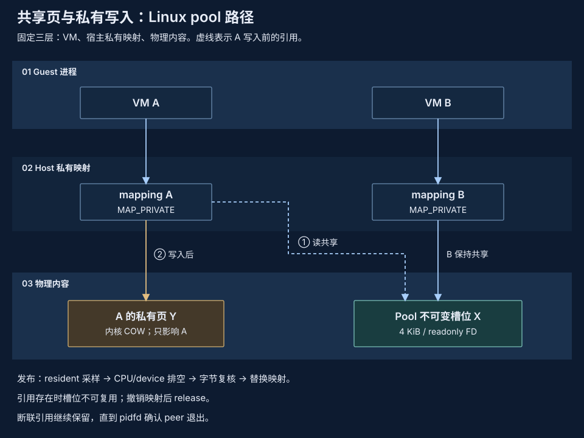

# 内存去重

跨 pVisor 实例共享相同内容，同时保持每个实例独立写入和退出。去重只消除重复副本，不压缩独特内容，也不负责保存完整机器状态。

## 架构目标 {#architecture}

优先共享已知相同的不可变 RAM 基线。运行后出现的重复私有页，通过显式选择 daemon 物理池或 Linux KSM 发现。实例负责 checkpoint 的保存、压缩和恢复，共享层不接管状态的唯一副本。公共边界见[内存优化](index.md)。

| 路线 | 共享内容 | 主要取舍 |
| --- | --- | --- |
| 不可变基线＋私有 COW | 从相同基线恢复的未修改页 | 无需扫描，但修改后共享减少 |
| Linux KSM | 内核发现的相同私有匿名页 | 不需要共享服务，但异步扫描消耗 CPU |
| Linux physical pool | 不同 VM 中相同的驻留原文页 | 扫描、slot/reference、kernel COW 与独立进程故障域 |
| 编码池内容去重 | 相同的编码冷对象 | 可以叠加压缩，但需要冷回收和恢复机制 |

编码对象去重由[池化服务器压缩](compression-pool.md)定义；Linux physical pool 共享驻留原文页，两者有不同的所有权合同。

## 不可变基线共享 {#baseline}

多个实例映射同一个 backing 对象的对应区间，以 `MAP_PRIVATE` 保持写入隔离。未修改文件页可以共享；写入由宿主 COW 私有化，不直接连接两个 VM 的可写 RAM。

压缩 checkpoint 先物化为可映射的不可变基线，再复用该基线。内容相同但 inode 不同的文件不自动共享缓存页，磁盘 reflink 也不等于内存共享。基线缓存是可再生加速层，不替代持久 checkpoint。

内容验证和不可变性是复用前提；实例持有自己的 backing 引用与租约，某实例退出或缓存淘汰不能破坏其他实例的映射。共享内容应由内核对象/存储引用维持，而不是依赖另一个实例的堆。

## Linux daemon physical pool {#physical-pool}



显式 `serve --sandbox --memory-pool` 启用 daemon 自有的原文页共享。候选只保留 hash；内容在不同 VM session 出现后才进入 bounded memfd slot。VM 在 CPU/device 排空后重新核对字节，使用只读 descriptor 和 `MAP_PRIVATE` 映射相同页。该路径不依赖 userfaultfd，不编码或压缩唯一页。

Reference pin 保护槽位到撤销映射之后，断联时等待 pidfd 确认 peer 退出再回收。Pool 是活跃共享页的 owner，丢失会使依赖 VM 失败；它不提供 durable snapshot 或进程重启恢复。预算和故障范围见[共享工作集](../daemon/shared-working-set.md)。

### 区域自适应扫描 {#adaptive-scan}

物理页 pager 借鉴 [UKSM 的区域分层设计](https://www.usenix.org/system/files/conference/fast18/fast18-xia.pdf)，
参考实现为 [dolohow/uksm 的 acb96fbc 版本](https://github.com/dolohow/uksm/tree/acb96fbc9e04e7aa967e8e9af011494c77f58aed)。
UKSM 优先扫描收益高的区域，降低频繁发生 COW 的区域的扫描量。
pVisor 用 Rust 独立实现这一调度思路。

每个合格 RAM mapping 分成最多 2 MiB 的区域。四个级别每轮分别允许探测
16、64、256、512 页，区域从最低级开始。至少采样 8 页后，成功合并比例达到
10%、且变化数低于合并数一半，可以升一级。观察到 COW、live bytes 复核失败
或共享页提前释放，均计入变化数。变化数达到合并数一半时回到最低级；
否则低收益轮次降一级。已完全共享的区域不再产生新合并，也会降低扫描量。

每个区域始终保留探索配额。带随机起点和互质步长的遍历在重复前覆盖所有页
偏移，包括不足整块的区域，无需存储逐页排列。区域之间轮转，每次最多探测
64 页；驻留查询只覆盖选中的区域，不触碰稀疏 RAM。单批最多考察 4,096 个
索引、选择 1 MiB 候选，保留 8 ms 软选择时间预算；完整轮次之间至少休息
250 ms。这些常量约束工作量，不保证任意 RAM 大小、冷却期、VM 调度或 IPC
延迟下的固定 CPU 占比或发现期限。

该策略负责 Linux 物理页的选择，不读取 guest 应用 VMA，不安装内核补丁，
也不以 UKSM 的自适应部分页哈希替代内容身份。完整哈希、逐字节比较、CPU/
设备静止窗口和第二次 live bytes 复核仍决定能否共享。压缩 pager 保留独立
的驱逐/refault 策略。

确定性测试覆盖遍历完整性、公平性、优先级变化、负载变化和元数据上限。
2026-10-18 的 Linux x86_64 双 VM 正确性探针通过：两个 guest 均完成内容、
私有写入和文件检查，日志记录了扫描、成功合并和 COW。复现命令：

```bash
cargo build --locked -p pvisor-daemon --example compressed_pool_case
PVISOR_CASE_VM_LIBRARY_DIR=/absolute/firmware \
  PVISOR_EXPERIMENTAL_MEMORY_METRICS=1 \
  target/debug/examples/compressed_pool_case /tmp/pv-scan-check --physical
```

输出路径须全新且简短。`result.json` 包含 guest 结果和扫描计数。探针使用
两个 256 MiB/单 vCPU VM，保持池存活，物理模式不要求 userfaultfd。
它不比较线性扫描或 UKSM 的性能；生产 CPU、延迟与净内存收益仍待验证。

## Linux KSM {#ksm}

KSM 对适合的私有匿名 RAM 接受 `MADV_MERGEABLE` 建议，并由内核后台扫描、合并和处理 COW。它不需要 pVisor 实例互相发现，也不需要用户态服务保管共享页。

登记成功不等于已扫描或已合并，不提供同步完成期限。实例只登记合适的区域；宿主全局扫描预算由管理员或宿主协调器管理，避免实例互相覆盖全局参数。

KSM 不合并文件 page cache；当前 `MAP_SHARED` live backing 不能只添加建议就实现去重。私有映射产生的匿名 COW 页可作为候选，具体资格与收益要按实际内核验证。macOS 没有标准 Linux KSM 能力；UKSM 作为算法参考，不成为部署依赖。

显式 `--memory-pool-mode compressed` 路径按解码后的 64 KiB 内容身份去重，
共享 sealed 压缩对象，经 userfaultfd 在本地恢复私有 RAM。其组件测试和双 VM
服务退出正确性探针与物理页共享证据分开，见[池化压缩](compression-pool.md)。

## 关键权衡 {#tradeoffs}

- **主动共享与后台发现：** 相同基线无需重新发现；动态重复内容交给 KSM，但接受扫描延迟与 CPU 成本。
- **节省与写入成本：** 高频写入会拆分共享，减少收益并增加 COW；不能只按初始共享率规划密度。
- **共享与隔离：** 限定信任域并评估内容存在性侧信道。KSM advice 没有 pVisor 自定义域参数，产品标签不能单独证明隔离。
- **简单与覆盖面：** 当前 physical pool 采用有界 resident 扫描；任意热页即时合并与 P2P 不属于交付范围。主动共享槽位与完整机器持久恢复分别设计。

同一区域首版不叠加 KSM 与用户态冷回收，避免先合并再复制压缩的重复工作。独特但可压缩的冷内容见[实例内压缩](compression-local.md)。

## 当前接入与验证基础 {#direction}

`[vm].ram_dedup` 是默认关闭的布尔字段；`--vm-ram-dedup` 启用它并选择 VM executor。runner 在 VM 启动时显式调用 `handle.advise_ram_dedup()`，将尽力而为的建议安装报告写入 stderr；建议失败不阻止 VM 继续运行。入口见 [CLI](../../reference/cli.md#vm-ram-dedup) 与[配置参考](../../reference/config.md#all-fields)。

Linux 上，普通私有匿名 RAM 与从快照恢复的私有 COW 映射可接受 `MADV_MERGEABLE`。live `MAP_SHARED` RAM 被跳过，不转换为私有或匿名映射。设备窗口、huge-page、不可写或未对齐映射被排除；活跃冷页回收或设备准备也会阻止建议。macOS 对其他条件合格的映射报告不支持。报告按映射记录接受、跳过、不支持或错误状态；`accepted_bytes` 仅统计建议被接受的区间字节数，不是已合并字节、内存节省，也不证明 KSM scanner 已启用。pVisor 不修改宿主全局 KSM 参数，不启动新服务。

`ram_dedup` 与 `vm.memory_pool`、`vm.ram_compression`、
`vm.cold_ram_compression`（[Linux 本地 live pager](compression-local.md)）及旧的 `PVISOR_EXPERIMENTAL_MEMORY_POOL` 启用方式互斥。建议保持快照基线、私有写入和各实例独立持有的 backing 引用，不接管状态的唯一副本。跨工作负载内容共享风险要求显式启用；建议不可用时保留原有映射，不承诺固定节省率或扫描期限。

当前单元测试覆盖默认关闭、配置往返、CLI 选择 executor、冲突拒绝、资格检查与部分接受报告、字节与地址不变，以及恢复 COW 的写入隔离和 backing 生命周期。测试允许真实建议不可用，不要求 scanner 运行；它们不等于生产验收，也不是合并量、节省或密度的实测证据。

[概念验证](proof-of-concept.md#correctness-evidence)保留共享基线、独立写入和引用生命周期的探针；[冷页池](proof-of-concept.md#ownership)证明的是编码对象共享，不是活跃页共享。现有映射机制和实验不能直接推导出新后端已完成生产验收。

收益比较需要纳入 COW、扫描 CPU、峰值和业务延迟；RSS 不能直接相加为唯一物理占用。Linux KSM 的能力与统计以[实际内核接口](https://docs.kernel.org/admin-guide/mm/ksm.html)为准。
