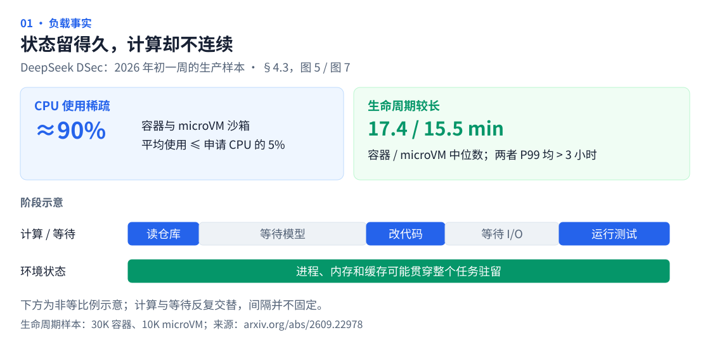
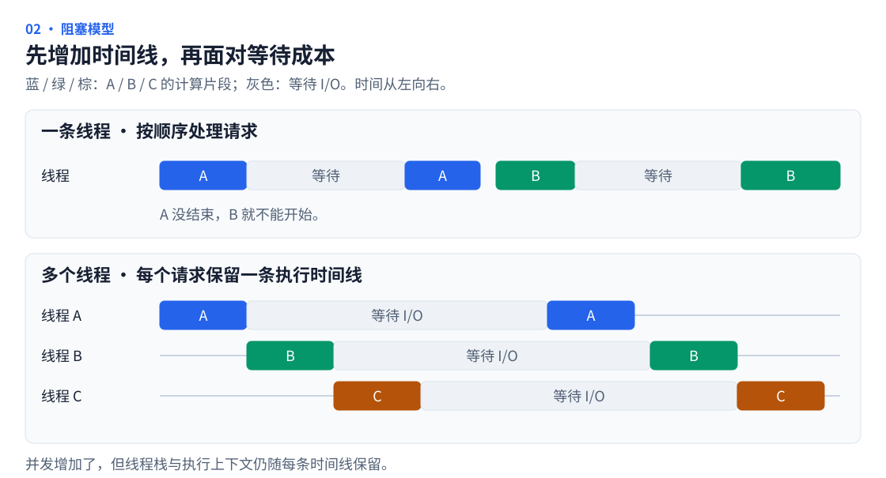
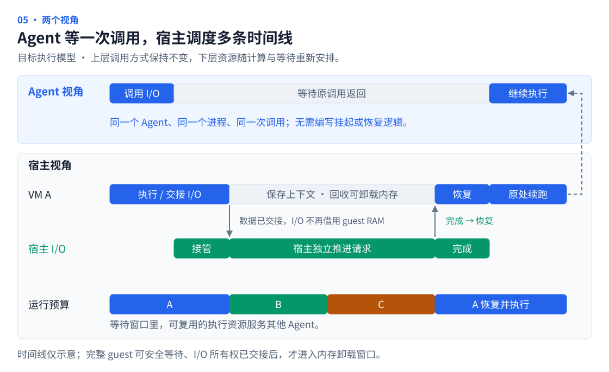

# Agent 时代为何需要 pVisor

**pVisor 要建立一种新的 Agent 执行范式：Agent 保持原有的顺序执行方式，由共享执行引擎接管可代理的 I/O，在等待期间回收资源，事件就绪后恢复原来的执行时间线。**

让自主 Agent 的执行可以规模化，需要改变资源跟随任务的方式。启动更快的沙箱是基础；更大的机会在于，让大量有状态的 Agent 可以持续推进，而不必为每条时间线始终保留一份完整的驻留环境。

## Agent 的时间线连续，资源需求却是间歇的 {#waiting-cost}

一个 Coding Agent 通常沿着自己的时间线工作：读取仓库、请求模型、修改代码、运行测试，再根据结果决定下一步。工具、子进程和后台服务可能并行运行，整个任务仍需要保留跨轮次的状态。

计算与等待在这条时间线上反复交替。等待模型回答时，推理发生在外部服务，沙箱却可能继续持有内存、缓存和进程状态。

DeepSeek 的 **DSec（DeepSeek Elastic Compute）** 报告给出了生产证据：在 2026 年初一周的样本中，约 90% 的容器和 microVM 沙箱，平均 CPU 使用量不超过申请量的 5%；生命周期中位数分别为 17.4 和 15.5 分钟，两者 P99 均超过 3 小时。报告也明确指出，沙箱会等待模型生成下一步动作，而状态和缓存仍然保留。[DSec §1、§4.3，图 5、图 7](https://arxiv.org/html/2609.22978v1#S4.SS3)



这些观察支持的是**长生命周期中的间歇性计算**。计算与等待会随交互轮次反复出现，但并不具有固定周期；上图的阶段时间线是示意，并非 DSec 的实测曲线。

任务增加以后，等待期间的驻留开销会随并发累积。**逻辑上的持续执行，不必对应物理资源的持续占用。** 需要优化的单位，因此是 Agent 从拿到环境到交付结果的完整生命周期。

## 从 I/O 执行模型看这次转变 {#io-models}

高并发服务器经历过类似的资源组织变化。一条线程按顺序处理请求时，一个请求等待 I/O，会推迟后续请求。为每个连接安排一个线程，就能保留顺序写法并让多条时间线并发；但大量连接等待 I/O 时，线程栈和执行上下文仍然存在。



事件驱动把等待集中起来，让较少的线程处理大量连接。Reactor 常用 epoll 等就绪通知，Proactor 围绕异步完成组织执行，IOCP 则提供完成通知与并发处理机制。直接采用这些模型，往往需要把顺序代码拆成状态机或回调，开发者也要管理更多执行状态。[epoll](https://man7.org/linux/man-pages/man7/epoll.7.html)、[IOCP](https://learn.microsoft.com/en-us/windows/win32/fileio/i-o-completion-ports)

透明协程进一步把这种改造集中到运行时：程序继续按顺序表达逻辑，运行时通过系统调用挂钩或标准库适配，把支持的阻塞 I/O 交给事件引擎；等待时挂起协程，就绪后从原来的调用位置继续。例如 libco 通过 socket 函数挂钩和 epoll / kqueue，让业务保留同步写法、异步执行。[libco](https://github.com/Tencent/libco)、[Go 的运行时调度](https://go.dev/doc/faq#goroutines)


图中用一个工作线程说明复用关系，实际可以扩展为多个。Reactor 通知“可以尝试读写”，Proactor 通知“已提交的操作完成”；协程则让应用不必直接围绕这些事件拆分状态。这里的透明，是在已适配的 I/O 上保留调用语义，并不意味着任意多线程程序都能自动、无损地迁移。

**pVisor 希望把这种转变带到 Agent 执行层。** Agent 继续使用已有的代码和 Linux 工具，执行引擎负责把可接管的等待转成事件驱动的推进与恢复。适配工作集中在运行时，无须让每个 Agent 都重写自己的并发结构。

## 用虚拟机承载 Agent 的执行上下文 {#agent-iocp}

沿着协程的思路，pVisor 把调度单位扩展到整个 Agent 执行环境。协程保存调用栈和局部变量；VM 则承载 Agent 的进程、内存与 Linux 内核状态，让运行时能够在应用之外保存和恢复它的执行上下文。


**Agent 无感，意味着它继续运行原来的代码、使用原来的 Linux 工具、发起原来的调用。** 文件和网络 I/O 经过 Linux 与虚拟设备进入宿主，pVisor 在已适配的设备与协议路径接管请求。对 guest 内核、VMM 和宿主服务的改造集中在这一层，Agent 无需改写成异步程序，也无需调用专用的挂起、卸载或恢复接口。[VM 执行路径](../design/vm-runtime.md)

## Agent 看到连续执行，宿主按事件调度 {#execution-path}

以一次可代理的模型请求为例：Agent 发起请求后照常等待。pVisor 将请求交给宿主推进，在整个 guest 可以安全等待时保存上下文、回收可卸载内存，让可复用的资源服务其他 Agent。响应到达后，pVisor 恢复这份上下文，让原来的调用返回，Agent 接着处理结果。



这相当于把多条 Agent 时间线交给一个共享执行引擎：**Agent 保留自己的逻辑进度，pVisor 安排它何时占用物理资源。** 恢复后继续的是同一个进程与同一次执行；VM 保存跨越等待所需的机器上下文，宿主保存等待期间仍须推进的 I/O 状态。

透明性的边界是原有调用语义：结果、错误、文件顺序和同步要求都要保留。宿主必须先持有独立的请求和数据，才能解除 I/O 对 guest RAM 的依赖；模型请求还需要协议适配，普通 TCP 转发无法自动接管 guest 内的 TLS 会话。后台仍有可运行工作时，guest 继续执行。

大批量写入也需要这种所有权转移。宿主取得独立的待写数据后，可以负责排队、合并和落盘；在保留写入顺序、错误及同步语义的前提下，当整个 guest 只剩对这些操作的等待，就有机会卸载它。**用较小的宿主缓冲，换回更大的 guest 驻留内存，是大规模异步化值得攻关的原因。** 队列背压、同步操作和仍在运行的后台任务都会影响可卸载窗口，缓冲本身也必须计入资源成本。[Agent I/O 完成机制](../design/experimental/agent-io-completion/index.md)

阻塞的 vCPU 本来就允许宿主调度其他工作。这里进一步追求的容量收益，主要来自回收等待中的 guest 仍然持有的物理内存。

## 容量收益可以先算清楚 {#capacity-estimate}

**对于等待占比较高、承载量受内存限制的 Agent 负载，可以把约 2 倍的稳态承载能力作为立项目标，高等待情景上探约 2.7 倍。** 这个目标来自公开原型、现有卸载测量与明确的参数假设；完整 I/O 接管路径尚未测得这样的生产容量。

### 公开结果与现有测量分别支持什么 {#capacity-evidence}

| 证据 | 实际观察 | 对测算的作用与边界 |
|---|---|---|
| [The Cost of Dynamic Reasoning，v2，§IV-A、图 5](https://arxiv.org/html/2506.04301v2#S4.SS1) | 四类 benchmark、多种 Agent 工作流中，LLM 推理平均占总延迟 69.4%，工具执行占 30.2%；默认模型为 Llama-3.1-8B，使用 vLLM 0.6.6 | 支持模型阶段可能占据多数时间；LLM 阶段仍可能与工具重叠，不能直接当作整个 guest 的可卸载比例 |
| [AgentSysBench，v1，§8.3、图 25(c,d)](https://arxiv.org/html/2608.15127v1#S8.SS3) | Mini-SWE 原型在模型规划调用超过固定时间阈值后卸载 sandbox，下一工具步骤前恢复；平均／峰值驻留内存降至基线的 1/4.6、1/2.1，延迟增加不超过 0.5% | 直接支持等待期卸载的收益潜力；指标是该次运行中全部并发 sandbox 进程的合计驻留内存，尚未证明整节点密度或整 VM 卸载 |
| [pVisor 历史静态内存测量](https://github.com/DeepLink-org/pvisor/blob/main/benchmark.new/memory/README.md#published-curves-and-archived-history)及其归档读数 | Linux x86_64/KVM，512 MiB guest、64 MiB 应用工作集；完整产品进程 PSS 约 179–181 MiB → 36 MiB，下降约 80%；含缓存的产品组 cgroup 约 224 MiB → 19 MiB | 给卸载后残留量提供参考；每条件 N=1、5 秒窗口，属于历史批次，不能代替真实 Agent 或整节点容量测量 |

AgentSysBench 未披露该卸载实验的阈值数值、并发数和底层卸载机制，适合作为方向证据。pVisor 的 PSS 与 cgroup 是不同口径，不能相加，也都不能直接替代整节点净回收量。

负载差异同样有公开证据。[AgentCgroup，v2，§3.2](https://arxiv.org/html/2602.09345v2#S3.SS2) 的 SWE-rebench 实验中，LLM 推理仅占端到端时间的 26–44%，其余包含工具执行与初始化。因此，可卸载比例需要按目标负载设定；DSec 的低平均 CPU 使用率也不能换算成“95% 的时间可以卸载”。

### 从可卸载窗口推导承载量 {#capacity-model}

先选定同一种负载和同一种物理内存计量口径，定义四个量：

- `m0`：原方案每个 Agent 的平均驻留内存，使用实际物理占用，不使用 guest 配置容量。
- `f`：有效卸载窗口所覆盖的原有“内存 × 时间”份额。原驻留近似不变时，它就是可安全卸载的时间占比；后台工作、未接管的 I/O、短等待及卸载和恢复过程均须扣除。
- `r`：有效窗口内实际释放的原驻留比例，按窗口内原驻留的“内存 × 时间”加权；卸载后的 VM 残留已在这里扣除。
- `h`：新增宿主驻留的全程平均值除以 `m0`，包含请求／响应缓冲、完成队列、未映射页缓存及交接时的额外副本。固定共享服务单独计入节点预算。

在可比观察窗口内，模型为：

```text
m1 / m0 = 1 - f * r + h
K_memory = m0 / m1 = 1 / (1 - f * r + h)
```

采用 `r = 80%` 作为参考假设，并为新增宿主驻留设定 `h = 5%` 的预算目标，可得到下面三档情景。**这些是参数假设与算术结果，尚非 pVisor 的 Agent 容量实测。**

| 情景 | 有效卸载份额 f | 窗口内回收比例 r | 新增宿主开销 h | 新平均驻留 m1 / m0 | 内存受限的稳态承载倍率 |
|---|---:|---:|---:|---:|---:|
| 保守 | 40% | 80% | 5% | 73% | 1.37 倍 |
| 中性目标负载 | 70% | 80% | 5% | 49% | 2.04 倍 |
| 高等待负载 | 85% | 80% | 5% | 37% | 2.70 倍 |

例如中性情景是 `1 - 70% × 80% + 5% = 49%`。若原来每个 Agent 平均占用 1 GiB，相同口径下预计变为约 0.49 GiB。扣除系统、共享引擎与恢复余量后，同样的 100 GiB Agent 内存预算，对应约 100 → 204 个执行上下文的平均驻留预算。

`f = 70%` 已经要求大部分相关等待都能安全接管；它不是把公开研究的 69.4% 四舍五入得到的实测参数。`r = 80%` 借鉴小工作集卸载的量级，实际还受工作集、共享和缓存影响。`h = 5%` 则是待实现验证的预算：对于 1 GiB 原驻留，它允许平均新增约 51 MiB；原驻留较小或同时积压大量响应时，需要重新估算。

宿主缓冲值得投入多少内存，也可以用这个模型判断。固定 `f = 70%`、`r = 80%`，若 `h` 从 5% 增至 15% 或 30%，倍率会从 2.04 降到 1.69 或 1.35。现有实验性宿主写缓存的单连接 payload 上限为 64 MiB，上限并不等于平均占用；多连接、元数据与响应暂存仍要共同受预算约束。[缓冲预算与当前限制](../design/experimental/agent-io-completion/index.md)

### 把恢复和峰值计入成本 {#capacity-limits}

节点上的平均驻留规划量可写为：

```text
N_memory = floor((R_node - S_fixed - P_headroom) / m)
```

`S_fixed` 包含系统和共享服务，`P_headroom` 为活动峰值、同时恢复及临时复制保留空间。前后的可用预算相同时，才得到表中的倍率；共享引擎或恢复余量增加时，还要乘以前后可用预算之比。等待阶段错开、恢复准入和硬预算共同决定实际可部署容量。

卸载与恢复也会增加任务时间。现有同一历史静态批次中，raw 卸载操作为约 44–98 ms；随后包含恢复、64 MiB 数据摘要及写入／fsync／读回校验的完整任务，相比不卸载增加约 156–178 ms。这是后台编译环境中的单次观察差值，不是独立 resume 延迟或尾延迟保证。[计时定义与数据](https://github.com/DeepLink-org/pvisor/blob/main/benchmark.new/memory/README.md#published-curves-and-archived-history)

若端到端任务时间增加比例为 `delta`，分别按原方案与新方案的完整任务计算平均驻留，每次完成任务的内存时间成本比例为：

```text
C_memory_time_new / C_memory_time_old = (m1 / m0) * (1 + delta)
```

`m1` 必须包含恢复和排队期间的驻留；延迟改变阶段占比时，需要重新计算 `f`、`r`、`h`。例如再假设中性情景的全程平均驻留比仍为 49%，任务慢 5%，成本比例为 `49% × 1.05 = 51.45%`，约节省 48.6% 的内存时间。这只估算 Agent 执行侧的内存成本；节点数能否同比减少，还取决于 CPU、存储、网络和模型配额等约束，模型 token 费用另计。

恢复带宽也要满足“每秒唤醒次数 × 每次实际读回字节数 ≤ 可用恢复带宽”，卸载写出有同样约束。集中完成的 I/O 需要排队恢复，排队延迟进入端到端统计。因此，稳态承载倍率、任务吞吐与恢复尾延迟需要分别报告。

### 与已有 VM 优化如何比较 {#vm-baseline}

现成的 VM 路线本身也有内存优化。DSec 在真实 agentic-RL 负载上，使用 virtio-pmem + DAX 使宿主峰值内存降低 40.2%；DAMON + balloon 空闲页报告单独使时间积分内存降低 21.2%，峰值基本不变。[DSec，v1，§8.4、图 12](https://arxiv.org/html/2609.22978v1#S8.SS4)

这些机制分别减少重复缓存和空闲页；pVisor 的核心攻关，是让宿主接管仍需推进的 I/O，从而扩大整个 guest 可卸载的有效窗口 `f`，同时控制新增开销 `h`。microVM 可以提供底层暂停、卸载和恢复原语，这条路径还需要 I/O 所有权转移、完成事件与恢复调度。

后续对照需要保留已有共享与回收能力，在同硬件、同镜像、同负载、同正确性与延迟约束下比较增量收益。DSec 的两项收益、pVisor 的静态卸载比例和上面的容量估算，各自有不同基线，不能直接相加或相乘。

## 从一次透明等待跑通整条路径 {#validation}

第一步是选定一种 I/O，让“接管请求 → 安全卸载 → 宿主继续推进 → 事件唤醒 → 原调用返回”形成闭环，再扩展到流式响应和更多工具。验证同时看调用语义是否保持，以及计入宿主缓冲、卸载和恢复成本后，固定资源能否支撑更多有效执行。

原型需要逐项收敛已有测算中的假设：

| 需要记录的数据 | 用来确认什么 |
|---|---|
| 原方案的驻留曲线、共享服务与整节点缓存 | `m0` 和实际可用节点预算；共享页面只计一次 |
| I/O 交接、RAM 引用排空、实际回收、开始恢复的时间 | 有效窗口 `f`；转换过程不计为已回收时间 |
| 卸载残留、宿主缓冲、队列、页缓存及临时副本 | 原驻留释放比例 `r` 与新增开销 `h`，避免内存只是换了位置 |
| 同时唤醒数、读写字节、活动／恢复峰值和恢复至首次有效执行的延迟分布 | 恢复余量、带宽及排队是否允许预计承载量；尾延迟需要足够样本 |
| 原调用的输出、错误、顺序、同步、取消，以及任务完成数和端到端延迟 | 增加的执行上下文能否保持正确并完成有效工作 |

现有基础包括受控文件与网络路径、暂停与内存卸载原语，以及实验性的宿主写缓存；自动识别等待、接管 I/O、完成唤醒与恢复调度仍需贯通验证。两图展示的是这一目标机制。[等待与卸载实验](../design/experimental/vcpu-idle-offload/index.md)、[Agent I/O 完成机制](../design/experimental/agent-io-completion/index.md)

**pVisor 要让 Agent 像使用透明协程那样，保留熟悉的执行方式，由运行时把等待转化为资源共享的机会。虚拟机提供承载这次转变的上下文与控制边界。**
