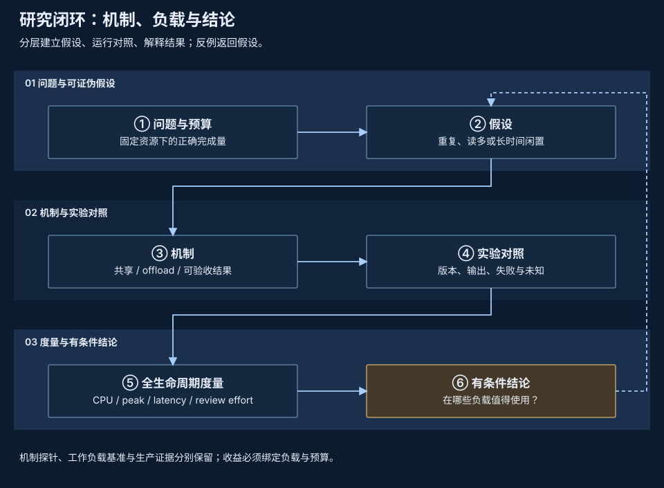
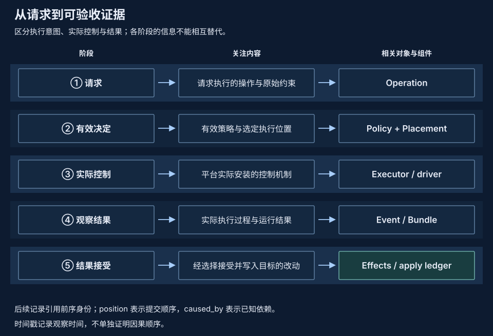

# 研究方向

OS 与 MLSys 研究关注固定资源下的正确任务完成量，以及人类处理这些结果的成本。pVisor 提供执行、状态与证据的机制；外部编排和训练器把它们组合成工作负载，再用对照实验判断收益。从环境准备、工具运行、模型等待与失败重做的成本出发的完整叙事见[Agent 任务的生命周期成本](agent-lifecycle-cost.md)。

## 从机制到可证伪结论 {#research-loop}

一个有用的假设应写出适用负载和反例。例如，相同基线、读多的 VM 可能从共享页受益；高比例私有写入会减少共享，扫描和 COW 峰值可能抵消 ready 阶段的节省。实验同时固定正确输出与预算，结论报告适用范围。

## 执行与编排的所有权 {#ownership}

pVisor 拥有单次执行的边界与观察；单节点 daemon 拥有本机 sandbox 归属与生命周期。外部编排（Kubernetes、Ray 或训练框架）拥有主机选择、队列、依赖与业务重试；训练器拥有模型、采样、奖励和评估器版本。pVisor 不用分布式产品控制面替代它们。

[Daemon API](../daemon/index.md) 尚未暴露原生 Job 暂存、execution checkpoint 和 Run Bundle 导出，因此研究接入需要显式的执行／证据交接。各层的当前职责与待验证项：

| 层 | 当前职责 | 待集成／验证 |
| --- | --- | --- |
| 原生 pVisor 执行 | Job 生命周期、执行器控制、暂存、可选 Gateway 与记录 | 编排适配器和代表性工作负载验收 |
| Sandbox daemon | NativeRuntime VM 准入、持久 supervisor 归属、生命周期与真实服务代理 | Bootstrap 提供／验证与 SDK profile；没有 stage/checkpoint API 或密度证据 |
| 原生 node 资源 | 本机不可变所有权、pin 与有界 warming | Daemon 接入、完整瞬时记账和工作负载测量 |
| 外部编排 | 主机选择、队列、依赖、重试与租户 | 显式执行／证据交接及业务副作用核对 |
| 证据／检查点仓库 | 原生完整性、发布与保留合同 | 集中收集、授权、复制与跨主机兼容性 |

本机记录路径或上传 JSON 不代表完整文件传输；检查点可下载不证明任意主机兼容恢复。早期 Controller/Worker 实现的归档测量保留历史范围，不描述当前 daemon。

## 三类状态、三个评价对象 {#state}

| 状态 | 保留的内容 | 独立评价对象 |
| --- | --- | --- |
| 文件 checkpoint | 候选文件、冲突基线、来源关系 | 分支隔离、合入正确性、copy-up 与存储成本 |
| Agent 轨迹 | 模型上下文与工具历史 | 前缀准备、工具重执行差异、模型续跑 |
| VM execution checkpoint | 支持 profile 的 CPU/RAM/设备/文件状态 | 一致性、兼容性、恢复与分叉成本 |

工具重执行产生 fresh observation，远程服务状态和训练 metadata 另行保存。执行成功、任务 reward 和文件接受分别判定：reward 由 evaluator 计算，pVisor 的成功结束只是执行结果。

## 一次 rollout 的执行契约 {#rollout-contract}

输入包含 task ID、attempt ID、仓库提交或镜像摘要、工作区、Agent 命令、策略、资源预算与随机种子；输出包含结束状态、退出码、文件候选、Run Bundle、原生轨迹，以及启用捕获时的 Gateway Journal。训练器把这些产物与模型版本、采样参数、reward 和 evaluator 版本关联。环境准备失败、权限拒绝和上游请求失败有自己的类别；评价模型解题能力时，按预先确定的规则处理这些基础设施失败。

最小集成顺序：先按 [rollout 指南](../../guides/rl-rollouts.md) 完成一个离线任务的候选收集与评分；再用独立工作区增加并发，确保每个 attempt 的文件和记录相互独立；最后接入原生 Agent 轨迹，分别验证前缀准备、工具重执行和模型续跑。回放工具会产生新观察，replay 的新观察与旧会话文字不能简单视为相同实验输入。

需要实验证明的部分：每秒完成的 rollout、尾延迟、每个候选的磁盘与驻留内存、fork/checkpoint 成本、工具重执行成本和 reward delta。固定模型服务容量，区分执行底座与模型服务瓶颈。异步队列、跨节点容错、奖励去重、共享前缀收益和大规模采样尚需集成与测量。

## 评价收益的证据层次 {#evidence}

- **机制证据：** 验证字节、映射、写入隔离、引用与失败状态。
- **工作负载证据：** 固定任务、输入、输出检查、模型容量与总资源，记录正确完成量、首次结果、恢复长尾、CPU、peak 和 memory-time。
- **产品证据：** 包含准备、SDK、guest 服务、回收、长期并发与故障波及范围。
- **监督证据：** 记录实际审查时间、拒绝与返工；machine CPU 成本不代替人类注意力。

原生 pool 或 offload 探针不能单独建立完整 daemon 密度。外部编排和 RL 适配仍在研究／规划阶段，收益需要各自工作负载验证；注入主机丢失、daemon／编排停机、分区、磁盘满等故障时，超时或控制身份不证明外部副作用停止，重试策略必须核对未知副作用。该方向不建立跨主机恢复、恰好一次外部副作用或 daemon 密度优势。

## 研究问题 {#questions}

- 执行与编排之间怎样的最小交接能保留请求策略、实际控制、观察结果和完整证据？
- 哪些保留输入与运行时兼容检查让恢复可移植，哪些副作用需要业务核对而非 replay？
- 在固定正确性与审计覆盖下，批量评审节省多少监督成本，包括收集与存储成本？
- 在相同总资源下，不可变共享或有界按需加载能否改善首个有效结果和完整完成？

研究计划不创建产品调度器，也不替代生产验收。

## 公开材料与写作参考 {#references}

当前没有登记的正式论文、外部报告或演讲；公开技术材料就是仓库中的设计文档与基准证据（如[回放保真度](../../benchmarks/replay-fidelity.md)），引用时带上报告日期、机器、执行器、任务和统计口径。设计文档的写作方式与开源项目表达参考维护在仓库的 [docs/README.md](https://github.com/DeepLink-org/pvisor/blob/main/docs/README.md)，不在这里重复。
