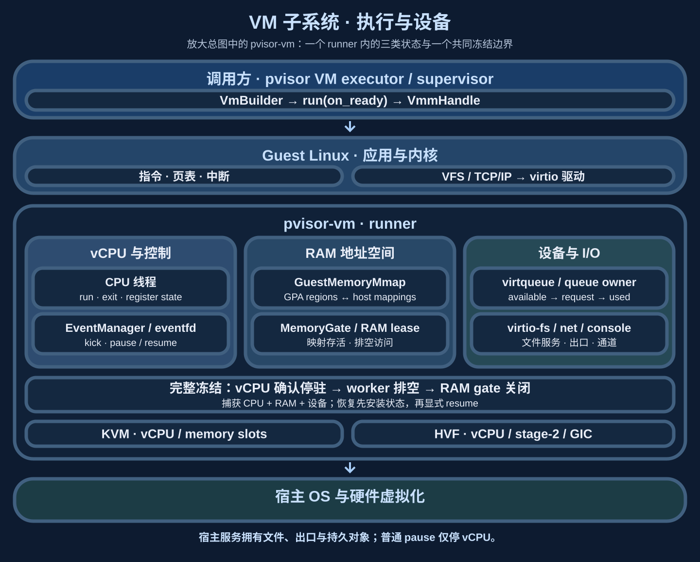

# VM 子系统：执行、设备与一致性

`pvisor-vm` 管理 guest 的 CPU、内存和虚拟设备，并协调它们的运行、暂停与状态恢复。这里的一致性要求 CPU、RAM 与设备状态相互对应，避免捕获或恢复时混入不同执行时刻的状态。

上层 Runtime 准备文件、网络与存储资源，监督 runner，并负责 Attempt 的收尾和结果发布。不同执行环境的隔离边界见[隔离机制](isolation.md)。

## 组成与资源归属 {#architecture}

vCPU 执行 guest 指令，RAM 映射承载 guest 地址空间，虚拟设备连接 guest 与 Host 服务。平台后端将执行接到 Linux KVM 或 macOS Hypervisor.framework；统一的 Rust API 不代表各平台能力完全相同。

| 管理主体 | 主要职责 |
| --- | --- |
| 调用方／supervisor | 准备宿主资源，监管和终止 runner，负责存储租约及持久发布。 |
| VMM | 管理 vCPU、RAM 和设备，协调控制请求与机器状态迁移。 |
| guest 内核与 supervisor | 运行工具、管理 guest 内进程，通过虚拟设备访问 Host 提供的资源。 |

`VmBuilder` 用于配置和启动，`VmmHandle` 用于控制运行中的 VM。Handle 持有弱引用，不延长 VM 生命周期；VM 结束后控制失败。

??? info "接口与线程所有权"

    | 所有者 | 持有的状态 | 边界 |
    | --- | --- | --- |
    | 调用方 / supervisor | runner 进程、宿主隔离、传入 FD、文件与网络服务、存储租约 | 负责准备、监督、终止和持久发布 |
    | `VmBuilder` | CPU/RAM、内核、设备及启动配置 | `run` 消费 builder，进入 runner 事件循环 |
    | 私有 `Vmm` | vCPU handles、guest memory、设备总线、控制状态与 RAM gate | 协调机器状态迁移，内部状态不越过 `api` |
    | vCPU / 设备线程 | CPU 状态、队列、请求缓冲区与 RAM lease | 在确认边界交回控制或所有权 |
    | `VmmHandle` | 对运行中 VM 的弱引用和控制入口 | handle 不延长 VM 生命周期；VM 结束后控制失败 |

    公开入口集中在 `pvisor_vm::api`：trait 声明配置、运行、控制和快照契约，私有模块负责方法实现、资源管理和平台分派。调用方显式导入需要的 trait，不访问 backend、VMM 或设备内部字段。

??? info "执行环境差异"

    Host 进程与 OCI 容器使用宿主内核，容器通过 namespace、资源控制和 Runtime 配置形成边界；VM 工具使用 guest 内核。Host 上的代理环境变量需要程序配合，受控 VM 虚拟网卡则提供统一出口；VM 同时引入 guest RAM、设备处理和启动成本。具体控制依执行器和平台而定，见[隔离机制](isolation.md)。

## 从配置到运行 {#boot}

1. 调用方解析执行配置，准备 rootfs、导出树、网络通道和可信固件输入，并在专用 runner 中构造 `VmBuilder`。
2. builder 建立 guest RAM 区域、内核与启动参数，安装所选虚拟设备，交给平台后端注册内存和创建 vCPU。
3. `VmRuntime::run(self, on_ready)` 消费配置，在 VM 可控制时向回调交付 `VmmHandle`。回调应及时返回，让事件循环推进；这个函数的返回值是运行结果，不是 handle。
4. vCPU 进入硬件虚拟化执行。需要宿主处理的 VM exit、设备通知、中断和控制请求，由相应 CPU 线程或事件循环处理。
5. guest 的 `pvisor-guest` supervisor 负责 guest 内启动与进程环境；宿主 Session 继续拥有整个 Attempt 的收尾和结果发布。

`run` 为专用 runner 设计，正常 guest 关机路径会结束该进程；初始化失败通过错误返回。外部服务不能把它当作任意应用线程里的无副作用函数。调用方负责 runner 消失时的归属核对和资源清理，具体身份关系见[执行模型](execution-model.md)。

## guest 与 Host 的 I/O 协作 {#execution}

普通 guest 指令与大部分系统调用在 guest 内执行。一次 guest `read` 只有在导出文件树需要后端 I/O 时才到 virtio-fs；guest 内存页命中、tmpfs 或 procfs 操作可由 guest 自己完成。网络连接通过 guest TCP/IP 和 virtio-net 进入宿主出口。

以一次需要 Host 后端读取的文件请求为例：guest 工具调用文件接口，virtio-fs 驱动提交请求，Host 设备调用文件服务取得内容，再将结果写回 guest 缓冲区并通知完成。

vCPU 线程负责执行 guest 指令并处理 VM exit；设备可能等待文件、socket 或 worker 的 I/O；事件循环协调设备通知与控制请求。它们可以独立推进，因此设备处理并不总与 guest 指令执行同步。

guest 驱动将请求和响应缓冲区放进 RAM，把 GPA、长度与方向写入 descriptor chain，再发布 available 条目并通知设备。宿主必须校验这些范围，才能把 GPA 转成可访问的宿主映射。请求完成后，queue owner 写回响应并发布 used 条目，guest 才能重用对应缓冲区。 校验包括 guest 地址是否落在允许的 RAM 范围内、长度是否溢出，以及缓冲区读写方向是否正确。

## 设备访问与内存有效性 {#virtio}

RAM lease 保护设备访问 guest 内存所依赖的映射。普通请求在访问缓冲区及发布完成信息期间持有 lease，保证相关映射持续有效；结果写回后，设备发布 used 条目，通知 guest 请求已经完成，可以重用缓冲区。

RAM gate 管理设备能否取得新的内存访问权。关闭入口并等待已有 lease 释放，才能形成没有设备访问 RAM 的窗口；具体关闭与排空顺序由对应的状态操作决定。

受支持的 Host 后端 READ 和合格只读 OPEN 路径可以暂时脱离 guest 缓冲区，由 Host 持有请求与结果；后端完成后先通知恢复协调逻辑，再重新取得内存访问权并写回。这为满足条件时卸载内存提供机会，但释放 lease 本身并不意味着可以立即 Offload，也不能推广到所有请求或写入路径。

??? info "Virtio 队列与并发实现"

    virtio-fs 目前保留一个普通 request queue 和一个 hiprio queue。可重叠的大 READ 与目录读取交给有界 blocking I/O worker，短请求和需要串行的修改由队列 owner 处理。worker 返回结果，owner 独占 available/used ring 更新；并发 I/O 不改变 ring 的所有权。

## 暂停、卸载与状态恢复 {#freeze}

暂停 vCPU 只停止 guest 指令执行，Host 设备仍可能处理请求。完整状态捕获还必须让设备和内存访问到达一致边界；普通 Pause、快照冻结与 Restore 因此具有不同条件。

| 操作 | 目的 | 关键边界 |
| --- | --- | --- |
| Pause | 停止 guest 指令执行 | 确认 vCPU 停驻，设备仍可能访问 RAM。 |
| Offload | 减少同一存活 VM 的驻留内存 | 停止 CPU 写入，关闭并排空设备 memory gate，保存 RAM 内容并请求回收；不创建完整检查点。 |
| 完整快照冻结 | 建立一致状态捕获窗口 | 协调 vCPU、设备队列与 RAM 访问，并结合捕获范围内的文件状态。 |
| 检查点恢复 | 恢复已保存的执行状态 | 校验并安装映射、CPU、设备和文件状态，保持暂停，成功后再显式 resume。 |

Offload 与完整冻结具有部分共同的安全条件，但目的与完成条件不同，不是固定的先后步骤。下面展开完整快照冻结的协调过程。

冻结按 **vCPU 确认 → 设备排空 → RAM gate 关闭** 推进。排空期间必须允许已有完成路径前进，不能提前关闭它们所需的 RAM 访问。`VmmHandle` 的控制事务串行化状态迁移；等待 worker 时释放 VMM 锁，让设备收尾有机会执行。

冻结超时或控制状态失败时，调用方必须终止失败 runner，不能让未知设备状态与 guest 并发恢复。完整快照还需要捕获范围内的文件系统和兼容性绑定；对端网络不会随本地 RAM 回退，所以当前原生 Job execution profile 排除网络设备。持久发布与恢复契约由[环境快照](environment-snapshot.md)维护。

Offload 用于回收同一存活 VM 的驻留内存，也需要停止 CPU 写入并关闭、排空设备 memory gate，但不等同于创建完整检查点。仅有 RAM backing 不能在 VMM 退出后恢复执行，具体条件见[内存卸载](memory-optimization/offload.md)。

冻结或 reset 会停止接收新请求，排空已接受的工作、回填结果并等待 worker 结束。thaw／restore 主动检查 available ring，不依赖此前的 guest kick；尚未完成的 Host I/O 不作为可重放请求保存进机器快照。

??? info "控制与平台支持边界"

    设备类型与平台能力决定支持哪些状态捕获。当前没有统一的虚拟硬件热插拔承诺；实验性 vCPU 观测本身只提供显式启用的数据，不自动触发 Offload，不代表其他生命周期管理路径没有主动卸载能力。

## 与上层系统的协作 {#integration}

VM 承担机器状态的唯一所有权，上层仍决定这次 Attempt 的文件、网络、存储与失败处置。内存优化必须经过 VM 的一致性边界；文件系统和网络服务不得自行保存 guest 裸指针；snapshot store 固定对象并发布可恢复状态。这个拆分让宿主存储和服务能够演进，同时保持 guest 地址空间与队列生命周期集中管理。

这里连接了三个专题：[内存子系统](memory-optimization/index.md)定义映射与恢复来源，[文件系统](overlayfs.md#filesystem-service)解释请求如何查找 lower 或修改 upper，[网络](overlaynet.md#vm-request-path)解释 Ethernet frame 如何变成受控宿主连接。它们共享设备/RAM 生命周期，但保留各自的业务状态。

| 源码入口（相对 `crates/pvisor-vm/src/`） | 重点 |
| --- | --- |
| `api.rs`、`builder.rs` | 配置、ready 回调、资源与平台契约 |
| `vmm/mod.rs`、`handle.rs` | VMM 状态、控制事务和冻结顺序 |
| `backend.rs`、`vmm/linux/vstate.rs`、`hvf/` | KVM/HVF 适配与 CPU 执行 |
| `devices/virtio/fs/worker.rs` | 请求分派、I/O worker、队列收尾 |
| `devices/virtio/memory_gate.rs`、`devices/snapshot.rs` | RAM lease、设备冻结和恢复拓扑 |
