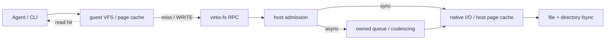
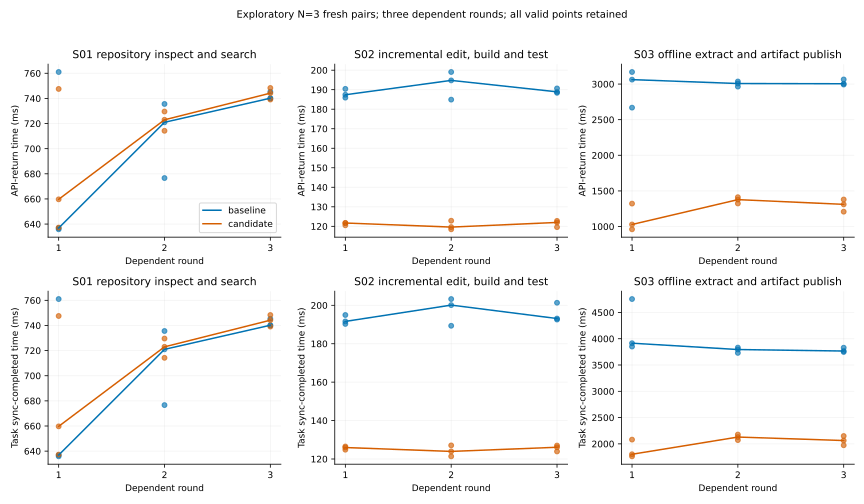
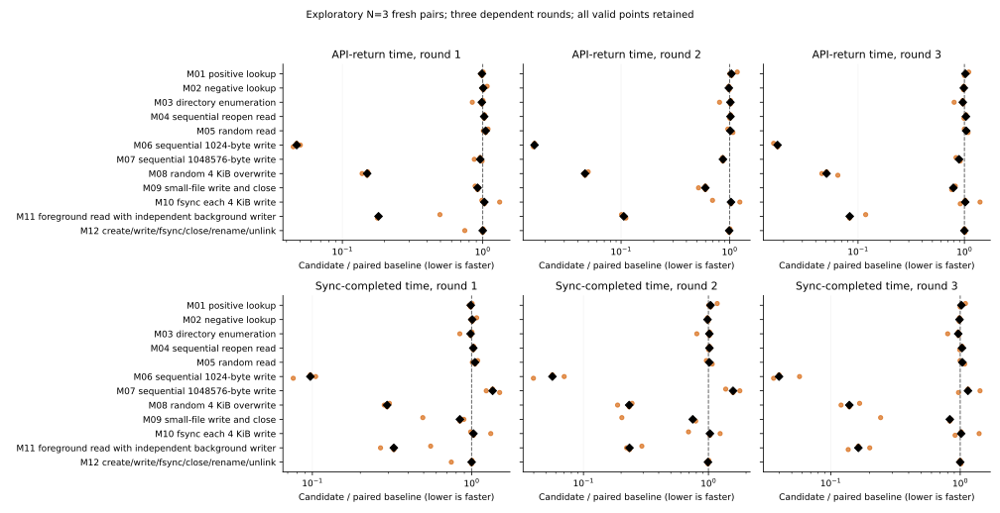
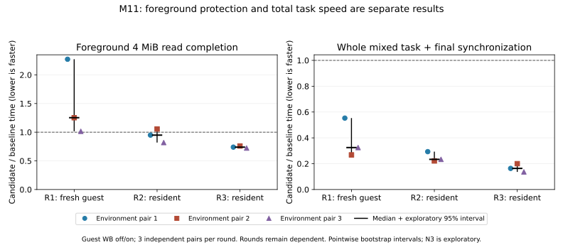
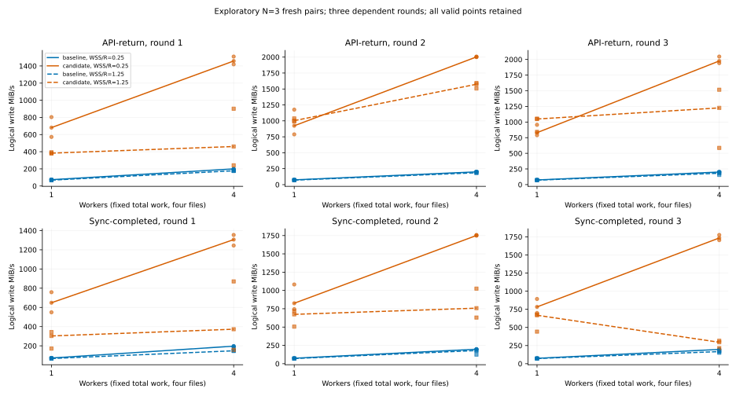
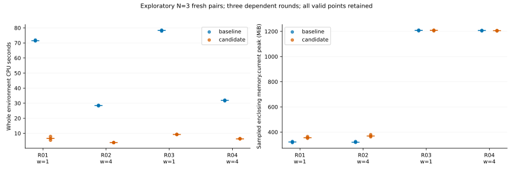
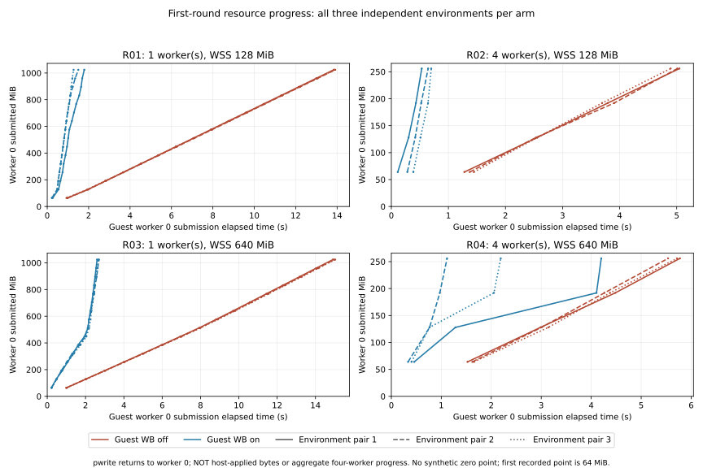

# 文件系统 I/O：缓存、异步合批与完成吞吐

> 注：文中「本地原始记录」及 `.data/` 路径指向测量时的本地归档，未随仓库或站点发布，仅用于批次溯源。

## 主要结论 {#conclusions}

### 1. 顶层判断：两项写密集任务更快，收益已有完整任务证据

**guest WB使增量修改—构建—执行校验任务的同步完成时间下降36.3%，离线解包—生成产物—发布下降48.6%；源码巡检未检出改善。** 19个分层锚点全部完成，114个环境、342条轮记录、零失败。结果来自SDK路径每case N3配对、内部三轮的浅度探索，不合成任意总分，也不外推普通CLI启动或所有Agent任务。

### 2. 原因与证据：小写合并兑现收益，完成同步和读干扰决定边界

**guest内部合并确实减少了跨边界请求。** 独立N1诊断中，1 KiB连续写的WRITE由12,288降至19，协议写字节仍为12 MiB；对应正式同步完成时间下降93.5%。离线发布的WRITE由101,779降至5,599，但协议字节增加约1.2%，收益不能解释成单纯减少数据量。

**请求更少也可能更慢。** 已用1 MiB请求的连续写，WRITE仍为12→12，完成时间增加39.0%。四worker工作集从128增至640 MiB时，WB收益从87.6%缩至56.3%，候选最终同步占比从11.9%升至49.2%；更大工作集还保留5倍字节，现有数据尚不能把退化单独归因于guest缓存容量、回收或物理I/O。

### 3. 分项判断：完成吞吐与前台响应须分别看

| 范围 | 观察结果 | 含义 |
| --- | --- | --- |
| 增量构建 / 离线发布 | 同步完成时间下降36.3% / 48.6% | 收益已进入两个完整本地任务，均保留同步与校验 |
| 1 KiB / 1 MiB连续写 | 下降93.5% / 增加39.0% | 原请求粒度决定合并空间；大请求的附加成本仍需定位 |
| 混合读写M11 | 三轮累计完成时间下降76.7%，首轮前台读却增加25.3% | 总吞吐改善不能替代读响应改善；两项数字的轮次范围不同 |
| 小文件M09 | 完成时间下降17.7%，WRITE仍768→768 | 三对差异很大，不能归因为跨文件写合并 |

完整[分层结果与曲线](#workload-v2-results)保留全部19点及N3探索性区间，未校正多重比较。此次同固件WB关/开对照不回答旧[0049对0048](#guest-writeback-tuning)的并发退化根因；历史[普通CLI结果](#guest-writeback-cli)也不被SDK数字替换。guest WB仍默认关闭。

## 优化动机 {#motivation}

目标是在 guest 等待 I/O 时，让 host 持有写入字节并继续处理文件，减少后台对 guest RAM 的依赖。host 接受 WRITE 后，队列持有复制出的字节和固定的原生文件 handle；对象存活与路径名分离，使后续 close、rename 或 unlink 能按既有排序边界处理。文件生命周期和错误语义由[Agent I/O 完成设计](../design/experimental/agent-io-completion/index.md)定义。

需要区分三个边界：accepted 表示字节已交给 host，completed 表示相关写入前缀已应用，durable 表示显式同步操作已成功完成。WRITE 返回不能代替文件或目录 fsync。队列容量解决的是吸收突发写入的能力；host 的页缓存已接受字节后，较大的队列不必然增加吞吐。完整 VM offload 还要求其他 guest RAM 引用和设备活动满足交接条件，当前曲线没有测量这个过程。

数据页命中发生在请求发出之前，host 写合并发生在协议请求已经到达之后。这个位置差异决定了两者分别能消除哪些成本；读、metadata 和同步操作仍要遵守已接收写入前缀的排序。

## 实验设计 {#design}

### 分层负载协议：机制、资源边界与完整任务 {#workload-v2}

**已实现的分层执行器用12个机制锚点、4个资源锚点和3个完整任务分别检验收益，不合成七工具系统总分。** 快速profile为每case三对独立新环境、内部三轮，共计划114个环境、342条轮记录；实际成功、失败与缺失库存以批次`records.json`和`status.json`为准。三个完整任务各自作为主要应用结果，旧数据保持独立。

当前仅对比同一冻结host、固件和负载下guest WB关闭/开启，host WB与DATA均关闭；使用SDK路径，guest为2 vCPU/512 MiB，父组两核quota/2 GiB/swap 0。新执行器尚未接入host写缓存、lower读缓存或native对照。Ready在静态payload启动并读取实际MemTotal后发出，先于case准备；setup及S02首次完整构建另记、排除在任务工作时间外。工作返回、最终同步、同步完成和退出分列，写入返回不代表host接管或物理落盘。

三个固定任务使用真实本地工具：S01遍历1,024个4 KiB仓库文件，运行`git status`、`git grep`并读取全部匹配文件核对结果；S02先准备100个C编译单元，每轮等量修改一个单元，以`cc -O0`编译、重新链接、执行校验输出并同步；S03用Python `tarfile`展开1,024个4 KiB文件，生成128个4 KiB小文件及以1 KiB请求写入的32 MiB产物，再完整校验、同步和原子发布。fixture、生成字节规则、工具摘要和调用被冻结；这是固定小型本地任务，不外推整个项目构建或网络下载。

每case各用独立VM，R1表示fresh guest，宿主缓存未控制；R2/R3继承该case状态，资源case包含前轮写入、同步和完整读回验证历史。资源四点保持4个文件、4 KiB请求、每轮2倍配置RAM的逻辑写量和最多1 MiB payload缓冲，仅改变1/4 worker及0.25/1.25 RAM工作集。guest逐轮校验，host退出后只核对最终保留状态，并检查物理OverlayFS标记；这些检查不证明中间状态独立落盘。分析在环境内先累加三轮，再取三个配对耗时比的中位数，保留全部点、范围和5000次环境对bootstrap探索性95%区间，逐项且未校正多重比较；N3不变成N9，也不足以稳定确认或估计操作尾延迟。计数另用N1，保留慢值和失败，不设安静、干扰或逐轮全量清单门禁。

当前四组主图分别展示机制归一化耗时、资源吞吐、环境CPU/采样内存成本及完整任务耗时；独立进度helper另画资源首轮worker 0的提交进度，不能解释成四worker总进度或host应用前缀。更密集的单轴曲线、guest dirty/temp页峰值、队列占用和操作P99仍待实现，有限写量不能证明稳态、饱和、IOCP或guest RAM offload。仓库协议为`benchmark.new/filesystem/WORKLOADS.md`，实际入口为`workloads_v2_run.py`；`workloads_v2.py`中保留的N5离线提案及未实现标记描述原计划，不代表当前运行库存。

### 既有结果的实验设计

独立的 guest 内核写回后续实验固定 host 缓存关闭，比较新固件 WB=0、新固件 WB=1、旧 0047 固件 WB=1 和 native。每臂五个新环境、内部三轮，共 20 个环境、900 行；独立诊断另用每臂 N1。两种固件的上游内核源码归档、实际配置、构建工具及 0041–0047 相同，0048 为内核代码差异；同一 host 已包含对象生命周期修复。native 只作绝对参照。SDK 和 enclosing 预算沿用下表，15 个 cell 覆盖 1/4/64/1024 KiB、1/2/4 workers、每 1/16/256 次及仅最终 fsync、128 个 1 KiB 文件及 8/64/128 MiB 压力。

后续 payload 不再额外 dup/close，最终原文件 fsync 负责排空 guest 写缓存，然后 checked close 和目录 fsync。`applied_ns=0` 表示未单独测量，不能解释为排空无成本。completed 包含完整显式同步边界，accepted 循环仍包含配置的周期 fsync 和小文件 close。三轮先在环境内求和，再形成候选/基线时间比，小于 1 表示更快；五个环境块的配对 bootstrap 为 5,000 次，95% CI 为逐项探索区间，未校正多重比较。新旧阶段边界不同，不拼接先前 host 缓存曲线。

rootfs 沿用 caller-owned prepared 目录，保留 Mutable 声明，本轮不重新计算全量摘要；它不是新认证的 immutable 输入。正式 profiling 关闭，独立诊断另跑；准备、完整字节校验与 VM 退出不计入 cell 完成时间。各环境保留原始全部轮次，失败和入口修正前的 pilot 另存，没有按速度剔除样本。

2026-10-17 的 B-FS-ENG 包含 N5 shape、N5 parameters、独立 N30 确认、N5 普通 CLI 和不可变 lower 读缓存等独立批次；B-FS-DIAG 的请求计数另跑，插桩耗时不进入性能分布。SDK 静态 Rust payload 的 native 参照与普通 CLI 的 Ready、任务完成时间分别计量。

| 条件 | 已执行设置 |
| --- | --- |
| 宿主 | Linux x86_64，AMD Ryzen 7 9700X，NVMe，Btrfs `compress=zstd:1` |
| 缓存与字节 | fresh guest、未控制的热宿主 backing；确定性 SplitMix64 高熵字节，完整核对 |
| SDK 预算 | guest 2 vCPU、512 MiB；整组 CPU 0、1、两核 quota、2 GiB、swap 0 |
| 样本 | 每条件 5 个新环境；每环境 3 个依赖的 resident rounds；seeded 随机配对条件和 cell 顺序 |
| host 缓存默认参数 | 64 MiB payload 容量、1,024 jobs、1 MiB batch、最多 64 chunks、10 ms 等待窗口 |
| 正确性 | guest 与 host 全字节校验、正常退出；shape 30/30、parameters 50/50 环境有效，失败均为 0 |
| 干扰 | 没有安静期、外部构建/测试扫描或逐轮全量清单门禁；保留全部有效慢样本和团队并行活动影响 |

shape 与 parameters 使用相同冻结的 host、payload、firmware 制品，完整源码和制品摘要随原始批次保存。分析使用独立的 post-collection v2；原冻结 harness 和原始记录保留。Btrfs 的挂载压缩选项不代表测得了物理压缩率，fresh guest 不代表冷磁盘。

本轮实现了 host 缓存容量、batch、jobs 和等待窗口的严格配置与队列高水位/背压计数，并把前台资格检查从后台文件 I/O 锁中解耦。固定 handle lease 保证 fd 生命周期，原生写入时仍重新检查可变 flags；这些候选保留排序和错误边界，下面用消融验证收益。

| shape 条件 | 改变的机制 |
| --- | --- |
| `sync` | 原直接同步 host 写路径，host cache 关闭 |
| `async` | host 拥有字节、异步合并，资格检查不获取后台文件 I/O 锁 |
| `async-old` | 保留资格检查与后台原生写共享的文件锁 |
| `unmerged` | host 拥有字节并异步执行，`chunks=1, delay_us=0` |
| `owned-sync` | 保留复制和 worker 分派，WRITE 返回前排空 |
| `native` | 同一个静态 payload 直接访问原生文件系统，仅作绝对参照 |

shape 覆盖 1 KiB–1 MiB 块、1/2/4 workers、每 1/16/256 次写或仅最终 fsync、1/8/32 MiB upper 热读以及小文件。块大小和并发曲线每轮共写 4 MiB；屏障曲线共写 1 MiB。parameters 逐项改变容量 4/16/64/256 MiB、batch 64/256/1,024 KiB 和等待 0/100/1,000/10,000/50,000 μs；采用 8/64/128 MiB 的 64 KiB 流写和 8 MiB 的 4 KiB 流写。两批不合并样本。

每轮依次记录操作循环、checked dup/close 触发的 FLUSH 排空、原文件 fd 的 fsync、最终 checked close、目录 fsync。total 是这些连续阶段的和；准备、完整校验和 VM 退出单独记录。配置的周期 fsync 位于操作循环内，所以 accepted/loop 吞吐包含该同步成本。两臂均显式同步文件和目录，避免把 cache-off 的 ENOSYS SYNCFS 与 cache-on 的真实同步混作同一边界。

独立样本单位是新环境：先把三轮字节、耗时分别求和，再计算完成吞吐；阶段耗时先在环境内平均。配对比是同 pair 的候选吞吐除以基线吞吐，再报告这些比值的中位数和 5,000 次配对 bootstrap 95% CI。它不等于两臂中位数相除。N5 不变成 N15，逐项 CI 未作多重比较校正。预登记的分离规则要求两侧各至少 3 个样本、相邻间隙至少 1.5 倍且簇中位数至少 1.7 倍；命中时保留各簇和全部点，撤下整体中位数及排名。N5 无法检验该规则，未标分离不证明单峰。

## 实验数据和分析 {#results}

shape CSV、shape 配对比、parameters CSV 和独立诊断 counters CSV 保存在对应的本地批次或归档中。原始 `protocol.json`、`records.json`、冻结来源与失败保存在对应 benchmark 批次中；写曲线采用 post-collection v2，读曲线采用 v4；分析源码摘要各自记录，同一数据的不同展示不增加样本量。 采集后仅按 crate 的 Rust 2021 edition 整理四个产品文件的格式；格式变换收据保留测量版和当前版摘要，冻结源码与可执行制品未修改。

### 分层快速对照：完整任务收益与失效边界 {#workload-v2-results}

**两个写密集完整任务改善，读查询和同步密集负载收益有限，大请求与首轮前台读存在退化。** 19个case各3对新VM、内部三轮，共114/114环境和342/342轮记录通过，零失败、零剔除。两臂使用同一冻结host/固件/负载，仅切换guest WB；host WB、DATA关闭，未配置DAX。guest为2 vCPU/512 MiB，观测MemTotal均为528,412 KiB；父组两核quota/2 GiB/swap 0。

以下耗时为每环境三轮同步完成时间之和，再取三个环境的中位数，单位ms。降幅先对每个环境对求`1−候选/基线`，再取中位数，不等于两臂中位数相除；正值表示更快，负值表示更慢。方括号是5000次环境对bootstrap的逐项95%探索区间，未校正多重比较；N3无法稳定确认、检验双峰或估计操作尾延迟。

#### 完整任务：收益已进入工作流

| 任务 | WB关 ms | WB开 ms | 配对耗时降幅 [95%探索区间] |
| --- | ---: | ---: | ---: |
| S01 仓库巡检与搜索 | 2,116.7 | 2,121.8 | −0.6% [−4.4%, 2.6%] |
| S02 修改—增量构建—执行校验 | 586.7 | 374.3 | 36.3% [34.7%, 36.5%] |
| S03 离线解包—生成产物—发布 | 11,512.8 | 6,023.3 | 48.6% [47.2%, 49.1%] |

S02先在setup中完整构建100个C单元，任务时钟只含每轮真实等量修改、单元重编译、链接、执行校验及最终同步。S03包含本地解包、128个小文件、32 MiB的1 KiB流写、发布前全字节核对、文件/目录同步和原子发布。高熵模式生成位于工作时钟内；准备、后续验证和退出单列。这里的SDK任务时间不代表普通CLI启动或完整项目首次构建。

#### 机制：小写受益，大写与读控制存在成本

| 机制 | WB关 ms | WB开 ms | 配对耗时降幅 [95%探索区间] |
| --- | ---: | ---: | ---: |
| M01 正项查询 | 155.4 | 154.0 | 1.2% [−0.9%, 2.9%] |
| M02 静态缺项查询 | 401.9 | 402.2 | 0.6% [−1.5%, 1.1%] |
| M03 目录枚举 | 18.9 | 18.5 | 1.0% [0.2%, 18.0%] |
| M04 顺序重开读 | 36.9 | 37.9 | −2.7% [−3.3%, −0.7%] |
| M05 随机读 | 157.1 | 161.8 | −2.1% [−6.7%, −1.8%] |
| M06 1 KiB连续写 | 648.2 | 41.8 | 93.5% [92.1%, 94.9%] |
| M07 1 MiB连续写 | 28.8 | 38.8 | −39.0% [−39.0%, −31.2%] |
| M08 4 KiB随机覆盖 | 177.9 | 39.6 | 77.7% [75.9%, 80.0%] |
| M09 小文件写与关闭 | 890.5 | 732.7 | 17.7% [16.8%, 71.9%] |
| M10 每次4 KiB写后fsync | 423.7 | 429.3 | 1.0% [−32.1%, 12.7%] |
| M11 独立文件混合读写 | 172.7 | 47.3 | 76.7% [68.5%, 77.0%] |
| M12 创建/写/同步/重命名/删除 | 638.7 | 630.2 | −0.1% [−0.4%, 9.8%] |

小写合并空间与收益一致，大写已经达到1 MiB协议粒度，附加缓存、复制、调度或同步成本尚未分解。读控制点约2%–3%的退化及M03的小差异也保留，不从多个N3区间挑出胜点推导总体改善。M05/M08使用固定块置换`(405i+113) mod 1024`全覆盖，仅作为乱序访问锚点，不是独立均匀随机抽样。M09三个时间比为0.281/0.832/0.823，变异很大；WRITE数不变，不能说跨文件合并已生效。

独立N1计数覆盖每个case的三轮、setup、验证和退出，包含S02首次完整编译，不能当作任务阶段计数或物理磁盘I/O。下列协议写字节不等于Rust行内逻辑字节；工具子进程亦会发出写入。

| Case | WRITE关→开 | 协议写字节关→开 |
| --- | ---: | ---: |
| M06 1 KiB连续写 | 12,288→19 | 12,582,912→12,582,912 |
| M07 1 MiB连续写 | 12→12 | 12,582,912→12,582,912 |
| M09 小文件 | 768→768 | 50,331,648→50,331,648 |
| S02 增量构建 | 2,029→316 | 263,552→280,827 |
| S03 离线发布 | 101,779→5,599 | 115,248,419→116,657,443 |

#### 混合负载：吞吐更高，首轮前台读更慢

M11三轮累计同步完成时间下降76.7%，但首轮前台读时间比为1.253，即增加25.3%。首轮混合任务本身下降67.5%，与三轮累计的76.7%分开。后台写更快不保证前台读响应改善，缺少锁等待、调度和逐阶段计数，干扰根因仍未定位。

| 轮次 | 前台读WB关→开 ms（中位数） | 前台读配对时间比 [95%探索区间] | 整轮同步完成耗时降幅 |
| --- | ---: | ---: | ---: |
| R1 | 9.010→11.448 | 1.253 [1.016, 2.273] | 67.5% |
| R2 | 5.617→4.709 | 0.949 [0.819, 1.056] | 76.7% |
| R3 | 6.562→4.748 | 0.740 [0.724, 0.759] | 83.7% |

#### 资源边界：工作集增大后，同步负担变重

每点每轮固定1 GiB逻辑写入、4文件、4 KiB请求；R2/R3继承前轮同步及全量读回验证的缓存历史。最终同步占比先在每个候选环境内求`三轮同步时间之和/三轮完成时间之和`，再取三个环境中位数。

| Case / worker / 工作集 | WB关 ms | WB开 ms | 配对耗时降幅 [95%探索区间] | WB开最终同步占比 |
| --- | ---: | ---: | ---: | ---: |
| R01 / 1 / 128 MiB | 41,503.4 | 4,126.7 | 90.1% [88.7%, 91.8%] | 6.8% |
| R02 / 4 / 128 MiB | 15,619.4 | 1,943.2 | 87.6% [87.1%, 88.1%] | 11.9% |
| R03 / 1 / 640 MiB | 44,240.5 | 7,124.6 | 83.9% [78.4%, 86.4%] | 33.8% |
| R04 / 4 / 640 MiB | 19,398.5 | 7,573.3 | 56.3% [47.2%, 64.0%] | 49.2% |

候选从1增至4 worker时，128 MiB工作集的三轮完成时间中位数为4,126.7→1,943.2 ms，640 MiB则为7,124.6→7,573.3 ms；大工作集未呈现相同的并发扩展趋势。这是跨case水平对照，未作配对显著性判断。

四worker下，候选三轮最终同步时间中位数由230.5升至4,048.2 ms，完成时间收益收窄。N1中R04的WRITE为3,365，少于R02的4,057，因此请求数不能单独解释耗时。640 MiB工作集还比128 MiB保留5倍最终字节，重复覆盖和实际同步工作也改变；这些点不能证明纯guest缓存容量效应。dirty/reclaim、队列占用与物理写量未知，不宣称稳态或饱和。

进度表示worker 0的pwrite返回，不是四worker总进度或host应用前缀。CPU与采样memory.current包含setup、验证和退出，不能给出精确工作阶段占比或guest RAM offload收益。host只独立验证最终保留状态，并核对OverlayFS标记；不据此推导中间状态落盘或掉电耐久。

配对比较、分条件耗时、环境资源、提交进度、前台读与独立计数的完整精度 CSV 保存在对应的本地批次或归档中；来源记录保留批次、范围及摘要。原始样本、失败预检和冻结来源留在benchmark本地`.data/`。历史0049增量与普通CLI对照在下文分别保留。

### 0049：guest 合批窗口与传输元数据 {#guest-writeback-tuning}

新一轮0048→0049对照没有检出完成时间的稳定改善：15个预设点中14个增量区间跨1，四文件并发的时间比为 **1.164 [1.022, 1.627]**，出现约16.4%的退化信号。1 KiB／4 KiB写循环时间比则为0.493／0.420，返回明显更早；开启WB相对关闭仍将这两点的完整同步时间降低93.6%／82.9%。这区分了已有WB收益、调优的前台响应收益与尚未兑现的完成吞吐收益。

这轮针对0048暴露的过早提交与热路统计成本：提前 kick 阈值改为压力目标的1/4（1–16 MiB），入队使用锁外近似计数，去掉重复背压和空 pending 调度。逐 folio 真实压力、近阈值精确统计、10 ms timer、256 leases、1 MiB WRITE 上限及完整性回写前后的两次 WRITE 屏障保留。新旧 WB 均使用同一冻结 host 和 payload、相同上游内核源码归档和实际配置摘要；固件只新增0049。比较的是这一组改动的整体效果，没有逐项拆分归因。

初版0049的正式批次有一个环境在第二轮128 MiB同步时返回 ENOMEM，整批20环境不用于性能结论，未抽取其中19个成功环境。保留完整历史序列后，独立诊断通过内核栈和对应 vmlinux 反汇编，定位到 `virtio_fs_enqueue_req+0x159` 的 order-2 原子 scatterlist 分配。错误后仍有约360 MiB可用／可回收内存；这次分配不能等待回收。修复版在每个 request virtqueue 启动时预分配516项 SG与指针暂存区，在原队列锁内复用，保留逐请求 argbuf 和数据页的原生命周期。这只缓存有界传输元数据，不增加第二份文件内容缓存，也没有消除所有其他原子分配点。

修复后的同序列在原512 MiB guest／2 GiB父预算下连续五个新环境通过，共225行、15次128 MiB同步，guest和host全字节一致，没有再记录此前的分配失败。它是独立正确性诊断，不并入下面的性能分布。失败、定位及修复验证分别保存在 `.data/guest-writeback-tuning-curves-20261017`、`.data/guest-writeback-memory-20261017` 和 `.data/guest-writeback-memory-v2-20261017`。

#### 新固件的独立 N5 完成曲线

新批次20/20环境有效、900行完整，无失败或速度剔除；仍为四臂、每臂五个新环境、内部三轮，profile关闭。准备、完整字节验证和退出不计入 cell。completed 保留写循环、最终文件 fsync、checked close和目录 fsync；accepted仍包含配置的周期fsync。先在环境内合计三轮，再对五个环境块做5,000次配对 bootstrap；区间逐项探索，未校正多重比较。以下前三列为每轮毫秒的环境中位数，时间比小于1更快，不能直接用两列中位数相除代替配对统计。旧0048初轮与本轮0048对照来自不同批次，不拼成N10。

| 负载 | WB=0 ms | 0048 WB ms | 0049 WB ms | 0049 / off [95% CI] | 0049 / 0048 [95% CI] |
| --- | ---: | ---: | ---: | ---: | ---: |
| 1 KiB 流写 | 226.928 | 9.940 | 14.546 | 0.064 [0.033, 0.135] | 0.882 [0.814, 3.431] |
| 4 KiB 流写 | 60.048 | 8.782 | 11.027 | 0.171 [0.105, 0.389] | 0.958 [0.361, 2.646] |
| 64 KiB 流写 | 9.916 | 8.233 | 8.074 | 0.672 [0.439, 3.027] | 0.981 [0.704, 1.942] |
| 1 MiB 流写 | 8.491 | 8.909 | 9.948 | 1.172 [0.416, 4.191] | 1.105 [0.727, 1.522] |
| 1 worker | 60.770 | 6.930 | 7.425 | 0.118 [0.114, 0.498] | 1.084 [0.960, 2.135] |
| 2 workers | 39.459 | 10.336 | 9.050 | 0.220 [0.191, 0.711] | 1.206 [0.633, 1.532] |
| 4 workers | 30.978 | 12.426 | 14.460 | 0.488 [0.324, 1.240] | 1.164 [1.022, 1.627] |
| 每写 fsync | 137.633 | 164.799 | 142.810 | 1.054 [0.891, 2.557] | 1.018 [0.188, 1.458] |
| 每16写 fsync | 23.630 | 11.606 | 20.316 | 0.941 [0.520, 1.236] | 1.726 [0.622, 2.116] |
| 每256写 fsync | 17.715 | 5.331 | 5.821 | 0.303 [0.159, 1.563] | 1.082 [0.621, 4.229] |
| 仅最终 fsync | 17.723 | 4.680 | 4.182 | 0.254 [0.214, 0.643] | 0.989 [0.253, 1.405] |
| 128个1KiB文件 | 139.844 | 121.536 | 133.381 | 0.873 [0.838, 1.455] | 1.041 [0.890, 1.503] |
| 8 MiB 压力 | 17.741 | 13.365 | 20.395 | 1.150 [0.401, 3.203] | 1.248 [0.773, 4.489] |
| 64 MiB 压力 | 179.223 | 108.518 | 196.787 | 0.955 [0.528, 2.626] | 1.893 [0.844, 3.592] |
| 128 MiB 压力 | 511.463 | 259.039 | 328.753 | 0.643 [0.409, 1.797] | 1.006 [0.550, 2.580] |

1 KiB、4 KiB和64 KiB的 accepted/0048 时间比分别为0.493 [0.328, 0.861]、0.420 [0.311, 0.737]及0.600 [0.265, 0.731]。它们没有转换成可检出的完成时间改善；4 workers反而退化。128 MiB完成时间比为1.006 [0.550, 2.580]，也无增量证据。全部慢值和原始环境点均保留，部分区间很宽，N5不足以确认稳定幅度。扩大合批窗口能使前台更早返回，最终同步及其他阶段仍须完成原有工作；这些数据没有把剩余成本精确归因到某一个组件。

吞吐、全部环境、环境时间、两组时间比、0049增量吞吐比及开启WB吞吐比的完整精度记录保存在该批次的本地记录或归档中。独立来源记录关联实际固件、冻结源码、原始批次、分析与正确性收据；图表导出文件也留在本地。

#### 请求计数和流水线

独立N1/臂、内部三轮核对12个final、270个token和540个component interval；实际协商off=0/0、旧／新WB=1/1，host缓存始终关闭。下表是三轮FUSE WRITE合计，诊断时间不进入正式性能分布。

| 每轮负载 | WB=0 | 0048 WB | 0049 WB |
| --- | ---: | ---: | ---: |
| 1 KiB流写，4 MiB | 12,288 | 325 | 12 |
| 4 KiB流写，4 MiB | 3,072 | 16 | 12 |
| 64 KiB流写，4 MiB | 192 | 15 | 12 |
| 1 MiB流写，4 MiB | 12 | 15 | 12 |
| 128个1 KiB文件 | 384 | 384 | 384 |
| 每写fsync，1 MiB | 768 | 768 | 768 |
| 128 MiB压力，64 KiB写 | 6,144 | 560 | 620 |

1 KiB流写在新固件中每轮仅4个WRITE，三轮协议字节恰为12 MiB，说明合并已发生在guest发出请求之前。128 MiB点的新WB请求反而多于旧WB，不能把小工作量的合并率推广到所有压力点；小文件和每写fsync也没有请求减少。大小桶只提供区间，未测逐cell精确最大请求。

受控流水诊断仍将A的首次backing写延迟1.5秒，200 ms后写入已打开的B。0048／0049的B分别在A开始后 202.9／201.5 ms写入，均早于A完成；两边正常退出并完整核对2 MiB。这确认新调优保留0048的流水行为，没有据此宣称0049新增了同等幅度的生产收益。流水事件保存在本地诊断批次中。

最终固件通过真实KVM完整及错误传播回归，含四线程同inode多FD的6,144次pwrite、114次重开，关闭后unlink／rename再syncfs、128 MiB单次写、同页覆盖、O_SYNC、mmap及子挂载卸载。后台EIO仍按预期使supervisor退出125。固件合同7项通过，该次正确性收据记录基准Python50项通过；后续CLI采集器修复后，最终基准Python为51项通过。未改变的host实现沿用511项通过、8项跳过及rustdoc记录，探针另行编译执行。这些结果不覆盖断电恢复、macOS运行时、完整IOCP或guest RAM offload。

### 普通 CLI：流式写显著加快，七工具累计未检出改善 {#guest-writeback-cli}

同一新 host 与修复后的 0049 固件，两臂仅切换 guest writeback（host 写缓存与 DAX 关闭）。真实普通 CLI 通过 prepared rootfs/workspace 启动，每个样本独立 private Host+VM；正式 10/10 环境有效，预检 2/2、独立计数 2/2 均通过真实 semspec 入口。五对新环境各内部三轮，不能按 N15 计算。guest与父组内存均为16 GiB；固定 cgroup 的实际 memory.max=16GiB、swap.max=0、cpu.max=200000/100000（两核配额），测量继承 CPU0,1 affinity，启动服务设置 NOFILE=65536；没有 quiet/干扰/全清单门禁，保留全部有效慢样本。

主指标三轮七工具累计 4372.600→4373.951ms，耗时比 1.0003 [0.9658,1.0415]，降幅 −0.03% [−4.15,+3.42]，未检出整体收益。Ready 855.526→855.989ms，比值 1.0005 [0.9923,1.0062]，也未检出收益；Ready 包含新 Host+VM，排除退出。三轮 seven_tools 各自的区间同样跨 1。全部 32 项是未做多重校正的配对 bootstrap 区间（5000 次、seed20261017），只有累计为预登记主指标；R1 cargo 的 1.61% [1.05,4.87] 降幅属于单项探索结果，后两轮没有同方向统计支持。

流式写为每轮8192次1KiB写，同一文件共8MiB，计时包含文件fsync和checked close。三轮中位数分别为 382.950→16.179、376.657→10.242、373.739→10.616ms，降幅95.78% [91.95,97.68]、97.28% [94.92,97.67]、97.16% [96.75,97.38]。它是额外友好场景，不属于七工具累计。普通小文件write每轮256×64KiB，保留write/close/stat但没有显式fsync；七工具是工具响应时间，不能当全部写入的持久完成时间。正常退出后另在宿主完整核对256个小文件和3个8MiB stream文件，退出及宿主校验不进上述时钟；本轮也不等于微曲线包含目录fsync的完成时钟。

以下为耗时比 median(on)/median(off)，降幅=1−该比值；配对重抽环境后重新计算两臂中位数之比。小于1表示更快，区间为同一五对环境的95%未校正区间；不同于微曲线的median(pair ratios)估计量。

| 操作 | 第1轮 on/off [95%区间] | 第2轮 | 第3轮 |
|---|---:|---:|---:|
| metadata | 0.9639 [0.9116, 1.1928] | 0.6682 [0.6121, 1.0639] | 0.8715 [0.5210, 1.3056] |
| read | 0.9971 [0.9798, 1.0207] | 1.0196 [0.9432, 1.0524] | 0.9719 [0.9583, 1.0019] |
| write | 0.8641 [0.7831, 1.0912] | 1.0809 [0.7696, 1.4794] | 1.4450 [0.7833, 1.4816] |
| git | 0.9968 [0.9370, 1.0265] | 1.0205 [0.8456, 1.2142] | 1.0289 [0.7945, 1.3335] |
| rg | 1.0038 [0.9922, 1.0221] | 0.9956 [0.9820, 1.0357] | 1.0006 [0.9831, 1.0145] |
| cargo | 0.9839 [0.9513, 0.9895] | 1.0263 [0.8940, 1.1700] | 0.9697 [0.7493, 1.2647] |
| npm | 0.9810 [0.8413, 1.0684] | 1.0418 [0.9729, 1.1223] | 1.0575 [0.9813, 1.1659] |
| hot_open | 0.9960 [0.9923, 1.0112] | 1.0035 [0.9930, 1.0128] | 1.0028 [0.9818, 1.0162] |
| stream_write | 0.0422 [0.0232, 0.0805] | 0.0272 [0.0233, 0.0508] | 0.0284 [0.0262, 0.0325] |
| seven_tools | 0.9850 [0.9247, 1.0118] | 1.0088 [0.9538, 1.0290] | 0.9962 [0.9297, 1.1216] |

独立 N1 诊断每臂13个final（8 scoped、5 unscoped），每mount54个token、每VM216个component interval；两mount的guest_writeback_enabled与guest_batched_writeback_enabled均明确为off=0/on=1。R3 workspace stream的协议WRITE8192→8，payload8MiB不变，平均请求1KiB→1MiB，FSYNC1、FLUSH3、OPEN2不变；smallfile write的WRITE256→256、16MiB不变，background标记0→256，未发生跨文件合并。npm R3阶段WRITE1→0可能移到阶段之外，不能解释为持久工作消失。请求计数不是磁盘I/O或耗时占比；这些计数没有进入计时样本。

当前build/source与最终固件均冻结；GNU native进程真实映射的固件通过路径/inode、进程Btrfs挂载证据及/proc/PID/root完整字节SHA核对。先前批次的Btrfs设备号观测断言失败单独保留；当时产品正常退出并通过字节校验，该观测脚本修正不计为产品writeback失败，也没有混入本批样本。该实验对比的是最终固件下WB开关，并非0049相对0048的增量收益。

### 0048初轮：guest内核合并与写回流水线 {#guest-writeback}

#### 同步边界相同的 N5 完成时间

全部 20/20 环境有效、900 行完整，无失败或剔除。开启 WB 相比 WB=0，在 1 KiB、4 KiB 和 64 KiB 流写上的完成时间分别下降 **94.0%、83.6%、24.5%**；1 KiB 的配对降幅区间为 [93.5%, 95.5%]。但这些收益不能都归于 0048：**新 WB 相对旧 WB 的 15 个完成时间区间全部跨 1，没有检出重构带来的完成吞吐提升。**

下表前三列为毫秒：先将每个环境三轮合计除以 3，再取五环境中位数。后两列为环境内三轮总时间的配对比及 95% CI，小于 1 更快；不能用前三列中位数相除代替。全部预设点均展示，未因结果选择样本或负载。

| 负载 | WB=0 ms | 旧 WB ms | 新 WB ms | 新 WB / off [95% CI] | 新 WB / 旧 WB [95% CI] |
| --- | ---: | ---: | ---: | ---: | ---: |
| 1 KiB 流写 | 217.828 | 9.740 | 12.998 | 0.060 [0.045, 0.065] | 1.284 [0.932, 1.715] |
| 4 KiB 流写 | 58.842 | 7.184 | 9.634 | 0.164 [0.117, 0.260] | 1.114 [0.944, 1.906] |
| 64 KiB 流写 | 10.073 | 7.336 | 7.973 | 0.755 [0.666, 0.944] | 1.150 [0.876, 1.211] |
| 1 MiB 流写 | 6.835 | 8.439 | 7.399 | 1.205 [1.035, 1.233] | 1.045 [0.800, 1.291] |
| 1 worker | 59.716 | 7.472 | 8.138 | 0.134 [0.122, 0.153] | 0.999 [0.704, 1.266] |
| 2 workers | 39.381 | 8.279 | 8.892 | 0.222 [0.218, 0.273] | 1.063 [0.970, 1.357] |
| 4 workers | 29.652 | 11.877 | 11.545 | 0.397 [0.372, 0.429] | 1.028 [0.953, 1.162] |
| 每写 fsync | 140.492 | 131.925 | 148.548 | 1.111 [1.022, 1.183] | 1.104 [0.935, 1.411] |
| 每 16 写 fsync | 24.087 | 11.729 | 11.951 | 0.490 [0.433, 0.596] | 0.982 [0.913, 1.234] |
| 每 256 写 fsync | 17.571 | 5.438 | 6.447 | 0.350 [0.242, 0.745] | 1.050 [0.927, 2.407] |
| 仅最终 fsync | 17.047 | 4.480 | 4.408 | 0.253 [0.240, 0.358] | 1.003 [0.540, 1.372] |
| 128 个 1 KiB 文件 | 136.198 | 122.891 | 124.926 | 0.917 [0.810, 1.149] | 1.147 [0.884, 1.214] |
| 8 MiB 压力 | 17.230 | 10.662 | 14.370 | 0.942 [0.647, 0.967] | 1.348 [0.910, 1.550] |
| 64 MiB 压力 | 136.022 | 104.850 | 96.295 | 0.695 [0.605, 0.768] | 1.033 [0.673, 1.201] |
| 128 MiB 压力 | 339.676 | 273.289 | 266.224 | 0.805 [0.761, 1.185] | 0.951 [0.818, 1.590] |

1 MiB 写与每写 fsync 相比 WB=0 分别出现约 20.5% 和 11.1% 的退化信号；小文件未检出改善。新旧 WB 的 accepted 阶段也不是统一受益：1 KiB 时间比为 1.825 [1.299, 3.855]，128 MiB 为 0.965 [0.832, 0.995]，均为未校正的逐项 N5 区间。更积极的提交和背压统计可能增加开销，本轮未单独归因；此次证据不支持把“更异步”直接等同于“正常 NVMe 任务更快”。

吞吐、全部环境、环境时间、两组时间比、重构吞吐比及开启 WB 吞吐比的完整精度记录保存在该批次的本地记录或归档中。本地来源记录保留实际固件选择、源码、原始记录、独立分析、正确性和发布文件摘要；图表导出文件也留在本地。

#### 独立请求计数

以下是独立 N1/臂、内部三轮的 FUSE WRITE 合计；未与正式时钟逐项绑定。全部实例注册/final 和 270 个阶段 token、540 个 component interval 均核对通过，三个 VM 条件实际协商的 writeback/批量写回开关分别为 off=0/0、旧/新 WB=1/1。

| 每轮负载 | WB=0 | 旧固件 WB=1 | 新固件 WB=1 |
| --- | ---: | ---: | ---: |
| 1 KiB 连续写，4 MiB | 12,288 | 26 | 176 |
| 4 KiB 连续写，4 MiB | 3,072 | 20 | 15 |
| 64 KiB 连续写，4 MiB | 192 | 27 | 14 |
| 1 MiB 连续写，4 MiB | 12 | 17 | 14 |
| 128 个 1 KiB 文件 | 384 | 384 | 384 |
| 每写 fsync，1 MiB | 768 | 768 | 768 |
| 128 MiB 压力，64 KiB 写 | 6,144 | 717 | 646 |

1 KiB 情况新 WB 请求数下降约 98.6%，但旧 WB 已经具备合并能力；不能将全部减少归于 0048。新实现提交更早，可产生更多较小中间写入，1 KiB 此次还出现约 0.94% 协议字节放大；128 MiB 压力的平均请求则从旧版约 548.4 KiB 增至新版约 608.7 KiB。小文件和每写 fsync 没有请求减少。精确最大请求未测，最大占用桶仅给粒度上下界。逐轮 WRITE 和大小桶记录保存在本地批次中。

#### 实现与受控流水诊断

0048 保留 native FUSE page cache/writepages，在 guest 发出请求之前合并脏页，协商的单次 WRITE 上限为 1 MiB。压力统计改为 BDI 的真实 dirty 页和 FUSE 临时 WRITE 页，避免把反复覆盖同页计作无限累计字节；目标是 guest 实际 RAM 的 1/8，限制在 16–256 MiB。本次 512 MiB guest 的只读 getter 实测为 67,633,152 字节。它是背压目标，原生全局 dirty 规则仍有效，不是整个 page cache 或 RAM 的硬上限。

提交队列与完成队列分开。完成线程先等待已提交的临时 WRITE，再做可能发送 SETATTR 的完整性回写，最后再次等待新提交 WRITE。最初只拆队列仍会因提前 SETATTR 持有 host 元数据锁而阻塞后续文件；这一诊断结果保留，最终实现修正了等待顺序。并发重写及原生 flusher 仍可能造成合法排队，不代表所有 metadata 操作完全并行。

独立 B-FS-DIAG 提前打开两个文件，关闭 A 后等待 200 ms 写 B；宿主只将 A 的首次 backing 写人为延迟 1.5 秒。下表使用同一宿主单调时钟，不是正常设备吞吐测量。两边均正常退出并完整核对 2 MiB 字节。

| WB=1 固件 | B 首次 backing 写距 A 开始 | B 是否在 A 完成前写入 |
| --- | ---: | --- |
| 旧 0047 | 1,503.3 ms | 否 |
| 新 0048 | 203.1 ms | 是 |

该结果证实后续 batch 能绕过前一 batch 的完成等待；不把人为延迟的 1.3 秒差额解释为生产任务加速。流水事件数据。原始前期失败、修正前对照和最终 `semspec bench` 证据分别保留在 `.data/guest-writeback-pipeline-*`，没有合并为重复样本。

关闭后的 unlink/rename 会再次弄脏 guest 时间戳，因此 host 对象不能随路径移除立即消失。新实现按 guest ENTRY/FORGET 引用保留已脱名 regular inode：upper 使用固定的原生 O_PATH 身份，lower 仅维护逻辑 metadata，不能修改物理 immutable lower。snapshot 在仍有这类身份时返回 Unsupported。真实 KVM 覆盖关闭后删除／替换再 syncfs、128 MiB 单次写、16,384 次同页覆盖、O_SYNC、共享 mmap 与子挂载卸载；后台 I/O 错误仍使 supervisor 按预期退出 125。VM 单元测试 511 通过、8 跳过，固件测试 5 通过。

Guest WB 保持默认关闭，与 host 写缓存互斥。这一 SDK 后续没有新的普通 CLI WB=1 测量，也没有测量完整 IOCP、guest RAM offload、断电恢复或 macOS runtime；脏页仍占用 guest RAM。

### 独立 N30 确认与普通 CLI

四个点在独立批次中各运行 30 对新环境、内部三轮；1 KiB 流写在采集前登记为主指标。下表为完成吞吐 MiB/s 和候选/基线配对比，95% CI；不合并前述 N5 样本。其余三点为预定次指标，区间未作多重比较校正，全部 60 个环境有效。

| 负载 | sync MiB/s | async MiB/s | async / sync [95% CI] |
| --- | ---: | ---: | ---: |
| 1 KiB 流写（主指标） | 18.456 | 17.659 | 0.936 [0.913, 0.962] |
| 64 KiB 流写 | 370.645 | 340.875 | 0.956 [0.930, 0.988] |
| 128 个 1 KiB 文件 | 0.925 | 0.904 | 0.985 [0.970, 1.003] |
| 每写 fsync，256 KiB | 7.076 | 6.917 | 0.966 [0.931, 0.990] |

普通 CLI 另用 2 vCPU/16 GiB guest 和两核/16 GiB enclosing 预算，固定认证 prepared rootfs/workspace、guest WB=0/DAX=0，只有 host 写缓存开关改变。每臂五个 fresh Host/VM、每环境三轮；先在环境内相加七工具，再比较两臂中位数。降幅按 `1 - median(on)/median(off)` 计算，对五个配对环境做 5,000 次 bootstrap；与上表的吞吐配对比统计量分开。

| 普通 CLI 主指标 | off ms | on ms | 降幅 [95% CI] |
| --- | ---: | ---: | ---: |
| 三轮七工具累计 | 4347.601 | 4467.797 | −2.76% [−6.99%, +1.09%] |
| Ready（不含任务和退出） | 856.926 | 856.852 | +0.01% [−2.04%, +0.56%] |

完整任务和 Ready 均未检出收益。首轮七工具合计有变慢信号，第三轮七个工具的区间全部跨零；32 项逐项探索未作多重比较校正，不能挑选单项热点作为合批提速结论。N30 完整精度、CLI 统计及配对区间保存在各自的本地批次中。

### 不可变 lower：工作集、缓存边界与重复访问

另一个独立批次固定相同物理 Immutable 输入，仅切换 root-data 缓存；native 使用同一静态负载。每臂五个新环境，guest 512 MiB，2 vCPU，两核/2 GiB enclosing 预算，host WB=0、guest WB=0、DAX=0。八个工作集每轮连续五次 reopen/read/全字节比较/checked-close，内部三轮，15/15 环境有效。`first` 为每个 cell 每轮的第一遍，`repeat` 为第 2–5 遍；三轮先合计字节、时间，不能把 `first` 解读为冷盘首次读取。

输入使用在文件内重复的 1 MiB 高熵 pattern，完整文件 SHA-256 与库存测前测后验证。guest 仅保留 1 MiB 期望值和 1 MiB 读缓冲；全字节比较在时钟内。宿主输入页在测量组外准备，可能已在其他 cgroup 计费，不能由此声称整机内存节省。external rootfs 保持原 Mutable 声明，只有受控 fixture layer 声明 Immutable。

下表的绝对值是重读吞吐 MiB/s，配对比为 on/off，区间是探索性 N5 的 95% CI；所有工作集均展示，逐项区间未作多重比较校正。

| 工作集 MiB | off 重读 MiB/s | on 重读 MiB/s | first on/off [95% CI] | repeat on/off [95% CI] |
| --- | ---: | ---: | ---: | ---: |
| 1 | 1749.9 | 2583.4 | 1.320 [0.959, 1.414] | 1.452 [1.327, 1.572] |
| 16 | 3035.5 | 3294.3 | 1.031 [1.003, 1.205] | 1.099 [1.038, 1.102] |
| 64 | 3158.5 | 3393.6 | 1.039 [1.005, 1.085] | 1.098 [1.040, 1.100] |
| 256 | 3236.5 | 3365.6 | 0.996 [0.962, 1.081] | 1.051 [1.036, 1.211] |
| 384 | 3243.4 | 3314.7 | 0.990 [0.971, 0.994] | 1.027 [1.015, 1.102] |
| 448 | 2965.9 | 3312.1 | 0.990 [0.970, 1.014] | 1.137 [1.019, 1.272] |
| 512 | 3256.6 | 3279.3 | 0.983 [0.927, 0.997] | 1.005 [0.997, 1.121] |
| 768 | 3171.7 | 3267.4 | 0.992 [0.981, 0.998] | 1.034 [1.012, 1.131] |

1 MiB 重读的配对提升为 45.2% [32.7%, 57.2%]，16/64 MiB 约 9.9%/9.8%，256 MiB 约 5.1%。这些数字包含 memcmp，且 off 在较大工作集已达到约 3 GiB/s；消除协议 READ 后，内存访问和比较仍有成本。此批次不是先前写合并 N30 的一部分，读收益仍是 N5 探索证据。

独立 N1 计数表展示每轮第 2–5 遍的每遍平均 FUSE READ 次数。off 三轮值相同；on 的 384 MiB 第一轮为 0，后两轮恢复为 384。由此观察到的容量边界在 256–448 MiB 之间，受访问历史影响；512 MiB 配置 RAM 不是精确可用数据缓存量。

| 工作集 MiB | off 每轮 | on 第 1 轮 | on 第 2 轮 | on 第 3 轮 |
| --- | ---: | ---: | ---: | ---: |
| 1 | 1 | 0 | 0 | 0 |
| 16 | 16 | 0 | 0 | 0 |
| 64 | 64 | 0 | 0 | 0 |
| 256 | 256 | 0 | 0 | 0 |
| 384 | 384 | 0 | 384 | 384 |
| 448 | 448 | 448 | 448 | 448 |
| 512 | 512 | 524.75 | 512 | 512 |
| 768 | 768.25 | 768 | 768 | 768 |

计数来自独立插桩环境，不能与某个正式耗时样本逐项绑定。512 MiB 的额外 READ 可能包含跨 marker 边界的异步预读；完整最终库存同时保留。448/768 MiB 仍有吞吐差异，但独立计数已不支持“消除了重读 READ”的解释，不能将全部差异归因于驻留命中。

逐轮拆解保持同一 pair 内的关联，不增加独立 N；聚合吞吐与分轮曲线同时保留。结果支持优先覆盖有重复访问、能驻留的不可变输入，后续再检验不同 RAM 与竞争压力下的准入或淘汰策略。吞吐数据、配对与逐轮区间及 READ 库存保存在本地批次中。

### 请求粒度、并发与屏障

以下列出全部 18 个 shape cell，绝对吞吐为各环境完成吞吐的中位数，单位 MiB/s；比值大于 1 表示 async 更快。跨负载不计算统一加权排名。

| 负载 | sync MiB/s | async MiB/s | async / sync [95% CI] |
| --- | ---: | ---: | ---: |
| 块 1 KiB | 19.84 | 18.67 | 0.939 [0.649, 1.162] |
| 块 4 KiB | 67.94 | 60.59 | 0.892 [0.771, 0.945] |
| 块 16 KiB | 213.69 | 188.79 | 0.863 [0.580, 1.163] |
| 块 64 KiB | 421.14 | 324.66 | 0.805 [0.535, 0.999] |
| 块 256 KiB | 574.34 | 448.10 | 0.791 [0.397, 1.153] |
| 块 1 MiB | 608.48 | 332.68 | 0.547 [0.089, 0.974] |
| 1 worker | 76.33 | 60.95 | 0.853 [0.653, 1.177] |
| 2 workers | 101.73 | 92.71 | 0.896 [0.562, 0.999] |
| 4 workers | 134.01 | 111.70 | 0.807 [0.488, 1.014] |
| 每次写 fsync，1 MiB | 7.63 | 6.11 | 0.837 [0.389, 0.978] |
| 每 16 次写 fsync | 47.83 | 40.30 | 0.777 [0.489, 0.974] |
| 每 256 次写 fsync | 57.89 | 56.34 | 0.876 [0.697, 1.148] |
| 仅最终 fsync，1 MiB | 58.08 | 55.20 | 0.886 [0.591, 0.987] |
| upper 热读 1 MiB | 1622.23 | 1570.73 | 0.944 [0.399, 1.572] |
| upper 热读 8 MiB | 1386.92 | 1605.70 | 0.652 [0.561, 1.630] |
| upper 热读 32 MiB | 762.70 | 950.07 | 1.131 [0.547, 1.372] |
| 128 个 1 KiB 文件 | 1.04 | 0.87 | 0.844 [0.506, 1.194] |
| 每次写 fsync，256 KiB | 7.11 | 5.06 | 0.712 [0.512, 1.073] |

native 保留在绝对吞吐面板，VM 配对面板只展示 VM 条件，避免 native 的大比值压缩 VM 差异。native 在 256 KiB 块上的操作循环约 14,706 MiB/s，完成吞吐约 841 MiB/s；显式同步后吞吐的下降说明只报告 WRITE 返回会遗漏主要成本。

六个块大小上，`async / async-old` 配对中位数为 0.555–0.978，所有区间跨 1，未建立解锁收益。4 KiB 上 `async / owned-sync` 为 1.065 [1.021, 1.221]，说明与其自身同步分派消融相比存在局部改善；对原 `sync` 的比较仍是 0.892。4 KiB 上 `async / unmerged` 为 0.893 [0.689, 0.986]，合并队列没有赢过不合并条件。读负对照的区间也较宽，全部保留。

### 阶段成本与慢样本

堆叠条使用跨环境的阶段算术均值；各段可相加到总耗时均值。空心点是每个独立环境的总耗时，三轮先在环境内平均。1 KiB 的时间主要在操作循环，较大块减少请求次数后，文件和目录同步占比上升。阶段边界不能进一步分解为精确的锁、复制、内核或设备归因。

1 MiB 块上，async 的平均总耗时为 25.893 ms，sync 为 6.623 ms；文件 fsync 分别为 16.797、3.386 ms，目录 fsync 为 7.483、2.030 ms。async 的一个 resident round 达到 228.084 ms，其中 file fsync 为 159.445 ms、directory fsync 为 66.817 ms，同环境另两轮为 6.751、6.877 ms。这个样本参与三轮求和和全部统计；不能把它直接归因为 10 ms 等待或资格锁优化。

### 容量、批量与等待窗口

下表保留全部参数条件的候选/default-async 配对比及 95% CI。默认容量为 64 MiB、batch 为 1 MiB、等待为 10 ms，只有对应参数发生变化。

| 条件 / 默认 async | 8 MiB、64 KiB 块 | 64 MiB、64 KiB 块 | 128 MiB、64 KiB 块 | 8 MiB、4 KiB 块 |
| --- | ---: | ---: | ---: | ---: |
| `capacity-4m` | 0.993 [0.172, 1.061] | 0.964 [0.816, 1.100] | 0.994 [0.875, 1.133] | 1.001 [0.735, 1.052] |
| `capacity-16m` | 0.982 [0.672, 1.175] | 1.032 [0.794, 1.175] | 0.931 [0.927, 1.081] | 1.142 [0.949, 1.215] |
| `capacity-256m` | 0.951 [0.558, 1.075] | 0.890 [0.465, 1.008] | 0.953 [0.560, 1.093] | 1.009 [0.826, 1.174] |
| `batch-64k` | 0.996 [0.558, 1.129] | 1.013 [0.543, 1.174] | 1.001 [0.713, 1.115] | 1.004 [0.986, 1.205] |
| `batch-256k` | 1.011 [0.744, 1.097] | 1.007 [0.987, 1.059] | 0.998 [0.890, 1.073] | 1.019 [0.868, 1.054] |
| `delay-0us` | 1.037 [0.129, 1.195] | 0.991 [0.288, 1.210] | 1.014 [0.888, 1.173] | 1.107 [0.618, 1.230] |
| `delay-100us` | 1.021 [0.410, 1.101] | 0.942 [0.463, 1.075] | 0.981 [0.504, 0.995] | 1.004 [0.699, 1.147] |
| `delay-1000us` | 0.993 [0.572, 1.209] | 1.063 [0.933, 1.248] | 0.982 [0.369, 1.162] | 1.047 [0.401, 1.315] |
| `delay-50000us` | 0.819 [0.485, 1.090] | 0.900 [0.448, 1.161] | 0.945 [0.679, 1.115] | 1.008 [0.721, 1.029] |

扩大到 256 MiB 没有显示稳定改善。4 KiB 流写中，0 μs 等待的配对比为 1.107 [0.618, 1.230]，16 MiB 容量为 1.142 [0.949, 1.215]；这些探索信号不足以决定默认值。64 MiB pressure 的 1 ms 等待为 1.063 [0.933, 1.248]，到 128 MiB 时为 0.982 [0.369, 1.162]，没有形成一致优势。完整环境的内存高水位包含所有 cell 与整个生命周期，不能解释为某 cell 的队列占用；共享 campaign 的内核 `memory.peak` 也不能当逐环境峰值。

### CLI 独立计数与优化方向

独立 B-FS-DIAG 每臂运行 1 个新 CLI 环境、内部三轮，校验实例库存和最终记录；以下为 workspace 第三轮的同负载计数。profile 区间包含各工具的启动和校验，其耗时不进入前述分布。

| CLI 负载 | off / on FUSE WRITE | on accepted requests | on backing batches | on backing bytes |
| --- | ---: | ---: | ---: | ---: |
| 单 fd 8 MiB 流写，1 KiB 请求 | 8,192 / 8,192 | 8,192 | 128 | 8,388,608 |
| 256 个文件，每个 64 KiB，逐文件关闭 | 256 / 256 | 256 | 256 | 16,777,216 |

流写的 64:1 合并符合 64-chunk 上限；1 KiB 请求下每批 64 KiB，尚未达到 1 MiB 的字节上限。host 合批没有减少这两项负载的 FUSE WRITE、OPEN、READ、FLUSH、RELEASE 请求库存，逐文件 close 的排序边界也限制跨文件积攒。

整个 CLI workspace owner 接受 25,393 次写、76,273,228 字节，执行 1,180 批；accepted 与 backing 字节一致，backing error 为 0。队列高水位为 401,288 字节、65 jobs，reserve wait 为 0。它属于整个 owner 生命周期，没有逐工具高水位；rootfs owner 接受的写入为 0。这个诊断不支持通过扩大 64 MiB 队列解决已测瓶颈。

后续优化优先核对每次 FUSE WRITE 的固定协议成本、资格检查和 worker 分派成本，并在保留文件排序、延迟错误和显式同步边界的前提下验证候选。较慢 backing 和真正并发生产者可能改变合批价值，需新批次验证。

### 整环境资源成本

独立 N30 四个 cell 的完整环境 CPU 中位数为 sync **1.946 CPU 秒**、async **2.048 CPU 秒**；配对 async/sync 为 1.051 [0.994, 1.085]。区间跨 1，未检出 CPU 节省。CPU 来自明确边界的 `cpu.stat` 差分，包含启动、准备、guest 与 host 校验及观察者；不能把这组数分摊为某个请求的复制或锁成本。

整环境资源数据保留逐 trial CPU、采样内存及采样数；CPU 配对统计使用 30 个 pair 和 5,000 次 bootstrap。10 ms 内存采样可能遗漏短峰；共享父组的累计 `memory.peak` 未作为逐环境峰值发布。读缓存批次没有同口径采样内存的字段留空，不能把缺失当成零。

### 测量覆盖与后续验证

SDK upper 热读负对照与不可变 lower 重读是不同实验；SDK native 绝对吞吐与普通 CLI 启动成本分别统计。独立 N30、CLI 和读缓存结果不与 N5 参数筛选拼接，也不累加历史批次百分比。

| 评估问题 | 已完成证据 | 尚需验证 |
| --- | --- | --- |
| 机制来自何处 | 同步、异步、无合并、同步分派、旧锁及 native 六臂 N5 消融；独立计数 | 固定协议成本与复制/资格检查的更细归因 |
| 哪些请求形态受益 | 块大小、1/2/4 workers、屏障频率、小文件与热读曲线；四点独立 N30 | 更长稳态及真正缓慢 backing |
| 扩大缓存是否有用 | 4–256 MiB、batch、delay 参数曲线；实际队列高水位及等待 | 当前队列未饱和，需要能触发背压的生产者与存储对照 |
| 读缓存何时失效 | 1–768 MiB 工作集、五次 reopen、三轮历史、N5 及独立 READ 计数 | 不同 RAM 配置、随机/混合访问与冷宿主缓存 |
| 能否改善产品路径 | 普通 CLI 七工具五对、内部三轮、独立 Ready 与计数 | Cargo/npm 等应用与其他真实 Agent 流程 |
| 资源与正确性 | 整环境 CPU/采样内存；host 缓存记录 497 项、guest 写回记录 511 项 VM 测试；真实 VM 与注入错误 | 操作阶段的资源归因、完整崩溃一致性矩阵 |
| 饱和、尾延迟与密度 | 当前为闭环单 VM 的 wall-time 曲线 | 开放到达负载、逐请求 P95/P99、固定父组预算下 1/2/4/8 VM、公平性 |
| 结论的推广范围 | 当前单一 NVMe/Btrfs 主机 | ext4/XFS、其他硬件、掉电恢复及完整 VM offload |

操作级尾延迟、开放到达负载、公平的多 VM 竞争、掉电或崩溃耐久、跨硬件和冷磁盘均未测量。队列持有 host 字节与固定 handle 的语义测试也不能证明完整 VM offload 期间的吞吐、释放的物理 RAM 或恢复成本。

复现命令、完整实验矩阵和剩余论文强度验证见仓库 `benchmark.new/filesystem/CURVES.md`。批次归档约定见[实验记录索引](index.md)。
