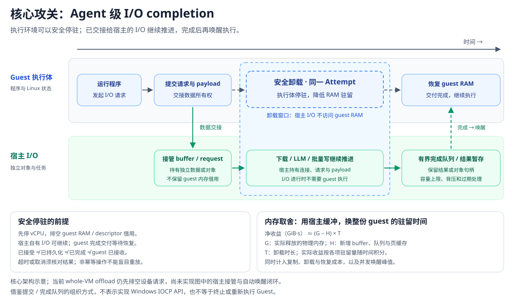
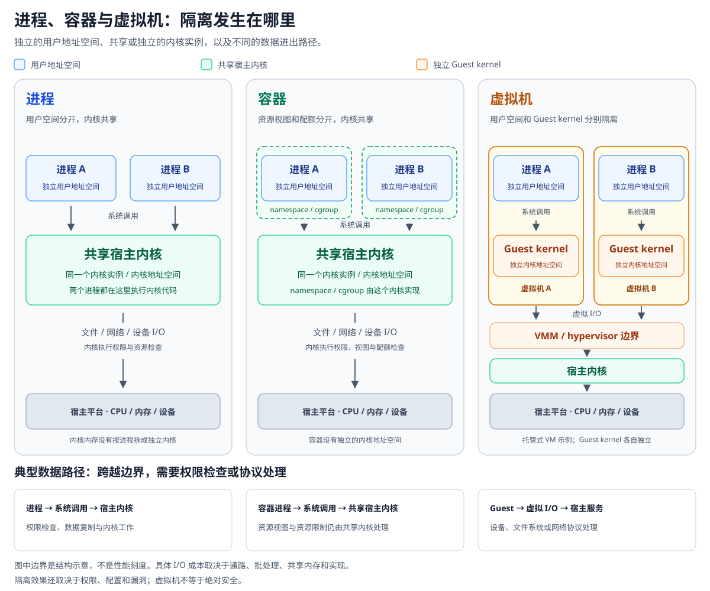
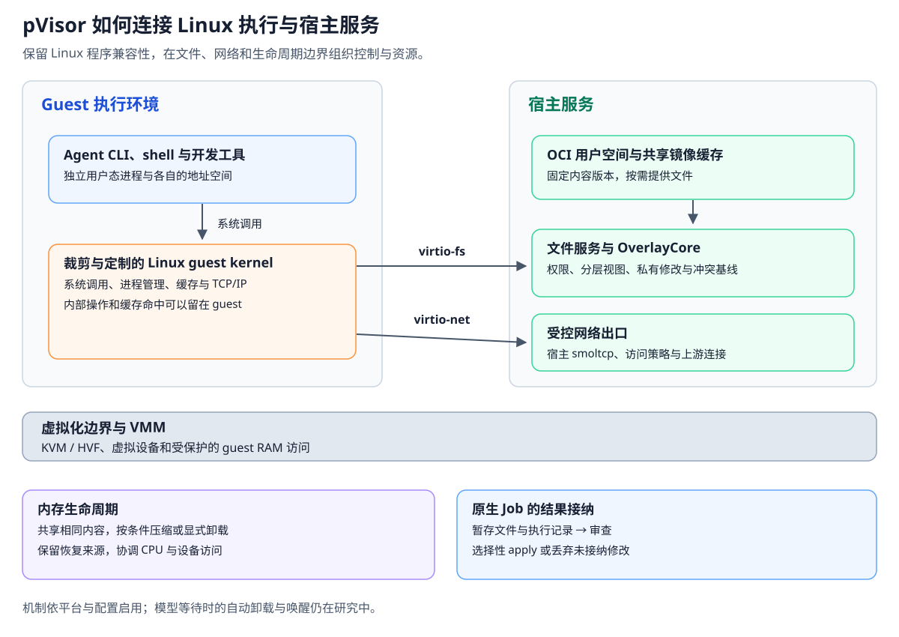

# Agent 时代为何需要 pVisor

**microVM 降低单个沙箱的成本，pVisor 要降低 Agent 从环境准备、运行等待到结果交付的全生命周期成本。**

让更多 Agent 并行探索、分工和验证，是提升问题求解能力的一条重要路径。规模扩大以后，成本也会跟着放大：准备一千份环境，保留一千份执行状态，等待一千次模型回答，再从大量尝试中找出值得接纳的结果。沙箱启动再快，这些支出也不会自动消失。

pVisor 的目标是让自主 Agent 的执行可以规模化。它使用进程、容器或 VM 提供执行边界，同时管理环境、文件修改、资源生命周期和执行记录。判断这层系统的价值，需要看完成任务的整个过程。

pVisor 的核心洞察是：**等待 I/O 不必让整份 guest 持续驻留。** 核心攻关点是接管下载文件、请求 LLM 和批量写入等 I/O，让宿主继续处理请求，guest 在等待期间卸载，结果就绪后再恢复执行。这决定了文件、网络与内存生命周期必须联合设计，也解释了为什么大规模异步化比单纯缩小 VM 更重要。

## 从一台沙箱的价格到一个可用结果的成本 {#cost-per-result}

假设让一千个 Agent 尝试修复同一个 bug，最后接纳其中一个方案。这是帮助理解成本的例子，不是一项性能测量。

这些尝试可能依赖相同的仓库基线、编译器和软件包。各自的进程状态和修改必须分开；失败的修改可以丢弃，成功的修改需要检查后再合入。相同内容有共享机会，尝试之间又需要清楚的边界。

只计算“启动一个沙箱用了多少毫秒、占多少 MiB”，只能覆盖这条链路的一部分。

| 生命周期阶段 | 成本从哪里来 | VM 基座之外还需要什么 | pVisor 的机制与攻关点 |
| --- | --- | --- | --- |
| 接入环境 | 安装工具、适配依赖、制作运行环境 | 镜像接入和环境管理 | 直接使用 Linux OCI 镜像，复用现有环境，无需用户另做 VM 磁盘镜像 |
| 准备与分发 | 重复下载、复制、展开相同内容 | 内容缓存、共享和按需获取 | 共享镜像缓存、固定版本、按访问读取文件内容 |
| 工具运行 | 文件操作、数据搬运、跨边界通信 | 兼容的系统调用与受控 I/O 路径 | Linux guest 执行程序，宿主文件服务与网络出口落实策略 |
| 等待模型或下载 | CPU 空闲，状态与内存仍然驻留 | 宿主代理 I/O、回收与恢复协作 | 已有代理和内存原语；核心攻关是让宿主在 guest 卸载期间继续推进请求 |
| 大批量写入 | 频繁等待回写，脏页和设备请求牵住 guest 内存 | 有界异步队列、数据所有权交接与完成通知 | 已有显式批量回写路径；核心攻关是让宿主持有待写数据，解除 I/O 对 guest 驻留的依赖 |
| 失败后再试 | 重新准备环境、整理失败输出 | 隔离修改、保留可复用起点 | 暂存、已停止 Job 的逻辑检查点与分叉，失败修改可以独立丢弃 |
| 排查与交付 | 查过程、找改动、解决覆盖冲突 | 执行记录与结果接纳流程 | Run Bundle、可选模型请求捕获、按路径 apply、丢弃未接纳修改、冲突拒绝覆盖 |

VM 可以承载这些能力，但 VM 本身不定义它们。文件暂存、镜像分发、闲置状态回收和结果接纳，需要执行层把它们组织起来。这也是“pVisor 不是另一个虚拟机”的具体含义：产品交付的是从运行到审查的任务流程，虚拟化是其中一种隔离机制。

一个更有意义的业务指标是：

```text
每个可用结果的成本
  = 全部尝试消耗的模型、环境、机器、控制面和结果处理成本
    / 最终被接纳的结果数
```

失败尝试也计入分子。机器开销和人工时间应分别记录，按明确的单价折算后才能相加；端到端延迟、正确性和失败率仍需单独观察。pVisor 不改变模型本身的推理单价，资源优化也不等于任务成功率提高。

## 真实负载已经揭示了成本错位 {#workload-evidence}

DeepSeek 在 2026 年 9 月发布的 DSec 技术报告，描述了 Agent 训练与评估的生产沙箱。它为资源组织方式提供了具体依据，也让比较可以离开“Agent 应该很轻”的直觉。

| 观察对象 | 公开数据 | 统计含义 |
| --- | --- | --- |
| DSec container 与 microVM 的 CPU | 约 90% 的沙箱，平均 CPU 使用不超过各自申请量的 5% | 分母是申请的 CPU，不能读作整机利用率 |
| DSec 沙箱存活时间 | 中位数分别为 17.4、15.5 分钟；两类 p99 均超过三小时 | 包含等待，不等于一次命令耗时或完整任务时长 |
| Azure 历史 VM 负载 | 60% 的 VM，平均虚拟 CPU 利用率低于 20% | 2016—2017 年的 IaaS/PaaS 混合样本，五分钟采样 |

DSec 数据来自 2026 年初的生产样本，生命周期样本包含 30K containers 与 10K microVMs；Azure 数据来自 Resource Central 的历史研究。两者的年代、工作负载和采样方法不同，不能直接相除得到效率倍数。[DSec §4.3](https://arxiv.org/html/2609.22978v1#S4.SS3)、[Resource Central §3.2](https://www.microsoft.com/en-us/research/wp-content/uploads/2017/10/Resource-Central-SOSP17.pdf)

**环境需要继续存在，计算却可能只在部分时间发生。** 这意味着 CPU 超配只能解决一部分问题。只要状态仍被保留，内存、文件缓存和可写数据就会继续影响节点容量。

云计算早已面对低利用率、短请求和长作业。Borg 论文区分了长期运行服务承载的数微秒至数百毫秒请求，以及数秒至数天的 batch 作业；Azure Functions 的研究则发现，50% 的函数平均执行时间不足一秒，且不包含冷启动时间。[Borg §2.1](https://research.google.com/pubs/archive/43438.pdf)、[Serverless in the Wild §3.4](https://www.microsoft.com/en-us/research/uploads/prod/2020/05/serverless-ATC20.pdf)

因此，Agent 的区别需要放在整条执行轨迹上理解：工具执行、模型等待和后续探索交错发生；环境跨多轮保留状态，下一步要做什么、还要运行多久，取决于前面的反馈。长期服务通常由稳定副本承接许多请求，Agent 探索则可能不断创建和丢弃新的尝试。这里变化的是负载特征的组合，以及平台需要优化的单位。

## 时长不可预知时要管理等待的代价 {#waiting-cost}

一次 Agent 任务可能在一次工具调用后结束，也可能经历多轮修改、测试和探索。即使总时长接近，两个任务的资源曲线也可能不同：一个一直编译，另一个大部分时间在等模型。

至少需要分开观察三个时间：**工具实际运行的时间、任务端到端时间、环境保留时间**。将它们合并成一个“运行时长”，就很难判断应该优化启动、执行还是等待。

对等待期而言，值得记录的是物理内存随时间的积分，例如 GB·s。减少十毫秒启动开销，无法自动抵消一份状态多驻留几十分钟的成本。同样，暂停 vCPU 只停止计算，并不自动释放 guest RAM。

等待期回收必须回答两个问题：什么时候回收值得做，以及恢复后能否继续正确执行。卸载会产生写入、压缩和恢复成本；模型连接、网络超时、定时器和外部服务也不会因为 guest 暂停而一起停止。只有预计节省的驻留成本足以覆盖这些代价，并且满足恢复延迟约束，回收才有意义。

pVisor 已有不同用途的内存原语：共享相同内容、压缩实例冷页、显式卸载整 VM 并在同一进程中恢复。它们有平台与配置限制，不能任意叠加。[内存子系统](../design/memory-optimization/index.md)给出这些机制的边界；[等待观测与卸载实验](../design/experimental/vcpu-idle-offload/index.md)仍处于观察原型阶段，尚未交付“模型开始思考就自动卸载、回答到达就自动唤醒”的完整闭环。

这揭示了 pVisor 的核心洞察：**I/O 推进需要的是已交接的请求状态，不应要求整份 guest 持续驻留。** 环境保留时间、I/O 处理时间与资源驻留量，需要由执行层分别管理。

## Agent 层面的 IOCP 是核心攻关点 {#agent-iocp}

IOCP，即 I/O Completion Ports，提供了提交异步 I/O、汇集完成通知并调度处理者的模型。Agent 层面的 IOCP 借用这个思路，把调度粒度扩展到执行环境，构成 pVisor 的核心架构主张。这里借鉴的是提交与完成队列的组织方式，并不表示实现 Windows API。[Microsoft IOCP 文档](https://learn.microsoft.com/en-us/windows/win32/fileio/i-o-completion-ports)

Agent 发起外部操作后，pVisor 负责推进请求与保存结果。只要整个 guest 暂时没有其他需要运行的工作，就可以在完成安全交接后降低它的驻留量，等到结果、错误或必须处理的进度事件到达，再恢复执行。**I/O 的推进不再要求整份 guest 一直留在内存里陪着等待。**



| 操作 | 宿主需要接管什么 | guest 何时需要回来 |
| --- | --- | --- |
| 下载文件 | 已授权的下载请求、连接、目标文件与临时落盘，完成后按约定发布结果 | 文件可用、操作失败，或需要处理进度与取消时 |
| 请求 LLM | 上游请求、响应或流式数据，以及有界的结果暂存 | 答案就绪，或流式交付策略要求消费数据时 |
| 大批量写入 | 已交接的字节、目标对象、写入顺序与后台提交 | 需要同步、消费错误，或后续执行可以继续时 |

这要求请求具有明确的应用或文件语义。普通 TCP 代理只看到字节，TLS 仍在 guest 中时，也无法替应用完整处理任意 HTTPS 下载。下载需要能独立执行并写入目标文件的宿主代理，LLM 需要显式的模型协议路径；流式响应还要约定分批唤醒和背压，不能假设整段流都可以无限缓存。

### 先交接 I/O 所有权 再卸载 guest {#io-ownership}

关键变化是把请求与 guest RAM 的绑定拆开。把同步函数放进线程池，或者让 vCPU 停下来，都不会自动完成这一步。

1. **接收与准入。** 验证权限，绑定 Attempt、会话代际与请求身份，预留请求、字节及结果缓冲预算，区分尚未接收与已经接收的操作。
2. **交接数据与对象。** 宿主持有请求所需的字节或独立有效的 backing、文件句柄及连接；结束对可回收 guest RAM 的借用。仍依赖 guest 页面的操作必须先结束访问，不能回收之后再触碰那些页面。
3. **卸载与继续推进。** 确认 guest 已到安全等待点，排空仍访问其 RAM 的设备阶段，再执行 offload。宿主已接管的操作独立继续，完成和错误保存在受预算约束的队列或存储中。
4. **恢复与交付。** 根据完成、超时、取消或缓冲压力决定何时恢复。完成事件在卸载与恢复的转换窗口中也必须锁存，并能直接通知控制方，不能先等待 guest RAM 才触发唤醒。重建 RAM 与设备访问并确认恢复后，核对请求及执行身份，按协议投递结果或设备完成通知。不能等待 guest 消费全部数据后才允许它运行，也不能持队列或代理锁同步等待恢复。完成事件不能覆盖人工暂停，也不能唤醒已结束的 Attempt。

现有 virtio-fs 路径从读取 guest 缓冲区到发布 used ring 一直持有 RAM lease；offload 必须等待这些访问结束。核心攻关是把“访问 guest 内存”和“等待宿主 I/O”分成两个阶段，让后者不再长期占用前者的租约。[当前设备与 RAM 合同](../design/vm-runtime.md#virtio)

现有 Gateway 也已经提供协作入口：Agent 可以声明某次推理等待期间整个 guest 静默，由嵌入运行时通过 `ModelWaitLifecycle` 接入等待和交付屏障。它还没有接上自动的原生资源释放与 RAM 回收；普通模型请求本身也不能证明其他工具或后台任务已经空闲。[Gateway 等待接口](https://github.com/DeepLink-org/pvisor/blob/main/crates/pvisor-gateway/README.md)

宿主队列与 guest 状态必须共同拥有可核对的生命周期。现有快照的捕获范围，不会自动覆盖宿主接管模式下的在途请求、完成队列和外部效果；需要持久检查点时，必须把这些状态的身份与提交进度纳入同一恢复合同。完成回传需要去重；暂停和取消不能自动撤销外部效果。宿主崩溃后的请求核对与恢复，是需要另外建立的合同，不能靠重新播放机器快照来盲目重发 LLM 请求、下载或写操作。

### 写入异步化决定能否真正交出等待 {#asynchronous-writes}

大规模写入尤其重要。如果每写一个文件都要等待宿主完成，guest 就会反复停在短等待上；如果只是先写进 guest 页缓存，待写字节仍属于 guest，也可能继续牵住它的驻留内存。要创造更长的可卸载窗口，需要把数据与提交责任真正移交给宿主，再通过有界队列合并调度和后台写入。

攻关可以分步推进：先保持原系统调用的等待语义，由宿主接管 I/O，guest 卸载，完成后恢复并返回真实结果；再实现宿主接收数据即可返回、后台继续提交的 write-behind。后一种方式还需要宿主写缓存及更完整的可见性与错误合同。

这里需要区分几个完成点：请求已接收、宿主已持有所需数据、文件写入完成、同步持久化完成，以及结果已经交付给 guest。普通 `write` 的返回条件与 `fsync` 的持久化条件不同，异步化必须保留它们各自的承诺，`O_SYNC` / `O_DSYNC` 写入也须维持其同步语义。后续读取要能观察到约定的写入；同一对象的顺序、短写、磁盘满、延迟错误和任务结束前的同步屏障，都要维持正确。

当前已有显式启用的跨文件批量回写路径，但数据仍主要保留在 guest 页缓存，不能据此宣称已经实现“guest 卸载时宿主继续写”。它为批量化提供了基础，Agent 层面的 IOCP 还需要推进数据所有权、完成队列与卸载协议的协作。[现有写回机制与限制](https://github.com/DeepLink-org/pvisor/blob/main/crates/pvisor-vm/README.md)

### 允许增加缓冲内存 以减少整份 guest 的驻留 {#buffer-memory-tradeoff}

最少复制、最小缓冲与最低生命周期成本，并不总是同一个目标。如果零拷贝意味着必须一直保留 guest 页面，而复制到宿主后可以释放更多 guest 内存，那么增加一次复制和适量缓冲就可能值得。

应当观察的是整个等待区间的净效果：

```text
净节省的内存时间
  = ∫（基线 guest 驻留量 − 卸载后 guest 驻留量
       − 新增请求缓冲 − 新增完成缓冲 − 新增执行引擎开销）dt
```

缓冲、页缓存以及恢复来源中仍驻留的页面，要按整节点实际物理内存记账，不能使用配置容量或单个 VMM 的 RSS 降幅代替。卸载文件大小与存储 I/O 单独计费。净节省为正还不够，复制、编码、I/O 和恢复延迟也要进入成本判断。每个 Attempt 与整个节点都需要请求数、字节数、脏数据和完成队列预算；预算耗尽时必须背压、溢写存储或恢复消费，避免用无界宿主内存替代 guest 内存。

因此，异步写入值得投入的原因，既包括吞吐，也包括让更多执行环境摆脱等待期的驻留开销。**用一份有界的宿主 I/O 状态，替代整份 guest 的持续等待，是 pVisor 的核心收益与验证目标。**

## 控制面应该为哪些状态付出一致性成本 {#control-plane}

高频创建和销毁环境，会把原本可以摊薄的管理成本带进任务关键路径。一次尝试需要经过多少次对象更新、持久化和控制器通知，可能和实际执行一样值得优化。

Kubernetes 的控制器通过异步循环让实际状态接近期望状态；etcd 的 KV 操作默认提供线性一致性，而 watch 通知又有自己的语义。高频生命周期操作经过 API Server、对象序列化、etcd 持久化与限流时，管理开销会随之累积。[Kubernetes 控制器](https://kubernetes.io/docs/concepts/architecture/controller/)、[etcd API 保证](https://etcd.io/docs/v3.6/learning/api_guarantees/)

Kubedirect 在 NSDI 2026 的研究中，使用 Kubernetes v1.32.0，在 80 节点集群中批量扩展 100—800 个 Pods，发现控制器经 API Server 交换状态形成主要瓶颈。它将可重建的中间状态移出这条路径，同时保留状态收敛与终止语义。这说明改进方向可以是减少不必要的持久化协调，并保留 Kubernetes 生态。[Kubedirect §2—3](https://www.usenix.org/system/files/nsdi26-qi.pdf)

| 状态或操作 | 可以采用的策略 | 必须守住的边界 |
| --- | --- | --- |
| 节点负载观察、候选位置选择 | 容忍陈旧视图、乐观选择、失败重选 | 节点最终准入，避免资源分配失控 |
| 尚未执行、没有副作用的准备中间态 | 失败后重新生成，异步收敛 | 不能把已经执行的动作当成未执行 |
| 执行身份、权限、配额和结果提交 | 明确所有权、授权与提交协议 | 不能因状态迟到而越权或重复接纳 |
| 发消息、写数据库等外部动作 | 根据业务使用幂等键、去重或核对 | 超时不等于未发生，重试不等于回滚 |

Agent 允许探索失败，为可替换尝试留下了优化空间；重要进度和不可重复的副作用仍需保护。“最终一致性够用”应限定在适合它的状态上。

pVisor 当前负责单机执行，跨节点放置、工作流与重试由 Kubernetes、Ray 或其他外部编排器承担。这一分工让执行路径的优化可以独立进行；它不意味着 pVisor 已经提供一个新的集群调度系统。[集群化执行方向](../design/research/cluster-execution.md)

## 进程 容器与虚拟机分别隔离什么 {#isolation-boundaries}



普通进程通常拥有独立的用户态虚拟地址空间，也可以显式共享内存。不同进程仍调用同一个宿主内核，用户地址空间隔离不等于内核故障域隔离。

容器继续使用宿主内核。namespace 隔离进程、挂载和网络等资源视图，cgroup 提供资源记账与限制；capabilities、seccomp 和 LSM 可以补充访问控制。**namespace 与 cgroup 并不产生独立的内核地址空间。**

VM 拥有独立 guest 内核及其内存，通过硬件虚拟化和地址转换与宿主分隔。guest 系统调用可以在 guest 内完成；需要访问外部文件或网络时，再通过虚拟设备进入宿主路径。宿主虚拟化层、VMM 和设备实现仍属于安全边界的一部分。[隔离机制](../design/isolation.md)、[执行器边界](../security/executor-boundaries.md)

增加边界，通常也会增加协议处理、同步和可能的数据复制。不过，“隔离越强，所有 I/O 必然越慢”并不成立：guest 缓存可以避免越界，共享映射可以减少复制，批量提交可以摊薄通知成本。比较需要落到具体路径，而不能只按进程、容器和 VM 的名称排序。

对 Agent 而言，独立 guest 内核的价值，是让工作负载不直接以宿主系统调用接口作为自己的内核接口。减少不使用的驱动和设备，可以缩减 guest 中需要携带的能力；整体安全仍取决于宿主边界与实现，不能由内核大小直接推断。

## 为什么业界采用 microVM 以及专用化还能改变什么 {#runtime-choice}

microVM 的吸引力很直接：利用硬件虚拟化提供内核边界，同时保留现有 Linux 工具生态，并减少 VMM 和设备模型开销。Firecracker 已经采用最小设备模型和精简的 Linux guest；“采用 microVM”本身就是一次针对用途的专门化。[Firecracker 设计](https://github.com/firecracker-microvm/firecracker/blob/main/docs/design.md)

unikernel 从另一个方向专门化软件栈：把应用和所需操作系统组件组合成专用镜像。它与 microVM 处于不同维度，unikernel 也可以运行在虚拟化平台之上。[Unikernels 原始论文](https://anil.recoil.org/papers/2013-asplos-mirage/)

Agent 会动态运行 shell、包管理器、编译器和子进程，完整的软件兼容性很重要。传统的应用专用 unikernel 往往要求适配软件或预先确定组件。Firecracker 原论文也明确表示，它需要运行未经修改的 Linux 程序，因此没有采用当时讨论的 unikernel 路径。[Firecracker §2.1.3](https://www.usenix.org/system/files/nsdi20-paper-agache.pdf)

| 路径 | 适合的条件 | 需要承担的取舍 |
| --- | --- | --- |
| 宿主进程或容器 | 优先复用宿主内核、工具与缓存 | 共享内核边界；仍需任务级策略与结果管理 |
| 现成 microVM 加执行层 | 需要独立 guest 内核和广泛 Linux 兼容 | 环境分发与结果管理需要集成；I/O 所有权交接和完成唤醒超出单纯机器控制接口 |
| 应用专用 unikernel | 应用和所需组件可以预先确定 | 动态工具生态、进程语义和兼容性需要逐项评估 |
| pVisor 的专用 Linux 执行环境 | 保留 Linux 用户空间，围绕 Agent 层面的 IOCP 联合设计文件、网络与内存生命周期 | 承担 guest/VMM 协议、I/O 完成语义、平台适配与兼容性维护成本 |

pVisor 借鉴的是按用途专门化的思路：根据执行需求裁剪 Linux 和设备，让宿主提供受控的环境与结果服务。当前 VM 路径仍是 Linux guest 加独立用户态进程，不能称为严格意义上的 unikernel。

Agent 层面的 IOCP 决定了专用化的攻关重点：pVisor 要同时掌握 I/O 接管、guest 内存安全交接和完成后恢复。单纯的 microVM 暂停、快照与恢复接口不定义下载、模型响应或异步文件提交的完成语义。例如 Firecracker 的暂停会停止设备事件推进，允许的在途异步块 I/O 还需在快照时排空；恢复到另一进程也不保证保留连接。[Firecracker 快照合同](https://github.com/firecracker-microvm/firecracker/blob/main/docs/snapshotting/snapshot-support.md)

这项能力需要跨越机器控制、文件服务、模型协议和运行时调度来实现，microVM 可以继续作为底座。专用化投入应集中在让这些部分协作，使 I/O 在 guest 卸载期间仍有明确的所有者和推进路径。

专用化也涉及信任模型。公共云面对互不信任的租户，需要谨慎限制共享；同一信任域内的多个 Agent 可以利用共同的只读输入。Firecracker 原论文的生产建议包括禁用同页合并、避免文件共享以缓解侧信道。pVisor 当前[威胁模型](../security/threat-model.md)不承诺敌对多租户或侧信道隔离，不能把共享收益宣传成没有安全取舍。[Firecracker §3.4](https://www.usenix.org/system/files/nsdi20-paper-agache.pdf)

## pVisor 如何把生命周期要求落实到执行路径 {#execution-path}



### 复用 Linux 生态以减少环境适配 {#oci-environments}

pVisor VM 执行器直接接入匹配宿主架构的 Linux OCI 镜像，支持 `linux/amd64` 和 `linux/arm64`。用户可以复用开源项目已有的用户空间环境，无需先把它改造成一块可启动 VM 磁盘；镜像拉取不依赖 Docker、Podman 或 Buildah。[VM 执行器](../guides/executors/vm.md)

这降低的是环境接入成本。兼容 OCI 格式不等于兼容任意设备、内核功能或 Docker 部署配置；工作负载仍须满足所选 guest 和网络能力。现有内核也采用了具体取舍：例如通用 x86_64 配置裁剪了 ACPI/PCI 等能力，同时关闭 guest CPU 漏洞缓解，并非单向的安全增强。配置与限制由[固件说明](https://github.com/DeepLink-org/pvisor/blob/main/fw/README.md)和[平台矩阵](../reference/platforms.md)维护。

### 把环境内容作为共享输入 {#shared-environment}

已准备或发布的镜像，可以通过共享缓存按版本、文件和内容块读取。VM 直接接入文件后端，按访问取得内容，不要求每次执行都完整物化环境。首次未缓存镜像的准备端仍可能需要完整下载和解包；完整导出、快照或 copy-up 也可能要求补齐此前未读的数据。[共享镜像缓存](../reference/shared-image-cache.md)

这里需要分清三件事：磁盘内容去重、宿主缓存复用、多个 guest 共享同一物理页。它们不是同一项优化。DSec 的 Firecracker 实验通过 virtio-pmem 与 DAX 消除重复 guest 页缓存，将宿主峰值内存降低了 40.2%；这说明资源路径值得优化，也说明改进可以发生在 microVM 之内。[DSec §8.4](https://arxiv.org/html/2609.22978v1#S8.SS4)

### 保留本地系统调用 在设备边界处理外部访问 {#device-boundary}

普通指令和大部分系统调用在 guest 中执行，缓存命中、tmpfs 和 procfs 等操作可以留在内部。导出文件树的请求通过 virtio-fs 进入宿主文件服务；网络通过 virtio-net 进入宿主受控出口。pVisor 把控制点设在这些设备边界上。[VM 执行路径](../design/vm-runtime.md)、[文件服务](../design/overlayfs.md)、[网络数据面](../design/overlaynet.md)

这一划分使兼容性和控制可以协作：guest Linux 提供成熟进程语义；宿主文件服务管理可见视图、暂存写入和冲突基线；网络出口执行访问策略。[共享文件服务决策](../design/decisions/0007-shared-filesystem-service.md)解释了这些职责。

跨边界请求也可以按具体语义优化。目录镜像在底层内容稳定、修改入口受控时减少元数据往返；惰性只读 open 则把宿主句柄绑定延后到需要数据时。它们仍须维护授权、对象生命周期和错误处理合同，不能把“只读挂载”直接当成物理内容永不变化的保证。[VM 文件协议与适用条件](https://github.com/DeepLink-org/pvisor/blob/main/crates/pvisor-vm/README.md)

### 把执行结束与结果接纳分开 {#result-acceptance}

使用暂存运行时，文件修改先进入 Job 的 stage。结束以后，用户可以检查变更和记录，再选择 apply 或 drop；如果宿主文件已经变化，pVisor 拒绝直接覆盖。失败尝试因此可以留下可检查的产物，而不必把整台机器当成结果交接。[暂存语义](../concepts/staging.md)

原生 Job 的逻辑分叉要求源 Job 已停止，复用的是暂存文件状态和冲突基线，不是任意进程的内存。外部 API、数据库写入和已发送消息也不随文件 drop 撤销。[逻辑检查点与分叉](../guides/fork-checkpoint.md)、[失败语义](../design/failure-semantics.md)

这些能力属于原生 Job 流程。独立 daemon 当前提供本机 VM 生命周期 API，尚未接入 stage/apply、checkpoint/fork 和 offload API；两条入口的能力不能混用。[daemon 集成边界](../guides/daemon/boundaries.md)

## 用完整任务验证路线选择 {#validation}

更小的内核、更少的 VM exit 和更低的局部内存占用，都只能解释收益来自哪里。采用哪条路线，最终要看它们能否改善完整任务。

比较应使用相同工具、输入和结果验证方式，并声明相同的安全约束。现成 microVM 的对照也应采用合理精简的 guest，并补齐被比较的任务语义；完整 Ubuntu 冷启动与精简 pVisor 的差异，不能单独证明需要自有 runtime。

| 判断问题 | 应观察的证据 |
| --- | --- |
| 准备成本是否被摊薄 | 首次与重复使用环境的就绪时间、网络字节、实际物化数据量 |
| 等待是否更便宜 | 整节点物理内存随时间的积分，包含 VMM、缓存、共享服务与恢复余量 |
| I/O 能否脱离 guest 推进 | guest 卸载期间的下载、模型响应与写入进度，设备借用是否结束，完成通知是否正确交付 |
| 异步缓冲是否值得 | 新增缓冲与完成队列的物理占用、净节省的 GB·s、复制与回写成本、预算耗尽时的背压 |
| 恢复是否值得做 | 恢复后首次工具调用的 p99、连接与定时器行为、同步恢复时的峰值 |
| 并行尝试是否产生更多成果 | 固定资源和延迟约束下，通过相同验证的完成吞吐与结果接纳率 |
| 失败与交付成本是否下降 | 重试前重复工作量、记录完整性、审查时间与冲突处理结果 |

相似环境、多轮等待是值得测试的场景；高写入、低环境复用、频繁唤醒也应进入对照。共享、压缩与卸载各自有成本，不能只挑对某一种机制有利的负载。

pVisor 选择自有 runtime 的理由，需要建立在 guest、文件服务和资源生命周期的联合优化确实带来完整任务收益之上。核心攻关及验证目标，是宿主在 guest 卸载期间持续推进 I/O，并用有界的请求状态与缓冲换取更低的整节点驻留成本。底层 VMM 可以复用，I/O 接管、完成交付和资源恢复之间的协作则是执行层需要建立的能力。

**沙箱启动便宜，只是起点。Agent 从拿到环境，到交付一个可接受的结果，整个过程都值得优化。**
