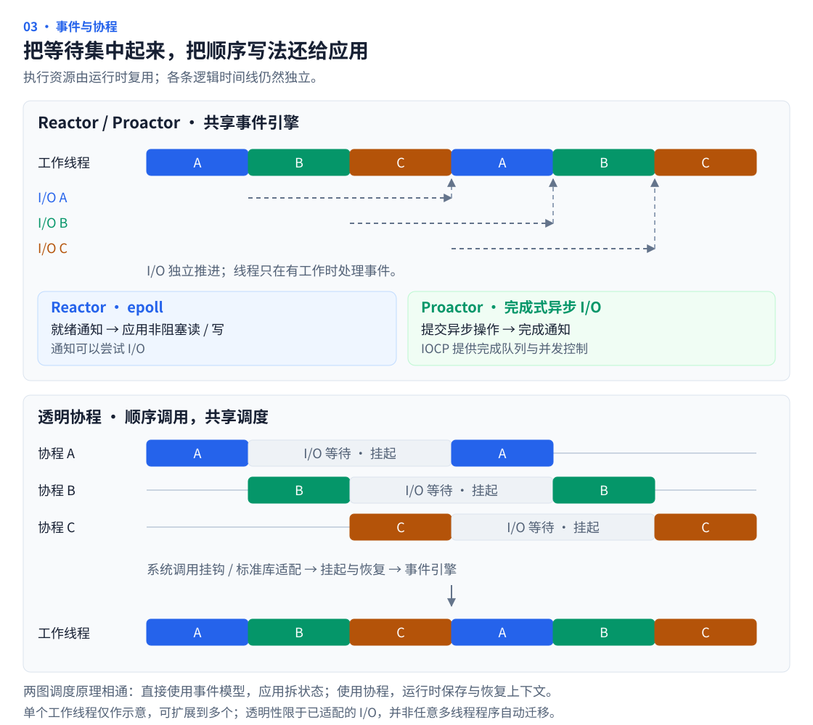
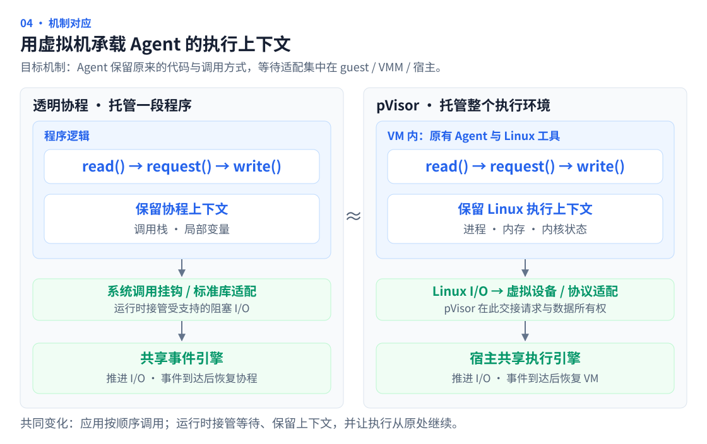

# Agent 时代为何需要 pVisor

**pVisor 要建立一种新的 Agent 执行范式：Agent 保持原有的顺序执行方式，由共享执行引擎接管可代理的 I/O，在等待期间回收资源，事件就绪后恢复原来的执行时间线。**

让自主 Agent 的执行可以规模化，需要改变资源跟随任务的方式。启动更快的沙箱是基础；更大的机会在于，让大量有状态的 Agent 可以持续推进，而不必为每条时间线始终保留一份完整的驻留环境。

## Agent 的时间线连续，资源需求却是间歇的 {#waiting-cost}

一个 Coding Agent 通常沿着自己的时间线工作：读取仓库、请求模型、修改代码、运行测试，再根据结果决定下一步。工具、子进程和后台服务可能并行运行，整个任务仍需要保留跨轮次的状态。

计算与等待在这条时间线上反复交替。等待模型回答时，推理发生在外部服务，沙箱却可能继续持有内存、缓存和进程状态。

DeepSeek 的 **DSec（DeepSeek Elastic Compute）** 报告给出了生产证据：在 2026 年初一周的样本中，约 90% 的容器和 microVM 沙箱，平均 CPU 使用量不超过申请量的 5%；生命周期中位数分别为 17.4 和 15.5 分钟，两者 P99 均超过 3 小时。报告也明确指出，沙箱会等待模型生成下一步动作，而状态和缓存仍然保留。[DSec §1、§4.3，图 5、图 7](https://arxiv.org/html/2609.22978v1#S4.SS3)

这些观察支持的是**长生命周期中的间歇性计算**。计算与等待会随交互轮次反复出现，但并不具有固定周期；上图的阶段时间线是示意，并非 DSec 的实测曲线。

任务增加以后，等待期间的驻留开销会随并发累积。**逻辑上的持续执行，不必对应物理资源的持续占用。** 需要优化的单位，因此是 Agent 从拿到环境到交付结果的完整生命周期。

## 从 I/O 执行模型看这次转变 {#io-models}

高并发服务器经历过类似的资源组织变化。一条线程按顺序处理请求时，一个请求等待 I/O，会推迟后续请求。为每个连接安排一个线程，就能保留顺序写法并让多条时间线并发；但大量连接等待 I/O 时，线程栈和执行上下文仍然存在。

事件驱动把等待集中起来，让较少的线程处理大量连接。Reactor 常用 epoll 等就绪通知，Proactor 围绕异步完成组织执行，IOCP 则提供完成通知与并发处理机制。直接采用这些模型，往往需要把顺序代码拆成状态机或回调，开发者也要管理更多执行状态。[epoll](https://man7.org/linux/man-pages/man7/epoll.7.html)、[IOCP](https://learn.microsoft.com/en-us/windows/win32/fileio/i-o-completion-ports)

透明协程进一步把这种改造集中到运行时：程序继续按顺序表达逻辑，运行时通过系统调用挂钩或标准库适配，把支持的阻塞 I/O 交给事件引擎；等待时挂起协程，就绪后从原来的调用位置继续。例如 libco 通过 socket 函数挂钩和 epoll / kqueue，让业务保留同步写法、异步执行。[libco](https://github.com/Tencent/libco)、[Go 的运行时调度](https://go.dev/doc/faq#goroutines)

图中用一个工作线程说明复用关系，实际可以扩展为多个。Reactor 通知“可以尝试读写”，Proactor 通知“已提交的操作完成”；协程则让应用不必直接围绕这些事件拆分状态。这里的透明，是在已适配的 I/O 上保留调用语义，并不意味着任意多线程程序都能自动、无损地迁移。

**pVisor 希望把这种转变带到 Agent 执行层。** Agent 继续使用已有的代码和 Linux 工具，执行引擎负责把可接管的等待转成事件驱动的推进与恢复。适配工作集中在运行时，无须让每个 Agent 都重写自己的并发结构。

## 用虚拟机承载 Agent 的执行上下文 {#agent-iocp}

沿着协程的思路，pVisor 把调度单位扩展到整个 Agent 执行环境。协程保存调用栈和局部变量；VM 则承载 Agent 的进程、内存与 Linux 内核状态，让运行时能够在应用之外保存和恢复它的执行上下文。

**Agent 无感，意味着它继续运行原来的代码、使用原来的 Linux 工具、发起原来的调用。** 文件和网络 I/O 经过 Linux 与虚拟设备进入宿主，pVisor 在已适配的设备与协议路径接管请求。对 guest 内核、VMM 和宿主服务的改造集中在这一层，Agent 无需改写成异步程序，也无需调用专用的挂起、卸载或恢复接口。[VM 执行路径](../design/vm-runtime.md)

## Agent 看到连续执行，宿主按事件调度 {#execution-path}

以一次可代理的模型请求为例：Agent 发起请求后照常等待。pVisor 将请求交给宿主推进，在整个 guest 可以安全等待时保存上下文、回收可卸载内存，让可复用的资源服务其他 Agent。响应到达后，pVisor 恢复这份上下文，让原来的调用返回，Agent 接着处理结果。

这相当于把多条 Agent 时间线交给一个共享执行引擎：**Agent 保留自己的逻辑进度，pVisor 安排它何时占用物理资源。** 恢复后继续的是同一个进程与同一次执行；VM 保存跨越等待所需的机器上下文，宿主保存等待期间仍须推进的 I/O 状态。

透明性的边界是原有调用语义：结果、错误、文件顺序和同步要求都要保留。宿主必须先持有独立的请求和数据，才能解除 I/O 对 guest RAM 的依赖；模型请求还需要协议适配，普通 TCP 转发无法自动接管 guest 内的 TLS 会话。后台仍有可运行工作时，guest 继续执行。

## 从一次透明等待跑通整条路径 {#validation}

第一步是选定一种 I/O，让“接管请求 → 安全卸载 → 宿主继续推进 → 事件唤醒 → 原调用返回”形成闭环，再扩展到流式响应和更多工具。验证同时看调用语义是否保持，以及计入宿主缓冲、卸载和恢复成本后，固定资源能否支撑更多有效执行。

现有基础包括受控文件与网络路径、暂停与内存卸载原语，以及实验性的宿主写缓存；自动识别等待、接管 I/O、完成唤醒与恢复调度仍需贯通验证。两图展示的是这一目标机制。[等待与卸载实验](../design/experimental/vcpu-idle-offload/index.md)、[Agent I/O 完成机制](../design/experimental/agent-io-completion/index.md)

**pVisor 要让 Agent 像使用透明协程那样，保留熟悉的执行方式，由运行时把等待转化为资源共享的机会。虚拟机提供承载这次转变的上下文与控制边界。**
